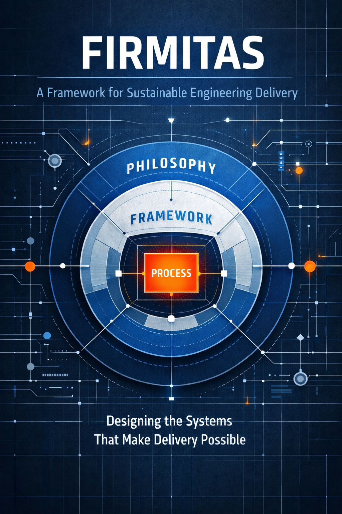

# Firmitas

**A Framework for Sustainable Engineering Delivery: Designing the Systems That Make Delivery Possible**

{ width="40%" }

[[CAPTION:Figure]] Firmitas, by Mark Bacon.

Most engineering programmes that fail do not fail suddenly. They fail slowly, visibly and predictably, in ways the people closest to the work could see coming. Firmitas is about why that happens and what to do about it. Part One describes how programmes fail. Part Two sets out the framework that responds to it. Part Three is about making it stick.

© 2025 Mark Bacon. Firmitas is licensed under a [Creative Commons Attribution-NonCommercial-NoDerivatives 4.0 International licence](https://creativecommons.org/licenses/by-nc-nd/4.0/).

## Contents

| Contents |
| --- |
| [Preface](01-preface.md) |
| [Acknowledgements](02-acknowledgements.md) |
| [Introduction](03-introduction.md) |
| [Part One: Why Programmes Fail](part-1-why-programmes-fail/index.md) |
| &nbsp;&nbsp;&nbsp;&nbsp;[Chapter 1: The Programme That Failed Predictably](part-1-why-programmes-fail/01-the-programme-that-failed-predictably.md) |
| &nbsp;&nbsp;&nbsp;&nbsp;[Chapter 2: Estimation: Why It Fails and What Honest Looks Like](part-1-why-programmes-fail/02-estimation-why-it-fails-and-what-honest-looks-like.md) |
| &nbsp;&nbsp;&nbsp;&nbsp;[Chapter 3: The Commitment That Wasn't Theirs](part-1-why-programmes-fail/03-the-commitment-that-wasnt-theirs.md) |
| &nbsp;&nbsp;&nbsp;&nbsp;[Chapter 4: What the System Did With the Information](part-1-why-programmes-fail/04-what-the-system-did-with-the-information.md) |
| &nbsp;&nbsp;&nbsp;&nbsp;[Chapter 5: The Learning That Doesn't Happen](part-1-why-programmes-fail/05-the-learning-that-doesnt-happen.md) |
| &nbsp;&nbsp;&nbsp;&nbsp;[Chapter 6: Engineering Is a Systems Discipline](part-1-why-programmes-fail/06-engineering-is-a-systems-discipline.md) |
| [Part Two: The Framework](part-2-the-framework/index.md) |
| &nbsp;&nbsp;&nbsp;&nbsp;[Chapter 7: Leadership Owns the System](part-2-the-framework/07-leadership-owns-the-system.md) |
| &nbsp;&nbsp;&nbsp;&nbsp;[Chapter 8: Delivery Knowledge Lives Closest to the Work](part-2-the-framework/08-delivery-knowledge-lives-closest-to-the-work.md) |
| &nbsp;&nbsp;&nbsp;&nbsp;[Chapter 9: Commitments, Estimates, and Honest Plans](part-2-the-framework/09-commitments-estimates-and-honest-plans.md) |
| &nbsp;&nbsp;&nbsp;&nbsp;[Chapter 10: Risk, Issues, and the Register That Actually Works](part-2-the-framework/10-risk-issues-and-the-register-that-actually-works.md) |
| &nbsp;&nbsp;&nbsp;&nbsp;[Chapter 11: Requirements: From Customer Need to Testable Specification](part-2-the-framework/11-requirements-from-customer-need-to-testable-specification.md) |
| &nbsp;&nbsp;&nbsp;&nbsp;[Chapter 12: Slack, Flow, and Why Efficiency Thinking Fails](part-2-the-framework/12-slack-flow-and-why-efficiency-thinking-fails.md) |
| &nbsp;&nbsp;&nbsp;&nbsp;[Chapter 13: Architecture as Delivery Infrastructure](part-2-the-framework/13-architecture-as-delivery-infrastructure.md) |
| &nbsp;&nbsp;&nbsp;&nbsp;[Chapter 14: The Delivery Model](part-2-the-framework/14-the-delivery-model.md) |
| &nbsp;&nbsp;&nbsp;&nbsp;[Chapter 15: Quality as a System Property](part-2-the-framework/15-quality-as-a-system-property.md) |
| &nbsp;&nbsp;&nbsp;&nbsp;[Chapter 16: Governance, Guardrails, and Decision Authority](part-2-the-framework/16-governance-guardrails-and-decision-authority.md) |
| &nbsp;&nbsp;&nbsp;&nbsp;[Chapter 17: Teams, Cognitive Load, and Organisation for Flow](part-2-the-framework/17-teams-cognitive-load-and-organisation-for-flow.md) |
| &nbsp;&nbsp;&nbsp;&nbsp;[Chapter 18: Communication, Information Flow, and Documentation](part-2-the-framework/18-communication-information-flow-and-documentation.md) |
| &nbsp;&nbsp;&nbsp;&nbsp;[Chapter 19: Technical Debt and Change Management](part-2-the-framework/19-technical-debt-and-change-management.md) |
| &nbsp;&nbsp;&nbsp;&nbsp;[Chapter 20: Capability, People, and Building for the Long Term](part-2-the-framework/20-capability-people-and-building-for-the-long-term.md) |
| &nbsp;&nbsp;&nbsp;&nbsp;[Chapter 21: Portfolio Flow and Prioritisation](part-2-the-framework/21-portfolio-flow-and-prioritisation.md) |
| &nbsp;&nbsp;&nbsp;&nbsp;[Chapter 22: Business Alignment, Economics, and the Customer](part-2-the-framework/22-business-alignment-economics-and-the-customer.md) |
| &nbsp;&nbsp;&nbsp;&nbsp;[Chapter 23: AI, Automation, and Human Accountability](part-2-the-framework/23-ai-automation-and-human-accountability.md) |
| [Part Three: Making It Stick](part-3-making-it-stick/index.md) |
| &nbsp;&nbsp;&nbsp;&nbsp;[Chapter 24: The Leader Who Has to Change](part-3-making-it-stick/24-the-leader-who-has-to-change.md) |
| &nbsp;&nbsp;&nbsp;&nbsp;[Chapter 25: Assessing Readiness and Adopting Progressively](part-3-making-it-stick/25-assessing-readiness-and-adopting-progressively.md) |
| &nbsp;&nbsp;&nbsp;&nbsp;[Chapter 26: Common Failure Modes and Anti-Patterns](part-3-making-it-stick/26-common-failure-modes-and-anti-patterns.md) |
| &nbsp;&nbsp;&nbsp;&nbsp;[Chapter 27: Measuring What Actually Matters](part-3-making-it-stick/27-measuring-what-actually-matters.md) |
| &nbsp;&nbsp;&nbsp;&nbsp;[Chapter 28: What Firmitas Cannot Fix](part-3-making-it-stick/28-what-firmitas-cannot-fix.md) |
| &nbsp;&nbsp;&nbsp;&nbsp;[Chapter 29: The Long View](part-3-making-it-stick/29-the-long-view.md) |
| [Appendices](appendices/index.md) |
| &nbsp;&nbsp;&nbsp;&nbsp;[Appendix A: Glossary of Terms](appendices/a-glossary-of-terms.md) |
| &nbsp;&nbsp;&nbsp;&nbsp;[Appendix B: Firmitas Templates](appendices/b-firmitas-templates.md) |
| &nbsp;&nbsp;&nbsp;&nbsp;[Appendix C: Architectural Principles for Firmitas](appendices/c-architectural-principles-for-firmitas.md) |
| &nbsp;&nbsp;&nbsp;&nbsp;[Appendix D: Minimal, Balanced, and Regulated Firmitas Profiles](appendices/d-minimal-balanced-and-regulated-firmitas-profiles.md) |
| &nbsp;&nbsp;&nbsp;&nbsp;[Appendix E: End-to-End Worked Example](appendices/e-end-to-end-worked-example.md) |
| &nbsp;&nbsp;&nbsp;&nbsp;[Appendix F: Leadership and Delivery Anti-Patterns Firmitas Is Designed to Prevent](appendices/f-leadership-and-delivery-anti-patterns-firmitas-is-designed-to-prevent.md) |
| &nbsp;&nbsp;&nbsp;&nbsp;[Appendix G: Bibliography and Further Reading](appendices/g-bibliography-and-further-reading.md) |
| &nbsp;&nbsp;&nbsp;&nbsp;[Appendix H: Engineering Practice Across Disciplines](appendices/h-engineering-practice-across-disciplines.md) |
| &nbsp;&nbsp;&nbsp;&nbsp;[Appendix I: Quality, Regulation, and Assurance](appendices/i-quality-regulation-and-assurance.md) |

[[CAPTION:Table]] The contents of Firmitas.
