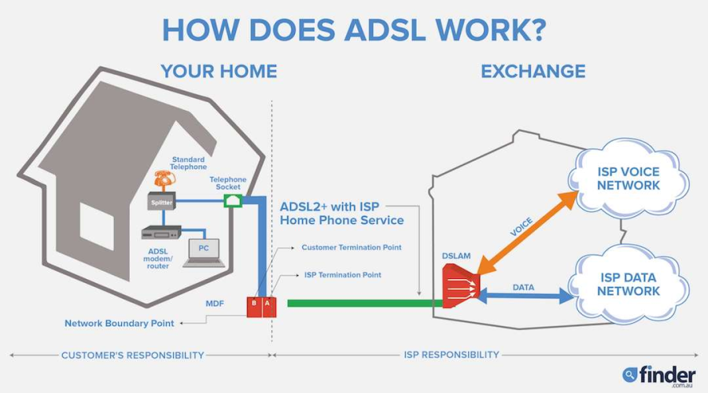
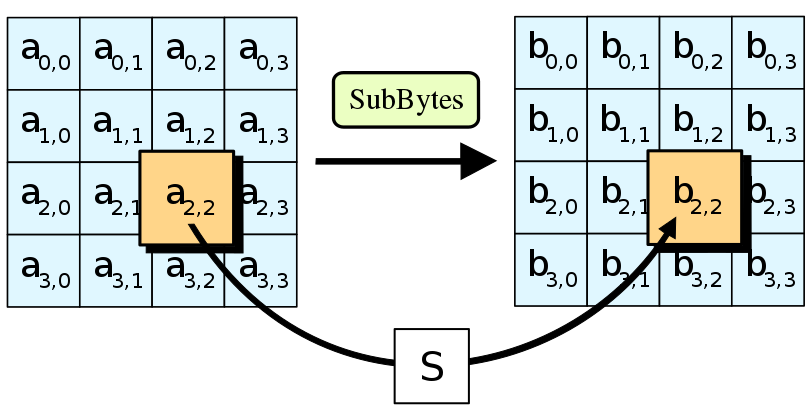
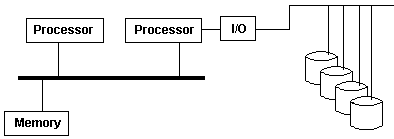
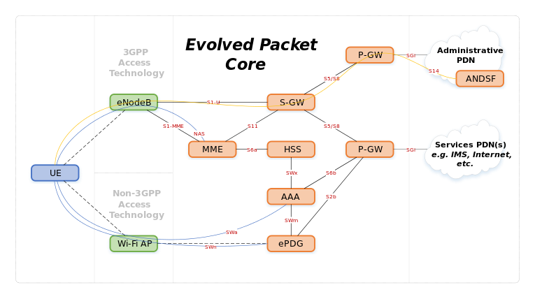
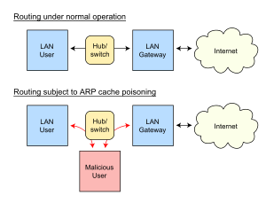
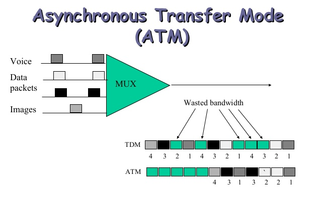
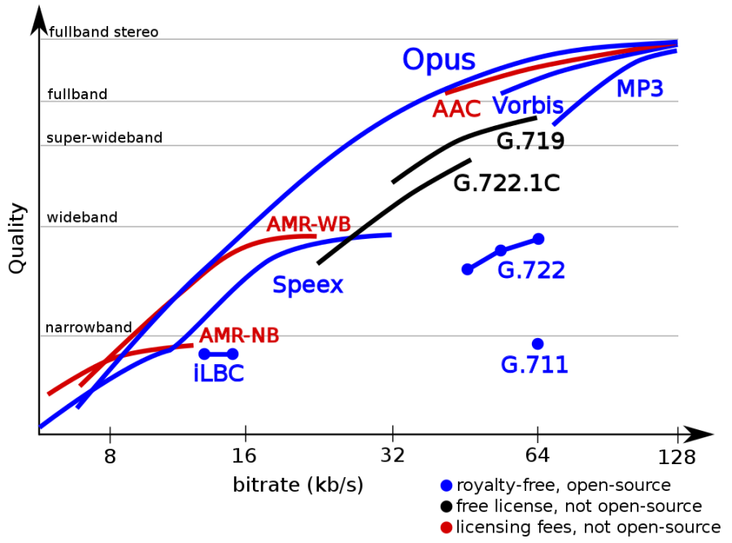

# A

## A-law
A companding algorithm that squeezes the dynamic range of speech before it is coded as 8-bit PCM. It is one of the two variants of ITU-T G.711, used in Europe and most of the world outside North America and Japan.

See also: [Mu-law](m.md#mu-law), [G.711](g.md#g711), [PCM](p.md#pcm).

## AA
**Authoritative Answer.** A flag in a DNS response that says the server answering owns the zone for the name asked about, rather than passing on a cached answer.

See also: [DNS](d.md#dns), [Authoritative Answer](#authoritative-answer).

## AAC
**Advanced Audio Coding.** A lossy audio coding format, standardised in MPEG-2 and MPEG-4 as the successor to MP3. At the same bit rate it usually sounds better than MP3. HE-AAC (AAC+) is a variant tuned for low bit rates, used in digital radio such as DAB+.

See also: [MP3](m.md#mp3), [MPEG](m.md#mpeg), [Audio Codecs](#audio-codecs).

## AAL1
**ATM Adaptation Layer 1.** The ATM adaptation layer for constant bit rate, connection-oriented traffic with tight timing, such as uncompressed voice and circuit emulation. It does not retransmit lost cells; it reports them and leaves recovery to the application.

See also: [ATM](#atm), [AAL2](#aal2), [AAL5](#aal5).

## AAL2
**ATM Adaptation Layer 2.** The ATM adaptation layer for low-delay, variable bit rate traffic, mainly compressed voice. It packs short packets from several users into one ATM connection, and was used on the Iu interfaces of UMTS. It is defined in ITU-T I.363.2.

See also: [ATM](#atm), [ALCAP](#alcap), [UMTS](u.md#umts).

## AAL5
**ATM Adaptation Layer 5.** The ATM adaptation layer for variable-length data packets of up to 65,535 octets, and the one most used for carrying IP over ATM. It puts its control information in an 8-octet trailer, including a 32-bit CRC, rather than a header.

See also: [ATM](#atm), [CRC](c.md#crc).

## Acceptance Test
A formal test, agreed with the customer, whose result decides whether a release is accepted.

See also: [Acceptance Testing](#acceptance-testing), [ATDD](#atdd).

## Acceptance Testing
Testing that checks a system against the behaviour its customer or users expect, usually written as concrete examples or scenarios. The aim is often to automate those examples so they run with every build.

See also: [Acceptance Test](#acceptance-test), [ATDD](#atdd), [BDD](b.md#bdd).

## Activity
A piece of work in a project that uses time and resources. Activities and tasks are near synonyms. PMBOK treats tasks as what an activity breaks down into.

See also: [Task](t.md#task), [Work Breakdown Structure](w.md#work-breakdown-structure).

## Activity Model
A model, such as a UML activity diagram, that shows the steps of a process or workflow and the flow of control between them.

See also: [UML](u.md#uml), [Model](m.md#model).

## AD
**Active Directory.** Microsoft's directory service for Windows domain networks. Domain controllers running Active Directory Domain Services authenticate users and computers, and apply security policy across the domain.

See also: [LDAP](l.md#ldap), [Kerberos](k.md#kerberos).

## Ad Hoc Testing
See [Informal Testing](i.md#informal-testing).

## Ada
A strongly and statically typed programming language, descended from Pascal, with built-in support for concurrency, contracts and protected objects. It is used where safety matters, such as avionics and rail. The language is standardised as ISO/IEC 8652.

See also: [Pascal](p.md#pascal).

## ADR
**Architecture Decision Record.** A short document that records one significant architecture decision: its context, the options considered, the choice made and its consequences. ADRs are kept with the code and are not edited once accepted; a later ADR supersedes an earlier one.

## ADSL
**Asymmetric Digital Subscriber Line.** A form of DSL that carries broadband over an ordinary copper telephone line, with more bandwidth downstream to the customer than upstream.

[[CAPTION:Figure]] ADSL.

See also: [DSL](d.md#dsl), [SDSL](s.md#sdsl), [VDSL](v.md#vdsl), [DSLAM](d.md#dslam).

## AES
**Advanced Encryption Standard.** A symmetric block cipher, chosen by NIST in 2001 from the Rijndael family. It has a 128-bit block and keys of 128, 192 or 256 bits, and replaced DES as the default cipher for bulk encryption.

[[CAPTION:Figure]] AES.

See also: [DES](d.md#des), [Triple DES](t.md#triple-des), [NIST](n.md#nist).

## Agent
In a project charter, another name for the [Project Sponsor](p.md#project-sponsor).

## Agile
An approach to projects that delivers requirements in small increments, with frequent feedback, rather than in one pass at the end.

See also: [Agile development](#agile-development), [Agile Manifesto](#agile-manifesto), [Scrum](s.md#scrum).

## Agile development
An umbrella term for iterative, incremental ways of developing software, such as Scrum, XP, Lean and DSDM.

See also: [Agile](#agile), [Scrum](s.md#scrum), [XP](x.md#xp), [DSDM](d.md#dsdm).

## Agile Manifesto
The 2001 statement of the values behind agile development. It prefers individuals and interactions to processes and tools, and working software to comprehensive documentation. It also prefers customer collaboration to contract negotiation, and responding to change to following a plan.

See also: [Agile](#agile).

## AIS
**Alarm Indication Signal.** A signal, all ones, that a transmission element sends downstream in place of traffic when the link feeding it has failed. It keeps the framing intact and tells equipment further along that the fault is upstream.

See also: [SDH](s.md#sdh), [PDH](p.md#pdh).

## ALCAP
**Access Link Control Application Part.** The UMTS control protocol that sets up and releases AAL2 connections in the radio access network, multiplexing many users onto one AAL2 path. It is the 3GPP version of ITU-T Q.2630.2.

See also: [AAL2](#aal2), [UTRAN](u.md#utran).

## Amazon EC2
**Amazon Elastic Compute Cloud.** The AWS service that rents virtual machines, called instances, started from machine images and paid for by the second while they run.

See also: [AWS](#aws), [IaaS](i.md#iaas).

## AMP
**Asymmetric Multiprocessing.** A multiprocessor design in which the processors have different roles, for example one running the operating system and the others running dedicated tasks. It is common in embedded systems that pair a general-purpose core with a real-time one.

[[CAPTION:Figure]] AMP.

See also: [SMP](s.md#smp), [RTOS](r.md#rtos).

## AMR-NB
**Adaptive Multi-Rate Narrowband.** The 3GPP speech codec for narrowband (300 to 3,400 Hz) speech, at eight bit rates from 4.75 to 12.2 kbit/s. The network picks the rate to suit the radio conditions. It is the standard codec for GSM and UMTS voice.

See also: [AMR-WB](#amr-wb), [GSM AMR](g.md#gsm-amr), [Audio Codecs](#audio-codecs).

## AMR-WB
**Adaptive Multi-Rate Wideband.** The wideband (50 to 7,000 Hz) version of AMR, also standardised as ITU-T G.722.2. It gives the "HD voice" quality used in VoLTE.

See also: [AMR-NB](#amr-nb), [VoLTE](v.md#volte), [G.722](g.md#g722).

## Analogy Estimation
Estimating new work by comparing it with similar work done before, and adjusting for the differences.

See also: [Estimation](e.md#estimation), [Expert Judgement](e.md#expert-judgement).

## Android
Google's mobile operating system, built on the Linux kernel and used on most smartphones and tablets, as well as TVs, cars and watches.

See also: [Linux](l.md#linux).

## ANDSF
**Access Network Discovery and Selection Function.** A 3GPP function that tells a mobile device which non-3GPP access networks, such as Wi-Fi, are nearby. It also gives the device policies for choosing between them and the mobile network.

[[CAPTION:Figure]] ANDSF.

See also: [E-UTRAN](e.md#e-utran), [Wi-Fi](w.md#wi-fi).

## ANSI
**American National Standards Institute.** The private, non-profit body that coordinates voluntary standards in the United States and represents the country at ISO.

See also: [ISO](i.md#iso).

## Antipattern
A common response to a recurring problem that looks reasonable but usually makes things worse.

See also: [Pattern](p.md#pattern), [Design Pattern](d.md#design-pattern).

## Anycast
An addressing and routing method in which one address is announced from several places, and the network delivers each packet to the nearest one by its routing metrics. DNS root servers and content delivery networks use it.

[[CAPTION:Figure]] Anycast.

See also: [Unicast](u.md#unicast), [Multicast](m.md#multicast), [Broadcast](b.md#broadcast), [Geocast](g.md#geocast).

## AOP
**Aspect-Oriented Programming.** A programming paradigm that separates cross-cutting concerns, such as logging or security checks, from the main logic. Code called advice is added at points chosen by a pattern called a pointcut, without editing the code it applies to.

See also: [Programming paradigm](p.md#programming-paradigm), [OO](o.md#oo).

## API
**Application Programming Interface.** A defined set of calls, messages or endpoints through which one piece of software uses another.

See also: [REST](r.md#rest), [SDK](s.md#sdk).

## APN
**Access Point Name.** The name a mobile device gives when it opens a data connection. It tells the operator which packet data network to connect it to, such as the public internet or a private company network, and so which addresses and policies apply.

See also: [GGSN](g.md#ggsn), [PGW](p.md#pgw), [GPRS](g.md#gprs).

## Architecture
The top-level structure of a system: its main parts, how they relate, and the principles behind its design.

See also: [ADR](#adr), [High Level Design](h.md#high-level-design), [TOGAF](t.md#togaf).

## ARP spoofing
An attack on a local network in which the attacker sends forged ARP replies. Other hosts then link the attacker's MAC address to someone else's IP address, often the default gateway's. Traffic then flows through the attacker, who can read, change or drop it. It is also called ARP cache poisoning.

[[CAPTION:Figure]] ARP spoofing.

See also: [RARP](r.md#rarp), [MAC Spoofing](m.md#mac-spoofing), [DNS Spoofing](d.md#dns-spoofing).

## Artefact
A tangible product of work, such as a document, a model, source code or a built system.

See also: [Deliverable](d.md#deliverable), [Work Product](w.md#work-product).

## ASCII
**American Standard Code for Information Interchange.** A 7-bit character encoding for English text, control codes and common symbols. UTF-8 and most other modern encodings keep ASCII as their first 128 characters.

See also: [Unicode](u.md#unicode), [UTF-8](u.md#utf-8).

## ASN.1 {#asn1}
**Abstract Syntax Notation One.** A language for describing data structures independently of how they are encoded, together with standard encoding rules such as BER, DER and PER. It is widely used in telecoms protocols and in cryptography, for example in X.509 certificates.

See also: [BER](b.md#ber), [DER](d.md#der), [PER](p.md#per), [CER](c.md#cer), [X.509](x.md#x509).

## Assessment
A review of a project's or an organisation's state or practices, often by someone independent.

See also: [Audit](#audit), [Review](r.md#review).

## ATDD
**Acceptance Test-Driven Development.** A practice in which customer, developer and tester agree acceptance tests before the feature is built, and the tests then drive the work.

See also: [TDD](t.md#tdd), [BDD](b.md#bdd), [Three Amigos](t.md#three-amigos).

## ATM
**Asynchronous Transfer Mode.** A connection-oriented switching technology that carries voice, video and data in fixed 53-byte cells. It was the basis of broadband ISDN and was widely used in carrier backbones and DSL access networks before IP and Ethernet replaced it.

[[CAPTION:Figure]] ATM.

See also: [AAL1](#aal1), [AAL2](#aal2), [AAL5](#aal5), [VPI](v.md#vpi), [VCI](v.md#vci).

## Audio Codecs
Software or hardware that encodes and decodes digital audio in a given coding format, usually compressing it. Speech codecs such as G.711, AMR and Opus are tuned for voice calls; music codecs such as MP3, AAC and Vorbis for general audio.

[[CAPTION:Figure]] Audio Codecs.

See also: [Codecs](c.md#codecs), [G.711](g.md#g711), [OPUS](o.md#opus), [AAC](#aac).

## Audit
A formal, independent assessment, usually against a standard or a contract.

See also: [Assessment](#assessment).

## Author
In a review, the person who wrote the artefact under review and who represents its viewpoint.

See also: [Review](r.md#review), [Inspection](i.md#inspection).

## Authoritative Answer
A DNS response from a server that is an authority for the zone holding the name asked about. The AA flag in the response header marks it.

See also: [AA](#aa), [DNS](d.md#dns).

## Authority
In a project charter, the person who funds and champions the project: the [Project Sponsor](p.md#project-sponsor).

## Automated Build
A build that runs from start to finish without anyone stepping in, using only what is in version control, so that anyone can repeat it at any time.

See also: [Build](b.md#build), [Continuous Integration](c.md#continuous-integration).

## Automated Testing
Running tests and checking their results with tools rather than by hand.

See also: [Manual Testing](m.md#manual-testing), [Regression testing](r.md#regression-testing).

## Awk
A small language for processing text line by line, found on every Unix-like system. An Awk script is a list of patterns and actions, and it is often used for one-line reports and data extraction in pipelines.

See also: [Sed](s.md#sed), [Shell Scripting](s.md#shell-scripting).

## AWS
**Amazon Web Services.** Amazon's cloud computing platform: virtual machines, storage, databases, networking and many managed services, rented on demand.

See also: [Amazon EC2](#amazon-ec2), [Azure](#azure), [Google Cloud Platform](g.md#google-cloud-platform).

## Azure
Microsoft's cloud computing platform, offering infrastructure, platform and software as a service.

See also: [AWS](#aws), [Google Cloud Platform](g.md#google-cloud-platform), [IaaS](i.md#iaas), [PaaS](p.md#paas).
