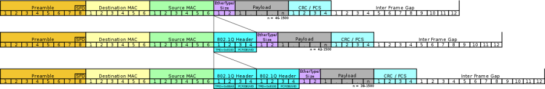
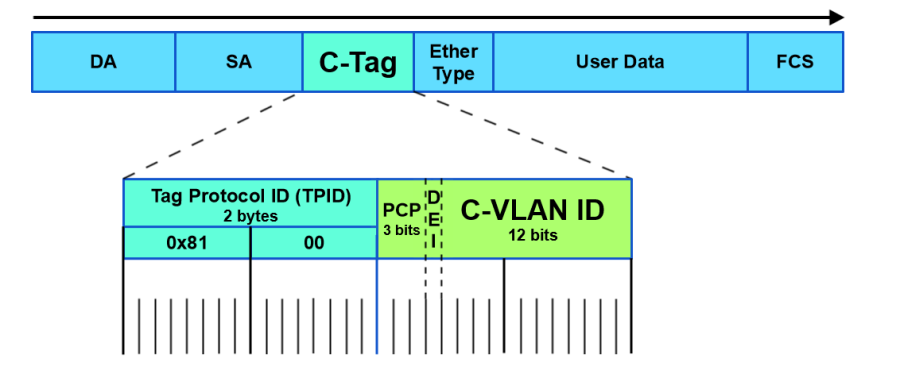
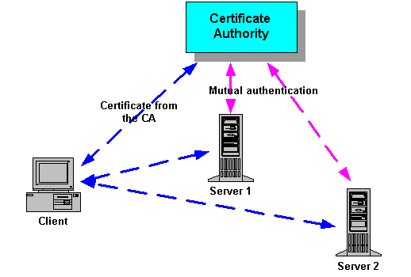
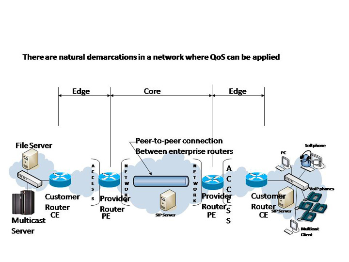
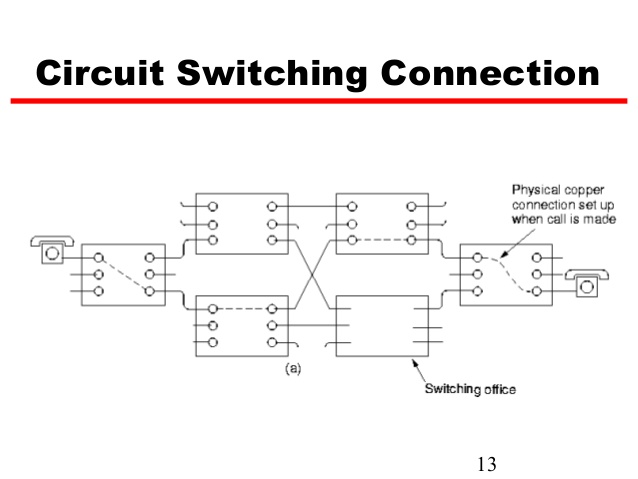
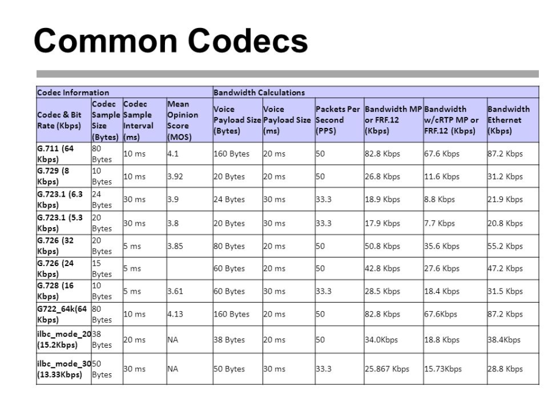
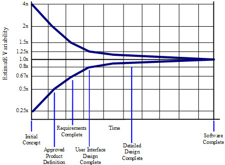
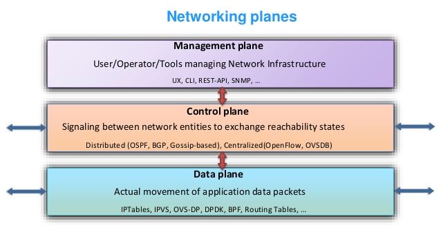
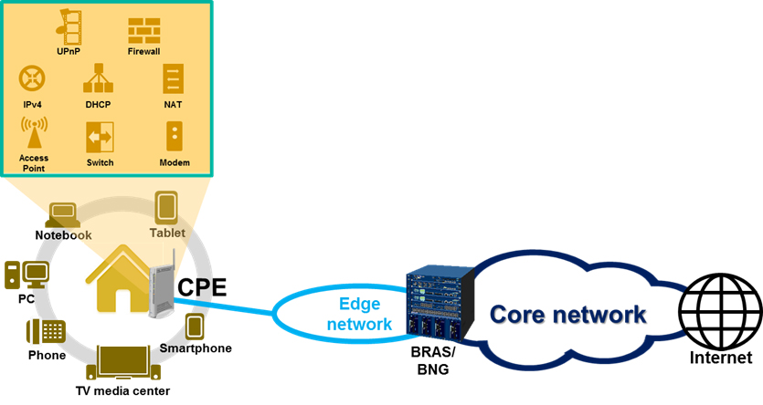
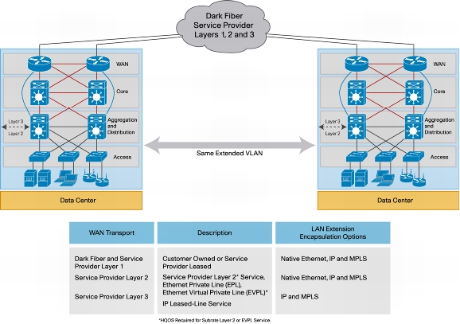

# C

## C Language
A general-purpose, imperative programming language created by Dennis Ritchie at Bell Labs in the early 1970s to write Unix. Its constructs map closely to machine instructions, so it is still the main language for operating systems and embedded software. It is standardised by ISO as ISO/IEC 9899.

See also: [C++](#c_1), [K & R C](k.md#k-r-c), [Embedded systems programming](e.md#embedded-systems-programming).

## C++ {#c_1}
A general-purpose language, created by Bjarne Stroustrup as an extension of C, that adds classes, templates and other abstractions while keeping low-level control of memory. It is standardised by ISO, with new versions every three years.

See also: [C Language](#c-language), [Bjarne Stroustrup](b.md#bjarne-stroustrup).

## C-Tag
**Customer VLAN tag.** In IEEE 802.1ad double tagging (Q-in-Q), the inner VLAN tag, set by the customer. The service provider adds an outer S-Tag.

[[CAPTION:Figure]] C-Tag.

[[CAPTION:Figure]] C-Tag.

See also: [S-Tag](s.md#s-tag), [VLAN](v.md#vlan), [Dot1Q](d.md#dot1q).

## C# {#c_2}
A general-purpose, object-oriented language from Microsoft, created around 2000 for the .NET platform. It also supports functional and generic programming, and is standardised as ECMA-334 and ISO/IEC 23270.

See also: [.NET](symbols.md#net), [Java](j.md#java).

## CA
**Certificate Authority.** A trusted organisation that issues digital certificates, signing each to bind a public key to the named subject. Browsers trust HTTPS sites because a CA they trust signed the site's certificate.

[[CAPTION:Figure]] CA.

See also: [X.509](x.md#x509), [TLS](t.md#tls), [HTTPS](h.md#https).

## Cacti
An open-source web tool that polls devices, usually over SNMP, and graphs the results with RRDtool, typically to show network traffic and CPU load over time.

See also: [SNMP](s.md#snmp).

## Cadence
The regular rhythm of a team's work, such as the length of its sprints or its release cycle.

See also: [Sprints](s.md#sprints), [Iteration](i.md#iteration), [Timebox](t.md#timebox).

## Calendar Days
The elapsed time an activity takes on the calendar. How staff days turn into calendar days depends on how many people work on it, and when.

See also: [Staff Days](s.md#staff-days).

## CAMEL
**Customised Applications for Mobile networks Enhanced Logic.** A set of 3GPP standards, based on Intelligent Network ideas, that lets operators add services such as prepaid calling to GSM and UMTS, including while the subscriber is roaming. It uses the CAP protocol.

See also: [CAP](#cap), [IN](i.md#in), [INAP](i.md#inap).

## Camel Case
Writing compound words with no spaces and a capital letter at the start of each word after the first, as in `camelCase`. Pascal case (`PascalCase`) capitalises the first word too. Many coding standards use one or both for identifiers.

See also: [Snake Case](s.md#snake-case), [Hungarian notation](h.md#hungarian-notation).

## CAP
**CAMEL Application Part.** The signalling protocol that CAMEL uses between the switch and the service control point. It runs over TCAP in SS7.

See also: [CAMEL](#camel), [TCAP](t.md#tcap), [SS7](s.md#ss7).

## Capability Maturity Model
**CMM.** A model of software process maturity, developed by the Software Engineering Institute for the US military. It defines five levels: initial, repeatable, defined, managed and optimising. Each level names the key process areas an organisation must have in place. Capability Maturity Model Integration (CMMI) replaced it.

## Cat 5
**Category 5 cable.** Twisted-pair cable rated to 100 MHz, used for 100 Mbit/s Ethernet and telephony. Category 5e superseded it in 2001.

See also: [Cat 5e](#cat-5e), [Cat 6](#cat-6), [Twisted pair](t.md#twisted-pair).

## Cat 5e
**Category 5e cable.** An enhanced Category 5 cable with tighter limits on crosstalk, rated to 100 MHz and good for Gigabit Ethernet up to 100 m.

See also: [Cat 5](#cat-5), [Cat 6](#cat-6).

## Cat 6
**Category 6 cable.** Twisted-pair cable rated to 250 MHz, with stricter crosstalk limits than Cat 5e. It carries 10 Gigabit Ethernet up to about 55 m; Category 6A, rated to 500 MHz, does so up to 100 m.

See also: [Cat 5](#cat-5), [Cat 5e](#cat-5e), [Ethernet over twisted pair](e.md#ethernet-over-twisted-pair).

## CBOR
**Concise Binary Object Representation.** A binary data format, defined in RFC 8949, based on the JSON data model but designed for small messages and small decoders. It is widely used in constrained IoT devices, with CoAP, and in security tokens.

See also: [JSON](j.md#json), [LwM2M](l.md#lwm2m).

## CCITT
**Comité Consultatif International Téléphonique et Télégraphique.** The former name, until 1993, of the [ITU-T](i.md#itu-t).

## CCS
**Common Channel Signalling.** Telephone signalling carried on a separate channel shared by many voice circuits, rather than in or alongside each circuit. SS7 is the main example. The alternative is channel-associated signalling (CAS).

See also: [SS7](s.md#ss7), [ISUP](i.md#isup).

## CCTA
**Central Computer and Telecommunications Agency.** A former UK government agency that supported departments' computing and telecoms. It created ITIL and PRINCE.

See also: [ITIL](i.md#itil), [PRINCE2](p.md#prince2).

## CDMA
**Code-Division Multiple Access.** A channel access method in which many transmitters share the same frequency band at the same time, each spread with its own code. It is the basis of cdmaOne, CDMA2000 and, as wideband CDMA, UMTS.

See also: [CDMA2000](#cdma2000), [W-CDMA](w.md#w-cdma), [OFDMA](o.md#ofdma).

## CDMA2000
The 3G family of mobile standards developed by 3GPP2 as the successor to cdmaOne (IS-95), used mainly in North America and South Korea. It competed with UMTS.

See also: [CDMA](#cdma), [UMTS](u.md#umts).

## CDR
**Call Detail Record.** A record made by a switch or other network element for each call or session, with details such as the numbers, start time, duration and outcome. CDRs feed billing, fraud detection and reporting.

See also: [Mediation](m.md#mediation).

## CE
**Customer Edge.** The customer's router that connects to the service provider's provider edge (PE) router in an MPLS VPN. It exchanges routes with the PE, statically or with a routing protocol.

[[CAPTION:Figure]] CE.

See also: [VRF](v.md#vrf), [L3VPN](l.md#l3vpn), [NPE](n.md#npe).

## CER
**Canonical Encoding Rules.** A restricted form of BER for ASN.1 that allows only one encoding for each value, so that encoded data can be compared or signed.

See also: [BER](b.md#ber), [DER](d.md#der), [ASN.1](a.md#asn1).

## Ceremonies
The regular meetings of an agile process, such as sprint planning, the daily stand-up, the review and the retrospective.

See also: [Daily Scrum](d.md#daily-scrum), [Sprint Planning](s.md#sprint-planning), [Sprint retrospective](s.md#sprint-retrospective).

## CESG
**Communications-Electronics Security Group.** The part of GCHQ that was the UK government's technical authority for information assurance. Its role passed to the National Cyber Security Centre in 2016.

See also: [GCHQ](g.md#gchq), [NCSC](n.md#ncsc), [IA](i.md#ia).

## CFi
**Canonical Format Indicator.** A one-bit field in the IEEE 802.1Q VLAN tag that showed whether MAC addresses were in canonical form. It is always 0 on Ethernet, and later revisions renamed it the drop eligible indicator.

See also: [Dot1Q](d.md#dot1q), [VLAN](v.md#vlan).

## CGI
**Common Gateway Interface.** A standard way for a web server to run an external command to answer a request, passing it the request details and returning its output as the page.

See also: [HTTP](h.md#http).

## Change Control
The part of change management that decides which artefacts are controlled and makes sure changes to them are proposed, assessed and approved before they are made. The term is also used for change management as a whole.

See also: [Change Control Board](#change-control-board), [Change Request](#change-request), [Explicit Change Control](e.md#explicit-change-control), [Implicit Change Control](i.md#implicit-change-control).

## Change Control Board
**CCB.** The group that decides on change requests to artefacts under change control.

See also: [Change Control](#change-control), [Change Request](#change-request).

## Change Control Plan
A plan that sets out what change control applies to which project artefacts.

See also: [Change Control](#change-control).

## Change Management
Managing requested changes to a project's scope, features or artefacts in a controlled way.

See also: [Change Control](#change-control), [Configuration Management](#configuration-management).

## Change Request
**CR.** A request to change something under change control, usually to add, change or remove a requirement, or to change the project plan.

See also: [Change Control Board](#change-control-board), [Software Change Request](s.md#software-change-request).

## CHAP
**Challenge-Handshake Authentication Protocol.** A PPP authentication protocol, defined in RFC 1994. The server sends a challenge and the client answers with a hash of the challenge and a shared secret, so the secret never crosses the link. It is safer than PAP.

See also: [PAP](p.md#pap), [PPP](p.md#ppp), [EAP](e.md#eap).

## Chrome OS
Google's operating system, based on the Linux kernel, that uses the Chrome browser as its main interface and runs mostly web applications.

See also: [Linux](l.md#linux), [Android](a.md#android).

## Circuit Switched
A network in which a dedicated path is set up between the two ends before they communicate, and held for the whole call, as in the traditional telephone network.

[[CAPTION:Figure]] Circuit Switched.

See also: [Packet Switched](p.md#packet-switched), [PSTN](p.md#pstn), [TDM](t.md#tdm).

## Class 4 Softswitch
A softswitch that routes large volumes of voice calls between carriers, the VoIP equivalent of a class 4 (trunk) exchange. What matters most is protocol support and conversion, transcoding and call capacity.

See also: [Softswitch](s.md#softswitch), [Class 5 Softswitch](#class-5-softswitch).

## Class 5 Softswitch
A softswitch that serves end users, the VoIP equivalent of a class 5 (local) exchange. It provides subscriber features such as IP PBX functions, call centres and voicemail.

See also: [Softswitch](s.md#softswitch), [Class 4 Softswitch](#class-4-softswitch).

## Class Model
A model of the static structure of an object-oriented system: its classes and how they relate.

See also: [UML](u.md#uml), [OO](o.md#oo).

## CLF
**Connectivity Session Location and Repository Function.** In the ETSI TISPAN next-generation network, the function that records each subscriber's access session, linking their IP address to their line and location. It is not to be confused with the IMS subscriber location function (SLF), which finds the right HSS for a user when there are several.

See also: [NGN](n.md#ngn), [HSS](h.md#hss), [IMS](i.md#ims).

## CMDB
**Configuration Management Database.** A store of the configuration items in an IT estate and the relationships between them, used in ITIL to understand the effect of changes and incidents.

See also: [Configuration Item](#configuration-item), [ITIL](i.md#itil).

## CNG
**Comfort Noise Generation.** Adding artificial background noise at the receiving end of a call during silences, when voice activity detection has stopped the sender transmitting. Without it, the line goes dead quiet and callers think the call has dropped.

See also: [VAD](v.md#vad), [VoIP](v.md#voip).

## COBOL
**Common Business-Oriented Language.** An English-like, compiled language designed in 1959 for business data processing. A great deal of banking and government software on mainframes is still written in it.

See also: [Fortran](f.md#fortran).

## Code and Fix Lifecycle
Developing a system from a rough idea through repeated rounds of coding and fixing, with little planning or design, until it seems ready to release.

See also: [Lifecycle](l.md#lifecycle), [Waterfall](w.md#waterfall).

## Codecs
A codec (coder-decoder) is a device or piece of software that encodes a signal or data stream for transmission or storage, usually compressing it. It also decodes it again for use.

[[CAPTION:Figure]] Codecs.

See also: [Audio Codecs](a.md#audio-codecs), [MPEG](m.md#mpeg).

## Coding
Writing the source code that defines how software behaves; the core activity of construction.

See also: [Construction](#construction), [Source Code](s.md#source-code).

## Coding Standard
See [Construction Standard](#construction-standard).

## CoE
**Centre of Excellence.** A team or group that provides leadership, good practice, support and training in one area, such as a technology or a skill, across an organisation.

## COFDM
**Coded Orthogonal Frequency-Division Multiplexing.** OFDM with forward error correction and interleaving added, so the signal survives multipath fading. Digital terrestrial TV (DVB-T) and DAB use it.

See also: [OFDMA](o.md#ofdma), [DTT](d.md#dtt).

## Collaboration Model
A model, such as a UML communication diagram, that shows a set of objects or roles and the messages they exchange.

See also: [Sequence Model](s.md#sequence-model), [UML](u.md#uml).

## Collaborative Construction
A way of building software in which a small group of developers work closely together on the same functionality. They talk often and informally, and share ownership of the code and its tests.

See also: [Pair Programming](p.md#pair-programming), [Mob Programming](m.md#mob-programming), [Collective code ownership](#collective-code-ownership).

## Collective code ownership
The convention that anyone on the team may change any part of the code, to finish a task, fix a defect or improve its structure.

See also: [XP](x.md#xp), [Pair Programming](p.md#pair-programming).

## COLO
**Colocation.** Housing equipment in another party's building, typically placing a provider's equipment in a carrier's exchange or a data centre.

## Compatibility Test
See [Configuration Test](#configuration-test).

## Compiled Language
A programming language whose usual implementations translate source code ahead of time into machine code, rather than interpret it. The line is blurred: many languages compile to bytecode that a virtual machine then interprets or compiles just in time.

See also: [Compiler](#compiler), [Interpreted Language](i.md#interpreted-language).

## Compiler
Software that translates code from one language, usually a high-level language, into another, usually machine code or bytecode. A typical compiler has a front end, a middle end and a back end. A cross-compiler produces code for a different machine from the one it runs on.

[[CAPTION:Figure]] Compiler.

See also: [Compiler Front end](#compiler-front-end), [Compiler Middle end](#compiler-middle-end), [Compiler Back end](#compiler-back-end), [Compiler preprocessor](#compiler-preprocessor), [Machine code](m.md#machine-code).

## Compiler Back end
The stage of a compiler that turns the optimised intermediate representation into code for one target processor: choosing instructions, allocating registers and scheduling.

See also: [Compiler](#compiler), [Compiler Middle end](#compiler-middle-end).

## Compiler Front end
The stage of a compiler that reads the source language: it checks syntax and semantics, reports errors, and produces an intermediate representation for the later stages.

See also: [Compiler](#compiler), [Compiler Middle end](#compiler-middle-end).

## Compiler Middle end
The stage of a compiler that optimises the intermediate representation in ways that do not depend on the target processor, such as removing dead code and propagating constants.

See also: [Compiler](#compiler), [Compiler Front end](#compiler-front-end), [Compiler Back end](#compiler-back-end).

## Compiler preprocessor
A tool that transforms source code before compilation, for example the C preprocessor, which expands macros, includes files and handles conditional compilation.

See also: [Compiler](#compiler), [C Language](#c-language).

## Component
A part of a software system with a defined interface and responsibility.

See also: [Component Test](#component-test).

## Component Test
A test of one software component on its own, apart from the rest of the system.

See also: [Unit Testing](u.md#unit-testing), [Integration Test](i.md#integration-test).

## Cone of Uncertainty
The observation that estimates made early in a project can be wrong by a large factor either way. The range narrows as the project goes on and decisions are made.

[[CAPTION:Figure]] Cone of Uncertainty.

See also: [Estimation](e.md#estimation), [Progressive Elaboration](p.md#progressive-elaboration).

## Configuration Item
**CI.** An artefact, or a group of them, that is placed under configuration management and tracked as a unit.

See also: [Configuration Management](#configuration-management), [CMDB](#cmdb).

## Configuration Management
**CM.** Identifying, recording, releasing and controlling the versions of a system's artefacts so that its state is known at every point.

See also: [Configuration Item](#configuration-item), [Version Control](v.md#version-control), [Software Configuration Management](s.md#software-configuration-management).

## Configuration Test
A test of how a system behaves on different platforms, settings and environments.

## Construction
Turning a design into working software: detailed design, coding, unit testing, integration and debugging.

See also: [Coding](#coding), [Construction Standard](#construction-standard).

## Construction Environment
See [Development Environment](d.md#development-environment).

## Construction Lead
The person responsible for construction on a project: integration, builds, the development environment, technology problems and deployment.

## Construction Standard
The conventions and style developers follow when writing a system's source code. Also called a coding standard.

See also: [Coding Standard](#coding-standard).

## Construction Test Environment
See [Local Test Environment](l.md#local-test-environment).

## Construction Testing
The tests a developer runs while building a component, to check changes both in the component and in the system around it.

See also: [Unit Testing](u.md#unit-testing), [Developer Integration Test](d.md#developer-integration-test).

## Continuous Deployment
Releasing every change that passes the automated pipeline straight to production, so that code reaches users soon after it is written.

See also: [Continuous Integration](#continuous-integration), [DevOps](d.md#devops).

## Continuous Integration
**CI.** Merging every developer's changes into a shared mainline several times a day, with an automated build and tests on each merge. The product is then always in a releasable state.

See also: [Automated Build](a.md#automated-build), [Continuous Deployment](#continuous-deployment).

## Control Plane
The part of a network device or network that decides where traffic goes: running routing protocols and building the tables that the data plane uses to forward packets.

[[CAPTION:Figure]] Control Plane.

See also: [Data Plane](d.md#data-plane), [Management Plane](m.md#management-plane), [User Plane](u.md#user-plane), [SDN](s.md#sdn).

## Copyleft
Licensing that lets anyone copy, change and share a work on condition that copies and derived works are shared under the same terms. The GPL is the best-known copyleft licence.

[[CAPTION:Figure]] Copyleft.

See also: [GPL](g.md#gpl), [GNU](g.md#gnu).

## CoS
**Class of Service.** A marking in a frame or packet that puts it into a traffic class, so the network can give some classes priority over others.

See also: [QoS](q.md#qos), [PCP](p.md#pcp), [DSCP](d.md#dscp).

## COTS
**Commercial off-the-shelf.** Products bought ready-made, and configured or adapted, rather than built to order.

See also: [Mil-COTS](m.md#mil-cots).

## CPE
**Customer Premises Equipment.** Equipment at the customer's site that connects to the operator's network at the demarcation point, such as a router, modem or phone.

[[CAPTION:Figure]] CPE.

See also: [NTU](n.md#ntu).

## CPM
**Critical Path Method.** A scheduling technique that finds the longest chain of dependent activities in a project. That chain sets the shortest possible duration, and any delay on it delays the end date.

See also: [PERT chart](p.md#pert-chart), [Gantt chart](g.md#gantt-chart).

## CPS
**Carrier Pre-Selection.** A UK telephone service that sent a customer's calls through another carrier's network automatically, without dialling a prefix, while the line stayed with the incumbent.

See also: [WLR](w.md#wlr), [LCR](l.md#lcr).

## CRC
**Cyclic Redundancy Check.** An error-detecting code calculated as the remainder of a polynomial division of the data. The sender appends it; the receiver recalculates it and treats any mismatch as corruption. Ethernet's frame check sequence is a CRC-32.

See also: [FCS](f.md#fcs), [Hash Function](h.md#hash-function).

## CRC Cards
**Class-Responsibility-Collaborator cards.** Index cards used in object-oriented design sessions, one for each class, listing what the class is responsible for and which classes it works with.

See also: [OO](o.md#oo), [Class Model](#class-model).

## CSCF
**Call Session Control Function.** The SIP servers at the heart of IMS. The proxy CSCF (P-CSCF) is the device's first contact with the network. The interrogating CSCF (I-CSCF) finds the right serving CSCF for a user. The serving CSCF (S-CSCF) registers users and controls their sessions.

See also: [IMS](i.md#ims), [SIP](s.md#sip), [HSS](h.md#hss).

## Csh
The C shell, a Unix shell written by Bill Joy at Berkeley in the late 1970s, with a syntax modelled on C. Tcsh is its improved successor.

See also: [Tcsh](t.md#tcsh), [Bash](b.md#bash), [Sh](s.md#sh).

## CSI
**Customer Site Interconnect.** A physical link between an operator's network and a customer's site or another operator's equipment.

[[CAPTION:Figure]] CSI.

See also: [Leased Line](l.md#leased-line).

## CSMA
**Carrier-Sense Multiple Access.** A media access method in which a device listens for traffic on a shared medium and transmits only when it is idle. Classic Ethernet added collision detection (CSMA/CD); Wi-Fi uses collision avoidance (CSMA/CA).

See also: [MAC](m.md#mac), [Wi-Fi](w.md#wi-fi).

## CSS
**Cascading Style Sheets.** The language that describes how HTML documents are presented, such as layout, colours and fonts, keeping presentation apart from content.

See also: [XML](x.md#xml), [W3C](w.md#w3c).

## CUE
**Configure Unify Execute.** An open-source language for validating, templating and generating configuration and data. It treats types and values as one thing, so a schema, a constraint and concrete data can be combined and checked in the same way.

See also: [JSON](j.md#json), [YAML](y.md#yaml).

## Customer Development
A four-step framework from Steve Blank (discovery, validation, creation and building the company) for testing assumptions about a product and its market by experiment.

See also: [MVP](m.md#mvp).

## CVSD
**Continuously Variable Slope Delta modulation.** A speech coding method that sends one bit per sample, saying whether the signal went up or down, with a step size that adapts to the signal. It is robust against bit errors and is used in military radio and Bluetooth voice.

See also: [PCM](p.md#pcm), [Audio Codecs](a.md#audio-codecs).
