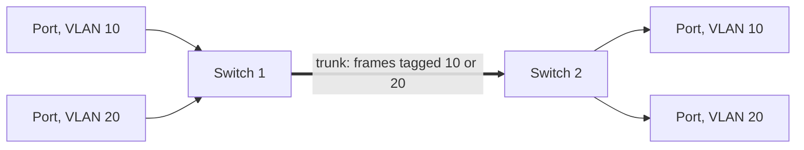
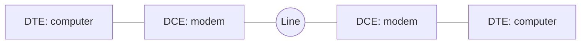
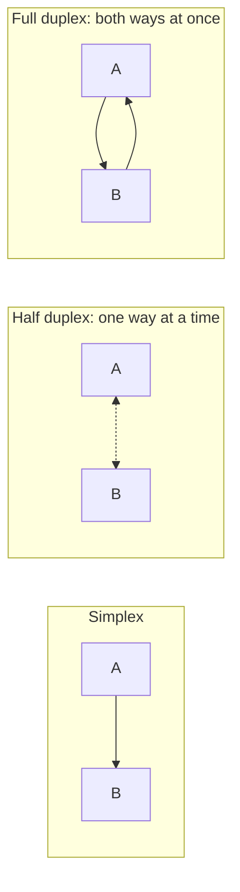

# D to F

## D

### DAD
**Disciplined Agile Delivery.** A process decision framework by Scott Ambler and Mark Lines. It combines practices from Scrum, XP, Lean and agile modelling, and helps teams choose how to work across the whole delivery lifecycle, including at scale.

See also: [Agile](a-c.md#agile), [SAFe](s-z.md#safe), [LeSS](l-n.md#less).

### Daily Meeting
A short meeting held at the same time each day, at which the team coordinates its work. Also called the daily stand-up.

See also: [Daily Scrum](#daily-scrum), [Three Questions](s-z.md#three-questions).

### Daily Scrum
Scrum's daily stand-up: a meeting of 15 minutes or less in which the team reviews progress towards the sprint goal and plans the next day.

See also: [Daily Meeting](#daily-meeting), [Scrum](s-z.md#scrum).

### Dark Fibre
Optical fibre that is installed but not lit by its owner's equipment. Customers lease it and attach their own equipment, so they control the capacity and technology rather than buying a bandwidth service.

See also: [Leased Line](l-n.md#leased-line).

### DASS1
**Digital Access Signalling System 1.** An early BT protocol for ISDN access in the UK, replaced by DASS2 and long obsolete.

See also: [DASS2](#dass2), [ISDN](g-k.md#isdn).

### DASS2
**Digital Access Signalling System 2.** BT's signalling protocol for ISDN primary rate lines (2 Mbit/s, 30 channels), designed before Q.931 was finished. Standard EuroISDN (Q.931) access has replaced it.

See also: [DASS1](#dass1), [Q.931](o-r.md#q931), [PRI](o-r.md#pri), [DPNSS](#dpnss).

### Data modelling
Analysing the data a business uses: identifying the entities, their attributes and the relationships between them.

See also: [RDBMS](o-r.md#rdbms), [Model](l-n.md#model).

### Data Plane
The part of a network device that forwards packets, using tables built by the control plane. Also called the forwarding plane or [User Plane](s-z.md#user-plane).

See also: [Control Plane](a-c.md#control-plane), [Management Plane](l-n.md#management-plane).

### Database Lead
On projects with large or critical databases, the person responsible for the design and construction of the database parts of the system.

### Data Warehouse
A central store of current and historical data, integrated from several operational systems and organised for reporting and analysis rather than for transactions.

See also: [ETL](#etl), [RDBMS](o-r.md#rdbms).

### DCE
**Data Circuit-terminating Equipment.** The device that connects a terminal or computer (the DTE) to a transmission line, such as a modem.

See also: [DTE](#dte).

### DDK
**Driver Development Kit.** The tools, libraries, headers and documentation needed to write device drivers for an operating system.

See also: [Driver](#driver), [SDK](s-z.md#sdk).

### DDOS
**Distributed Denial of Service.** An attack that floods a target with traffic from many sources at once, often a botnet, to make it unavailable to legitimate users. Because the traffic comes from everywhere, blocking one source does not stop it.

See also: [Firewall](#firewall), [IPS](g-k.md#ips).

### Decomposition Estimation
Estimating each part of a system after breaking it down. See [Bottom-Up Estimation](a-c.md#bottom-up-estimation).

### Defect
A flaw in a system, process or artefact that makes it fail to meet its specification, a standard or a reasonable expectation.

See also: [Bug](a-c.md#bug), [Defect Report](#defect-report), [Defect Management](#defect-management).

### Defect Management
Recording, prioritising, tracking and closing defects so that none are lost.

See also: [Defect](#defect), [Issue tracker](g-k.md#issue-tracker).

### Defect Report
A record asking for an artefact to be changed because it does not conform to a requirement or standard, or because it fails.

See also: [Defect](#defect).

### Definition of Done
**DoD.** A list, agreed by the team, of what must be true before a piece of work, such as a user story, counts as finished. It usually includes tests passing, review and documentation.

See also: [Definition of Ready](#definition-of-ready), [User Stories](s-z.md#user-stories).

### Definition of Ready
**DoR.** Criteria a backlog item must meet before the team takes it into an iteration, such as clear acceptance criteria and no blocking dependencies. Many teams base it on INVEST.

See also: [Definition of Done](#definition-of-done), [INVEST](g-k.md#invest), [Backlog Grooming](a-c.md#backlog-grooming).

### Deliverable
An artefact, or set of artefacts, that a project or piece of work hands over as its output.

See also: [Artefact](a-c.md#artefact), [Work Product](s-z.md#work-product).

### Delphi
Embarcadero's (originally Borland's) development environment for Object Pascal, an object-oriented descendant of Pascal. The language itself is often called Delphi too.

See also: [Pascal](o-r.md#pascal).

### Deployment
Installing a system and making it ready for use, including any integration and configuration for the particular site.

See also: [Deployment Plan](#deployment-plan), [Release](o-r.md#release).

### Deployment Lead
On projects with complex deployment needs, the person who plans and oversees deployment, and often operations and maintenance.

### Deployment Plan
A plan for releasing a system, covering the target platforms, the configuration to release and the steps to follow.

See also: [Deployment](#deployment), [Release Management](o-r.md#release-management).

### DER
**Distinguished Encoding Rules.** A restricted form of BER that allows exactly one encoding for each ASN.1 value. It is used where encodings must be unique, above all for data that is signed, such as X.509 certificates.

See also: [BER](a-c.md#ber), [CER](a-c.md#cer), [ASN.1](a-c.md#asn1), [X.509](s-z.md#x509).

### DES
**Data Encryption Standard.** A symmetric block cipher from IBM, published as a US federal standard in 1977, with a 64-bit block and a 56-bit key. The short key made it breakable by brute force by the late 1990s, and AES replaced it.

See also: [Triple DES](s-z.md#triple-des), [AES](a-c.md#aes).

### Design
Software design: working out the structure of a system and the models and plans for implementing its requirements.

See also: [High Level Design](g-k.md#high-level-design), [Low Level Design](l-n.md#low-level-design), [Architecture](a-c.md#architecture).

### Design Lead
The person responsible for a system's architecture and for overseeing design work.

### Design Pattern
A general, reusable solution to a problem that keeps coming up in software design. A pattern is a description to adapt, not finished code. The Gang of Four book catalogued the best-known object-oriented patterns.

See also: [GoF](g-k.md#gof), [Pattern](o-r.md#pattern), [Antipattern](a-c.md#antipattern).

### Design to Tools
Deciding what goes into a system by what existing tools support directly, rather than by what users need.

### Desk Check
An informal review in which the author asks one or more colleagues to read an artefact and look for defects.

See also: [Review](o-r.md#review), [Walkthrough](s-z.md#walkthrough).

### Detailed Design
Design work below the architecture, covering parts of both high-level and low-level design.

See also: [High Level Design](g-k.md#high-level-design), [Low Level Design](l-n.md#low-level-design).

### Detailed Schedule
A fine-grained schedule of tasks, effort, people and dependencies, usually built bottom-up from a work plan. It often covers only the next few weeks and rolls forward.

See also: [Business Schedule](a-c.md#business-schedule), [Rolling Wave Planning](o-r.md#rolling-wave-planning), [Project Headlights](o-r.md#project-headlights).

### Developer
A software engineer, especially when doing design and construction.

### Developer Integration Test
**DIT.** An integration test that a developer runs in the system test environment after a project build, before releasing new functionality.

See also: [Integration Test](g-k.md#integration-test).

### Development Environment
The hardware, software and tools in which developers build and test software.

See also: [Local Development Environment](l-n.md#local-development-environment), [IDE](g-k.md#ide).

### Development process
The set of activities a team follows to develop software.

See also: [Lifecycle](l-n.md#lifecycle), [SDLC](s-z.md#sdlc).

### DevOps
A way of working that brings development and operations together, sharing responsibility for delivering and running software. It relies on automation of builds, tests, deployment and monitoring.

See also: [Continuous Integration](a-c.md#continuous-integration), [Continuous Deployment](a-c.md#continuous-deployment).

### DHCP
**Dynamic Host Configuration Protocol.** The protocol a device uses to get an IP address and other network settings, such as the gateway and DNS servers, from a server when it joins a network.

See also: [BOOTP](a-c.md#bootp), [DNS](#dns).

### Diagram
A graphical representation of a system, process or other information.

### DLE
**Digital Local Exchange.** A digital telephone exchange that connects subscribers' lines, either directly or through remote concentrators. In the UK these were System X and AXE 10 exchanges.

See also: [SystemX](s-z.md#systemx), [MDF](l-n.md#mdf), [Local Loop](l-n.md#local-loop).

### DLP
**Data Link Protocol.** Any protocol at the data link layer (layer 2) of the OSI model, such as Ethernet, Token Ring, FDDI or PPP. DLP also commonly stands for data loss prevention.

See also: [L2](l-n.md#l2).

### DMZ
**Demilitarised Zone.** A network segment that sits between the internet and an organisation's internal network, holding the services that outsiders need to reach, such as web and mail servers. Firewalls on both sides limit what each zone can reach.

See also: [Firewall](#firewall).

### DN
**Directory Number.** A telephone number: the digits that identify a subscriber's line or device and route calls to it.

See also: [E.164](#e164).

### DNB
A Dun & Bradstreet business file: a company's credit and identity record from Dun & Bradstreet.

### DNS
**Domain Name System.** The internet's distributed, hierarchical naming system. Its main job is to translate names such as `example.com` into IP addresses, but it holds many other kinds of record.

See also: [Domain Name](#domain-name), [FQDN](#fqdn), [DNS - A](#dns-a), [DNS Spoofing](#dns-spoofing).

### DNS - A {#dns-a}
**Address record.** A DNS record that maps a name to an IPv4 address.

See also: [DNS - AAAA](#dns-aaaa), [DNS](#dns).

### DNS - AAAA {#dns-aaaa}
A DNS record that maps a name to an IPv6 address.

See also: [DNS - A](#dns-a), [IPv6](g-k.md#ipv6).

### DNS - CNAME {#dns-cname}
**Canonical name record.** A DNS record that makes one name an alias for another; the lookup carries on with the target name.

See also: [DNS - DNAME](#dns-dname).

### DNS - DNAME {#dns-dname}
A DNS record that makes a name, and every name under it, an alias for another domain. A CNAME aliases only the exact name.

See also: [DNS - CNAME](#dns-cname).

### DNS - SRV {#dns-srv}
**Service record.** A DNS record that gives the host and port for a named service, such as SIP or XMPP, together with priority and weight.

See also: [SIP](s-z.md#sip), [XMPP](s-z.md#xmpp).

### DNS - TXT {#dns-txt}
A DNS record that holds arbitrary text. It now mostly carries machine-readable data, such as SPF, DKIM and DMARC policies for email and domain ownership proofs.

### DNS Spoofing
An attack that puts false records into a DNS resolver's cache, so that it sends users to the wrong address, usually one the attacker controls. Also called DNS cache poisoning.

See also: [DNS](#dns), [ARP spoofing](a-c.md#arp-spoofing).

### DoD
See [Definition of Done](#definition-of-done).

### DoR
See [Definition of Ready](#definition-of-ready).

### Docker
A platform for building and running software in containers: packages that hold an application and its dependencies and run in isolation on a shared operating system kernel.

See also: [VM](s-z.md#vm).

### Document Collaboration
Tools that let several people work on the same document at once, from different places, to reach one final version. Wikis, Confluence and SharePoint are examples.

See also: [Wiki](s-z.md#wiki).

### Domain Name
A name registered in the DNS, such as `example.co.uk`, that identifies an area of administrative control on the internet. Names form a hierarchy under the unnamed root: top-level domains, then second-level domains, then subdomains.

See also: [DNS](#dns), [FQDN](#fqdn).

### Dot1Q
**IEEE 802.1Q.** The standard for VLANs on Ethernet. It adds a 4-byte tag to each frame with a 12-bit VLAN identifier and a 3-bit priority (802.1p).

See also: [VLAN](s-z.md#vlan), [Dot1Q trunking](#dot1q-trunking), [PCP](o-r.md#pcp).

### Dot1Q trunking
Carrying several VLANs over one link between switches. Each frame is tagged with its VLAN ID as it enters the trunk. The switch at the other end uses the tag to deliver it to ports in the same VLAN.

[[CAPTION:Figure]] Two VLANs sharing an 802.1Q trunk.

See also: [Dot1Q](#dot1q), [VLAN](s-z.md#vlan).

### Downstream
In a project, the later activities and artefacts, such as coding, testing and deployment. In networking, the direction towards the customer.

See also: [Upstream](s-z.md#upstream).

### DP
**Distribution Point.** In a UK access network, the point near the customer, often on a telegraph pole, where the drop wire to the premises joins the cable from the exchange. In fibre networks, the point where a fibre splits towards several premises.

See also: [Local Loop](l-n.md#local-loop), [PCP](o-r.md#pcp).

### DPI
**Deep Packet Inspection.** Examining the contents of packets, beyond the IP and transport headers, to classify, block, shape or log traffic. Firewalls, intrusion prevention and traffic management use it.

See also: [Firewall](#firewall), [IPS](g-k.md#ips), [Packet sniffing](o-r.md#packet-sniffing).

### DPNSS
**Digital Private Network Signalling System.** A BT-defined protocol for linking PBXs over digital private circuits, with a common set of features across vendors. QSIG is the international equivalent.

See also: [QSIG](o-r.md#qsig), [DASS2](#dass2).

### DQ
**Data Quality.** How accurate, complete, consistent and timely data is for its purpose.

### Draft
An artefact under version control but not yet under change control.

See also: [Baseline](a-c.md#baseline).

### Driver
Software that lets an operating system and applications use a particular device, hiding the details of the hardware behind a standard interface.

See also: [DDK](#ddk), [Kernel](g-k.md#kernel).

### DSCP
**Differentiated Services Code Point.** A 6-bit field in the IP header that marks a packet's traffic class, so routers can give it the right treatment under DiffServ quality of service.

See also: [QoS](o-r.md#qos), [CoS](a-c.md#cos).

### DSDM
**Dynamic Systems Development Method.** An agile framework from the 1990s, built on rapid application development, that fixes time and cost and varies scope. It is now called the DSDM agile project framework.

See also: [Agile development](a-c.md#agile-development), [RAD](o-r.md#rad).

### DSL
**Digital Subscriber Line.** A family of technologies that carry digital data over copper telephone lines, using frequencies above voice. ADSL and VDSL are the most common.

See also: [ADSL](a-c.md#adsl), [SDSL](s-z.md#sdsl), [VDSL](s-z.md#vdsl), [DSLAM](#dslam).

### DSLAM
**Digital Subscriber Line Access Multiplexer.** The equipment in an exchange or street cabinet that terminates many customers' DSL lines and combines their traffic onto one high-speed link.

See also: [DSL](#dsl), [MSAN](l-n.md#msan), [BRAS](a-c.md#bras).

### DTE
**Data Terminal Equipment.** The device at the end of a data link that is the source or destination of data, such as a computer or terminal. It connects to the line through a DCE.

[[CAPTION:Figure]] DTEs connected through DCEs.

See also: [DCE](#dce).

### DTLS
**Datagram Transport Layer Security.** A version of TLS for datagram transports such as UDP, giving the same confidentiality, integrity and authentication. It is used by CoAP and LwM2M in IoT and by WebRTC. The current version is DTLS 1.3, in RFC 9147.

See also: [TLS](s-z.md#tls), [UDP](s-z.md#udp), [LwM2M](l-n.md#lwm2m).

### DTMF
**Dual-Tone Multi-Frequency.** Telephone signalling in which each key sends two tones at once, one from a low group and one from a high group. It is standardised as ITU-T Q.23, and BT calls it MF4.

See also: [IVR](g-k.md#ivr), [PSTN](o-r.md#pstn).

### DTT
**Digital Terrestrial Television.** Television broadcast digitally from ground-based transmitters, such as Freeview in the UK. It fits several channels into the spectrum one analogue channel used.

See also: [DTV](#dtv), [COFDM](a-c.md#cofdm).

### DTV
**Digital Television.** Television sent as digital signals rather than analogue, by terrestrial, satellite, cable or IP networks.

See also: [DTT](#dtt), [IPTV](g-k.md#iptv).

### Duplex
A link that can carry communication in both directions. In full duplex both sides can send at once; in half duplex they take turns. A simplex link carries one direction only.

[[CAPTION:Figure]] Simplex, half duplex and full duplex.

See also: [Full duplex](#full-duplex), [Half Duplex](g-k.md#half-duplex), [Simplex](s-z.md#simplex).

### DVSR
**Dynamically Verified Static Routing.** A Redback (later Ericsson) routing feature: a static route that the router adds to its table only while regular pings show the next hop is reachable.

See also: [Router](o-r.md#router).

## E

### E NodeB
**Evolved Node B (eNodeB, eNB).** The LTE base station. Unlike a UMTS Node B, it has no separate controller: it handles radio resource management and handover itself, and connects directly to the core.

See also: [E-UTRAN](#e-utran), [Node B](l-n.md#node-b), [MME](l-n.md#mme), [LTE (4G)](l-n.md#lte-4g).

### E-UTRAN
**Evolved UMTS Terrestrial Radio Access Network.** The LTE radio access network: eNodeBs and the E-UTRA air interface, which uses OFDMA downstream and SC-FDMA upstream.

See also: [E NodeB](#e-nodeb), [UTRAN](s-z.md#utran), [LTE (4G)](l-n.md#lte-4g).

### E.164 {#e164}
The ITU-T recommendation for the international public telephone numbering plan. An E.164 number has at most 15 digits, starting with the country code, and is written with a leading `+`.

See also: [DN](#dn).

### EAD
**Ethernet Access Direct.** Openreach's point-to-point fibre Ethernet circuit, used to connect business sites and for backhaul, at speeds up to 10 Gbit/s.

See also: [EoFTTC](#eofttc), [Leased Line](l-n.md#leased-line), [Backhaul](a-c.md#backhaul).

### EAP
**Extensible Authentication Protocol.** An authentication framework, defined in RFC 3748, that carries many authentication methods, such as EAP-TLS and PEAP. IEEE 802.1X uses it for network access control on Wi-Fi and wired networks.

See also: [PEAP](o-r.md#peap), [WPA2](s-z.md#wpa2), [Radius](o-r.md#radius).

### Earned Value
**EV.** A measure of progress that compares the value of the work completed with the work planned and its actual cost, to show schedule and cost variance.

See also: [Earned Value Management](#earned-value-management).

### Earned Value Management
**EVM.** Managing a project using earned value measures.

See also: [Earned Value](#earned-value).

### Echo
A delayed reflection of a signal. On telephone calls it comes from hybrids that convert between 2-wire and 4-wire circuits, or from a loudspeaker feeding back into a microphone. Delay makes it more noticeable.

See also: [Echo cancellation](#echo-cancellation), [Sidetone](s-z.md#sidetone).

### Echo cancellation
Removing echo from a call by modelling the echo path and subtracting an estimate of the echo from the incoming signal. It replaced echo suppression, which muted the return path while the far end was talking. Line echo cancellers handle network echo; acoustic echo cancellers handle loudspeaker-to-microphone echo.

See also: [Echo](#echo), [Echo Cancellation - G.168](#echo-cancellation-g168).

### Echo Cancellation - G.168 {#echo-cancellation-g168}
ITU-T Recommendation G.168, which specifies digital network echo cancellers. It covers their performance, how tones disable them for fax and data, and the laboratory tests to check them.

See also: [Echo cancellation](#echo-cancellation).

### EDB
**Emergency Database.** In UK telephony, the database that tells emergency services the address behind the number calling 999.

### EDGE
**Enhanced Data rates for GSM Evolution.** An upgrade to GSM data, also called EGPRS, that uses better modulation and coding to roughly triple GPRS speeds on the same radio channels.

See also: [GPRS](g-k.md#gprs), [GSM](g-k.md#gsm), [GERAN](g-k.md#geran).

### Editor
In an inspection, the person who makes the fixes to the artefact afterwards, usually its author.

See also: [Inspection](g-k.md#inspection).

### EFM
**Ethernet in the First Mile.** IEEE 802.3ah, which defines Ethernet over the access link between provider and customer, on copper or fibre, with its own management functions.

See also: [Ethernet over twisted pair](#ethernet-over-twisted-pair), [EoFTTC](#eofttc).

### Egress
Traffic leaving a network or a device, as opposed to ingress traffic coming in.

See also: [Ingress](g-k.md#ingress).

### EIA
**Electronic Industries Alliance.** A former US standards and trade body for electronics manufacturers, known for standards such as RS-232. It closed in 2011 and its work passed to other bodies, including the TIA.

See also: [TIA](s-z.md#tia).

### EIGRP
**Enhanced Interior Gateway Routing Protocol.** Cisco's advanced distance-vector routing protocol, which sends only incremental updates. It replaced IGRP in 1993 and was published as RFC 7868 in 2016.

See also: [IGRP](g-k.md#igrp), [OSPF](o-r.md#ospf), [IGP](g-k.md#igp).

### Embedded systems programming
Writing software for an embedded system, a computer built into a device, using the interfaces and limited resources the device provides.

See also: [RTOS](o-r.md#rtos), [MCU](l-n.md#mcu), [C Language](a-c.md#c-language).

### Engineering Discussion
A meeting to frame a problem and look for solutions. If materials go out beforehand for people to read, it is closer to a preview.

See also: [Preview](o-r.md#preview).

### Engineering Management
**EM.** Planning, staffing, tracking and controlling software projects, together with managing the teams and the organisation.

### Engineering Process
Software engineering process: defining how software engineering work is done, and improving it.

See also: [Process](o-r.md#process).

### EoFTTC
**Ethernet over FTTC.** A business Ethernet service over fibre to the cabinet: copper runs from the premises to the street cabinet, and fibre from there to the exchange. It gives symmetrical speeds of tens of megabits per second at lower cost than a fibre leased line.

See also: [EAD](#ead), [VDSL](s-z.md#vdsl), [EFM](#efm).

### EoS
**Ethernet over SDH or SONET.** Protocols that carry Ethernet over SDH or SONET networks. They usually use the generic framing procedure (GFP) and virtual concatenation to fit the Ethernet rate into SDH paths.

See also: [SDH](s-z.md#sdh), [SONET](s-z.md#sonet).

### ePDG
**Evolved Packet Data Gateway.** The LTE core node that lets devices on untrusted non-3GPP access, such as public Wi-Fi, reach the mobile core through an IPsec tunnel. Wi-Fi calling relies on it.

See also: [PGW](o-r.md#pgw), [IPSec](g-k.md#ipsec), [ANDSF](a-c.md#andsf).

### Epic
A large user story, too big for one iteration, that is split into smaller stories.

See also: [User Stories](s-z.md#user-stories), [Story Splitting](s-z.md#story-splitting).

### EPWS
**Ethernet Private Wire Service.** A point-to-point Ethernet service between two customer sites, carried over the provider's network.

See also: [EVPL](#evpl), [VPWS](s-z.md#vpws).

### ESB
**Enterprise Service Bus.** Middleware in a service-oriented architecture that connects applications through a shared bus. It routes, transforms and mediates messages between them, so that each application integrates with the bus rather than with every other application.

See also: [SOA](s-z.md#soa), [Microservice](l-n.md#microservice).

### Estimate
The result of estimating: the predicted size, effort, cost or duration, with the inputs, assumptions and method behind it. It can be a full project estimate or a one-line task estimate.

See also: [Estimation](#estimation), [Project Estimate](o-r.md#project-estimate), [Task Estimate](s-z.md#task-estimate).

### Estimation
Working out the likely size, effort, cost, schedule or quality of a project. Several techniques used together give a better estimate than one, and estimates should be redone as the project goes on.

See also: [Estimate](#estimate), [Cone of Uncertainty](a-c.md#cone-of-uncertainty), [Planning Poker](o-r.md#planning-poker).

### Ethernet over twisted pair
Ethernet physical layers that use twisted-pair copper cable. 10BASE-T, 100BASE-TX, 1000BASE-T and 10GBASE-T are the main ones. Single-pair variants, such as 10BASE-T1L, serve industrial and automotive uses.

See also: [Cat 5](a-c.md#cat-5), [Cat 6](a-c.md#cat-6), [Twisted pair](s-z.md#twisted-pair).

### Ethical Hacking
Testing an organisation's security with its permission, using attackers' methods to find weaknesses before they do. Ethical hackers are also called white hats.

See also: [Pen testing](o-r.md#pen-testing).

### ETL
**Extract, Transform, Load.** The three steps for moving data into a data warehouse: read data from source systems, convert and clean it into the target form, and write it into the target.

See also: [Data Warehouse](#data-warehouse).

### ETSI
**European Telecommunications Standards Institute.** The not-for-profit body, based in Sophia Antipolis in France, that sets European telecoms standards. Its work includes GSM, DECT and TETRA, and it is a founding partner of 3GPP.

See also: [ITU](g-k.md#itu), [GSM](g-k.md#gsm).

### EVC
**Ethernet Virtual Connection.** In Metro Ethernet Forum (MEF) terms, the association between two or more customer interfaces (UNIs) across a provider's network. It is a virtual pipe that defines which sites can exchange frames.

See also: [EVPL](#evpl), [UNI](s-z.md#uni).

### Evolutionary Delivery Lifecycle
A lifecycle that combines evolutionary prototyping with staged delivery.

See also: [Evolutionary Prototyping Lifecycle](#evolutionary-prototyping-lifecycle), [Staged Delivery Lifecycle](s-z.md#staged-delivery-lifecycle).

### Evolutionary Prototyping Lifecycle
A lifecycle in which a system grows from an initial concept through repeated prototypes until it is ready to deliver.

See also: [Lifecycle](l-n.md#lifecycle), [Iterative Development](g-k.md#iterative-development).

### EVPL
**Ethernet Virtual Private Line.** An MEF E-Line service that carries several point-to-point virtual connections over one customer interface, separated by VLAN. Its sibling, Ethernet Private Line (EPL), gives one transparent connection per port.

See also: [EVC](#evc), [EPWS](#epws).

### Expert Judgement
Estimating from the experience of people who know the work. It works best when combined with other techniques, such as analogy and decomposition.

See also: [Estimation](#estimation), [Analogy Estimation](a-c.md#analogy-estimation).

### Explicit Change Control
Change control of artefacts, such as requirements and plans, that a change control board manages directly.

See also: [Implicit Change Control](g-k.md#implicit-change-control), [Change Control Board](a-c.md#change-control-board).

### Explicit Risk Management
See [Extrinsic Risk Management](#extrinsic-risk-management).

### Exploratory Testing
Testing in which the tester learns about the software, designs tests and runs them all at once, rather than following a script.

See also: [Informal Testing](g-k.md#informal-testing).

### Extrinsic Risk Management
Formal risk management added to a project, such as keeping a top-ten risk list and reviewing it regularly.

See also: [Intrinsic Risk Management](g-k.md#intrinsic-risk-management), [Risk Management](o-r.md#risk-management).

## F

### Facilitation
Running a meeting or workshop so the group reaches its goal, without taking part in the content. The person who does it is the facilitator.

### FCS
**Frame Check Sequence.** An error-detecting code, usually a CRC, added to the end of a frame. A receiver that finds a mismatch discards the frame; protocols higher up, such as TCP, recover the loss.

See also: [CRC](a-c.md#crc).

### FDDI
**Fibre Distributed Data Interface.** A 100 Mbit/s token-passing LAN standard over a dual fibre ring. Fast Ethernet made it obsolete.

See also: [Token Ring](s-z.md#token-ring), [100 Mbps (Fast Ethernet)](s-z.md#100-mbps-fast-ethernet).

### Feature
A piece of a system's functionality, seen from the user's side. The term also refers to a project's scope, measured in features.

See also: [Feature Test](#feature-test), [Feature creep](#feature-creep).

### Feature creep
The tendency for requirements to keep growing during a project, adding features that were never planned, at a cost to schedule and quality.

See also: [Change Control](a-c.md#change-control).

### Feature Test
A test of one area of system functionality once its construction is finished.

### FemtoCell
A small, low-power mobile base station for a home or small office, connected to the operator over the customer's broadband. It improves indoor coverage for a handful of phones.

See also: [Mobile Cell](l-n.md#mobile-cell), [E NodeB](#e-nodeb).

### FIPS
**Federal Information Processing Standards.** US federal government standards for computer systems, issued by NIST, covering areas such as cryptography where no suitable industry standard exists.

See also: [FIPS 140-2](#fips-140-2), [NIST](l-n.md#nist).

### FIPS 140-2
The US standard, from 2001, of security requirements for cryptographic modules. It defines four security levels and covers module design, ports, roles, physical security and key management. FIPS 140-3 replaced it in 2019, and 140-2 certificates are being retired.

See also: [FIPS](#fips), [NIST](l-n.md#nist).

### Firewall
A network security device or software that allows or blocks traffic by rules, usually between a trusted internal network and an untrusted one. Network firewalls protect whole networks; host-based firewalls protect one machine.

See also: [DMZ](#dmz), [IPS](g-k.md#ips), [DPI](#dpi).

### FNA
**Full Network Authentication.** A broadband login method in which the network authenticates the line itself, by its network identifier, through RADIUS, rather than a username and password typed by the customer.

See also: [Radius](o-r.md#radius), [PPPoE](o-r.md#pppoe).

### Formal Testing
Testing that follows documented test cases.

See also: [Informal Testing](g-k.md#informal-testing), [Test Case](s-z.md#test-case).

### Fortran
The first widely used high-level language, developed at IBM in the 1950s for scientific computing. Modern Fortran is still used for numerical work and supercomputing.

See also: [COBOL](a-c.md#cobol).

### Forwarding plane
See [Data Plane](#data-plane).

### FOTA
**Firmware Over-The-Air.** Updating device firmware remotely over a wireless link. A safe design verifies a signature on each image and keeps two partitions, so a failed update rolls back. It also rolls updates out to the fleet in stages.

See also: [Root of Trust](o-r.md#root-of-trust), [LwM2M](l-n.md#lwm2m).

### FQDN
**Fully Qualified Domain Name.** A domain name that names every level of the DNS hierarchy down from the root, such as `www.example.com.`, so it can mean only one thing.

See also: [Domain Name](#domain-name), [DNS](#dns).

### Frame Relay
A packet-switched WAN technology, widely sold by carriers in the 1990s, that connects sites through virtual circuits over a shared network. It was cheaper than leased lines; MPLS VPNs have since replaced it.

See also: [X.25](s-z.md#x25), [PVC](o-r.md#pvc), [L3VPN](l-n.md#l3vpn).

### Frequent Releases
Putting the product into users' hands often, so the team gets feedback early and acts on it.

See also: [Continuous Deployment](a-c.md#continuous-deployment), [Release](o-r.md#release).

### Frequently Asked Question
**FAQ.** A list of common questions and their answers.

### FSK
**Frequency-Shift Keying.** Modulation that sends digital data by switching the carrier between frequencies; in binary FSK, one frequency for 1 and another for 0. Caller ID and early modems use it.

See also: [QAM](o-r.md#qam).

### FTP
**File Transfer Protocol.** A protocol for transferring files between a client and a server, using separate control and data connections. It sends credentials in clear text, so FTPS or SFTP should be used instead.

See also: [FTPS](#ftps), [SFTP](s-z.md#sftp).

### FTPS
**FTP Secure.** FTP with TLS encryption added. It is a different protocol from SFTP, which runs over SSH.

See also: [FTP](#ftp), [SFTP](s-z.md#sftp), [TLS](s-z.md#tls).

### Full duplex
Communication in which both ends can send and receive at the same time, like a telephone call.

See also: [Duplex](#duplex), [Half Duplex](g-k.md#half-duplex).

### Function Point
A measure of software size based on the functionality it gives users, counted from its inputs, outputs, enquiries, files and interfaces.

See also: [Lines of Code](l-n.md#lines-of-code), [Estimation](#estimation).

### Functional Requirement
Something a system must do to meet the business requirements. Also called a [What Requirement](s-z.md#what-requirement).

See also: [Non-functional Requirement](l-n.md#non-functional-requirement), [Business Requirement](a-c.md#business-requirement).

### Functional Testing
Testing a system's behaviour against what is expected, without regard to how it works inside. Also called black-box testing.

See also: [Black-Box Testing](a-c.md#black-box-testing).

### Fuzzy Front End
The early, ill-defined stage of a project, from the first idea to the approval of the project charter.

See also: [Project Charter](o-r.md#project-charter).

### Fuzzy Logic
In estimation, sorting items into rough size bands, such as small, medium and large, each standing for an overlapping range of values. In computing generally, fuzzy logic means reasoning with degrees of truth between 0 and 1.

See also: [T-Shirt Sizing](s-z.md#t-shirt-sizing), [Analogy Estimation](a-c.md#analogy-estimation).

### FXO
**Foreign Exchange Office.** The port on a device, such as a phone, fax or VoIP gateway, that plugs into an analogue telephone line and receives dial tone and ringing from it.

See also: [FXS](#fxs).

### FXS
**Foreign Exchange Station.** The port that provides an analogue telephone line: it supplies power, dial tone and ringing to the phone connected to it. An exchange line or an analogue adapter has FXS ports.

See also: [FXO](#fxo).
