# D

## DAD
**Disciplined Agile Delivery.** A process decision framework by Scott Ambler and Mark Lines. It combines practices from Scrum, XP, Lean and agile modelling, and helps teams choose how to work across the whole delivery lifecycle, including at scale.

See also: [Agile](a.md#agile), [SAFe](s.md#safe), [LeSS](l.md#less).

## Daily Meeting
A short meeting held at the same time each day, at which the team coordinates its work. Also called the daily stand-up.

See also: [Daily Scrum](#daily-scrum), [Three Questions](t.md#three-questions).

## Daily Scrum
Scrum's daily stand-up: a meeting of 15 minutes or less in which the team reviews progress towards the sprint goal and plans the next day.

See also: [Daily Meeting](#daily-meeting), [Scrum](s.md#scrum).

## Dark Fibre
Optical fibre that is installed but not lit by its owner's equipment. Customers lease it and attach their own equipment, so they control the capacity and technology rather than buying a bandwidth service.

See also: [Leased Line](l.md#leased-line).

## DASS1
**Digital Access Signalling System 1.** An early BT protocol for ISDN access in the UK, replaced by DASS2 and long obsolete.

See also: [DASS2](#dass2), [ISDN](i.md#isdn).

## DASS2
**Digital Access Signalling System 2.** BT's signalling protocol for ISDN primary rate lines (2 Mbit/s, 30 channels), designed before Q.931 was finished. Standard EuroISDN (Q.931) access has replaced it.

See also: [DASS1](#dass1), [Q.931](q.md#q931), [PRI](p.md#pri), [DPNSS](#dpnss).

## Data modelling
Analysing the data a business uses: identifying the entities, their attributes and the relationships between them.

See also: [RDBMS](r.md#rdbms), [Model](m.md#model).

## Data Plane
The part of a network device that forwards packets, using tables built by the control plane. Also called the forwarding plane or [User Plane](u.md#user-plane).

See also: [Control Plane](c.md#control-plane), [Management Plane](m.md#management-plane).

## Database Lead
On projects with large or critical databases, the person responsible for the design and construction of the database parts of the system.

## Data Warehouse
A central store of current and historical data, integrated from several operational systems and organised for reporting and analysis rather than for transactions.

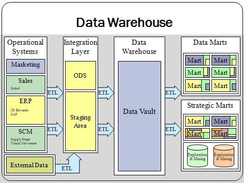

[[CAPTION:Figure]] Data Warehouse.

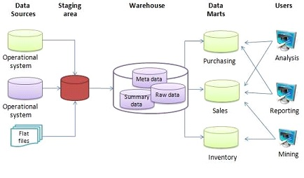

[[CAPTION:Figure]] Data Warehouse.

See also: [ETL](e.md#etl), [RDBMS](r.md#rdbms).

## DCE
**Data Circuit-terminating Equipment.** The device that connects a terminal or computer (the DTE) to a transmission line, such as a modem.

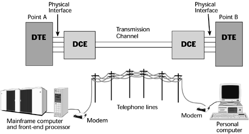

[[CAPTION:Figure]] DCE.

See also: [DTE](#dte).

## DDK
**Driver Development Kit.** The tools, libraries, headers and documentation needed to write device drivers for an operating system.

See also: [Driver](#driver), [SDK](s.md#sdk).

## DDOS
**Distributed Denial of Service.** An attack that floods a target with traffic from many sources at once, often a botnet, to make it unavailable to legitimate users. Because the traffic comes from everywhere, blocking one source does not stop it.

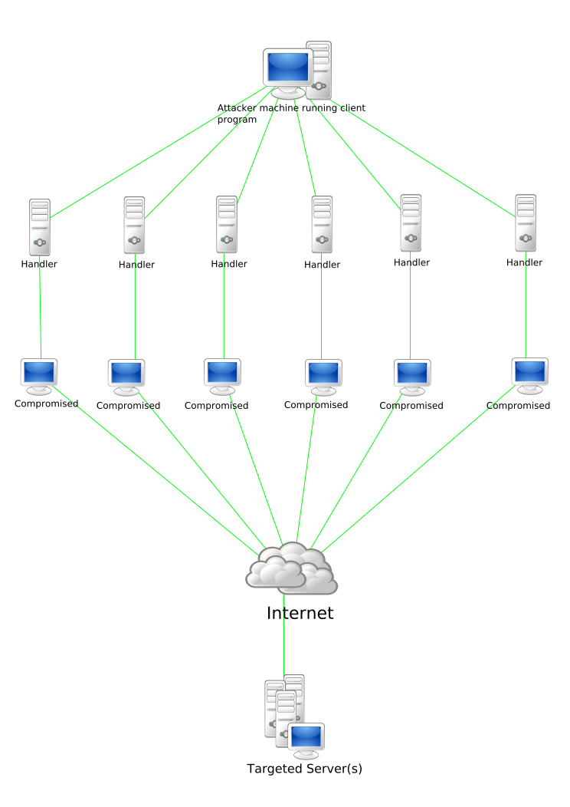

[[CAPTION:Figure]] DDOS.

See also: [Firewall](f.md#firewall), [IPS](i.md#ips).

## Decomposition Estimation
Estimating each part of a system after breaking it down. See [Bottom-Up Estimation](b.md#bottom-up-estimation).

## Defect
A flaw in a system, process or artefact that makes it fail to meet its specification, a standard or a reasonable expectation.

See also: [Bug](b.md#bug), [Defect Report](#defect-report), [Defect Management](#defect-management).

## Defect Management
Recording, prioritising, tracking and closing defects so that none are lost.

See also: [Defect](#defect), [Issue tracker](i.md#issue-tracker).

## Defect Report
A record asking for an artefact to be changed because it does not conform to a requirement or standard, or because it fails.

See also: [Defect](#defect).

## Definition of Done
**DoD.** A list, agreed by the team, of what must be true before a piece of work, such as a user story, counts as finished. It usually includes tests passing, review and documentation.

See also: [Definition of Ready](#definition-of-ready), [User Stories](u.md#user-stories).

## Definition of Ready
**DoR.** Criteria a backlog item must meet before the team takes it into an iteration, such as clear acceptance criteria and no blocking dependencies. Many teams base it on INVEST.

See also: [Definition of Done](#definition-of-done), [INVEST](i.md#invest), [Backlog Grooming](b.md#backlog-grooming).

## Deliverable
An artefact, or set of artefacts, that a project or piece of work hands over as its output.

See also: [Artefact](a.md#artefact), [Work Product](w.md#work-product).

## Delphi
Embarcadero's (originally Borland's) development environment for Object Pascal, an object-oriented descendant of Pascal. The language itself is often called Delphi too.

See also: [Pascal](p.md#pascal).

## Deployment
Installing a system and making it ready for use, including any integration and configuration for the particular site.

See also: [Deployment Plan](#deployment-plan), [Release](r.md#release).

## Deployment Lead
On projects with complex deployment needs, the person who plans and oversees deployment, and often operations and maintenance.

## Deployment Plan
A plan for releasing a system, covering the target platforms, the configuration to release and the steps to follow.

See also: [Deployment](#deployment), [Release Management](r.md#release-management).

## DER
**Distinguished Encoding Rules.** A restricted form of BER that allows exactly one encoding for each ASN.1 value. It is used where encodings must be unique, above all for data that is signed, such as X.509 certificates.

See also: [BER](b.md#ber), [CER](c.md#cer), [ASN.1](a.md#asn1), [X.509](x.md#x509).

## DES
**Data Encryption Standard.** A symmetric block cipher from IBM, published as a US federal standard in 1977, with a 64-bit block and a 56-bit key. The short key made it breakable by brute force by the late 1990s, and AES replaced it.

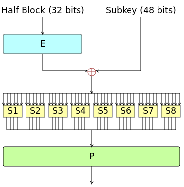

[[CAPTION:Figure]] DES.

See also: [Triple DES](t.md#triple-des), [AES](a.md#aes).

## Design
Software design: working out the structure of a system and the models and plans for implementing its requirements.

See also: [High Level Design](h.md#high-level-design), [Low Level Design](l.md#low-level-design), [Architecture](a.md#architecture).

## Design Lead
The person responsible for a system's architecture and for overseeing design work.

## Design Pattern
A general, reusable solution to a problem that keeps coming up in software design. A pattern is a description to adapt, not finished code. The Gang of Four book catalogued the best-known object-oriented patterns.

See also: [GoF](g.md#gof), [Pattern](p.md#pattern), [Antipattern](a.md#antipattern).

## Design to Tools
Deciding what goes into a system by what existing tools support directly, rather than by what users need.

## Desk Check
An informal review in which the author asks one or more colleagues to read an artefact and look for defects.

See also: [Review](r.md#review), [Walkthrough](w.md#walkthrough).

## Detailed Design
Design work below the architecture, covering parts of both high-level and low-level design.

See also: [High Level Design](h.md#high-level-design), [Low Level Design](l.md#low-level-design).

## Detailed Schedule
A fine-grained schedule of tasks, effort, people and dependencies, usually built bottom-up from a work plan. It often covers only the next few weeks and rolls forward.

See also: [Business Schedule](b.md#business-schedule), [Rolling Wave Planning](r.md#rolling-wave-planning), [Project Headlights](p.md#project-headlights).

## Developer
A software engineer, especially when doing design and construction.

## Developer Integration Test
**DIT.** An integration test that a developer runs in the system test environment after a project build, before releasing new functionality.

See also: [Integration Test](i.md#integration-test).

## Development Environment
The hardware, software and tools in which developers build and test software.

See also: [Local Development Environment](l.md#local-development-environment), [IDE](i.md#ide).

## Development process
The set of activities a team follows to develop software.

See also: [Lifecycle](l.md#lifecycle), [SDLC](s.md#sdlc).

## DevOps
A way of working that brings development and operations together, sharing responsibility for delivering and running software. It relies on automation of builds, tests, deployment and monitoring.

See also: [Continuous Integration](c.md#continuous-integration), [Continuous Deployment](c.md#continuous-deployment).

## DHCP
**Dynamic Host Configuration Protocol.** The protocol a device uses to get an IP address and other network settings, such as the gateway and DNS servers, from a server when it joins a network.

See also: [BOOTP](b.md#bootp), [DNS](#dns).

## Diagram
A graphical representation of a system, process or other information.

## DLE
**Digital Local Exchange.** A digital telephone exchange that connects subscribers' lines, either directly or through remote concentrators. In the UK these were System X and AXE 10 exchanges.

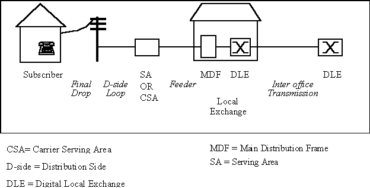

[[CAPTION:Figure]] DLE.

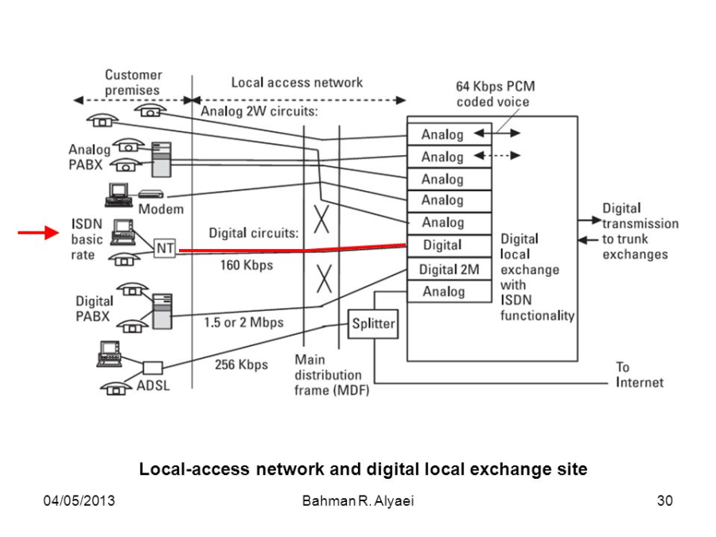

[[CAPTION:Figure]] DLE.

See also: [SystemX](s.md#systemx), [MDF](m.md#mdf), [Local Loop](l.md#local-loop).

## DLP
**Data Link Protocol.** Any protocol at the data link layer (layer 2) of the OSI model, such as Ethernet, Token Ring, FDDI or PPP. DLP also commonly stands for data loss prevention.

See also: [L2](l.md#l2).

## DMZ
**Demilitarised Zone.** A network segment that sits between the internet and an organisation's internal network, holding the services that outsiders need to reach, such as web and mail servers. Firewalls on both sides limit what each zone can reach.

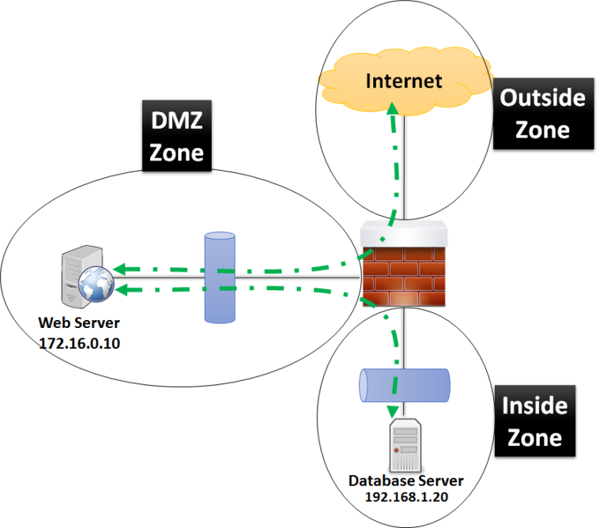

[[CAPTION:Figure]] DMZ.

See also: [Firewall](f.md#firewall).

## DN
**Directory Number.** A telephone number: the digits that identify a subscriber's line or device and route calls to it.

See also: [E.164](e.md#e164).

## DNB
A Dun & Bradstreet business file: a company's credit and identity record from Dun & Bradstreet.

## DNS
**Domain Name System.** The internet's distributed, hierarchical naming system. Its main job is to translate names such as `example.com` into IP addresses, but it holds many other kinds of record.

See also: [Domain Name](#domain-name), [FQDN](f.md#fqdn), [DNS - A](#dns-a), [DNS Spoofing](#dns-spoofing).

## DNS - A {#dns-a}
**Address record.** A DNS record that maps a name to an IPv4 address.

See also: [DNS - AAAA](#dns-aaaa), [DNS](#dns).

## DNS - AAAA {#dns-aaaa}
A DNS record that maps a name to an IPv6 address.

See also: [DNS - A](#dns-a), [IPv6](i.md#ipv6).

## DNS - CNAME {#dns-cname}
**Canonical name record.** A DNS record that makes one name an alias for another; the lookup carries on with the target name.

See also: [DNS - DNAME](#dns-dname).

## DNS - DNAME {#dns-dname}
A DNS record that makes a name, and every name under it, an alias for another domain. A CNAME aliases only the exact name.

See also: [DNS - CNAME](#dns-cname).

## DNS - SRV {#dns-srv}
**Service record.** A DNS record that gives the host and port for a named service, such as SIP or XMPP, together with priority and weight.

See also: [SIP](s.md#sip), [XMPP](x.md#xmpp).

## DNS - TXT {#dns-txt}
A DNS record that holds arbitrary text. It now mostly carries machine-readable data, such as SPF, DKIM and DMARC policies for email and domain ownership proofs.

## DNS Spoofing
An attack that puts false records into a DNS resolver's cache, so that it sends users to the wrong address, usually one the attacker controls. Also called DNS cache poisoning.

See also: [DNS](#dns), [ARP spoofing](a.md#arp-spoofing).

## DoD
See [Definition of Done](#definition-of-done).

## DoR
See [Definition of Ready](#definition-of-ready).

## Docker
A platform for building and running software in containers: packages that hold an application and its dependencies and run in isolation on a shared operating system kernel.

See also: [VM](v.md#vm).

## Document Collaboration
Tools that let several people work on the same document at once, from different places, to reach one final version. Wikis, Confluence and SharePoint are examples.

See also: [Wiki](w.md#wiki).

## Domain Name
A name registered in the DNS, such as `example.co.uk`, that identifies an area of administrative control on the internet. Names form a hierarchy under the unnamed root: top-level domains, then second-level domains, then subdomains.

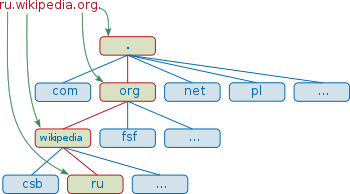

[[CAPTION:Figure]] Domain Name.

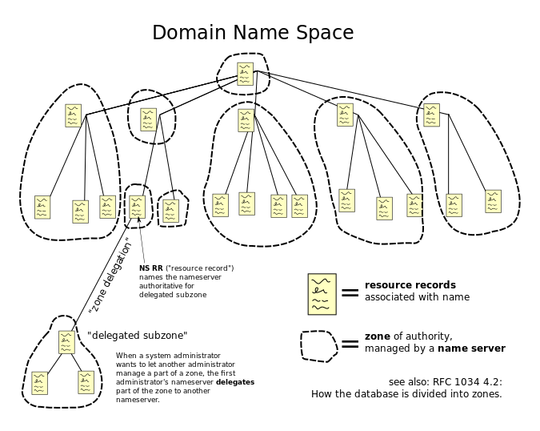

[[CAPTION:Figure]] Domain Name.

See also: [DNS](#dns), [FQDN](f.md#fqdn).

## Dot1Q
**IEEE 802.1Q.** The standard for VLANs on Ethernet. It adds a 4-byte tag to each frame with a 12-bit VLAN identifier and a 3-bit priority (802.1p).

See also: [VLAN](v.md#vlan), [Dot1Q trunking](#dot1q-trunking), [PCP](p.md#pcp).

## Dot1Q trunking
Carrying several VLANs over one link between switches. Each frame is tagged with its VLAN ID as it enters the trunk. The switch at the other end uses the tag to deliver it to ports in the same VLAN.

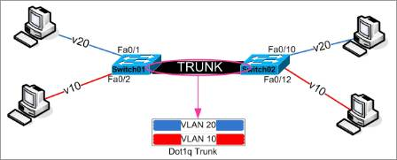

[[CAPTION:Figure]] Dot1Q trunking.

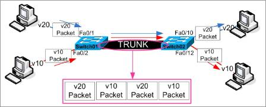

[[CAPTION:Figure]] Dot1Q trunking.

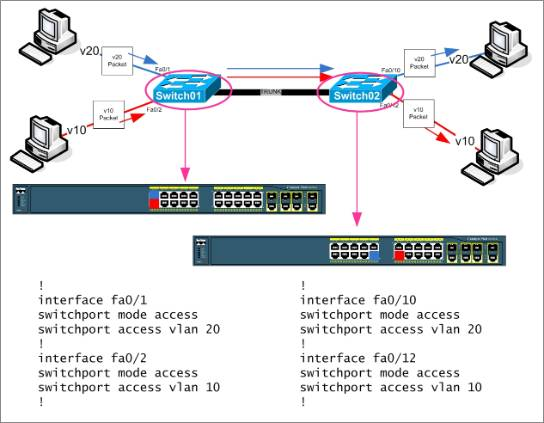

[[CAPTION:Figure]] Dot1Q trunking.

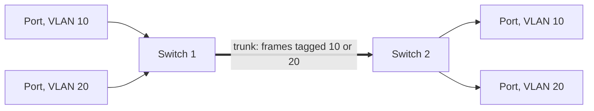

[[CAPTION:Figure]] Two VLANs sharing an 802.1Q trunk.

See also: [Dot1Q](#dot1q), [VLAN](v.md#vlan).

## Downstream
In a project, the later activities and artefacts, such as coding, testing and deployment. In networking, the direction towards the customer.

See also: [Upstream](u.md#upstream).

## DP
**Distribution Point.** In a UK access network, the point near the customer, often on a telegraph pole, where the drop wire to the premises joins the cable from the exchange. In fibre networks, the point where a fibre splits towards several premises.

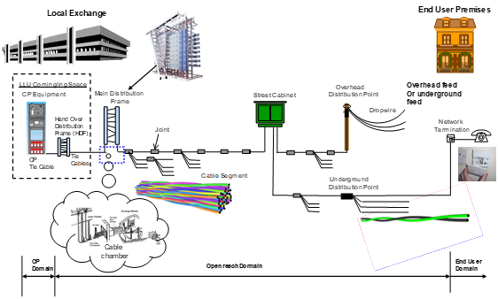

[[CAPTION:Figure]] DP.

See also: [Local Loop](l.md#local-loop), [PCP](p.md#pcp).

## DPI
**Deep Packet Inspection.** Examining the contents of packets, beyond the IP and transport headers, to classify, block, shape or log traffic. Firewalls, intrusion prevention and traffic management use it.

See also: [Firewall](f.md#firewall), [IPS](i.md#ips), [Packet sniffing](p.md#packet-sniffing).

## DPNSS
**Digital Private Network Signalling System.** A BT-defined protocol for linking PBXs over digital private circuits, with a common set of features across vendors. QSIG is the international equivalent.

See also: [QSIG](q.md#qsig), [DASS2](#dass2).

## DQ
**Data Quality.** How accurate, complete, consistent and timely data is for its purpose.

## Draft
An artefact under version control but not yet under change control.

See also: [Baseline](b.md#baseline).

## Driver
Software that lets an operating system and applications use a particular device, hiding the details of the hardware behind a standard interface.

See also: [DDK](#ddk), [Kernel](k.md#kernel).

## DSCP
**Differentiated Services Code Point.** A 6-bit field in the IP header that marks a packet's traffic class, so routers can give it the right treatment under DiffServ quality of service.

See also: [QoS](q.md#qos), [CoS](c.md#cos).

## DSDM
**Dynamic Systems Development Method.** An agile framework from the 1990s, built on rapid application development, that fixes time and cost and varies scope. It is now called the DSDM agile project framework.

See also: [Agile development](a.md#agile-development), [RAD](r.md#rad).

## DSL
**Digital Subscriber Line.** A family of technologies that carry digital data over copper telephone lines, using frequencies above voice. ADSL and VDSL are the most common.

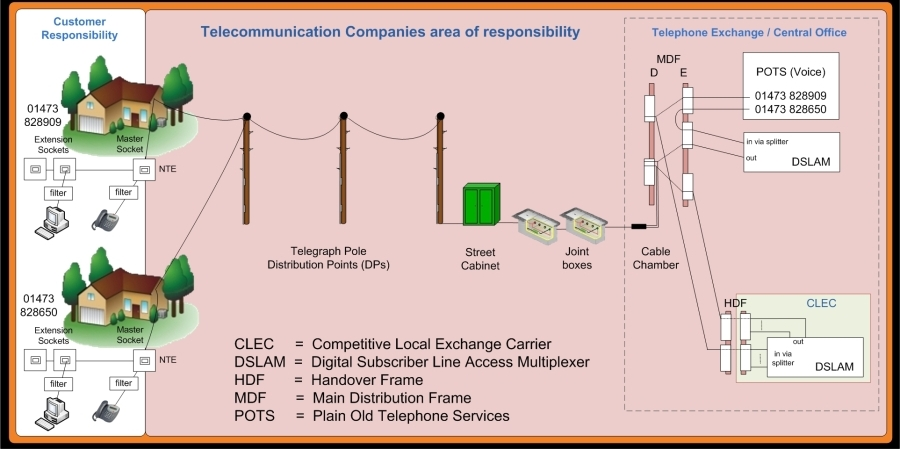

[[CAPTION:Figure]] DSL.

See also: [ADSL](a.md#adsl), [SDSL](s.md#sdsl), [VDSL](v.md#vdsl), [DSLAM](#dslam).

## DSLAM
**Digital Subscriber Line Access Multiplexer.** The equipment in an exchange or street cabinet that terminates many customers' DSL lines and combines their traffic onto one high-speed link.

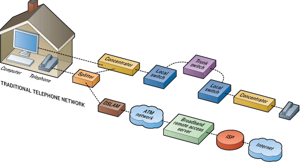

[[CAPTION:Figure]] DSLAM.

See also: [DSL](#dsl), [MSAN](m.md#msan), [BRAS](b.md#bras).

## DTE
**Data Terminal Equipment.** The device at the end of a data link that is the source or destination of data, such as a computer or terminal. It connects to the line through a DCE.

[[CAPTION:Figure]] DTE.

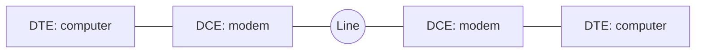

[[CAPTION:Figure]] DTEs connected through DCEs.

See also: [DCE](#dce).

## DTLS
**Datagram Transport Layer Security.** A version of TLS for datagram transports such as UDP, giving the same confidentiality, integrity and authentication. It is used by CoAP and LwM2M in IoT and by WebRTC. The current version is DTLS 1.3, in RFC 9147.

See also: [TLS](t.md#tls), [UDP](u.md#udp), [LwM2M](l.md#lwm2m).

## DTMF
**Dual-Tone Multi-Frequency.** Telephone signalling in which each key sends two tones at once, one from a low group and one from a high group. It is standardised as ITU-T Q.23, and BT calls it MF4.

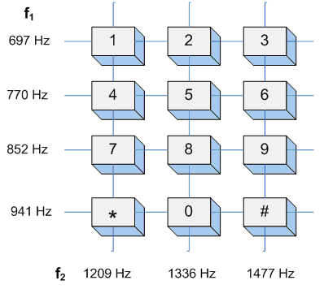

[[CAPTION:Figure]] DTMF.

See also: [IVR](i.md#ivr), [PSTN](p.md#pstn).

## DTT
**Digital Terrestrial Television.** Television broadcast digitally from ground-based transmitters, such as Freeview in the UK. It fits several channels into the spectrum one analogue channel used.

See also: [DTV](#dtv), [COFDM](c.md#cofdm).

## DTV
**Digital Television.** Television sent as digital signals rather than analogue, by terrestrial, satellite, cable or IP networks.

See also: [DTT](#dtt), [IPTV](i.md#iptv).

## Duplex
A link that can carry communication in both directions. In full duplex both sides can send at once; in half duplex they take turns. A simplex link carries one direction only.

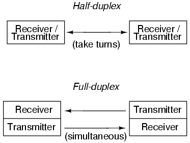

[[CAPTION:Figure]] Duplex.

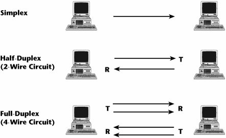

[[CAPTION:Figure]] Duplex.

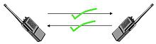

[[CAPTION:Figure]] Duplex.

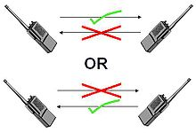

[[CAPTION:Figure]] Duplex.

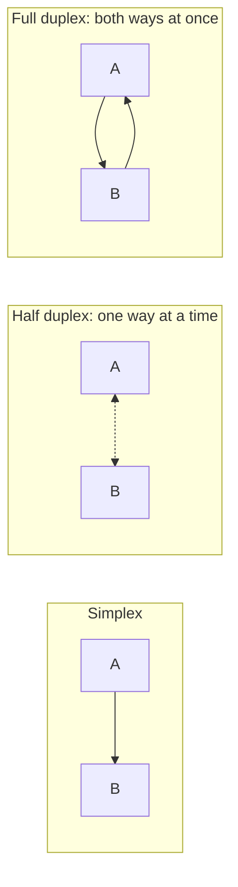

[[CAPTION:Figure]] Simplex, half duplex and full duplex.

See also: [Full duplex](f.md#full-duplex), [Half Duplex](h.md#half-duplex), [Simplex](s.md#simplex).

## DVSR
**Dynamically Verified Static Routing.** A Redback (later Ericsson) routing feature: a static route that the router adds to its table only while regular pings show the next hop is reachable.

See also: [Router](r.md#router).
