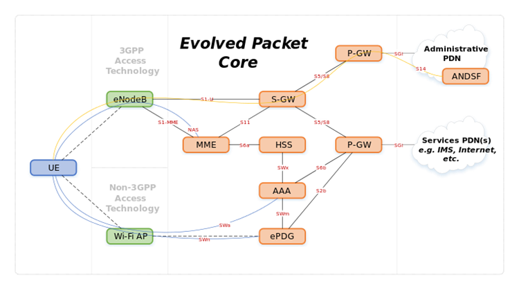
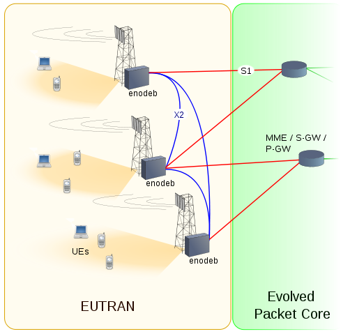
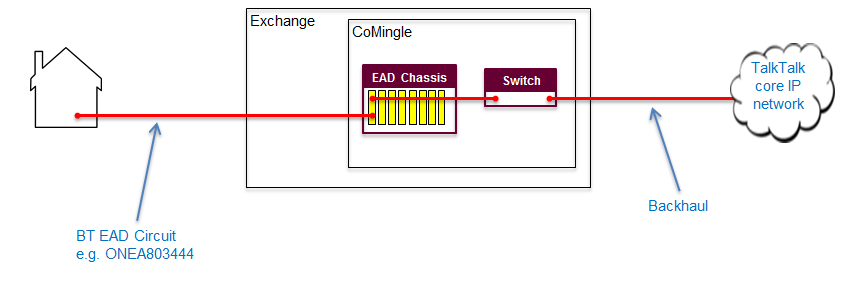
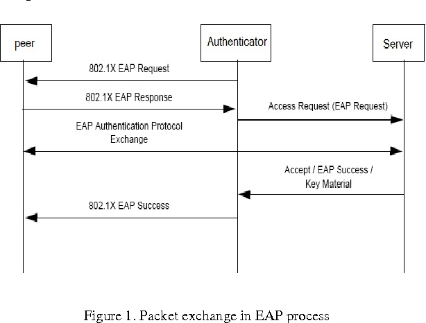
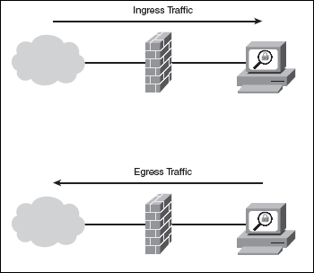
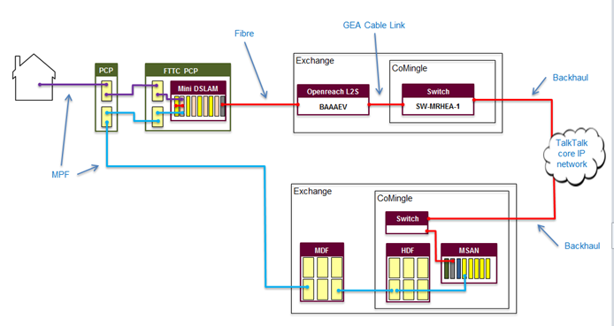
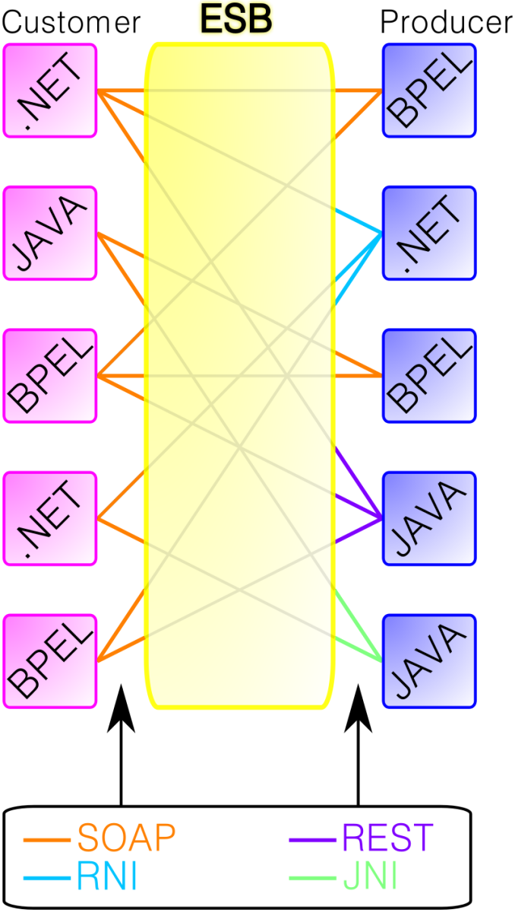
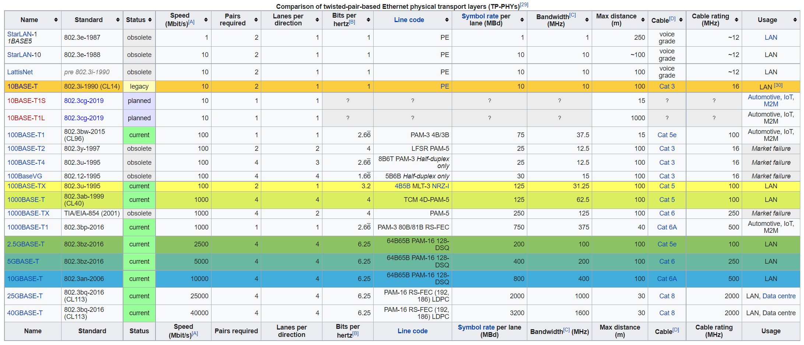
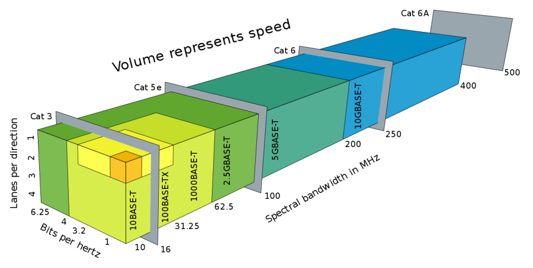
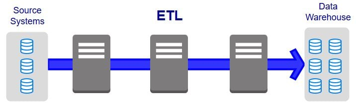

# E

## E NodeB
**Evolved Node B (eNodeB, eNB).** The LTE base station. Unlike a UMTS Node B, it has no separate controller: it handles radio resource management and handover itself, and connects directly to the core.

[[CAPTION:Figure]] E NodeB.

See also: [E-UTRAN](#e-utran), [Node B](n.md#node-b), [MME](m.md#mme), [LTE (4G)](l.md#lte-4g).

## E-UTRAN
**Evolved UMTS Terrestrial Radio Access Network.** The LTE radio access network: eNodeBs and the E-UTRA air interface, which uses OFDMA downstream and SC-FDMA upstream.

[[CAPTION:Figure]] E-UTRAN.

See also: [E NodeB](#e-nodeb), [UTRAN](u.md#utran), [LTE (4G)](l.md#lte-4g).

## E.164 {#e164}
The ITU-T recommendation for the international public telephone numbering plan. An E.164 number has at most 15 digits, starting with the country code, and is written with a leading `+`.

See also: [DN](d.md#dn).

## EAD
**Ethernet Access Direct.** Openreach's point-to-point fibre Ethernet circuit, used to connect business sites and for backhaul, at speeds up to 10 Gbit/s.

[[CAPTION:Figure]] EAD.

See also: [EoFTTC](#eofttc), [Leased Line](l.md#leased-line), [Backhaul](b.md#backhaul).

## EAP
**Extensible Authentication Protocol.** An authentication framework, defined in RFC 3748, that carries many authentication methods, such as EAP-TLS and PEAP. IEEE 802.1X uses it for network access control on Wi-Fi and wired networks.

[[CAPTION:Figure]] EAP.

See also: [PEAP](p.md#peap), [WPA2](w.md#wpa2), [Radius](r.md#radius).

## Earned Value
**EV.** A measure of progress that compares the value of the work completed with the work planned and its actual cost, to show schedule and cost variance.

See also: [Earned Value Management](#earned-value-management).

## Earned Value Management
**EVM.** Managing a project using earned value measures.

See also: [Earned Value](#earned-value).

## Echo
A delayed reflection of a signal. On telephone calls it comes from hybrids that convert between 2-wire and 4-wire circuits, or from a loudspeaker feeding back into a microphone. Delay makes it more noticeable.

See also: [Echo cancellation](#echo-cancellation), [Sidetone](s.md#sidetone).

## Echo cancellation
Removing echo from a call by modelling the echo path and subtracting an estimate of the echo from the incoming signal. It replaced echo suppression, which muted the return path while the far end was talking. Line echo cancellers handle network echo; acoustic echo cancellers handle loudspeaker-to-microphone echo.

See also: [Echo](#echo), [Echo Cancellation - G.168](#echo-cancellation-g168).

## Echo Cancellation - G.168 {#echo-cancellation-g168}
ITU-T Recommendation G.168, which specifies digital network echo cancellers. It covers their performance, how tones disable them for fax and data, and the laboratory tests to check them.

See also: [Echo cancellation](#echo-cancellation).

## EDB
**Emergency Database.** In UK telephony, the database that tells emergency services the address behind the number calling 999.

## EDGE
**Enhanced Data rates for GSM Evolution.** An upgrade to GSM data, also called EGPRS, that uses better modulation and coding to roughly triple GPRS speeds on the same radio channels.

See also: [GPRS](g.md#gprs), [GSM](g.md#gsm), [GERAN](g.md#geran).

## Editor
In an inspection, the person who makes the fixes to the artefact afterwards, usually its author.

See also: [Inspection](i.md#inspection).

## EFM
**Ethernet in the First Mile.** IEEE 802.3ah, which defines Ethernet over the access link between provider and customer, on copper or fibre, with its own management functions.

See also: [Ethernet over twisted pair](#ethernet-over-twisted-pair), [EoFTTC](#eofttc).

## Egress
Traffic leaving a network or a device, as opposed to ingress traffic coming in.

[[CAPTION:Figure]] Egress.

See also: [Ingress](i.md#ingress).

## EIA
**Electronic Industries Alliance.** A former US standards and trade body for electronics manufacturers, known for standards such as RS-232. It closed in 2011 and its work passed to other bodies, including the TIA.

See also: [TIA](t.md#tia).

## EIGRP
**Enhanced Interior Gateway Routing Protocol.** Cisco's advanced distance-vector routing protocol, which sends only incremental updates. It replaced IGRP in 1993 and was published as RFC 7868 in 2016.

See also: [IGRP](i.md#igrp), [OSPF](o.md#ospf), [IGP](i.md#igp).

## Embedded systems programming
Writing software for an embedded system, a computer built into a device, using the interfaces and limited resources the device provides.

See also: [RTOS](r.md#rtos), [MCU](m.md#mcu), [C Language](c.md#c-language).

## Engineering Discussion
A meeting to frame a problem and look for solutions. If materials go out beforehand for people to read, it is closer to a preview.

See also: [Preview](p.md#preview).

## Engineering Management
**EM.** Planning, staffing, tracking and controlling software projects, together with managing the teams and the organisation.

## Engineering Process
Software engineering process: defining how software engineering work is done, and improving it.

See also: [Process](p.md#process).

## EoFTTC
**Ethernet over FTTC.** A business Ethernet service over fibre to the cabinet: copper runs from the premises to the street cabinet, and fibre from there to the exchange. It gives symmetrical speeds of tens of megabits per second at lower cost than a fibre leased line.

[[CAPTION:Figure]] EoFTTC.

See also: [EAD](#ead), [VDSL](v.md#vdsl), [EFM](#efm).

## EoS
**Ethernet over SDH or SONET.** Protocols that carry Ethernet over SDH or SONET networks. They usually use the generic framing procedure (GFP) and virtual concatenation to fit the Ethernet rate into SDH paths.

See also: [SDH](s.md#sdh), [SONET](s.md#sonet).

## ePDG
**Evolved Packet Data Gateway.** The LTE core node that lets devices on untrusted non-3GPP access, such as public Wi-Fi, reach the mobile core through an IPsec tunnel. Wi-Fi calling relies on it.

See also: [PGW](p.md#pgw), [IPSec](i.md#ipsec), [ANDSF](a.md#andsf).

## Epic
A large user story, too big for one iteration, that is split into smaller stories.

See also: [User Stories](u.md#user-stories), [Story Splitting](s.md#story-splitting).

## EPWS
**Ethernet Private Wire Service.** A point-to-point Ethernet service between two customer sites, carried over the provider's network.

See also: [EVPL](#evpl), [VPWS](v.md#vpws).

## ESB
**Enterprise Service Bus.** Middleware in a service-oriented architecture that connects applications through a shared bus. It routes, transforms and mediates messages between them, so that each application integrates with the bus rather than with every other application.

[[CAPTION:Figure]] ESB.

See also: [SOA](s.md#soa), [Microservice](m.md#microservice).

## Estimate
The result of estimating: the predicted size, effort, cost or duration, with the inputs, assumptions and method behind it. It can be a full project estimate or a one-line task estimate.

See also: [Estimation](#estimation), [Project Estimate](p.md#project-estimate), [Task Estimate](t.md#task-estimate).

## Estimation
Working out the likely size, effort, cost, schedule or quality of a project. Several techniques used together give a better estimate than one, and estimates should be redone as the project goes on.

See also: [Estimate](#estimate), [Cone of Uncertainty](c.md#cone-of-uncertainty), [Planning Poker](p.md#planning-poker).

## Ethernet over twisted pair
Ethernet physical layers that use twisted-pair copper cable. 10BASE-T, 100BASE-TX, 1000BASE-T and 10GBASE-T are the main ones. Single-pair variants, such as 10BASE-T1L, serve industrial and automotive uses.

[[CAPTION:Figure]] Ethernet over twisted pair.

[[CAPTION:Figure]] Ethernet over twisted pair.

[[CAPTION:Figure]] Ethernet over twisted pair.

See also: [Cat 5](c.md#cat-5), [Cat 6](c.md#cat-6), [Twisted pair](t.md#twisted-pair).

## Ethical Hacking
Testing an organisation's security with its permission, using attackers' methods to find weaknesses before they do. Ethical hackers are also called white hats.

See also: [Pen testing](p.md#pen-testing).

## ETL
**Extract, Transform, Load.** The three steps for moving data into a data warehouse: read data from source systems, convert and clean it into the target form, and write it into the target.

[[CAPTION:Figure]] ETL.

See also: [Data Warehouse](d.md#data-warehouse).

## ETSI
**European Telecommunications Standards Institute.** The not-for-profit body, based in Sophia Antipolis in France, that sets European telecoms standards. Its work includes GSM, DECT and TETRA, and it is a founding partner of 3GPP.

See also: [ITU](i.md#itu), [GSM](g.md#gsm).

## EVC
**Ethernet Virtual Connection.** In Metro Ethernet Forum (MEF) terms, the association between two or more customer interfaces (UNIs) across a provider's network. It is a virtual pipe that defines which sites can exchange frames.

See also: [EVPL](#evpl), [UNI](u.md#uni).

## Evolutionary Delivery Lifecycle
A lifecycle that combines evolutionary prototyping with staged delivery.

See also: [Evolutionary Prototyping Lifecycle](#evolutionary-prototyping-lifecycle), [Staged Delivery Lifecycle](s.md#staged-delivery-lifecycle).

## Evolutionary Prototyping Lifecycle
A lifecycle in which a system grows from an initial concept through repeated prototypes until it is ready to deliver.

See also: [Lifecycle](l.md#lifecycle), [Iterative Development](i.md#iterative-development).

## EVPL
**Ethernet Virtual Private Line.** An MEF E-Line service that carries several point-to-point virtual connections over one customer interface, separated by VLAN. Its sibling, Ethernet Private Line (EPL), gives one transparent connection per port.

See also: [EVC](#evc), [EPWS](#epws).

## Expert Judgement
Estimating from the experience of people who know the work. It works best when combined with other techniques, such as analogy and decomposition.

See also: [Estimation](#estimation), [Analogy Estimation](a.md#analogy-estimation).

## Explicit Change Control
Change control of artefacts, such as requirements and plans, that a change control board manages directly.

See also: [Implicit Change Control](i.md#implicit-change-control), [Change Control Board](c.md#change-control-board).

## Explicit Risk Management
See [Extrinsic Risk Management](#extrinsic-risk-management).

## Exploratory Testing
Testing in which the tester learns about the software, designs tests and runs them all at once, rather than following a script.

See also: [Informal Testing](i.md#informal-testing).

## Extrinsic Risk Management
Formal risk management added to a project, such as keeping a top-ten risk list and reviewing it regularly.

See also: [Intrinsic Risk Management](i.md#intrinsic-risk-management), [Risk Management](r.md#risk-management).
