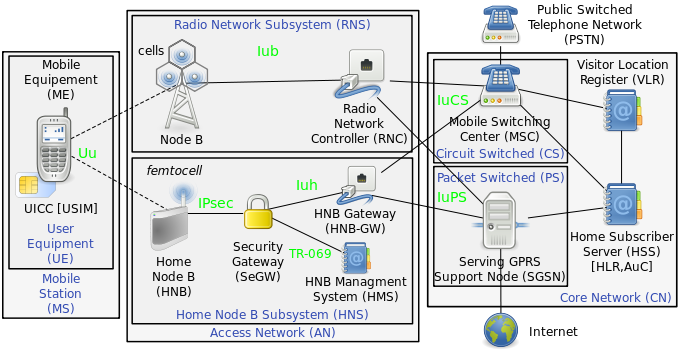
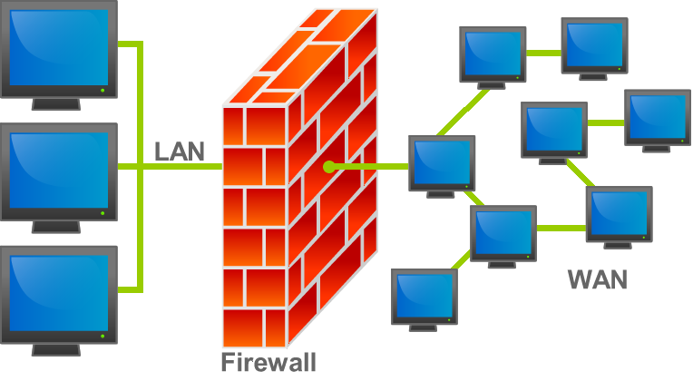
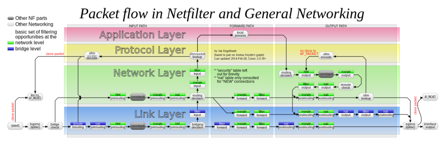
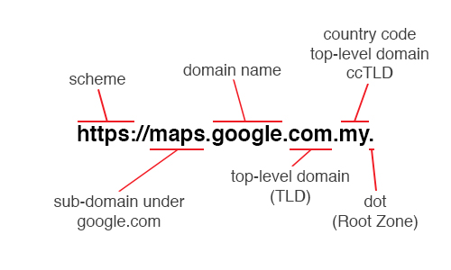
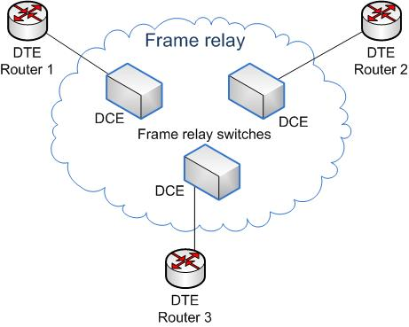
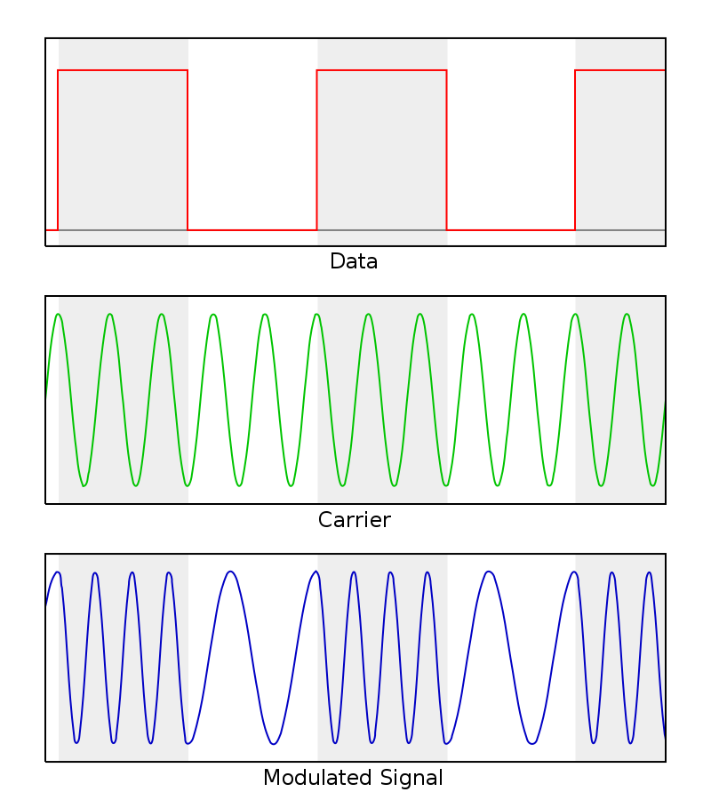
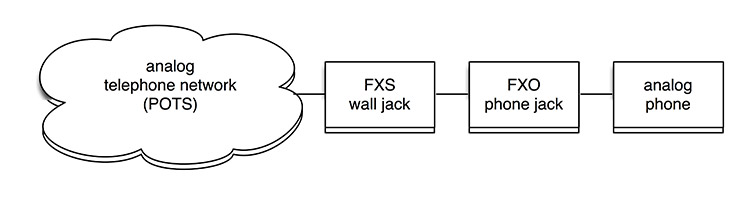

# F

## Facilitation
Running a meeting or workshop so the group reaches its goal, without taking part in the content. The person who does it is the facilitator.

## FCS
**Frame Check Sequence.** An error-detecting code, usually a CRC, added to the end of a frame. A receiver that finds a mismatch discards the frame; protocols higher up, such as TCP, recover the loss.

See also: [CRC](c.md#crc).

## FDDI
**Fibre Distributed Data Interface.** A 100 Mbit/s token-passing LAN standard over a dual fibre ring. Fast Ethernet made it obsolete.

See also: [Token Ring](t.md#token-ring), [100 Mbps (Fast Ethernet)](numbers.md#100-mbps-fast-ethernet).

## Feature
A piece of a system's functionality, seen from the user's side. The term also refers to a project's scope, measured in features.

See also: [Feature Test](#feature-test), [Feature creep](#feature-creep).

## Feature creep
The tendency for requirements to keep growing during a project, adding features that were never planned, at a cost to schedule and quality.

See also: [Change Control](c.md#change-control).

## Feature Test
A test of one area of system functionality once its construction is finished.

## FemtoCell
A small, low-power mobile base station for a home or small office, connected to the operator over the customer's broadband. It improves indoor coverage for a handful of phones.

[[CAPTION:Figure]] FemtoCell.

See also: [Mobile Cell](m.md#mobile-cell), [E NodeB](e.md#e-nodeb).

## FIPS
**Federal Information Processing Standards.** US federal government standards for computer systems, issued by NIST, covering areas such as cryptography where no suitable industry standard exists.

See also: [FIPS 140-2](#fips-140-2), [NIST](n.md#nist).

## FIPS 140-2
The US standard, from 2001, of security requirements for cryptographic modules. It defines four security levels and covers module design, ports, roles, physical security and key management. FIPS 140-3 replaced it in 2019, and 140-2 certificates are being retired.

See also: [FIPS](#fips), [NIST](n.md#nist).

## Firewall
A network security device or software that allows or blocks traffic by rules, usually between a trusted internal network and an untrusted one. Network firewalls protect whole networks; host-based firewalls protect one machine.

[[CAPTION:Figure]] Firewall.

[[CAPTION:Figure]] Firewall.

See also: [DMZ](d.md#dmz), [IPS](i.md#ips), [DPI](d.md#dpi).

## FNA
**Full Network Authentication.** A broadband login method in which the network authenticates the line itself, by its network identifier, through RADIUS, rather than a username and password typed by the customer.

See also: [Radius](r.md#radius), [PPPoE](p.md#pppoe).

## Formal Testing
Testing that follows documented test cases.

See also: [Informal Testing](i.md#informal-testing), [Test Case](t.md#test-case).

## Fortran
The first widely used high-level language, developed at IBM in the 1950s for scientific computing. Modern Fortran is still used for numerical work and supercomputing.

See also: [COBOL](c.md#cobol).

## Forwarding plane
See [Data Plane](d.md#data-plane).

## FOTA
**Firmware Over-The-Air.** Updating device firmware remotely over a wireless link. A safe design verifies a signature on each image and keeps two partitions, so a failed update rolls back. It also rolls updates out to the fleet in stages.

See also: [Root of Trust](r.md#root-of-trust), [LwM2M](l.md#lwm2m).

## FQDN
**Fully Qualified Domain Name.** A domain name that names every level of the DNS hierarchy down from the root, such as `www.example.com.`, so it can mean only one thing.

[[CAPTION:Figure]] FQDN.

See also: [Domain Name](d.md#domain-name), [DNS](d.md#dns).

## Frame Relay
A packet-switched WAN technology, widely sold by carriers in the 1990s, that connects sites through virtual circuits over a shared network. It was cheaper than leased lines; MPLS VPNs have since replaced it.

[[CAPTION:Figure]] Frame Relay.

See also: [X.25](x.md#x25), [PVC](p.md#pvc), [L3VPN](l.md#l3vpn).

## Frequent Releases
Putting the product into users' hands often, so the team gets feedback early and acts on it.

See also: [Continuous Deployment](c.md#continuous-deployment), [Release](r.md#release).

## Frequently Asked Question
**FAQ.** A list of common questions and their answers.

## FSK
**Frequency-Shift Keying.** Modulation that sends digital data by switching the carrier between frequencies; in binary FSK, one frequency for 1 and another for 0. Caller ID and early modems use it.

[[CAPTION:Figure]] FSK.

See also: [QAM](q.md#qam).

## FTP
**File Transfer Protocol.** A protocol for transferring files between a client and a server, using separate control and data connections. It sends credentials in clear text, so FTPS or SFTP should be used instead.

See also: [FTPS](#ftps), [SFTP](s.md#sftp).

## FTPS
**FTP Secure.** FTP with TLS encryption added. It is a different protocol from SFTP, which runs over SSH.

See also: [FTP](#ftp), [SFTP](s.md#sftp), [TLS](t.md#tls).

## Full duplex
Communication in which both ends can send and receive at the same time, like a telephone call.

See also: [Duplex](d.md#duplex), [Half Duplex](h.md#half-duplex).

## Function Point
A measure of software size based on the functionality it gives users, counted from its inputs, outputs, enquiries, files and interfaces.

See also: [Lines of Code](l.md#lines-of-code), [Estimation](e.md#estimation).

## Functional Requirement
Something a system must do to meet the business requirements. Also called a [What Requirement](w.md#what-requirement).

See also: [Non-functional Requirement](n.md#non-functional-requirement), [Business Requirement](b.md#business-requirement).

## Functional Testing
Testing a system's behaviour against what is expected, without regard to how it works inside. Also called black-box testing.

See also: [Black-Box Testing](b.md#black-box-testing).

## Fuzzy Front End
The early, ill-defined stage of a project, from the first idea to the approval of the project charter.

See also: [Project Charter](p.md#project-charter).

## Fuzzy Logic
In estimation, sorting items into rough size bands, such as small, medium and large, each standing for an overlapping range of values. In computing generally, fuzzy logic means reasoning with degrees of truth between 0 and 1.

See also: [T-Shirt Sizing](t.md#t-shirt-sizing), [Analogy Estimation](a.md#analogy-estimation).

## FXO
**Foreign Exchange Office.** The port on a device, such as a phone, fax or VoIP gateway, that plugs into an analogue telephone line and receives dial tone and ringing from it.

[[CAPTION:Figure]] FXO.

See also: [FXS](#fxs).

## FXS
**Foreign Exchange Station.** The port that provides an analogue telephone line: it supplies power, dial tone and ringing to the phone connected to it. An exchange line or an analogue adapter has FXS ports.

[[CAPTION:Figure]] FXS.

See also: [FXO](#fxo).
