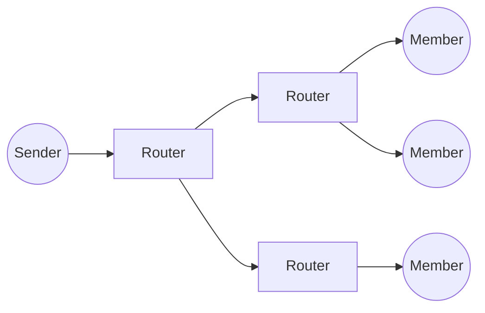
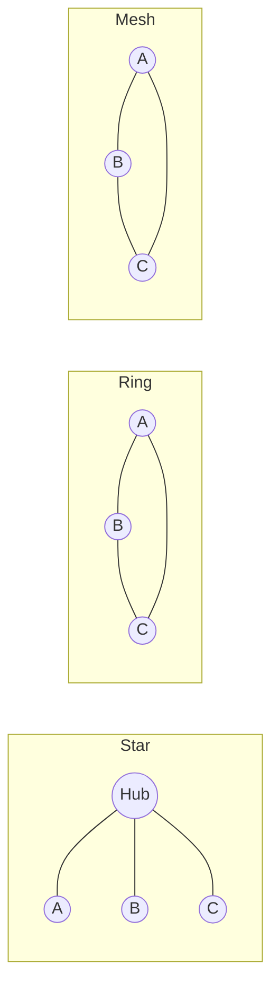

# L to N

## L

### L1
**Layer 1, the physical layer.** The lowest layer of the OSI model, which sends raw bits over a medium such as copper, fibre or radio. It defines the connectors, signals, timing and encoding.

See also: [L2](#l2), [Hub](g-k.md#hub).

### L2
**Layer 2, the data link layer.** The OSI layer that moves frames between devices on the same link or LAN segment, with local (MAC) addressing and error detection. Ethernet and Wi-Fi work here; switches forward traffic at this layer.

See also: [L1](#l1), [MAC](#mac), [Switch](s-z.md#switch), [DLP](d-f.md#dlp).

### L2F
**Layer 2 Forwarding.** A Cisco tunnelling protocol for carrying PPP sessions across an IP network. It has no encryption of its own, and L2TP replaced it.

See also: [L2TP](#l2tp), [PPTP](o-r.md#pptp).

### L2TP
**Layer 2 Tunnelling Protocol.** A protocol that tunnels PPP sessions over an IP network, used by ISPs to hand broadband sessions between networks and to build VPNs. It does not encrypt, so it is often run inside IPsec.

See also: [LAC](#lac), [LNS](#lns), [LTS](#lts), [IPSec](g-k.md#ipsec).

### L2VPN
**Layer 2 VPN.** A provider service that carries a customer's Ethernet or other layer-2 traffic between sites over the provider's MPLS network. The sites then appear to share one LAN or wire. Point-to-point and multipoint (VPLS) forms exist.

See also: [VPLS](s-z.md#vpls), [VPWS](s-z.md#vpws), [L3VPN](#l3vpn), [PW](o-r.md#pw).

### L3VPN
**Layer 3 VPN.** A provider service, usually MPLS-based as in RFC 4364, that routes a customer's IP traffic between sites. The provider edge routers keep each customer's routes in a separate VRF; customer edge routers connect to them, and provider core routers just switch labels.

See also: [VRF](s-z.md#vrf), [CE](a-c.md#ce), [L2VPN](#l2vpn), [LSP](#lsp).

### LAC
**L2TP Access Concentrator.** The device at one end of an L2TP tunnel that receives a user's PPP session and forwards it through the tunnel to the LNS.

See also: [L2TP](#l2tp), [LNS](#lns).

### LACP
**Link Aggregation Control Protocol.** The IEEE 802.1AX (formerly 802.3ad) protocol with which two devices agree to bundle several physical links into one logical link and check that each member is working.

See also: [LAG](#lag).

### LAG
**Link Aggregation Group.** Several physical links bundled into one logical link, to add capacity and survive the failure of a member. LACP usually manages it.

See also: [LACP](#lacp).

### LAN
**Local Area Network.** A network that connects devices within a limited area, such as a home, office or campus, usually with Ethernet and Wi-Fi.

See also: [WAN](s-z.md#wan), [MAN](#man).

### LANE
**LAN Emulation.** An ATM Forum standard that made an ATM network look like an Ethernet or Token Ring LAN to the devices attached to it.

See also: [ATM](a-c.md#atm).

### Latency
The delay between something being sent and it arriving. For telephone calls it is the mouth-to-ear delay, made up of codec, network and playout delays. ITU-T G.114 advises keeping one-way delay under about 150 ms for good conversation.

See also: [Jitter](g-k.md#jitter), [Jitter buffer](g-k.md#jitter-buffer), [Bandwidth](a-c.md#bandwidth).

### Lawful intercept
**LI.** Facilities in telecoms networks that let authorised agencies, with a warrant, intercept a named target's communications. Operators must provide them, through standardised interfaces. It differs from bulk surveillance in being targeted at individuals.

### LCR
**Least Cost Routing.** Choosing the route for each outgoing call by cost, across several carriers. Carriers revise their tables often, and PBXs can do the same for a business.

See also: [CPS](a-c.md#cps).

### LDAP
**Lightweight Directory Access Protocol.** An open protocol, defined in RFC 4511, for reading and updating directory services, such as a company's directory of users and groups. Active Directory supports it.

See also: [AD](a-c.md#ad), [Kerberos](g-k.md#kerberos).

### Lead Time
The time from a customer's request to its delivery. In software, often the time from a requirement being raised to it being met in production.

See also: [Kanban](g-k.md#kanban).

### Lean
A way of working, from Toyota's production system, that aims to deliver value to the customer by removing waste: anything that does not add value.

See also: [Lean programming](#lean-programming), [Kanban](g-k.md#kanban).

### Lean programming
Lean ideas applied to software development: removing waste, delivering fast, deciding as late as possible and building quality in.

See also: [Lean](#lean).

### Leased Line
A dedicated, symmetrical circuit between two points, rented for a fixed fee and always on. In the UK it is also called a private circuit. Businesses use leased lines to link sites and for internet access.

See also: [EAD](d-f.md#ead), [Dark Fibre](d-f.md#dark-fibre), [CSI](a-c.md#csi).

### LeSS
**Large-Scale Scrum.** A framework for scaling Scrum to many teams working on one product, with one product owner and one product backlog.

See also: [Scrum](s-z.md#scrum), [SAFe](s-z.md#safe), [DAD](d-f.md#dad).

### Lifecycle
A model of the activities from the first idea for a system to its retirement, usually divided into phases. Projects choose and tailor a lifecycle to suit their risks.

See also: [Waterfall](s-z.md#waterfall), [Spiral Lifecycle](s-z.md#spiral-lifecycle), [SDLC](s-z.md#sdlc), [Phase](o-r.md#phase).

### Lines of Code
**LOC.** A measure of software size as the number of source lines, usually counting neither comments nor blank lines. KLOC means thousands of lines.

See also: [Function Point](d-f.md#function-point).

### Linux
A family of free, open-source operating systems built on the Linux kernel, first released by Linus Torvalds in 1991. It is packaged in distributions, such as Debian, Ubuntu, Fedora and Red Hat Enterprise Linux. It runs most servers and embedded devices, and underlies Android.

See also: [GNU](g-k.md#gnu), [Unix](s-z.md#unix), [Kernel](g-k.md#kernel), [Android](a-c.md#android).

### Lisp
A family of languages, first specified in 1958, with a fully bracketed prefix syntax in which code and data share the same form. Common Lisp, Scheme and Clojure are its main dialects. Lisp introduced many ideas now common, such as garbage collection and the read-eval-print loop.

### LL
See [Local Loop](#local-loop).

### LNS
**L2TP Network Server.** The device at the far end of an L2TP tunnel from the LAC, which terminates the users' PPP sessions, typically at the ISP.

See also: [L2TP](#l2tp), [LAC](#lac), [LTS](#lts).

### Local Build
A build done in a developer's local development environment.

See also: [Project Build](o-r.md#project-build), [Build](a-c.md#build).

### Local Development Environment
**LDE.** A developer's own development environment, usually on their own machine.

See also: [Development Environment](d-f.md#development-environment), [Build Environment](a-c.md#build-environment).

### Local Loop
The line that connects a customer's premises to the operator's network, traditionally a copper pair to the local exchange. Also called the last mile or subscriber line.

See also: [MPF](#mpf), [MDF](#mdf), [DP](d-f.md#dp).

### Local Test Environment
The part of the local development environment used for construction testing.

See also: [Local Development Environment](#local-development-environment).

### LoFi Prototype
See [Low Fidelity Prototype](#low-fidelity-prototype).

### Low Fidelity Prototype
A rough mock-up of a system made with paper, sticky notes or simple drawings, used to explore ideas cheaply before building anything.

See also: [High Fidelity Prototype](g-k.md#high-fidelity-prototype), [Storyboard](s-z.md#storyboard).

### Low Level Design
**LLD.** The design level between high-level design and construction, detailed enough to build from directly.

See also: [High Level Design](g-k.md#high-level-design), [Detailed Design](d-f.md#detailed-design).

### LSP
**Label Switched Path.** A path through an MPLS network, set up by a protocol such as LDP or RSVP-TE. The first router adds a label, each router along the way swaps it, and the last removes it.

See also: [LSR](#lsr), [RSVP](o-r.md#rsvp), [L3VPN](#l3vpn).

### LSR
**Label Switch Router.** A router in the middle of an MPLS network that forwards packets by their labels alone.

See also: [LSP](#lsp).

### LTE (4G)
**Long-Term Evolution.** The 3GPP mobile standard (Release 8 onwards) that followed UMTS, with an OFDMA radio interface and an all-IP core, the Evolved Packet Core. LTE-Advanced meets the ITU's 4G requirements. Voice runs over IP as VoLTE.

See also: [E-UTRAN](d-f.md#e-utran), [E NodeB](d-f.md#e-nodeb), [MME](#mme), [S-GW](s-z.md#s-gw), [PGW](o-r.md#pgw), [VoLTE](s-z.md#volte).

### LTS
**L2TP Tunnel Switch.** A router between a LAC and an LNS that acts as both. It ends incoming L2TP tunnels and forwards the sessions through new tunnels to other LNSs, for example to different ISPs.

See also: [L2TP](#l2tp), [LAC](#lac), [LNS](#lns).

### Lua
A small, fast scripting language from Brazil, designed in 1993 to be embedded in applications through a simple C API. It is used widely in games and network equipment.

### LwM2M
**Lightweight Machine to Machine.** The OMA SpecWorks protocol for managing IoT devices and their data over CoAP, usually secured with DTLS. Devices expose standard objects, such as device information, connectivity and firmware update, so servers can manage different makers' devices in the same way.

See also: [M2M](#m2m), [DTLS](d-f.md#dtls), [CBOR](a-c.md#cbor), [FOTA](d-f.md#fota).

## M

### M2M
**Machine to Machine.** Direct communication between devices, such as meters, sensors and vehicles, and the systems that use their data, without people in the loop. It was the forerunner of the Internet of Things.

See also: [LwM2M](#lwm2m), [MQTT](#mqtt).

### MAC
**Medium Access Control.** The lower sublayer of the data link layer in IEEE 802 networks. It controls access to the shared medium and handles framing and hardware addressing; the logical link control (LLC) sublayer sits above it.

See also: [MAC Address](#mac-address), [L2](#l2), [CSMA](a-c.md#csma).

### MAC Address
**Media Access Control address.** The 48-bit hardware address of a network interface on Ethernet, Wi-Fi and other IEEE 802 networks. It is written as six hex pairs, such as `00:1A:2B:3C:4D:5E`. The first half normally identifies the manufacturer.

See also: [MAC](#mac), [MAC Spoofing](#mac-spoofing), [ARP spoofing](a-c.md#arp-spoofing).

### MAC Flooding
An attack that fills a switch's address table with fake MAC addresses. The switch then floods frames out of every port, letting the attacker see traffic meant for others.

See also: [Switch](s-z.md#switch), [MAC Spoofing](#mac-spoofing).

### MAC Spoofing
Changing the MAC address a network interface presents, usually through its driver, to pose as another device or hide its identity.

See also: [MAC Address](#mac-address), [ARP spoofing](a-c.md#arp-spoofing).

### Machine code
Instructions in the binary form a processor runs directly. People rarely write it by hand: compilers and assemblers produce it.

See also: [Compiler](a-c.md#compiler), [Compiled Language](a-c.md#compiled-language).

### Macro Estimation
Estimating something as a whole. See [Top-Down Estimation](s-z.md#top-down-estimation).

### Maintenance
Software maintenance: correcting, updating, adapting and operating software after its first release.

See also: [Maintenance Plan](#maintenance-plan).

### Maintenance Plan
A plan for maintaining a system after its first release.

### MAN
**Metropolitan Area Network.** A network that covers a city or region: larger than a LAN, smaller than a WAN, and often linking several LANs.

See also: [LAN](#lan), [WAN](s-z.md#wan).

### Management by Walking Around
**MBWA.** Managing through frequent, informal contact with the team, alongside formal tracking, to spot risks and problems early.

### Management Plane
The part of a network device or network that configures, monitors and manages it, through interfaces such as the CLI, SNMP or NETCONF.

See also: [Control Plane](a-c.md#control-plane), [Data Plane](d-f.md#data-plane), [SNMP](s-z.md#snmp).

### MANET
**Mobile Ad hoc Network.** A self-configuring wireless network of mobile devices with no fixed infrastructure, in which every device also routes traffic for the others.

See also: [WANET](s-z.md#wanet), [Wireless Mesh Network](s-z.md#wireless-mesh-network), [Geocast](g-k.md#geocast).

### Manual Testing
Testing in which a person runs the test cases and records the results.

See also: [Automated Testing](a-c.md#automated-testing).

### MAP
**Mobile Application Part.** The SS7 protocol with which GSM and UMTS core network nodes, such as the HLR, VLR, MSC and SGSN, exchange information. It covers location updates, authentication and SMS delivery.

See also: [SS7](s-z.md#ss7), [HLR](g-k.md#hlr), [VLR](s-z.md#vlr), [TCAP](s-z.md#tcap).

### MBMS
**Multimedia Broadcast Multicast Services.** 3GPP standards for broadcasting and multicasting content to many mobile devices at once. In LTE it is called eMBMS or LTE Broadcast.

See also: [Multicast](#multicast), [LTE (4G)](#lte-4g).

### MBORC
**Matters Beyond Our Reasonable Control.** A clause in Openreach contracts that relieves Openreach of its service-level obligations when an outside event, such as severe weather or third-party damage, prevents it from meeting them.

### MCU
**Microcontroller Unit.** A single chip with a processor core, flash and RAM, and peripherals, used in small embedded devices. It usually runs bare-metal code or an RTOS.

See also: [MPU](#mpu), [RTOS](o-r.md#rtos), [Embedded systems programming](d-f.md#embedded-systems-programming).

### MD5
**Message Digest 5.** A 128-bit hash function from 1991. It is broken for security uses because collisions are easy to make, so it should be used only as a checksum against accidental corruption.

See also: [SHA](s-z.md#sha), [Hash Function](g-k.md#hash-function).

### MDF
**Main Distribution Frame.** The frame in a telephone exchange where the external cables to customers are connected to the exchange's equipment by jumpers.

See also: [HDF](g-k.md#hdf), [Local Loop](#local-loop), [MPF](#mpf).

### Mediation
In telecoms, the systems that collect usage records, such as CDRs, from network elements, then clean, combine and convert them into the formats that billing, fraud and other systems need.

See also: [CDR](a-c.md#cdr), [OSS](o-r.md#oss).

### MELP
**Mixed-Excitation Linear Prediction.** A US military speech codec standard. Its enhanced version, MELPe, works at 2,400, 1,200 or 600 bit/s for secure and narrow-band radio links.

See also: [CVSD](a-c.md#cvsd), [Audio Codecs](a-c.md#audio-codecs).

### Metric
A measurement taken from a project, process or product to judge whether it has the qualities wanted.

See also: [KPI](g-k.md#kpi).

### MGCF
**Media Gateway Control Function.** In IMS, the function that converts call signalling between SIP and the circuit-switched network's ISUP or BICC, and controls the media gateway through H.248.

See also: [MGW](#mgw), [IMS](g-k.md#ims), [BGCF](a-c.md#bgcf).

### MGCP
**Media Gateway Control Protocol.** A VoIP protocol in which a central call agent controls simple media gateways and endpoints. It is an IETF informational RFC; H.248 is the formal standard for the same role.

See also: [H.248](g-k.md#h248), [Softswitch](s-z.md#softswitch).

### MGW
**Media Gateway.** A device that converts media between networks, typically between PCM on telephone circuits and RTP streams on IP. It also transcodes when the two sides use different codecs.

See also: [MGCF](#mgcf), [H.248](g-k.md#h248), [RTP](o-r.md#rtp).

### MIB
**Management Information Base.** The tree-structured set of objects that a device exposes for management, mostly through SNMP. Each object is identified by an object identifier (OID).

See also: [SNMP](s-z.md#snmp).

### Micro Estimation
Estimating the details of something. See [Bottom-Up Estimation](a-c.md#bottom-up-estimation).

### Microservice
An architecture style in which an application is a set of small services, each built around a business capability. Each can be deployed independently and communicates through lightweight APIs. It suits large systems with many teams, at the cost of operational complexity.

See also: [SOA](s-z.md#soa), [BFF](a-c.md#bff), [Docker](d-f.md#docker).

### Microstone
See [Miniature Milestone](#miniature-milestone).

### Mil-COTS
COTS products for military use. See [COTS](a-c.md#cots).

### Milestone
A significant point in a schedule, such as an achievement or a date.

See also: [Miniature Milestone](#miniature-milestone), [Business Schedule](a-c.md#business-schedule).

### Milestone Release
A release made for a milestone in the project plan.

### Milestone Retrospective
A detailed review by the team of a project's significant events, after a major milestone or at the end of the project.

See also: [Postmortem](o-r.md#postmortem), [Sprint retrospective](s-z.md#sprint-retrospective).

### Milestone Schedule
A business schedule that sets out the project's formal milestones.

See also: [Business Schedule](a-c.md#business-schedule).

### MIMO
**Multiple-Input, Multiple-Output.** Using several antennas at both ends of a radio link to send several data streams at once over the same channel, exploiting multipath propagation. Wi-Fi, LTE and 5G all rely on it.

See also: [SISO](s-z.md#siso), [SDMA](s-z.md#sdma), [Wi-Fi](s-z.md#wi-fi).

### Miniature Milestone
A small milestone, a day or two of work, that counts as either done or not done, never partly done. It makes progress easy to track.

See also: [Milestone](#milestone), [Inch-Pebble](g-k.md#inch-pebble).

### MME
**Mobility Management Entity.** The main control node of the LTE core. It authenticates users with the HSS, tracks and pages idle devices, chooses gateways and manages bearers and handovers.

See also: [HSS](g-k.md#hss), [S-GW](s-z.md#s-gw), [E NodeB](d-f.md#e-nodeb), [LTE (4G)](#lte-4g).

### MMF
**Minimum Marketable Feature.** The smallest feature that is worth releasing on its own because it gives users real value.

See also: [MVP](#mvp).

### MNC
**Mobile Network Code.** The two- or three-digit code that, with the mobile country code (MCC), identifies a mobile network. Both form the start of an IMSI.

See also: [IMSI](g-k.md#imsi).

### Mob Programming
The whole team working on the same thing, at the same time, in the same place, at one computer.

See also: [Pair Programming](o-r.md#pair-programming).

### Mobile Cell
The area served by one base station in a cellular network. Splitting coverage into cells lets the same frequencies be reused in cells further apart. Cell sizes range from a few metres to tens of kilometres.

See also: [BTS](a-c.md#bts), [FemtoCell](d-f.md#femtocell).

### Mock Objects
Stand-ins for real components, created for a test, that imitate the real behaviour and check how the code under test uses them.

See also: [Unit Testing](s-z.md#unit-testing), [TDD](s-z.md#tdd).

### Model
A simplified representation of a system or process, often as diagrams, that describes its important characteristics.

See also: [Modelling](#modelling), [UML](s-z.md#uml).

### Modelling
Using models in requirements and design work.

See also: [Model](#model).

### Moderator
The person who leads an inspection and makes sure it follows the process.

See also: [Inspection](g-k.md#inspection).

### MOS
**Mean Opinion Score.** A rating of perceived quality, especially of voice calls, on a scale from 1 (bad) to 5 (excellent). It is either the average of listeners' scores or estimated by an algorithm. ITU-T P.800 defines it.

| MOS | Quality | Impairment |
| --- | --- | --- |
| 5 | Excellent | Imperceptible |
| 4 | Good | Perceptible but not annoying |
| 3 | Fair | Slightly annoying |
| 2 | Poor | Annoying |
| 1 | Bad | Very annoying |

[[CAPTION:Table]] The MOS scale.

See also: [Latency](#latency), [Jitter](g-k.md#jitter).

### MP3
**MPEG-1 or MPEG-2 Audio Layer III.** A lossy audio coding format that removes sounds people are unlikely to hear. It made music files small enough to share and became the most common format for digital music.

See also: [AAC](a-c.md#aac), [MPEG](#mpeg).

### MPEG
**Moving Picture Experts Group.** The ISO and IEC working group that sets standards for audio and video coding, such as MPEG-2 and MPEG-4.

See also: [MPEG4](#mpeg4), [MP3](#mp3).

### MPEG4
**MPEG-4.** A family of ISO/IEC standards (14496) for coding audio and video. It includes AAC audio and the H.264 (AVC) video codec, widely used for streaming and broadcast.

See also: [MPEG](#mpeg), [AAC](a-c.md#aac).

### MPF
**Metallic Path Facility.** An Openreach product that gives another operator a whole copper line from the exchange to the customer, so the operator provides both voice and broadband.

See also: [SMPF](s-z.md#smpf), [Local Loop](#local-loop), [MDF](#mdf).

### MPU
**Microprocessor Unit.** A processor that relies on external memory and usually has a memory management unit, so it can run a full operating system such as Linux.

See also: [MCU](#mcu).

### MQTT
A lightweight publish-subscribe messaging protocol, over TCP, in which clients publish and subscribe to topics through a broker. It was designed in 1999 for low-bandwidth links, is an OASIS standard, and is widely used in IoT.

See also: [M2M](#m2m), [LwM2M](#lwm2m).

### MRF
**Media Resource Function.** In IMS, the function that plays announcements and tones, mixes conference audio and does other media processing.

See also: [IMS](g-k.md#ims).

### MRS
**Multiple Residence data.** Royal Mail address data that lists the separate homes, such as flats, behind a single delivery point.

### MRTIE
**Maximum Relative Time Interval Error.** A measure of clock stability in synchronised networks: the largest change in a clock's time error against a reference over a given observation interval.

See also: [PTP](o-r.md#ptp), [Jitter](g-k.md#jitter).

### MSAN
**Multi-Service Access Node.** Equipment in an exchange or cabinet that connects customers' lines to the core network and provides voice, ISDN and broadband from one platform. It replaces separate exchange line cards and DSLAMs.

See also: [DSLAM](d-f.md#dslam), [BT 21CN](a-c.md#bt-21cn), [NGN](#ngn).

### MSC
**Mobile Switching Centre.** The switch in a GSM or UMTS core network that sets up and routes voice calls and SMS, handles handovers between areas and produces charging records.

See also: [GMSC](g-k.md#gmsc), [HLR](g-k.md#hlr), [VLR](s-z.md#vlr), [BSC](a-c.md#bsc).

### MTP
**Message Transfer Part.** The lower levels (1 to 3) of SS7, which carry signalling messages reliably and in order between signalling points.

See also: [SS7](s-z.md#ss7), [SCCP](s-z.md#sccp).

### MTR
**Mean Time to Repair (MTTR).** The average time taken to restore failed equipment or a service to working order.

### MTU
**Maximum Transmission Unit.** The largest packet a network link can carry without fragmentation, 1,500 bytes on standard Ethernet. Tunnels add headers, so they reduce the usable MTU.

See also: [PDU](o-r.md#pdu).

### Mu-law
**µ-law.** A companding algorithm, one of the two variants of ITU-T G.711, used for 8-bit PCM speech in North America and Japan. It is also written u-law.

See also: [A-law](a-c.md#a-law), [G.711](g-k.md#g711).

### Multicast
Sending data to a group of receivers at once, with the network copying packets only where the paths divide. IPTV uses it, with receivers joining groups through IGMP.

[[CAPTION:Figure]] Multicast: one stream, copied only where the paths divide.

See also: [Unicast](s-z.md#unicast), [Broadcast](a-c.md#broadcast), [Anycast](a-c.md#anycast), [IGMP](g-k.md#igmp).

### Multiplex
Combining several signals or data streams onto one shared medium, by time, frequency, wavelength or code, and separating them again at the far end.

See also: [TDM](s-z.md#tdm), [OFDMA](o-r.md#ofdma), [CDMA](a-c.md#cdma).

### Mutex
A lock that lets only one thread at a time hold a shared resource, so threads cannot corrupt it by using it at once.

See also: [Mutual Exclusion](#mutual-exclusion), [Semaphore](s-z.md#semaphore).

### Mutual Exclusion
The requirement that only one thread at a time runs a critical section that uses a shared resource, to prevent race conditions. Edsger Dijkstra first described and solved the problem in 1965.

See also: [Mutex](#mutex), [Semaphore](s-z.md#semaphore).

### MVNE
**Mobile Virtual Network Enabler.** A company that provides MVNOs with the systems they need, such as billing, provisioning and network integration, without dealing with consumers itself.

See also: [MVNO](#mvno).

### MVNO
**Mobile Virtual Network Operator.** A mobile operator that sells services under its own brand but does not own the radio network. It buys capacity wholesale from a network operator.

See also: [MVNE](#mvne).

### MVP
**Minimum Viable Product.** The first version of a product built to learn as much as possible about customers with the least effort, as described by Eric Ries.

See also: [MMF](#mmf), [Customer Development](a-c.md#customer-development).

## N

### NaaS
**Network as a Service.** Network connectivity, such as VPNs and bandwidth on demand, offered as a cloud-style service, often built on network virtualisation.

See also: [IaaS](g-k.md#iaas), [SDN](s-z.md#sdn).

### NAPT
**Network Address and Port Translation.** NAT that also rewrites port numbers, so that many private hosts can share one public IP address. It is also called PAT or IP masquerading.

See also: [NAT](#nat).

### NAS
**Network Access Server.** A device that gives users access to a network, such as a dial-up or broadband access server. It usually authenticates them through RADIUS. In LTE, NAS also stands for the non-access stratum: the signalling between the device and the core.

See also: [Radius](o-r.md#radius), [BRAS](a-c.md#bras).

### NAT
**Network Address Translation.** Rewriting IP addresses in packets as they pass through a router, usually so that a private network can share public addresses. It has kept IPv4 going despite address exhaustion, but it complicates peer-to-peer protocols.

See also: [NAPT](#napt), [STUN](s-z.md#stun), [ICE](g-k.md#ice), [IPv4](g-k.md#ipv4).

### Native Risk Management
See [Intrinsic Risk Management](g-k.md#intrinsic-risk-management).

### NB-IoT
**Narrowband IoT.** A 3GPP low-power, wide-area radio technology for simple IoT devices, such as meters, that send little data and must run for years on a battery.

See also: [LTE (4G)](#lte-4g), [LwM2M](#lwm2m).

### NBAP
**Node B Application Part.** The UMTS signalling protocol on the Iub interface with which the RNC controls a Node B, setting up cells and radio links.

See also: [Node B](#node-b), [RNC](o-r.md#rnc), [UTRAN](s-z.md#utran).

### NCSC
**National Cyber Security Centre.** The UK's technical authority on cyber security, part of GCHQ, which advises government, businesses and the public. It opened in 2016.

See also: [GCHQ](g-k.md#gchq), [CESG](a-c.md#cesg).

### Network Topologies
The arrangement of a network's nodes and links, such as bus, star, ring, mesh or tree. The physical topology is how it is cabled; the logical topology is how data flows.

[[CAPTION:Figure]] Star, ring and mesh topologies.

### NFS
**Network File System.** A protocol, first developed by Sun in 1984, that lets a computer use files on a remote server as if they were local.

### NGN
**Next-Generation Network.** A packet-based network, usually all-IP, that carries every service, voice included, with service control separate from transport. ITU-T and ETSI TISPAN defined NGN architectures in the 2000s, and IMS became their service layer.

See also: [IMS](g-k.md#ims), [BT 21CN](a-c.md#bt-21cn), [Softswitch](s-z.md#softswitch).

### NGWFQ
A form of weighted fair queuing. Weighted fair queuing shares a link's capacity between flows or classes in proportion to weights set for each.

See also: [PWFQ](o-r.md#pwfq), [QoS](o-r.md#qos).

### Niko-niko Calendar
A calendar on which each team member records their mood each day, often with a smiley face, to show patterns in how the team feels.

See also: [Information Radiators](g-k.md#information-radiators).

### NIST
**National Institute of Standards and Technology.** The US agency that maintains measurement standards and publishes widely used computer security standards and guidance, such as FIPS and the SP 800 series.

See also: [FIPS](d-f.md#fips), [AES](a-c.md#aes).

### NNI
**Network-to-Network Interface.** The interface between two networks, or two parts of one network, with its signalling and management. It differs from the user-network interface (UNI), between a network and its customer.

See also: [UNI](s-z.md#uni).

### NNTP
**Network News Transfer Protocol.** The protocol, first defined in RFC 977 in 1986, for distributing, reading and posting Usenet news articles.

### NOC
**Network Operations Centre.** The place from which an operator monitors and manages its network.

### Node B
The UMTS base station, the equivalent of the GSM BTS. It handles the radio link with mobile devices, under the control of an RNC.

See also: [RNC](o-r.md#rnc), [BTS](a-c.md#bts), [E NodeB](d-f.md#e-nodeb), [NBAP](#nbap).

### Nominal Path
The path through a system's behaviour where everything goes as expected, with no errors or exceptions. Also called the happy path.

See also: [Use Case](s-z.md#use-case), [Happy Path](g-k.md#happy-path).

### Non-functional Requirement
A requirement about how well a system works rather than what it does, such as performance, reliability, security, usability or compatibility. Also called a quality attribute.

See also: [Functional Requirement](d-f.md#functional-requirement), [How Requirement](g-k.md#how-requirement).

### NoSQL
Databases that store data in forms other than relational tables, such as key-value, document, wide-column or graph stores. They often trade strict consistency for easier horizontal scaling.

See also: [RDBMS](o-r.md#rdbms), [SQL](s-z.md#sql).

### NPE
**Network Provider Edge.** A provider edge (PE) router, which connects customer networks or other providers' networks to a provider's core.

See also: [CE](a-c.md#ce), [L3VPN](#l3vpn).

### NSS
**Network Switching Subsystem.** The GSM core network: the MSCs, HLR, VLR and related nodes that switch calls and manage mobility. GPRS added a packet core alongside it.

See also: [MSC](#msc), [HLR](g-k.md#hlr), [GSM](g-k.md#gsm).

### NTP
**Network Time Protocol.** The protocol that synchronises computer clocks over packet networks. It gets within tens of milliseconds of UTC over the internet, and usually within a millisecond on a LAN.

See also: [SNTP](s-z.md#sntp), [PTP](o-r.md#ptp), [UTC](s-z.md#utc).

### NTS
**Number Translation Service.** A non-geographic number, such as a UK 08 number, that the network translates to an ordinary number, so the destination can change without changing the published number.

See also: [IN](g-k.md#in).

### NTU
**Network Terminating Unit.** The device that marks the boundary between the operator's line and the customer's equipment, and gives a point for testing the line.

See also: [CPE](a-c.md#cpe).

### NYB
**Not Yet Built.** Royal Mail address data for properties that are planned or under construction.
