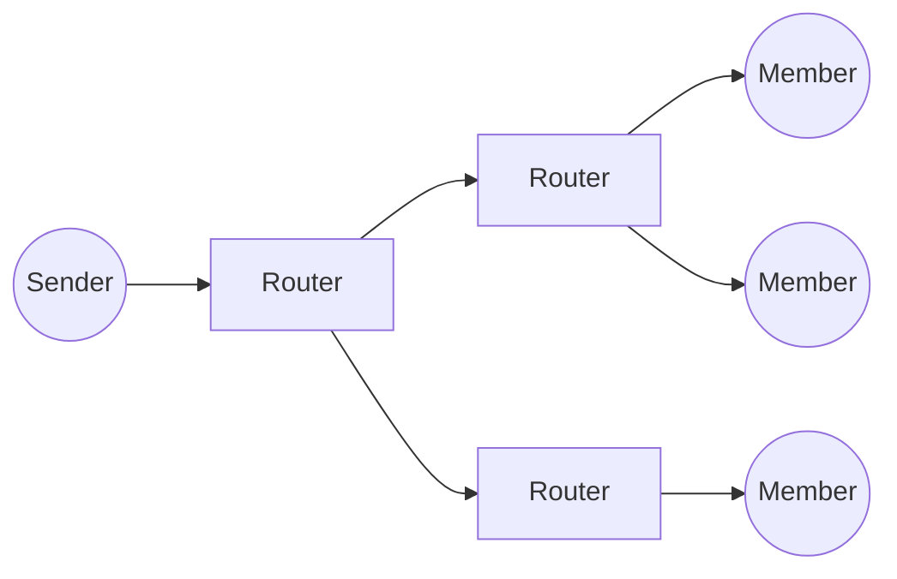

# M

## M2M
**Machine to Machine.** Direct communication between devices, such as meters, sensors and vehicles, and the systems that use their data, without people in the loop. It was the forerunner of the Internet of Things.

See also: [LwM2M](l.md#lwm2m), [MQTT](#mqtt).

## MAC
**Medium Access Control.** The lower sublayer of the data link layer in IEEE 802 networks. It controls access to the shared medium and handles framing and hardware addressing; the logical link control (LLC) sublayer sits above it.

See also: [MAC Address](#mac-address), [L2](l.md#l2), [CSMA](c.md#csma).

## MAC Address
**Media Access Control address.** The 48-bit hardware address of a network interface on Ethernet, Wi-Fi and other IEEE 802 networks. It is written as six hex pairs, such as `00:1A:2B:3C:4D:5E`. The first half normally identifies the manufacturer.

See also: [MAC](#mac), [MAC Spoofing](#mac-spoofing), [ARP spoofing](a.md#arp-spoofing).

## MAC Flooding
An attack that fills a switch's address table with fake MAC addresses. The switch then floods frames out of every port, letting the attacker see traffic meant for others.

See also: [Switch](s.md#switch), [MAC Spoofing](#mac-spoofing).

## MAC Spoofing
Changing the MAC address a network interface presents, usually through its driver, to pose as another device or hide its identity.

See also: [MAC Address](#mac-address), [ARP spoofing](a.md#arp-spoofing).

## Machine code
Instructions in the binary form a processor runs directly. People rarely write it by hand: compilers and assemblers produce it.

See also: [Compiler](c.md#compiler), [Compiled Language](c.md#compiled-language).

## Macro Estimation
Estimating something as a whole. See [Top-Down Estimation](t.md#top-down-estimation).

## Maintenance
Software maintenance: correcting, updating, adapting and operating software after its first release.

See also: [Maintenance Plan](#maintenance-plan).

## Maintenance Plan
A plan for maintaining a system after its first release.

## MAN
**Metropolitan Area Network.** A network that covers a city or region: larger than a LAN, smaller than a WAN, and often linking several LANs.

See also: [LAN](l.md#lan), [WAN](w.md#wan).

## Management by Walking Around
**MBWA.** Managing through frequent, informal contact with the team, alongside formal tracking, to spot risks and problems early.

## Management Plane
The part of a network device or network that configures, monitors and manages it, through interfaces such as the CLI, SNMP or NETCONF.

See also: [Control Plane](c.md#control-plane), [Data Plane](d.md#data-plane), [SNMP](s.md#snmp).

## MANET
**Mobile Ad hoc Network.** A self-configuring wireless network of mobile devices with no fixed infrastructure, in which every device also routes traffic for the others.

See also: [WANET](w.md#wanet), [Wireless Mesh Network](w.md#wireless-mesh-network), [Geocast](g.md#geocast).

## Manual Testing
Testing in which a person runs the test cases and records the results.

See also: [Automated Testing](a.md#automated-testing).

## MAP
**Mobile Application Part.** The SS7 protocol with which GSM and UMTS core network nodes, such as the HLR, VLR, MSC and SGSN, exchange information. It covers location updates, authentication and SMS delivery.

See also: [SS7](s.md#ss7), [HLR](h.md#hlr), [VLR](v.md#vlr), [TCAP](t.md#tcap).

## MBMS
**Multimedia Broadcast Multicast Services.** 3GPP standards for broadcasting and multicasting content to many mobile devices at once. In LTE it is called eMBMS or LTE Broadcast.

See also: [Multicast](#multicast), [LTE (4G)](l.md#lte-4g).

## MBORC
**Matters Beyond Our Reasonable Control.** A clause in Openreach contracts that relieves Openreach of its service-level obligations when an outside event, such as severe weather or third-party damage, prevents it from meeting them.

## MCU
**Microcontroller Unit.** A single chip with a processor core, flash and RAM, and peripherals, used in small embedded devices. It usually runs bare-metal code or an RTOS.

See also: [MPU](#mpu), [RTOS](r.md#rtos), [Embedded systems programming](e.md#embedded-systems-programming).

## MD5
**Message Digest 5.** A 128-bit hash function from 1991. It is broken for security uses because collisions are easy to make, so it should be used only as a checksum against accidental corruption.

See also: [SHA](s.md#sha), [Hash Function](h.md#hash-function).

## MDF
**Main Distribution Frame.** The frame in a telephone exchange where the external cables to customers are connected to the exchange's equipment by jumpers.

See also: [HDF](h.md#hdf), [Local Loop](l.md#local-loop), [MPF](#mpf).

## Mediation
In telecoms, the systems that collect usage records, such as CDRs, from network elements, then clean, combine and convert them into the formats that billing, fraud and other systems need.

See also: [CDR](c.md#cdr), [OSS](o.md#oss).

## MELP
**Mixed-Excitation Linear Prediction.** A US military speech codec standard. Its enhanced version, MELPe, works at 2,400, 1,200 or 600 bit/s for secure and narrow-band radio links.

See also: [CVSD](c.md#cvsd), [Audio Codecs](a.md#audio-codecs).

## Metric
A measurement taken from a project, process or product to judge whether it has the qualities wanted.

See also: [KPI](k.md#kpi).

## MGCF
**Media Gateway Control Function.** In IMS, the function that converts call signalling between SIP and the circuit-switched network's ISUP or BICC, and controls the media gateway through H.248.

See also: [MGW](#mgw), [IMS](i.md#ims), [BGCF](b.md#bgcf).

## MGCP
**Media Gateway Control Protocol.** A VoIP protocol in which a central call agent controls simple media gateways and endpoints. It is an IETF informational RFC; H.248 is the formal standard for the same role.

See also: [H.248](h.md#h248), [Softswitch](s.md#softswitch).

## MGW
**Media Gateway.** A device that converts media between networks, typically between PCM on telephone circuits and RTP streams on IP. It also transcodes when the two sides use different codecs.

See also: [MGCF](#mgcf), [H.248](h.md#h248), [RTP](r.md#rtp).

## MIB
**Management Information Base.** The tree-structured set of objects that a device exposes for management, mostly through SNMP. Each object is identified by an object identifier (OID).

See also: [SNMP](s.md#snmp).

## Micro Estimation
Estimating the details of something. See [Bottom-Up Estimation](b.md#bottom-up-estimation).

## Microservice
An architecture style in which an application is a set of small services, each built around a business capability. Each can be deployed independently and communicates through lightweight APIs. It suits large systems with many teams, at the cost of operational complexity.

See also: [SOA](s.md#soa), [BFF](b.md#bff), [Docker](d.md#docker).

## Microstone
See [Miniature Milestone](#miniature-milestone).

## Mil-COTS
COTS products for military use. See [COTS](c.md#cots).

## Milestone
A significant point in a schedule, such as an achievement or a date.

See also: [Miniature Milestone](#miniature-milestone), [Business Schedule](b.md#business-schedule).

## Milestone Release
A release made for a milestone in the project plan.

## Milestone Retrospective
A detailed review by the team of a project's significant events, after a major milestone or at the end of the project.

See also: [Postmortem](p.md#postmortem), [Sprint retrospective](s.md#sprint-retrospective).

## Milestone Schedule
A business schedule that sets out the project's formal milestones.

See also: [Business Schedule](b.md#business-schedule).

## MIMO
**Multiple-Input, Multiple-Output.** Using several antennas at both ends of a radio link to send several data streams at once over the same channel, exploiting multipath propagation. Wi-Fi, LTE and 5G all rely on it.

See also: [SISO](s.md#siso), [SDMA](s.md#sdma), [Wi-Fi](w.md#wi-fi).

## Miniature Milestone
A small milestone, a day or two of work, that counts as either done or not done, never partly done. It makes progress easy to track.

See also: [Milestone](#milestone), [Inch-Pebble](i.md#inch-pebble).

## MME
**Mobility Management Entity.** The main control node of the LTE core. It authenticates users with the HSS, tracks and pages idle devices, chooses gateways and manages bearers and handovers.

See also: [HSS](h.md#hss), [S-GW](s.md#s-gw), [E NodeB](e.md#e-nodeb), [LTE (4G)](l.md#lte-4g).

## MMF
**Minimum Marketable Feature.** The smallest feature that is worth releasing on its own because it gives users real value.

See also: [MVP](#mvp).

## MNC
**Mobile Network Code.** The two- or three-digit code that, with the mobile country code (MCC), identifies a mobile network. Both form the start of an IMSI.

See also: [IMSI](i.md#imsi).

## Mob Programming
The whole team working on the same thing, at the same time, in the same place, at one computer.

See also: [Pair Programming](p.md#pair-programming).

## Mobile Cell
The area served by one base station in a cellular network. Splitting coverage into cells lets the same frequencies be reused in cells further apart. Cell sizes range from a few metres to tens of kilometres.

See also: [BTS](b.md#bts), [FemtoCell](f.md#femtocell).

## Mock Objects
Stand-ins for real components, created for a test, that imitate the real behaviour and check how the code under test uses them.

See also: [Unit Testing](u.md#unit-testing), [TDD](t.md#tdd).

## Model
A simplified representation of a system or process, often as diagrams, that describes its important characteristics.

See also: [Modelling](#modelling), [UML](u.md#uml).

## Modelling
Using models in requirements and design work.

See also: [Model](#model).

## Moderator
The person who leads an inspection and makes sure it follows the process.

See also: [Inspection](i.md#inspection).

## MOS
**Mean Opinion Score.** A rating of perceived quality, especially of voice calls, on a scale from 1 (bad) to 5 (excellent). It is either the average of listeners' scores or estimated by an algorithm. ITU-T P.800 defines it.

| MOS | Quality | Impairment |
| --- | --- | --- |
| 5 | Excellent | Imperceptible |
| 4 | Good | Perceptible but not annoying |
| 3 | Fair | Slightly annoying |
| 2 | Poor | Annoying |
| 1 | Bad | Very annoying |

[[CAPTION:Table]] The MOS scale.

See also: [Latency](l.md#latency), [Jitter](j.md#jitter).

## MP3
**MPEG-1 or MPEG-2 Audio Layer III.** A lossy audio coding format that removes sounds people are unlikely to hear. It made music files small enough to share and became the most common format for digital music.

See also: [AAC](a.md#aac), [MPEG](#mpeg).

## MPEG
**Moving Picture Experts Group.** The ISO and IEC working group that sets standards for audio and video coding, such as MPEG-2 and MPEG-4.

See also: [MPEG4](#mpeg4), [MP3](#mp3).

## MPEG4
**MPEG-4.** A family of ISO/IEC standards (14496) for coding audio and video. It includes AAC audio and the H.264 (AVC) video codec, widely used for streaming and broadcast.

See also: [MPEG](#mpeg), [AAC](a.md#aac).

## MPF
**Metallic Path Facility.** An Openreach product that gives another operator a whole copper line from the exchange to the customer, so the operator provides both voice and broadband.

See also: [SMPF](s.md#smpf), [Local Loop](l.md#local-loop), [MDF](#mdf).

## MPU
**Microprocessor Unit.** A processor that relies on external memory and usually has a memory management unit, so it can run a full operating system such as Linux.

See also: [MCU](#mcu).

## MQTT
A lightweight publish-subscribe messaging protocol, over TCP, in which clients publish and subscribe to topics through a broker. It was designed in 1999 for low-bandwidth links, is an OASIS standard, and is widely used in IoT.

See also: [M2M](#m2m), [LwM2M](l.md#lwm2m).

## MRF
**Media Resource Function.** In IMS, the function that plays announcements and tones, mixes conference audio and does other media processing.

See also: [IMS](i.md#ims).

## MRS
**Multiple Residence data.** Royal Mail address data that lists the separate homes, such as flats, behind a single delivery point.

## MRTIE
**Maximum Relative Time Interval Error.** A measure of clock stability in synchronised networks: the largest change in a clock's time error against a reference over a given observation interval.

See also: [PTP](p.md#ptp), [Jitter](j.md#jitter).

## MSAN
**Multi-Service Access Node.** Equipment in an exchange or cabinet that connects customers' lines to the core network and provides voice, ISDN and broadband from one platform. It replaces separate exchange line cards and DSLAMs.

See also: [DSLAM](d.md#dslam), [BT 21CN](b.md#bt-21cn), [NGN](n.md#ngn).

## MSC
**Mobile Switching Centre.** The switch in a GSM or UMTS core network that sets up and routes voice calls and SMS, handles handovers between areas and produces charging records.

See also: [GMSC](g.md#gmsc), [HLR](h.md#hlr), [VLR](v.md#vlr), [BSC](b.md#bsc).

## MTP
**Message Transfer Part.** The lower levels (1 to 3) of SS7, which carry signalling messages reliably and in order between signalling points.

See also: [SS7](s.md#ss7), [SCCP](s.md#sccp).

## MTR
**Mean Time to Repair (MTTR).** The average time taken to restore failed equipment or a service to working order.

## MTU
**Maximum Transmission Unit.** The largest packet a network link can carry without fragmentation, 1,500 bytes on standard Ethernet. Tunnels add headers, so they reduce the usable MTU.

See also: [PDU](p.md#pdu).

## Mu-law
**µ-law.** A companding algorithm, one of the two variants of ITU-T G.711, used for 8-bit PCM speech in North America and Japan. It is also written u-law.

See also: [A-law](a.md#a-law), [G.711](g.md#g711).

## Multicast
Sending data to a group of receivers at once, with the network copying packets only where the paths divide. IPTV uses it, with receivers joining groups through IGMP.

[[CAPTION:Figure]] Multicast: one stream, copied only where the paths divide.

See also: [Unicast](u.md#unicast), [Broadcast](b.md#broadcast), [Anycast](a.md#anycast), [IGMP](i.md#igmp).

## Multiplex
Combining several signals or data streams onto one shared medium, by time, frequency, wavelength or code, and separating them again at the far end.

See also: [TDM](t.md#tdm), [OFDMA](o.md#ofdma), [CDMA](c.md#cdma).

## Mutex
A lock that lets only one thread at a time hold a shared resource, so threads cannot corrupt it by using it at once.

See also: [Mutual Exclusion](#mutual-exclusion), [Semaphore](s.md#semaphore).

## Mutual Exclusion
The requirement that only one thread at a time runs a critical section that uses a shared resource, to prevent race conditions. Edsger Dijkstra first described and solved the problem in 1965.

See also: [Mutex](#mutex), [Semaphore](s.md#semaphore).

## MVNE
**Mobile Virtual Network Enabler.** A company that provides MVNOs with the systems they need, such as billing, provisioning and network integration, without dealing with consumers itself.

See also: [MVNO](#mvno).

## MVNO
**Mobile Virtual Network Operator.** A mobile operator that sells services under its own brand but does not own the radio network. It buys capacity wholesale from a network operator.

See also: [MVNE](#mvne).

## MVP
**Minimum Viable Product.** The first version of a product built to learn as much as possible about customers with the least effort, as described by Eric Ries.

See also: [MMF](#mmf), [Customer Development](c.md#customer-development).
