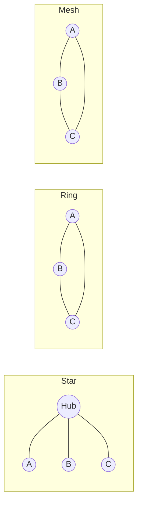

# N

## NaaS
**Network as a Service.** Network connectivity, such as VPNs and bandwidth on demand, offered as a cloud-style service, often built on network virtualisation.

See also: [IaaS](i.md#iaas), [SDN](s.md#sdn).

## NAPT
**Network Address and Port Translation.** NAT that also rewrites port numbers, so that many private hosts can share one public IP address. It is also called PAT or IP masquerading.

See also: [NAT](#nat).

## NAS
**Network Access Server.** A device that gives users access to a network, such as a dial-up or broadband access server. It usually authenticates them through RADIUS. In LTE, NAS also stands for the non-access stratum: the signalling between the device and the core.

See also: [Radius](r.md#radius), [BRAS](b.md#bras).

## NAT
**Network Address Translation.** Rewriting IP addresses in packets as they pass through a router, usually so that a private network can share public addresses. It has kept IPv4 going despite address exhaustion, but it complicates peer-to-peer protocols.

See also: [NAPT](#napt), [STUN](s.md#stun), [ICE](i.md#ice), [IPv4](i.md#ipv4).

## Native Risk Management
See [Intrinsic Risk Management](i.md#intrinsic-risk-management).

## NB-IoT
**Narrowband IoT.** A 3GPP low-power, wide-area radio technology for simple IoT devices, such as meters, that send little data and must run for years on a battery.

See also: [LTE (4G)](l.md#lte-4g), [LwM2M](l.md#lwm2m).

## NBAP
**Node B Application Part.** The UMTS signalling protocol on the Iub interface with which the RNC controls a Node B, setting up cells and radio links.

See also: [Node B](#node-b), [RNC](r.md#rnc), [UTRAN](u.md#utran).

## NCSC
**National Cyber Security Centre.** The UK's technical authority on cyber security, part of GCHQ, which advises government, businesses and the public. It opened in 2016.

See also: [GCHQ](g.md#gchq), [CESG](c.md#cesg).

## Network Topologies
The arrangement of a network's nodes and links, such as bus, star, ring, mesh or tree. The physical topology is how it is cabled; the logical topology is how data flows.

[[CAPTION:Figure]] Star, ring and mesh topologies.

## NFS
**Network File System.** A protocol, first developed by Sun in 1984, that lets a computer use files on a remote server as if they were local.

## NGN
**Next-Generation Network.** A packet-based network, usually all-IP, that carries every service, voice included, with service control separate from transport. ITU-T and ETSI TISPAN defined NGN architectures in the 2000s, and IMS became their service layer.

See also: [IMS](i.md#ims), [BT 21CN](b.md#bt-21cn), [Softswitch](s.md#softswitch).

## NGWFQ
A form of weighted fair queuing. Weighted fair queuing shares a link's capacity between flows or classes in proportion to weights set for each.

See also: [PWFQ](p.md#pwfq), [QoS](q.md#qos).

## Niko-niko Calendar
A calendar on which each team member records their mood each day, often with a smiley face, to show patterns in how the team feels.

See also: [Information Radiators](i.md#information-radiators).

## NIST
**National Institute of Standards and Technology.** The US agency that maintains measurement standards and publishes widely used computer security standards and guidance, such as FIPS and the SP 800 series.

See also: [FIPS](f.md#fips), [AES](a.md#aes).

## NNI
**Network-to-Network Interface.** The interface between two networks, or two parts of one network, with its signalling and management. It differs from the user-network interface (UNI), between a network and its customer.

See also: [UNI](u.md#uni).

## NNTP
**Network News Transfer Protocol.** The protocol, first defined in RFC 977 in 1986, for distributing, reading and posting Usenet news articles.

## NOC
**Network Operations Centre.** The place from which an operator monitors and manages its network.

## Node B
The UMTS base station, the equivalent of the GSM BTS. It handles the radio link with mobile devices, under the control of an RNC.

See also: [RNC](r.md#rnc), [BTS](b.md#bts), [E NodeB](e.md#e-nodeb), [NBAP](#nbap).

## Nominal Path
The path through a system's behaviour where everything goes as expected, with no errors or exceptions. Also called the happy path.

See also: [Use Case](u.md#use-case), [Happy Path](h.md#happy-path).

## Non-functional Requirement
A requirement about how well a system works rather than what it does, such as performance, reliability, security, usability or compatibility. Also called a quality attribute.

See also: [Functional Requirement](f.md#functional-requirement), [How Requirement](h.md#how-requirement).

## NoSQL
Databases that store data in forms other than relational tables, such as key-value, document, wide-column or graph stores. They often trade strict consistency for easier horizontal scaling.

See also: [RDBMS](r.md#rdbms), [SQL](s.md#sql).

## NPE
**Network Provider Edge.** A provider edge (PE) router, which connects customer networks or other providers' networks to a provider's core.

See also: [CE](c.md#ce), [L3VPN](l.md#l3vpn).

## NSS
**Network Switching Subsystem.** The GSM core network: the MSCs, HLR, VLR and related nodes that switch calls and manage mobility. GPRS added a packet core alongside it.

See also: [MSC](m.md#msc), [HLR](h.md#hlr), [GSM](g.md#gsm).

## NTP
**Network Time Protocol.** The protocol that synchronises computer clocks over packet networks. It gets within tens of milliseconds of UTC over the internet, and usually within a millisecond on a LAN.

See also: [SNTP](s.md#sntp), [PTP](p.md#ptp), [UTC](u.md#utc).

## NTS
**Number Translation Service.** A non-geographic number, such as a UK 08 number, that the network translates to an ordinary number, so the destination can change without changing the published number.

See also: [IN](i.md#in).

## NTU
**Network Terminating Unit.** The device that marks the boundary between the operator's line and the customer's equipment, and gives a point for testing the line.

See also: [CPE](c.md#cpe).

## NYB
**Not Yet Built.** Royal Mail address data for properties that are planned or under construction.
