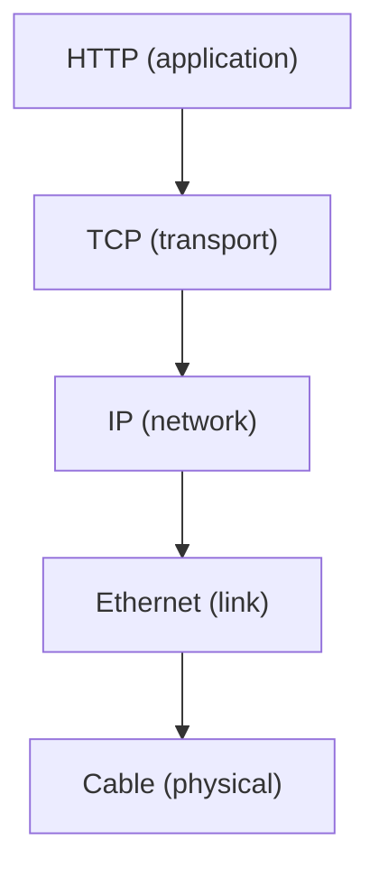
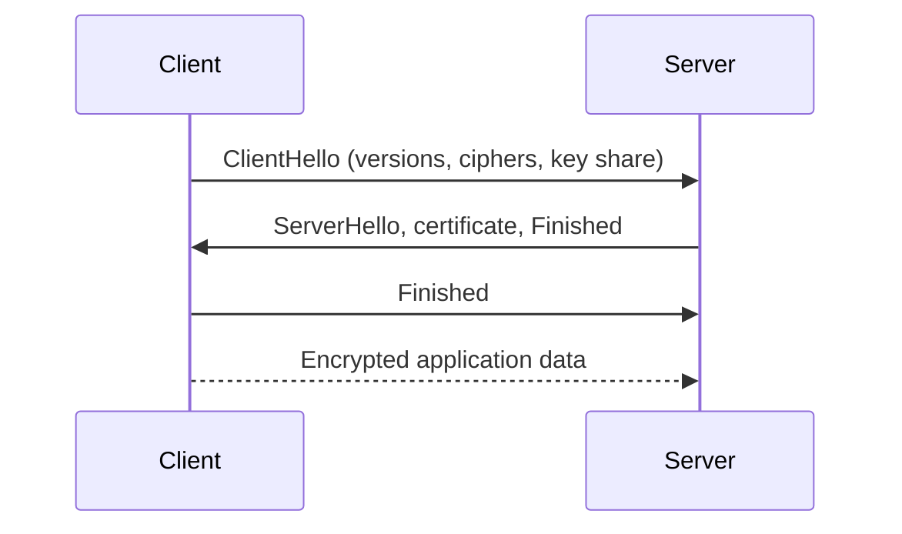
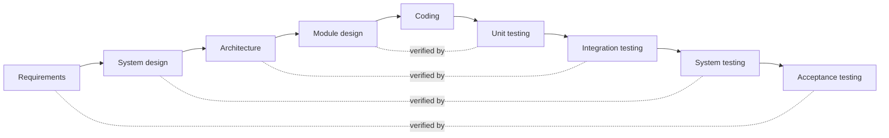

# S to Z and numbers

## S

### S-Tag
**Service VLAN tag.** In IEEE 802.1ad double tagging (Q-in-Q), the outer VLAN tag added by the service provider, with TPID 0x88A8. It sits outside the customer's own C-Tag.

See also: [C-Tag](a-c.md#c-tag), [VLAN](#vlan), [Dot1Q](d-f.md#dot1q).

### S-GW
**Serving Gateway.** The LTE core gateway that forwards users' packets between the eNodeBs and the PGW. It anchors the user plane during handovers and buffers data for idle devices while the MME pages them.

See also: [PGW](o-r.md#pgw), [MME](l-n.md#mme), [LTE (4G)](l-n.md#lte-4g).

### SAAL
**Signalling ATM Adaptation Layer.** The ATM adaptation layer that carries signalling messages reliably between ATM switches.

See also: [ATM](a-c.md#atm), [AAL5](a-c.md#aal5).

### SaaS
**Software as a Service.** Software that a provider hosts and runs, and customers use over the internet, usually in a browser, on a subscription.

See also: [PaaS](o-r.md#paas), [IaaS](g-k.md#iaas).

### SAE
**System Architecture Evolution.** The 3GPP work that defined the LTE core network, the Evolved Packet Core: a simpler, all-IP core that also supports other access networks, such as Wi-Fi.

See also: [LTE (4G)](l-n.md#lte-4g), [MME](l-n.md#mme), [S-GW](#s-gw), [PGW](o-r.md#pgw).

### SAFe
**Scaled Agile Framework.** A framework for running agile development across many teams in a large organisation, with set roles, planning events and portfolio management.

See also: [Scaled Agile](#scaled-agile), [LeSS](l-n.md#less), [DAD](d-f.md#dad).

### SBC
**Session Border Controller.** A device at the edge of a VoIP network that controls the signalling, and usually the media, of calls crossing it. It provides security, NAT traversal, interworking and policing.

See also: [SIP](#sip), [SIP Trunk](#sip-trunk), [NAT](l-n.md#nat).

### SC-FDMA
**Single-Carrier FDMA.** A multiple access scheme, also called DFT-spread OFDMA, with a lower peak-to-average power ratio than OFDMA. That saves battery power, so LTE uses it for the uplink.

See also: [OFDMA](o-r.md#ofdma), [LTE (4G)](l-n.md#lte-4g).

### Scala
A statically typed language for the Java virtual machine that combines object-oriented and functional programming, and works with Java libraries.

See also: [Java](g-k.md#java).

### Scaled Agile
Agile methods applied to large projects and programmes, with many teams working on one product.

See also: [SAFe](#safe), [LeSS](l-n.md#less), [Scrum of Scrums](#scrum-of-scrums).

### SCCP
**Signalling Connection Control Part.** The SS7 layer above MTP that adds richer addressing (global title translation), connection-oriented services and segmentation. MAP and other application parts use it.

See also: [MTP](l-n.md#mtp), [SS7](#ss7), [TCAP](#tcap).

### Scenario
A narrative of an activity, told as a story, often a concrete path through a use case.

See also: [Use Case](#use-case), [Storyboard](#storyboard).

### Schedule
A plan that sets the timing, resources and dependencies of the tasks needed to finish a project or part of one.

See also: [Business Schedule](a-c.md#business-schedule), [Detailed Schedule](d-f.md#detailed-schedule).

### Scheduler
The part of an operating system, or a network device, that decides which task or packet gets a resource next, such as a processor or a link. Its aims include keeping resources busy, sharing them fairly and meeting deadlines or quality of service targets.

See also: [Round Robin](o-r.md#round-robin), [Preemption](o-r.md#preemption), [RTOS](o-r.md#rtos).

### SCM
**Software Configuration Management.** Tracking and controlling changes to software: version control, baselines, builds and releases. It is the software part of configuration management.

See also: [Configuration Management](a-c.md#configuration-management), [Version Control](#version-control).

### Scratch
A visual, block-based programming language and online community from the MIT Media Lab, designed to teach children to code.

### Scribe
The person who records issues in an inspection or other formal meeting.

See also: [Inspection](g-k.md#inspection).

### Scrum
An agile framework in which a small team works in fixed-length sprints towards a sprint goal. It has three roles: product owner, Scrum Master and developers. Its events are sprint planning, the daily scrum, the sprint review and the retrospective.

See also: [Sprints](#sprints), [Product Owner](o-r.md#product-owner), [Scrum Master](#scrum-master).

### Scrum Master
The Scrum role that helps the team follow Scrum and work well, by coaching, removing obstacles and protecting the team's focus.

See also: [Scrum](#scrum).

### Scrum of Scrums
A way to coordinate several Scrum teams: each team sends a representative to a regular meeting to raise dependencies and problems between teams.

See also: [Scaled Agile](#scaled-agile).

### SCTP
**Stream Control Transmission Protocol.** A transport protocol (RFC 9260) that delivers messages reliably like TCP, keeps message boundaries like UDP, and supports multiple streams and multi-homing. It carries SS7 signalling over IP (SIGTRAN) and LTE control traffic.

See also: [TCP](#tcp), [UDP](#udp), [SGW](#sgw).

### SDES
**SDP Security Descriptions.** A way to exchange the keys for SRTP (secure RTP) inside the SDP of a SIP call. It relies on the signalling itself being encrypted.

See also: [SDP](#sdp), [RTP](o-r.md#rtp), [SIP](#sip).

### SDH
**Synchronous Digital Hierarchy.** The ITU-T standard for synchronous multiplexing of digital signals over fibre, from STM-1 (155 Mbit/s) upwards, with strong management and fast protection switching. It replaced PDH; SONET is the North American equivalent.

See also: [SONET](#sonet), [PDH](o-r.md#pdh), [EoS](d-f.md#eos).

### SDK
**Software Development Kit.** The libraries, tools, documentation and examples needed to build software for a particular platform or service.

See also: [API](a-c.md#api), [DDK](d-f.md#ddk).

### SDLC
**Systems Development Life Cycle.** A structured process for developing a system, from feasibility study through to maintenance. Waterfall, spiral and iterative models are all versions of it.

See also: [Lifecycle](l-n.md#lifecycle), [Waterfall](#waterfall).

### SDMA
**Space-Division Multiple Access.** Using smart antennas to point beams at different users, so that users in different places can share the same frequency at the same time.

See also: [MIMO](l-n.md#mimo), [CDMA](a-c.md#cdma).

### SDN
**Software-Defined Networking.** Separating a network's control plane from its data plane, and putting control in software controllers that configure the forwarding devices through open interfaces. The network is then managed centrally and programmatically.

See also: [Control Plane](a-c.md#control-plane), [Data Plane](d-f.md#data-plane), [NaaS](l-n.md#naas).

### SDP
**Session Description Protocol.** A text format (RFC 8866) for describing multimedia sessions: media types, codecs, addresses and ports. SIP uses it in an offer and answer exchange to agree the media of a call.

See also: [SIP](#sip), [SDES](#sdes), [RTP](o-r.md#rtp).

### SDS
**Software Design Specification.** A document that sets out a system's detailed design: its modules, interfaces, data models, state machines, timing and memory layout. Ideally it is kept up to date alongside the code.

See also: [Software Requirements Specification](#software-requirements-specification), [Low Level Design](l-n.md#low-level-design).

### SDSL
**Symmetric Digital Subscriber Line.** DSL with the same speed in both directions, aimed at businesses. HDSL and G.SHDSL are examples.

See also: [ADSL](a-c.md#adsl), [HDSL](g-k.md#hdsl), [DSL](d-f.md#dsl).

### Sed
**Stream editor.** A Unix tool, written at Bell Labs in the 1970s, that transforms text line by line using a small command language, most often for substitutions with regular expressions.

See also: [Awk](a-c.md#awk), [Regular expression](o-r.md#regular-expression).

### Secure Element
**SE.** A tamper-resistant chip that stores keys and runs sensitive code in isolation, with protection against physical and side-channel attacks. SIM cards, payment cards and many IoT devices use one.

See also: [Root of Trust](o-r.md#root-of-trust), [TrustZone](#trustzone), [SIM](#sim).

### SE
See [Secure Element](#secure-element).

### Semaphore
A synchronisation primitive: a counter that threads decrement to take one unit of a resource, waiting if none is left, and increment to release it. A binary semaphore works like a lock.

See also: [Mutex](l-n.md#mutex), [Mutual Exclusion](l-n.md#mutual-exclusion).

### Semantic Versioning
**SemVer.** A version numbering scheme, `MAJOR.MINOR.PATCH`. Increase the major number for incompatible API changes, the minor number for compatible new features and the patch number for compatible bug fixes. Pre-release and build labels can follow, as in `2.1.0-rc.1+build.5`.

See also: [Release Management](o-r.md#release-management), [Version](#version).

### Sequence Model
A model, such as a UML sequence diagram, that shows the messages exchanged between objects or roles in time order.

See also: [Collaboration Model](a-c.md#collaboration-model), [UML](#uml).

### SF
**Superframe.** The T1 framing format that groups 12 frames and uses their framing bits for alignment. Extended Superframe (ESF), with 24 frames, replaced it.

See also: [PDH](o-r.md#pdh), [TDM](#tdm).

### SFTP
**SSH File Transfer Protocol.** A protocol for transferring and managing files over an SSH connection. It is unrelated to FTP and FTPS, apart from its purpose.

See also: [SSH](#ssh), [FTPS](d-f.md#ftps), [FTP](d-f.md#ftp).

### SGML
**Standard Generalized Markup Language.** The ISO standard (ISO 8879) for defining markup languages that describe a document's structure rather than its appearance. HTML and XML derive from it.

See also: [XML](#xml).

### SGSN
**Serving GPRS Support Node.** The GPRS and UMTS core node that serves devices in its area. It tracks their location, authenticates them and routes their packets to and from the GGSN.

See also: [GGSN](g-k.md#ggsn), [GPRS](g-k.md#gprs), [MME](l-n.md#mme).

### SGW
**Signalling Gateway.** A gateway that carries SS7 signalling between circuit-switched networks and IP networks, for example passing ISUP from an MGCF over SCTP (SIGTRAN) to the SS7 network over MTP.

See also: [MGCF](l-n.md#mgcf), [SCTP](#sctp), [SS7](#ss7).

### Sh
The Bourne shell, the standard shell of Version 7 Unix, written by Stephen Bourne. `/bin/sh` on Unix-like systems today is a shell compatible with it, as POSIX defines.

See also: [Bash](a-c.md#bash), [Ksh](g-k.md#ksh), [Shell Scripting](#shell-scripting), [POSIX](o-r.md#posix).

### SHA
**Secure Hash Algorithm.** A family of cryptographic hash functions published by NIST. SHA-1 (160-bit) is broken and should not be used for security. SHA-2 (SHA-256, SHA-512) and SHA-3 are current.

See also: [Hash Function](g-k.md#hash-function), [MD5](l-n.md#md5).

### Shell Scripting
Writing scripts for a command-line shell, such as Bash, to automate tasks like handling files and running other tools.

See also: [Bash](a-c.md#bash), [Sh](#sh).

### Sidetone
The small part of a speaker's own voice fed back into their earpiece, so that a phone line sounds alive and people do not shout.

See also: [Echo](d-f.md#echo).

### Sign Up
**Signing up for tasks.** In agile teams, members choose the tasks they will work on, rather than a manager assigning them.

See also: [Task Board](#task-board).

### SIM
**Subscriber Identity Module.** The smart card, or embedded chip (eSIM), that holds a mobile subscriber's IMSI and secret key. The network uses them to identify and authenticate the subscriber.

See also: [IMSI](g-k.md#imsi), [Secure Element](#secure-element), [HLR](g-k.md#hlr).

### SIMPLE
**SIP for Instant Messaging and Presence Leveraging Extensions.** The IETF's SIP-based protocols for instant messaging and presence. XMPP is the main alternative.

See also: [SIP](#sip), [XMPP](#xmpp).

### Simple Design
The agile practice of keeping the design as simple as the current needs allow, guided by rules such as Kent Beck's.

See also: [Rule of Simplicity](o-r.md#rule-of-simplicity), [KISS Principle](g-k.md#kiss-principle), [Quick Design Session](o-r.md#quick-design-session).

### Simplex
Communication in one direction only, such as broadcast radio. ITU usage also applies the term to links that work one way at a time, which most people call half duplex.

See also: [Duplex](d-f.md#duplex), [Half Duplex](g-k.md#half-duplex).

### Single Step Test
A test in a debugger, stepping through the source code line by line as it runs.

### SIP
**Session Initiation Protocol.** The IETF's text-based signalling protocol (RFC 3261) for setting up, changing and ending voice, video and messaging sessions. It is modelled on HTTP and carries SDP to agree the media. SIP is the basis of most VoIP and of IMS.

See also: [SDP](#sdp), [RTP](o-r.md#rtp), [IMS](g-k.md#ims), [SIP Trunk](#sip-trunk).

### SIP Trunk
A VoIP connection, using SIP, between a business's phone system and a service provider, replacing ISDN lines for external calls.

See also: [SIP](#sip), [SBC](#sbc), [ISDN](g-k.md#isdn).

### SISO
**Single-Input, Single-Output.** A system with one input and one output; in radio, a link with one antenna at each end.

See also: [MIMO](l-n.md#mimo).

### Skew
**Clock skew.** The difference in the arrival time of the same clock signal at different parts of a circuit, or between the readings of two clocks.

See also: [Jitter](g-k.md#jitter).

### SLA
**Service Level Agreement.** An agreement between a provider and a customer on the service's measurable levels, such as availability, response and repair times, with remedies if they are missed.

See also: [KPI](g-k.md#kpi), [MTR](l-n.md#mtr).

### SLIP
**Serial Line Internet Protocol.** A very simple way of sending IP packets over a serial line (RFC 1055), with no negotiation or error checking. PPP replaced it, though it is still used on small microcontrollers.

See also: [PPP](o-r.md#ppp).

### SME
**Subject Matter Expert.** A person with deep knowledge of a particular area, often a business domain that the software serves. SME also commonly means small and medium-sized enterprise.

### Smoke Test
A quick test that a new build works at all, run before deeper testing.

See also: [Smoke testing](#smoke-testing), [Build](a-c.md#build).

### Smoke testing
Quick, shallow testing of a system's most important functions, to decide whether it is stable enough for further testing.

See also: [Smoke Test](#smoke-test), [Regression testing](o-r.md#regression-testing).

### SMP
**Symmetric Multiprocessing.** A design in which two or more identical processors, or cores, share one memory and are run by one operating system that treats them all equally. Most multi-core computers work this way.

See also: [AMP](a-c.md#amp).

### SMPF
**Shared Metallic Path Facility.** An Openreach product that shares one copper line between two providers. Typically one provides voice over the low frequencies and the other broadband over the high frequencies.

See also: [MPF](l-n.md#mpf), [WLR](#wlr).

### SMSC
**Short Message Service Centre.** The network element that stores SMS messages and forwards them to their destination, retrying until the recipient is reachable.

See also: [MAP](l-n.md#map), [GSM](g-k.md#gsm).

### Snake Case
Writing compound names in lower case with underscores between the words, as in `snake_case`. Python uses it for functions and variables.

See also: [Camel Case](a-c.md#camel-case).

### SNMP
**Simple Network Management Protocol.** The IETF protocol for monitoring and managing network devices. Managers read and set variables in each device's MIB, and devices send traps when events happen. SNMPv3 adds proper security.

See also: [MIB](l-n.md#mib), [Management Plane](l-n.md#management-plane), [Cacti](a-c.md#cacti).

### SNTP
**Simple Network Time Protocol.** A simpler form of NTP, without NTP's long-term state and filtering, for devices that need only modest clock accuracy.

See also: [NTP](l-n.md#ntp).

### SOA
**Service-Oriented Architecture.** An architecture style in which applications are built from services. Each service provides a business function through a network interface, can be used without knowing how it works, and can be combined with others.

See also: [ESB](d-f.md#esb), [Microservice](l-n.md#microservice), [SOAP](#soap).

### SOAP
An XML-based messaging protocol for web services, usually over HTTP. A SOAP envelope holds a header and a body, and WSDL describes the services. REST has largely replaced it for new APIs.

See also: [WSDL](#wsdl), [REST](o-r.md#rest), [XML](#xml).

### Softswitch
A call control system implemented in software on general-purpose servers, which routes calls in VoIP and next-generation networks. It controls media gateways rather than switching media itself.

See also: [Class 4 Softswitch](a-c.md#class-4-softswitch), [Class 5 Softswitch](a-c.md#class-5-softswitch), [MGCP](l-n.md#mgcp), [H.248](g-k.md#h248).

### Software Change Request
See [Change Request](a-c.md#change-request).

### Software Configuration Management
See [SCM](#scm).

### Software Development Plan
**SDP.** On software projects, another name for the [Project Plan](o-r.md#project-plan).

### Software Engineering Body of Knowledge
**SWEBOK.** The IEEE Computer Society's guide to the generally accepted knowledge of software engineering, organised into knowledge areas.

See also: [IEEE](g-k.md#ieee).

### Software Engineering Lab
**SEL.** The Software Engineering Laboratory at NASA Goddard, which studied and improved software processes from 1976 into the 2000s.

### Software Engineering Process Group
**SEPG.** A group that leads software process improvement in an organisation, and gives projects independent technical oversight.

See also: [Capability Maturity Model](a-c.md#capability-maturity-model).

### Software Requirements Specification
**SRS.** A document that captures the requirements for a software system, often alongside models and prototypes.

See also: [Requirements](o-r.md#requirements), [SDS](#sds).

### SOLID Principles
Five object-oriented design principles promoted by Robert C. Martin: single responsibility, open-closed, Liskov substitution, interface segregation and dependency inversion. Together they aim for code that is modular and easy to change.

See also: [OO](o-r.md#oo), [Design Pattern](d-f.md#design-pattern).

### SoGEA
**Single Order Generic Ethernet Access.** An Openreach broadband product over fibre to the cabinet with no phone service on the line, ordered as one product. It is the standalone broadband line used as the copper phone network closes.

See also: [VDSL](#vdsl), [EoFTTC](d-f.md#eofttc), [PSTN](o-r.md#pstn).

### SONET
**Synchronous Optical Network.** The North American standard for synchronous multiplexing over fibre, equivalent to SDH, with rates starting at OC-1 (51.84 Mbit/s).

See also: [SDH](#sdh).

### Source Code
The human-readable instructions of software, written in a programming language, that a compiler or interpreter turns into something a computer can run.

See also: [Machine code](l-n.md#machine-code), [Version Control](#version-control).

### SPEEX
**Speex.** An open, patent-free speech codec from the Xiph.Org Foundation, based on CELP. Opus has replaced it.

See also: [OPUS](o-r.md#opus), [Vorbis](#vorbis).

### SPI
**Serial Peripheral Interface.** A synchronous, full-duplex serial bus for short-distance links between a microcontroller and peripherals such as sensors, flash memory and displays. It uses a clock, two data lines and a chip select for each device.

See also: [MCU](l-n.md#mcu).

### Spiral Lifecycle
A lifecycle made of a series of small projects, each tackling the biggest remaining risks, until the system is delivered.

See also: [Spiral Model](#spiral-model), [Lifecycle](l-n.md#lifecycle).

### Sponsor
See [Project Sponsor](o-r.md#project-sponsor).

### Spiral Model
Barry Boehm's risk-driven process model. Each loop of the spiral sets objectives, identifies and resolves risks, develops and tests, and plans the next loop. It can borrow from other models, such as waterfall or prototyping, as the risks suggest.

See also: [Spiral Lifecycle](#spiral-lifecycle), [Waterfall](#waterfall).

### Sprint Planning
The Scrum event at the start of a sprint, in which the team agrees the sprint goal and chooses the backlog items to work on.

See also: [Sprints](#sprints), [Scrum](#scrum).

### Sprint retrospective
The Scrum event at the end of a sprint, in which the team reviews how it worked and agrees improvements.

See also: [Heartbeat Retrospective](g-k.md#heartbeat-retrospective), [Scrum](#scrum).

### Sprints
Fixed-length iterations, usually two to four weeks, in which a Scrum team produces a usable increment.

See also: [Iteration](g-k.md#iteration), [Timebox](#timebox), [Scrum](#scrum).

### SQL
**Structured Query Language.** The standard language for defining, querying and changing data in relational databases.

See also: [RDBMS](o-r.md#rdbms), [NoSQL](l-n.md#nosql).

### SS7
**Signalling System No. 7.** The ITU-T set of protocols that telephone networks use to set up and clear calls and to provide services such as number translation, number portability, prepaid and SMS. In the UK it is also called C7. Its layers include MTP, SCCP, TCAP, ISUP and MAP.

See also: [MTP](l-n.md#mtp), [SCCP](#sccp), [ISUP](g-k.md#isup), [TCAP](#tcap), [MAP](l-n.md#map), [CCS](a-c.md#ccs).

### SSADM
**Structured Systems Analysis and Design Method.** A waterfall method for analysing and designing information systems, developed for and widely used in UK government from the 1980s.

See also: [Waterfall](#waterfall), [CCTA](a-c.md#ccta).

### SSH
**Secure Shell.** A cryptographic protocol for logging in to and running commands on remote machines securely over an untrusted network. It also tunnels other traffic and carries SFTP.

See also: [SFTP](#sftp).

### SSID
**Service Set Identifier.** The name of a Wi-Fi network.

See also: [Wi-Fi](#wi-fi).

### SSIS
**SQL Server Integration Services.** The Microsoft SQL Server component for data integration and ETL workflows.

See also: [ETL](d-f.md#etl).

### SSL
**Secure Sockets Layer.** The predecessor of TLS. All SSL versions are broken and must not be used, though "SSL" is still often said when TLS is meant. See [TLS](#tls).

### Stack
A protocol stack: the layered set of protocols that together provide communication, such as Ethernet, IP, TCP and HTTP, or the software that implements them.

[[CAPTION:Figure]] A typical protocol stack, from application to physical layer.

See also: [Internet Protocol Suite](g-k.md#internet-protocol-suite), [L1](l-n.md#l1), [L2](l-n.md#l2).

### Staff Days
A measure of effort: how much work an activity needs, in days of one person's time, as distinct from calendar days.

See also: [Calendar Days](a-c.md#calendar-days).

### Stage
Often a synonym for phase. More precisely, a phase can be divided into stages.

See also: [Phase](o-r.md#phase).

### Staged Delivery Lifecycle
A lifecycle that delivers a system in stages, with the most important functions first.

See also: [Evolutionary Delivery Lifecycle](d-f.md#evolutionary-delivery-lifecycle), [Incremental Development](g-k.md#incremental-development).

### Stakeholder
A person or organisation with an interest in a project's outcome, such as its customers, users and sponsors, and any group it affects.

### Standard
An agreed, documented set of rules, conventions or requirements that work must follow.

See also: [Construction Standard](a-c.md#construction-standard).

### Statistical Estimation
Estimating with a statistical model built from historical data, usually predicting effort and time from size. It works best when calibrated on similar past projects.

See also: [Parametric Estimation](o-r.md#parametric-estimation).

### STB
**Set-Top Box.** A device that receives television signals, by aerial, satellite, cable or IP, and turns them into pictures and sound on a TV.

See also: [IPTV](g-k.md#iptv), [DTT](d-f.md#dtt).

### Story Mapping
Arranging user stories in two dimensions: along the user's journey from left to right, and by priority from top to bottom. The map helps plan releases.

See also: [User Stories](#user-stories).

### Story Splitting
Breaking a user story into smaller stories, each of which still has value of its own.

See also: [User Stories](#user-stories), [Epic](d-f.md#epic).

### Storyboard
A sequence of pictures showing a scenario or use case.

See also: [Scenario](#scenario), [Low Fidelity Prototype](l-n.md#low-fidelity-prototype).

### STRIDE Threat Model
Microsoft's mnemonic for six kinds of security threat: Spoofing, Tampering, Repudiation, Information disclosure, Denial of service and Elevation of privilege. Each one threatens a security property: authenticity, integrity, non-repudiation, confidentiality, availability and authorisation.

See also: [Pen testing](o-r.md#pen-testing).

### STP
**Spanning Tree Protocol.** The IEEE 802.1D protocol that stops loops in Ethernet networks by blocking redundant links so that one loop-free path remains, and unblocking them if the active path fails. Radia Perlman invented the algorithm.

See also: [RSTP](o-r.md#rstp), [Switch](#switch).

### Strategy
The overall approach taken to a problem or goal.

### STUN
**Session Traversal Utilities for NAT.** A protocol (RFC 8489) with which a device behind a NAT discovers the public address and port the NAT has given it. ICE, SIP and WebRTC use it.

See also: [ICE](g-k.md#ice), [NAT](l-n.md#nat).

### Subversion
**SVN.** Apache Subversion, a centralised version control system designed as a successor to CVS.

See also: [Git](g-k.md#git), [Version Control](#version-control).

### Sustainable Pace
Working at a pace the team could keep up indefinitely, without overtime and burnout.

See also: [XP](#xp).

### SVC
**Switched Virtual Circuit.** A virtual circuit set up on demand for a call or transfer and cleared when it ends.

See also: [PVC](o-r.md#pvc), [ATM](a-c.md#atm), [X.25](#x25).

### Swift
Apple's compiled, multi-paradigm language for its platforms, released in 2014 as the successor to Objective-C. It is open source and also runs on Linux.

See also: [Objective C](o-r.md#objective-c).

### Switch
A network device that connects devices on a LAN and forwards each frame only to the port where its destination MAC address is. It learns those addresses from the traffic it sees. A layer-3 switch can also route.

See also: [Hub](g-k.md#hub), [Router](o-r.md#router), [VLAN](#vlan).

### System
A set of hardware, software and processes that work together. In a project, the system is what the project was set up to build.

### System Test
A test of the whole system's behaviour, using a project build in the system test environment.

See also: [Integration Test](g-k.md#integration-test), [System Test Environment](#system-test-environment).

### System Test Environment
An environment that copies the live environment and its conditions as closely as possible, for system testing.

See also: [System Test](#system-test).

### SystemX
**System X.** The UK's national digital telephone exchange system, developed by the Post Office (later BT) with GEC, Plessey and STC, and introduced in the 1980s. It includes concentrators, digital local exchanges (DLEs) and trunk exchanges (DMSUs).

See also: [DLE](d-f.md#dle), [PSTN](o-r.md#pstn).

## T

### T-Shirt Sizing
Estimating by sorting items into rough relative sizes, such as extra small, small, medium, large and extra large, rather than giving false precision.

See also: [Relative Estimation](o-r.md#relative-estimation), [Points](o-r.md#points).

### Task
A small, distinct unit of work in a project.

See also: [Activity](a-c.md#activity), [Work Item](#work-item).

### Task Board
A board with columns such as "To do", "In progress" and "Done", on which cards for tasks move as work progresses.

See also: [Kanban Board](g-k.md#kanban-board), [Information Radiators](g-k.md#information-radiators).

### Task Estimate
An estimate for a single task, usually made during planning and tracking and fed into work plans and detailed schedules.

See also: [Project Estimate](o-r.md#project-estimate), [Estimate](d-f.md#estimate).

### TCAP
**Transaction Capabilities Application Part.** The SS7 layer that manages dialogues between applications, such as MAP, INAP and CAP, using transaction IDs to run many at once. It encodes messages with ASN.1 BER.

See also: [SS7](#ss7), [MAP](l-n.md#map), [INAP](g-k.md#inap), [CAP](a-c.md#cap).

### Tcl/tk
Tcl is a dynamic scripting language, and Tk is the cross-platform GUI toolkit that grew up with it. Together they offer a quick way to build desktop interfaces, and other languages, such as Python's Tkinter, also use Tk.

### TCP
**Transmission Control Protocol.** The internet's main transport protocol (RFC 9293). It gives applications a reliable, ordered, error-checked byte stream over IP, with flow and congestion control. The web, email and file transfer use it.

See also: [UDP](#udp), [Internet Protocol Suite](g-k.md#internet-protocol-suite), [Out-of-order delivery](o-r.md#out-of-order-delivery).

### Tcsh
An enhanced C shell that adds command-line editing and completion. It was long the default shell for the root user on FreeBSD.

See also: [Csh](a-c.md#csh).

### TDD
**Test-Driven Development.** Writing a failing unit test first, then the simplest code that passes it, then refactoring, in short repeated cycles.

See also: [Unit Testing](#unit-testing), [Refactoring](o-r.md#refactoring), [BDD](a-c.md#bdd).

### TDM
**Time-Division Multiplexing.** Sharing a channel by giving each signal its own repeating time slot. Digital telephony carries each call in a 64 kbit/s slot, for example 30 calls on an E1.

See also: [Multiplex](l-n.md#multiplex), [PDH](o-r.md#pdh), [SDH](#sdh).

### Team
In agile terms, a small group of people working on the same product or goal, nearly all of them full time.

### Team Room
A space set aside for a team for the length of a project, so that its members, including the product owner, can work together closely.

See also: [Information Radiators](g-k.md#information-radiators).

### Technical Debt
The future cost of rework caused by choosing a quick solution now over a better one that would take longer. Like money, it gathers interest: left unpaid, it makes every later change harder.

See also: [Refactoring](o-r.md#refactoring).

### Template
An outline or framework for creating an artefact.

### Test
A single test case, or testing in general.

See also: [Testing](#testing), [Test Case](#test-case).

### Test Activity
A specific test procedure, combining one or more test techniques and test types.

### Test Case
**TC.** The inputs, steps and expected results that check whether a feature works or a requirement is met.

See also: [Test Case Specification](#test-case-specification), [Test Plan](#test-plan).

### Test Case Specification
**TCS.** A document listing the test cases that verify one or more features.

See also: [Test Case](#test-case).

### Test Design
Working out how to test a product: linking test cases to its requirements and design, when testing needs real analysis and structure.

See also: [Test Design Specification](#test-design-specification).

### Test Design Specification
**TDS.** A document recording the test design for a group of test cases.

See also: [Test Design](#test-design).

### Test Level
See [Test Type](#test-type).

### Test Plan
**TP.** A document setting out the scope, approach, resources, test items and schedule of testing.

See also: [Quality Plan](o-r.md#quality-plan), [Test Case](#test-case).

### Test Technique
The method used in a test activity, such as boundary value analysis or equivalence partitioning.

### Test Type
A category of testing, such as unit, integration, system or acceptance testing, defined by what it tests, how, why and when.

### Testing
Running software to find defects and to show that it meets its requirements.

See also: [Quality Control](o-r.md#quality-control), [Test Plan](#test-plan).

### Three Amigos
A meeting of the three main perspectives on a piece of work, business, development and testing, to agree what it should do before, during and after development.

See also: [ATDD](a-c.md#atdd), [BDD](a-c.md#bdd).

### Three C's
**Card, Conversation, Confirmation.** The three parts of a user story: a short note on a card, the conversation that fills in the detail, and the acceptance tests that confirm it is done.

See also: [User Stories](#user-stories).

### Three Questions
The traditional structure of the daily stand-up: what did I complete, what will I do next, and what is in my way?

See also: [Daily Scrum](d-f.md#daily-scrum).

### TIA
**Telecommunications Industry Association.** The US trade body, accredited by ANSI, that develops standards such as TIA-568 for structured cabling.

See also: [EIA](d-f.md#eia), [ANSI](a-c.md#ansi).

### Timebox
A fixed, agreed period in which a person or team works towards a goal, and which ends on time whether or not everything is done.

See also: [Sprints](#sprints), [Iteration](g-k.md#iteration).

### TKIP
**Temporal Key Integrity Protocol.** The stop-gap Wi-Fi security protocol, from 802.11i, that replaced WEP on existing hardware. It is no longer secure and was deprecated in 2012.

See also: [WEP](#wep), [WPA2](#wpa2).

### TLS
**Transport Layer Security.** The protocol that encrypts and authenticates connections between applications, such as HTTPS. A handshake authenticates the server, usually with an X.509 certificate, and agrees keys. Symmetric encryption then protects the data. TLS 1.3 (RFC 8446) is current, and it replaced SSL.

[[CAPTION:Figure]] A TLS 1.3 handshake, simplified.

See also: [HTTPS](g-k.md#https), [DTLS](d-f.md#dtls), [X.509](#x509), [SSL](#ssl).

### TLV
**Type-Length-Value.** An encoding in which each element has a type code, a length and then the value. Receivers can skip elements they do not understand, so formats can grow. BER, IS-IS and many other protocols use it.

See also: [BER](a-c.md#ber).

### TOGAF
**The Open Group Architecture Framework.** A widely used enterprise architecture framework. Its Architecture Development Method (ADM) guides architecture work across the business, data, application and technology domains.

See also: [Architecture](a-c.md#architecture), [ADR](a-c.md#adr).

### Token Ring
A LAN technology from IBM, standardised as IEEE 802.5. A token passes round a ring of stations, and only the station holding it may transmit. There are therefore no collisions. Ethernet replaced it.

See also: [FDDI](d-f.md#fddi).

### TOML
**Tom's Obvious, Minimal Language.** A configuration file format, created by Tom Preston-Werner, designed to be easy to read and to map clearly to a dictionary. Python's `pyproject.toml` and Rust's `Cargo.toml` use it.

See also: [YAML](#yaml), [JSON](g-k.md#json).

### Top Level Schedule
See [Business Schedule](a-c.md#business-schedule).

### Top-Down Estimation
Estimating a whole system first, then dividing the total among its parts.

See also: [Bottom-Up Estimation](a-c.md#bottom-up-estimation), [Macro Estimation](l-n.md#macro-estimation).

### Triple DES
**3DES, or TDEA.** DES applied three times to each block with two or three keys, to extend its life after DES's 56-bit key became too short. It is slow and now deprecated in favour of AES.

See also: [DES](d-f.md#des), [AES](a-c.md#aes).

### TTY
**Teletypewriter.** Originally an electromechanical typewriter used as a terminal. On Unix the name now means any terminal device, including a terminal emulator window.

See also: [Unix](#unix).

### TrustZone
Arm's hardware security extension that splits a processor into a secure world and a normal world. The secure world holds keys, secure boot and trusted applications, isolated from the main operating system. It exists on Cortex-A and, as Armv8-M, on Cortex-M.

See also: [Root of Trust](o-r.md#root-of-trust), [Secure Element](#secure-element).

### TUP
**Telephone User Part.** The first SS7 call control protocol, for ordinary telephone calls without ISDN features. ISUP has largely replaced it.

See also: [ISUP](g-k.md#isup), [SS7](#ss7).

### Twisted pair
Cable in which the two wires of each circuit are twisted together, which cuts interference and crosstalk. It is used for telephone lines and Ethernet.

See also: [Cat 5](a-c.md#cat-5), [Ethernet over twisted pair](d-f.md#ethernet-over-twisted-pair).

## U

### UA
**User Agent.** Software acting for a user. In HTTP, the browser or client, which names itself in the `User-Agent` header; in SIP, an endpoint that makes or receives calls.

See also: [HTTP](g-k.md#http), [SIP](#sip).

### Ubiquitous Language
In domain-driven design, a shared vocabulary drawn from the business domain, used consistently by everyone, from conversations and requirements through to the code.

### UDP
**User Datagram Protocol.** A simple, connectionless transport protocol (RFC 768) that sends datagrams with port numbers and a checksum, but no guarantee of delivery or order. DNS, VoIP media and streaming use it, along with protocols that add their own reliability.

[[CAPTION:Table]] The UDP header: four 16-bit fields, then the data.

| Bits 0 to 15 | Bits 16 to 31 |
| --- | --- |
| Source port | Destination port |
| Length | Checksum |
| Data | Data |

See also: [TCP](#tcp), [RTP](o-r.md#rtp), [DTLS](d-f.md#dtls).

### UER
**Universal Edge Router.** Juniper's name for its broadband edge routers, which do the job of a BRAS.

See also: [BRAS](a-c.md#bras), [BNG](a-c.md#bng).

### UML
<!-- vale PyDoc.Spelling = NO -->
**Unified Modeling Language.**
<!-- vale PyDoc.Spelling = YES -->
The standard graphical language for modelling software systems, maintained by the Object Management Group. It was created by Grady Booch, Ivar Jacobson and James Rumbaugh in the mid-1990s. Its diagrams include class, sequence, activity, state and use case diagrams.

See also: [Class Model](a-c.md#class-model), [Sequence Model](#sequence-model), [Use Case](#use-case).

### UMTS
**Universal Mobile Telecommunications System.** The 3GPP third-generation (3G) mobile system, which evolved from GSM. It uses wideband CDMA radio, and HSPA later speeded up its data.

See also: [W-CDMA](#w-cdma), [UTRAN](#utran), [GSM](g-k.md#gsm), [LTE (4G)](l-n.md#lte-4g).

### UNI
**User-Network Interface.** The demarcation between a service provider's network and a customer's equipment, where the provider's responsibility ends.

See also: [NNI](l-n.md#nni), [EVC](d-f.md#evc).

### Unicast
Sending data from one sender to one receiver, each identified by its own address. Most internet traffic is unicast.

See also: [Multicast](l-n.md#multicast), [Broadcast](a-c.md#broadcast), [Anycast](a-c.md#anycast).

### Unicode
The standard that gives a unique number, or code point, to every character in the world's writing systems, plus symbols and emoji. It is kept in step with ISO/IEC 10646. UTF-8 and UTF-16 are ways of encoding it.

See also: [UTF-8](#utf-8), [UTF-16](#utf-16), [ASCII](a-c.md#ascii).

### Unified Communications
**UC.** Bringing an organisation's communication services, such as voice, video, messaging, presence, conferencing and voicemail, together behind one consistent user experience across devices.

See also: [VoIP](#voip), [SIP](#sip).

### Unit Test
The lowest level of component test: a test of one small piece of code on its own.

See also: [Unit Testing](#unit-testing).

### Unit Testing
Writing and running small automated tests, written by the developers, that each check a narrow piece of the code.

See also: [Unit Test](#unit-test), [TDD](#tdd), [Mock Objects](l-n.md#mock-objects).

### Unix
A family of multi-user, multitasking operating systems descended from the original developed at Bell Labs by Ken Thompson, Dennis Ritchie and others from 1969. BSD, Solaris, AIX and macOS are Unix systems; Linux is Unix-like.

See also: [Linux](l-n.md#linux), [POSIX](o-r.md#posix), [Sh](#sh).

### Update
Planned work to bring an artefact up to date with the project's current needs.

See also: [Rework](o-r.md#rework).

### Upstream
In a project, the early activities and artefacts, such as chartering, planning, requirements and architecture. In networking, the direction from the customer towards the network.

See also: [Downstream](d-f.md#downstream).

### URI
**Uniform Resource Identifier.** A string that identifies a resource (RFC 3986). URLs, which say where to find it, and URNs, which name it, are both kinds of URI.

See also: [URL](#url), [URN](#urn).

### URL
**Uniform Resource Locator.** A URI that says how and where to get a resource: a scheme, such as `https`, a host, a path and optional query and fragment, as in `https://example.com/page?id=1#top`.

See also: [URI](#uri), [URN](#urn), [HTTP](g-k.md#http).

### URN
**Uniform Resource Name.** A URI that names a resource permanently, without saying where it is, as in `urn:isbn:0451450523`.

See also: [URI](#uri), [URL](#url).

### Usability Testing
Watching real users try to do realistic tasks with a product, to find where it is hard to use.

See also: [User Experience](#user-experience).

### Use Case
A description of how a user (actor) interacts with a system to achieve a goal, including the main path and alternatives.

See also: [Use Case Model](#use-case-model), [Use Case Specification](#use-case-specification), [Nominal Path](l-n.md#nominal-path).

### Use Case Model
The set of use cases and actors that describes a system's behaviour from the outside.

See also: [Use Case](#use-case), [UML](#uml).

### Use Case Specification
The document that describes one use case in full.

See also: [Use Case](#use-case).

### User Experience
**UX.** The whole of a person's experience of using a product, including but going beyond its user interface: how useful, easy and pleasant it is.

See also: [User Interface](#user-interface), [Usability Testing](#usability-testing), [Personas](o-r.md#personas).

### User Interface
**UI.** The part of a system through which people interact with it, such as screens, controls and messages.

See also: [User Interface Design](#user-interface-design), [User Experience](#user-experience).

### User Interface Design
Designing how people interact with a system: layout, controls, flows and feedback.

See also: [User Interface](#user-interface), [User Interface Prototype](#user-interface-prototype).

### User Interface Prototype
A prototype built to explore a user interface's behaviour or look and feel.

See also: [High Fidelity Prototype](g-k.md#high-fidelity-prototype), [Low Fidelity Prototype](l-n.md#low-fidelity-prototype).

### User Plane
The part of a network that carries users' traffic, as opposed to the control plane, which carries signalling. In routers it is also called the data plane or forwarding plane. In mobile networks, separating the two planes lets each scale on its own.

See also: [Data Plane](d-f.md#data-plane), [Control Plane](a-c.md#control-plane), [Management Plane](l-n.md#management-plane).

### User Stories
Short descriptions of functionality from the user's point of view, agreed with the customer or product owner, that the team uses to divide up the work.

See also: [Role-feature-reason](o-r.md#role-feature-reason), [INVEST](g-k.md#invest), [Three C's](#three-cs), [Epic](d-f.md#epic).

### UTC
**Coordinated Universal Time.** The world's primary time standard, kept by atomic clocks and adjusted with leap seconds to stay close to the Earth's rotation. It has no daylight saving time, and for everyday purposes it is the same as GMT.

See also: [NTP](l-n.md#ntp).

### UTF-16
A Unicode encoding that uses one 16-bit unit for characters in the Basic Multilingual Plane and two units, a surrogate pair, for the rest. Windows, Java and JavaScript use it internally. UTF-32, by contrast, uses a fixed 32 bits for every code point.

See also: [Unicode](#unicode), [UTF-8](#utf-8).

### UTF-8
The most widely used Unicode encoding, designed by Ken Thompson and Rob Pike. It uses one to four bytes per character, and the first 128 characters are the same as ASCII, so ASCII text is valid UTF-8. It is the default encoding of the web.

See also: [Unicode](#unicode), [UTF-16](#utf-16), [ASCII](a-c.md#ascii).

### UTRAN
**UMTS Terrestrial Radio Access Network.** The 3G radio access network: the Node Bs and the RNCs that control them.

See also: [Node B](l-n.md#node-b), [RNC](o-r.md#rnc), [UMTS](#umts), [E-UTRAN](d-f.md#e-utran).

## V

### V Model
A development model that extends waterfall by pairing each specification and design stage with the test stage that checks it. Requirements pair with acceptance testing, and so on down to unit tests. Drawn out, the stages form a V.

[[CAPTION:Figure]] The V model: each design stage is verified by a matching test stage.

See also: [Waterfall](#waterfall), [Testing](#testing).

### V.90 {#v90}
The ITU-T standard, from 1998, for 56 kbit/s dial-up modems. It achieves 56 kbit/s downstream and 33.6 kbit/s upstream by using the digital connection at the network end.

See also: [V.92](#v92).

### V.92 {#v92}
The ITU-T successor to V.90, which raised upstream speed to 48 kbit/s and added quicker connection and modem-on-hold.

See also: [V.90](#v90).

### VAD
**Voice Activity Detection.** Detecting whether speech is present in an audio signal. VoIP and mobile systems use it to stop sending during silence, which saves bandwidth, and generate comfort noise at the other end.

See also: [CNG](a-c.md#cng), [VoIP](#voip).

### VB
**Visual Basic.** Microsoft's event-driven language and IDE, first released in 1991, for building Windows applications quickly from forms and components. Classic VB became legacy in 2008; VB.NET is its .NET successor.

See also: [BASIC](a-c.md#basic), [VBS](#vbs), [RAD](o-r.md#rad).

### VBS
**VBScript.** Microsoft's scripting language based on Visual Basic, used for Windows administration and old web pages. Microsoft is removing it from Windows.

See also: [VB](#vb).

### VC
**Virtual Circuit.** A connection across a packet network that behaves like a dedicated circuit between two endpoints, set up before data flows. X.25, Frame Relay and ATM use virtual circuits.

See also: [PVC](o-r.md#pvc), [SVC](#svc), [VCI](#vci).

### VCI
**Virtual Channel Identifier.** The 16-bit field in an ATM cell header that, with the VPI, identifies the virtual channel the cell belongs to.

See also: [VPI](#vpi), [ATM](a-c.md#atm).

### VCID
**Virtual Circuit Identifier.** The identifier that both ends of a pseudowire use to match up the same circuit, for example in an MPLS VPWS.

See also: [PW](o-r.md#pw), [VPWS](#vpws).

### VDSL
**Very-high-bit-rate DSL.** DSL using frequencies up to 30 MHz on short lines. VDSL2 (G.993.2) gives tens of megabits per second, and up to around 80 Mbit/s downstream from a street cabinet. It is the technology of fibre-to-the-cabinet broadband.

See also: [ADSL](a-c.md#adsl), [G.Fast](g-k.md#gfast), [PCP](o-r.md#pcp).

### Velocity
The amount of work, usually in story points, that a team completes in an iteration. Teams use it to forecast what they can take on next.

See also: [Points](o-r.md#points), [Burndown Chart](a-c.md#burndown-chart).

### Verifier
In an inspection, the person who checks that the rework has been done properly.

See also: [Inspection](g-k.md#inspection).

### Version
A formally released revision of an artefact, recognised by configuration management.

See also: [Revision](o-r.md#revision), [Semantic Versioning](#semantic-versioning).

### Version Control
Recording every change to files, such as source code, so that any earlier version can be recovered and several people can work in parallel and merge their work. Git is the most widely used tool.

See also: [Git](g-k.md#git), [Subversion](#subversion), [SCM](#scm).

### VHDL
**VHSIC Hardware Description Language.** A language, standardised as IEEE 1076, for describing and simulating digital hardware, from systems down to logic gates. It came out of the US Very High-Speed Integrated Circuits programme in the 1980s. Verilog is its main alternative.

### VISP
**Virtual ISP.** An internet service provider that sells another ISP's service under its own brand.

See also: [ISP](g-k.md#isp), [MVNO](l-n.md#mvno).

### VLAN
**Virtual LAN.** A separate broadcast domain created on shared switches, usually by tagging frames with an 802.1Q VLAN ID, so that one physical network carries several isolated LANs.

See also: [Dot1Q](d-f.md#dot1q), [Dot1Q trunking](d-f.md#dot1q-trunking), [Switch](#switch).

### VLR
**Visitor Location Register.** The database, usually built into each MSC, of the subscribers currently in its area. It copies their details from their HLR.

See also: [HLR](g-k.md#hlr), [MSC](l-n.md#msc).

### VM
**Virtual Machine.** A software emulation of a computer, on which an operating system and applications run as if on real hardware. A hypervisor shares the physical machine between several VMs.

See also: [Docker](d-f.md#docker), [IaaS](g-k.md#iaas).

### VOD
**Video on Demand.** Letting viewers choose and watch video when they want, rather than at a broadcast time, by streaming or downloading.

See also: [IPTV](g-k.md#iptv), [STB](#stb).

### VoIP
**Voice over IP.** Carrying voice calls over IP networks, with signalling protocols such as SIP to set up calls and RTP to carry the media.

See also: [SIP](#sip), [RTP](o-r.md#rtp), [SBC](#sbc), [VoLTE](#volte).

### VoLTE
**Voice over LTE.** Voice calls over an LTE network as IP packets, using IMS, following the GSMA IR.92 profile. It needs no circuit-switched network, connects calls faster and supports HD voice.

See also: [IMS](g-k.md#ims), [LTE (4G)](l-n.md#lte-4g), [AMR-WB](a-c.md#amr-wb).

### Vorbis
An open, royalty-free lossy audio codec from the Xiph.Org Foundation, usually used in the Ogg container (Ogg Vorbis). Opus has largely replaced it.

See also: [OPUS](o-r.md#opus), [MP3](l-n.md#mp3).

### VPI
**Virtual Path Identifier.** The field in an ATM cell header that identifies a virtual path, a bundle of virtual channels. See [VCI](#vci).

### VPLS
**Virtual Private LAN Service.** A provider service that joins several customer sites into one Ethernet broadcast domain over an MPLS network, using a mesh of pseudowires. It is defined in RFCs 4761 and 4762.

See also: [L2VPN](l-n.md#l2vpn), [PW](o-r.md#pw), [VPWS](#vpws).

### VPN
**Virtual Private Network.** A private network built over a shared or public one, such as the internet or a provider's MPLS core. It uses tunnelling and often encryption, so that remote sites or users act as if directly connected.

See also: [IPSec](g-k.md#ipsec), [L3VPN](l-n.md#l3vpn), [L2VPN](l-n.md#l2vpn).

### VPWS
**Virtual Private Wire Service.** A point-to-point layer-2 service, such as Ethernet, carried over an MPLS network by a pseudowire. It is also called a virtual leased line or Ethernet over MPLS (EoMPLS).

See also: [PW](o-r.md#pw), [VPLS](#vpls), [EPWS](d-f.md#epws).

### VRF
**Virtual Routing and Forwarding.** Several separate routing tables in one router, so that different customers or networks, even with overlapping addresses, stay apart. It is the building block of MPLS layer-3 VPNs.

See also: [L3VPN](l-n.md#l3vpn), [CE](a-c.md#ce).

## W

### W-CDMA
**Wideband CDMA.** The UMTS air interface, which uses direct-sequence CDMA over pairs of 5 MHz channels.

See also: [UMTS](#umts), [CDMA](a-c.md#cdma).

### W3C
**World Wide Web Consortium.** The international body, founded by Tim Berners-Lee, that develops standards for the web, such as HTML, CSS and XML.

See also: [XML](#xml), [CSS](a-c.md#css).

### Walkthrough
An informal review in which the author takes one or more people through an artefact to find defects.

See also: [Review](o-r.md#review), [Desk Check](d-f.md#desk-check).

### WAN
**Wide Area Network.** A network that spans a large area, linking sites in different cities or countries, usually over carriers' circuits. The internet is the largest WAN.

See also: [LAN](l-n.md#lan), [MAN](l-n.md#man).

### WANET
**Wireless Ad hoc Network.** A decentralised wireless network with no routers or access points, in which every node forwards traffic for the others. A MANET is the mobile kind.

See also: [MANET](l-n.md#manet), [Wireless Mesh Network](#wireless-mesh-network).

### WAP
**Wireless Access Point.** A device that lets Wi-Fi devices connect to a wired network. WAP also stood for Wireless Application Protocol, an early way of browsing on mobile phones.

See also: [Wi-Fi](#wi-fi), [Wireless Repeater](#wireless-repeater).

### Waterfall
A sequential development model in which work flows through requirements, design, construction, testing and deployment, each finished before the next starts. Winston Royce's 1970 paper, often cited as its origin, described it as risky.

See also: [Waterfall Lifecycle](#waterfall-lifecycle), [V Model](#v-model), [Spiral Model](#spiral-model).

### Waterfall Lifecycle
A lifecycle that moves through ordered phases, from concept to delivery, with a review at the end of each.

See also: [Waterfall](#waterfall).

### WBC
**Wholesale Broadband Connect.** BT Wholesale's broadband access product on the 21CN network. ISPs connect at regional aggregation points to collect their customers' traffic.

See also: [WBMC](#wbmc), [BT 21CN](a-c.md#bt-21cn).

### WBCC
**Wholesale Broadband Connect Converge.** A BT Wholesale package, based on WBC, that combined voice and broadband on one bill for the ISP.

See also: [WBC](#wbc).

### WBMC
**Wholesale Broadband Managed Connect.** A BT Wholesale product, built on WBC, in which BT carries the traffic end to end to a single handover point. It replaced IPStream.

See also: [WBC](#wbc), [IPSC](g-k.md#ipsc).

### Weekly Individual Plan
A plan in which each person sets their miniature milestones for the week.

See also: [Miniature Milestone](l-n.md#miniature-milestone).

### WEP
**Wired Equivalent Privacy.** The original Wi-Fi security from 1997, which is easily broken. WPA and WPA2 replaced it, and it was deprecated in 2004.

See also: [WPA2](#wpa2), [TKIP](#tkip).

### What Requirement
See [Functional Requirement](d-f.md#functional-requirement).

### Why Requirement
See [Business Requirement](a-c.md#business-requirement).

### Wi-Fi
Wireless LAN technology based on the IEEE 802.11 standards. Wi-Fi is the Wi-Fi Alliance's trademark for certified products. Recent generations are numbered, such as Wi-Fi 6 (802.11ax) and Wi-Fi 7 (802.11be).

See also: [802.11](#80211), [WAP](#wap), [WPA2](#wpa2), [SSID](#ssid).

### Wiki
A website that its users edit together in the browser, usually with simple markup.

See also: [Document Collaboration](d-f.md#document-collaboration), [Knowledge Management](g-k.md#knowledge-management).

### WiMAX
**Worldwide Interoperability for Microwave Access.** Wireless broadband based on the IEEE 802.16 standards, promoted as an alternative to DSL and as a 4G candidate. LTE won out.

See also: [LTE (4G)](l-n.md#lte-4g).

### WIN-T
**Warfighter Information Network-Tactical.** The US Army's mobile tactical communications network, giving units secure voice, data and video on the move without fixed infrastructure.

See also: [MANET](l-n.md#manet).

### Wireless Mesh Network
A wireless network in which nodes connect in a mesh and relay traffic for each other, with some nodes acting as gateways to a wired network. The nodes rarely move, so routes stay stable.

See also: [WANET](#wanet), [MANET](l-n.md#manet), [Network Topologies](l-n.md#network-topologies).

### Wireless Repeater
A device that receives a Wi-Fi signal and rebroadcasts it to extend coverage. Also called a range extender.

See also: [WAP](#wap).

### Wireshark
A free, open-source packet analyser, formerly called Ethereal, used for troubleshooting networks and developing protocols.

See also: [Packet sniffing](o-r.md#packet-sniffing).

### WISP
**Wireless ISP.** An internet service provider whose access network is wireless, such as fixed wireless or Wi-Fi.

See also: [ISP](g-k.md#isp).

### WLR
**Wholesale Line Rental.** A UK product that let a provider rent a phone line from Openreach and bill the customer for line and calls. It is being withdrawn as the copper phone network closes.

See also: [CPS](a-c.md#cps), [SMPF](#smpf), [SoGEA](#sogea).

### WMA
**Windows Media Audio.** Microsoft's family of audio codecs, including lossy, professional, lossless and voice versions.

See also: [MP3](l-n.md#mp3), [AAC](a-c.md#aac).

### Work Breakdown Structure
**WBS.** A hierarchical breakdown of all a project's work into work packages. Larger projects keep it as a separate document; smaller ones hold it in the work plan or schedule.

See also: [Work Package](#work-package), [Work Plan](#work-plan).

### Work Item
A unit of tracked work, such as a task, story or defect. Also used for the artefact the work produces.

See also: [Artefact](a-c.md#artefact), [Item](g-k.md#item).

### Work Package
The lowest level of a work breakdown structure, often a tangible deliverable, which is broken down further into activities and tasks for estimating and scheduling.

See also: [Work Breakdown Structure](#work-breakdown-structure).

### Work Plan
A plan of the work packages and their task estimates, used to plan, track and control detailed work.

See also: [Work Package](#work-package), [Detailed Schedule](d-f.md#detailed-schedule), [Earned Value](d-f.md#earned-value).

### Work Product
See [Artefact](a-c.md#artefact).

### WPA2
**Wi-Fi Protected Access 2.** The Wi-Fi security certification, from 2004, based on the full IEEE 802.11i standard with AES encryption. It replaced WEP and WPA, and WPA3 now succeeds it.

See also: [WEP](#wep), [TKIP](#tkip), [EAP](d-f.md#eap).

### WPS
**Wi-Fi Protected Setup.** A Wi-Fi Alliance scheme, from 2006, for adding devices to a network with a button or PIN rather than a passphrase. The PIN method is insecure and should be disabled.

See also: [WPA2](#wpa2).

### Write-only code
Code so hard to read that nobody, often not even its author, can understand it later.

See also: [Construction Standard](a-c.md#construction-standard).

### WS-BPEL
**Web Services Business Process Execution Language.** The full name of [BPEL](a-c.md#bpel).

### WSDL
**Web Services Description Language.** An XML language for describing a web service's interface: its operations, messages, data types and endpoints. It is mostly used with SOAP.

See also: [SOAP](#soap), [XML Schema](#xml-schema).

## X

### X.25 {#x25}
An ITU-T packet-switching protocol suite for WANs, from 1976, using virtual circuits with error correction at every hop. It was widely used in the 1980s, for example for cash machines, and IP has replaced it.

See also: [Frame Relay](d-f.md#frame-relay), [HDLC](g-k.md#hdlc).

### X.509 {#x509}
The ITU-T standard format for public key certificates, which bind an identity, such as a host name, to a public key under a CA's signature. TLS and many other protocols use them.

See also: [CA](a-c.md#ca), [TLS](#tls), [DER](d-f.md#der).

### XML
**Extensible Markup Language.** A W3C text format for structured documents and data, with user-defined, nested elements. It is the basis of many formats and protocols, such as SOAP and SVG.

See also: [XML Schema](#xml-schema), [JSON](g-k.md#json), [SGML](#sgml).

### XML Schema
A description of the allowed structure and content of a type of XML document, used to validate documents. DTD, XSD and RELAX NG are schema languages.

See also: [Xsd](#xsd), [XML](#xml).

### XML-RPC
A simple remote procedure call protocol that encodes calls in XML and sends them over HTTP. SOAP grew out of it.

See also: [JSON-RPC](g-k.md#json-rpc), [SOAP](#soap), [RPC](o-r.md#rpc).

### XMPP
**Extensible Messaging and Presence Protocol.** An open, XML-based protocol for instant messaging and presence, originally called Jabber. It has been extended for many other real-time uses.

See also: [SIMPLE](#simple).

### XP
**Extreme Programming.** An agile method that focuses on engineering practices, such as pair programming, test-driven development, continuous integration, refactoring and small releases.

See also: [Pair Programming](o-r.md#pair-programming), [TDD](#tdd), [Agile development](a-c.md#agile-development).

### Xsd
**XML Schema Definition.** The W3C's XML schema language. It describes the elements and attributes an XML document may contain, with data types, so documents can be validated.

See also: [XML Schema](#xml-schema).

### XSS
**Cross-Site Scripting.** A web vulnerability in which an attacker gets a site to include their script in pages other users view. The script then runs with the site's privileges in the victims' browsers. Encoding output and a content security policy prevent it.

See also: [Pen testing](o-r.md#pen-testing).

## Y

### YAML
**YAML Ain't Markup Language.** A human-readable data format that uses indentation for nesting, widely used for configuration files. YAML 1.2 is a superset of JSON.

See also: [JSON](g-k.md#json), [TOML](#toml).

## Z

### ZigBee
A low-power, low-rate wireless mesh protocol based on IEEE 802.15.4, used in home automation and sensors. It is simpler and uses less power than Bluetooth or Wi-Fi.

See also: [Bluetooth](a-c.md#bluetooth), [Wireless Mesh Network](#wireless-mesh-network).

## Numbers

### .NET
Microsoft's software platform for building and running applications. Code compiles to an intermediate language that the Common Language Runtime runs, with a large class library. The original .NET Framework was Windows only; modern .NET is open source and cross-platform.

See also: [C#](a-c.md#c_2), [VB](#vb).

### 100 Mbps (Fast Ethernet) {#100-mbps-fast-ethernet}
**Fast Ethernet.** Ethernet at 100 Mbit/s, introduced in 1995 as IEEE 802.3u. 100BASE-TX over Cat 5 cable is by far the most common form.

See also: [Gigabit Ethernet](g-k.md#gigabit-ethernet), [Ethernet over twisted pair](d-f.md#ethernet-over-twisted-pair).

### 5ESS {#5ess}
A digital telephone switch developed by Western Electric for AT&T, first in service in 1982. It became one of the most widely used local exchanges in the United States.

See also: [SystemX](#systemx), [Class 5 Softswitch](a-c.md#class-5-softswitch).

### 5G {#5g}
The fifth generation of mobile networks, standardised by 3GPP from Release 15 (2018) to meet the ITU's IMT-2020 targets. It uses the New Radio (NR) air interface and a service-based core. It offers faster broadband, low-latency services and very large numbers of IoT devices. Speeds depend heavily on the frequency band used.

See also: [LTE (4G)](l-n.md#lte-4g), [OFDMA](o-r.md#ofdma), [MIMO](l-n.md#mimo).

### 802.11 {#80211}
The IEEE family of standards for wireless LANs, first published in 1997, which defines the physical and MAC layers that Wi-Fi products use. Amendments add speed and features, such as 802.11n, ac, ax and be.

See also: [Wi-Fi](#wi-fi), [IEEE](g-k.md#ieee).

### 802.3 Physical Layer {#8023-physical-layer}
**IEEE 802.3.** The IEEE working group and family of standards that define wired Ethernet: the physical layers and the MAC. They cover speeds from 10 Mbit/s to hundreds of gigabits per second, over copper and fibre.

See also: [Ethernet over twisted pair](d-f.md#ethernet-over-twisted-pair), [MAC](l-n.md#mac), [CSMA](a-c.md#csma).
