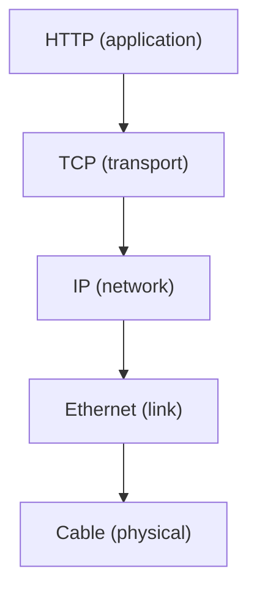

# S

## S-Tag
**Service VLAN tag.** In IEEE 802.1ad double tagging (Q-in-Q), the outer VLAN tag added by the service provider, with TPID 0x88A8. It sits outside the customer's own C-Tag.

See also: [C-Tag](c.md#c-tag), [VLAN](v.md#vlan), [Dot1Q](d.md#dot1q).

## S-GW
**Serving Gateway.** The LTE core gateway that forwards users' packets between the eNodeBs and the PGW. It anchors the user plane during handovers and buffers data for idle devices while the MME pages them.

See also: [PGW](p.md#pgw), [MME](m.md#mme), [LTE (4G)](l.md#lte-4g).

## SAAL
**Signalling ATM Adaptation Layer.** The ATM adaptation layer that carries signalling messages reliably between ATM switches.

See also: [ATM](a.md#atm), [AAL5](a.md#aal5).

## SaaS
**Software as a Service.** Software that a provider hosts and runs, and customers use over the internet, usually in a browser, on a subscription.

See also: [PaaS](p.md#paas), [IaaS](i.md#iaas).

## SAE
**System Architecture Evolution.** The 3GPP work that defined the LTE core network, the Evolved Packet Core: a simpler, all-IP core that also supports other access networks, such as Wi-Fi.

See also: [LTE (4G)](l.md#lte-4g), [MME](m.md#mme), [S-GW](#s-gw), [PGW](p.md#pgw).

## SAFe
**Scaled Agile Framework.** A framework for running agile development across many teams in a large organisation, with set roles, planning events and portfolio management.

See also: [Scaled Agile](#scaled-agile), [LeSS](l.md#less), [DAD](d.md#dad).

## SBC
**Session Border Controller.** A device at the edge of a VoIP network that controls the signalling, and usually the media, of calls crossing it. It provides security, NAT traversal, interworking and policing.

See also: [SIP](#sip), [SIP Trunk](#sip-trunk), [NAT](n.md#nat).

## SC-FDMA
**Single-Carrier FDMA.** A multiple access scheme, also called DFT-spread OFDMA, with a lower peak-to-average power ratio than OFDMA. That saves battery power, so LTE uses it for the uplink.

See also: [OFDMA](o.md#ofdma), [LTE (4G)](l.md#lte-4g).

## Scala
A statically typed language for the Java virtual machine that combines object-oriented and functional programming, and works with Java libraries.

See also: [Java](j.md#java).

## Scaled Agile
Agile methods applied to large projects and programmes, with many teams working on one product.

See also: [SAFe](#safe), [LeSS](l.md#less), [Scrum of Scrums](#scrum-of-scrums).

## SCCP
**Signalling Connection Control Part.** The SS7 layer above MTP that adds richer addressing (global title translation), connection-oriented services and segmentation. MAP and other application parts use it.

See also: [MTP](m.md#mtp), [SS7](#ss7), [TCAP](t.md#tcap).

## Scenario
A narrative of an activity, told as a story, often a concrete path through a use case.

See also: [Use Case](u.md#use-case), [Storyboard](#storyboard).

## Schedule
A plan that sets the timing, resources and dependencies of the tasks needed to finish a project or part of one.

See also: [Business Schedule](b.md#business-schedule), [Detailed Schedule](d.md#detailed-schedule).

## Scheduler
The part of an operating system, or a network device, that decides which task or packet gets a resource next, such as a processor or a link. Its aims include keeping resources busy, sharing them fairly and meeting deadlines or quality of service targets.

See also: [Round Robin](r.md#round-robin), [Preemption](p.md#preemption), [RTOS](r.md#rtos).

## SCM
**Software Configuration Management.** Tracking and controlling changes to software: version control, baselines, builds and releases. It is the software part of configuration management.

See also: [Configuration Management](c.md#configuration-management), [Version Control](v.md#version-control).

## Scratch
A visual, block-based programming language and online community from the MIT Media Lab, designed to teach children to code.

## Scribe
The person who records issues in an inspection or other formal meeting.

See also: [Inspection](i.md#inspection).

## Scrum
An agile framework in which a small team works in fixed-length sprints towards a sprint goal. It has three roles: product owner, Scrum Master and developers. Its events are sprint planning, the daily scrum, the sprint review and the retrospective.

See also: [Sprints](#sprints), [Product Owner](p.md#product-owner), [Scrum Master](#scrum-master).

## Scrum Master
The Scrum role that helps the team follow Scrum and work well, by coaching, removing obstacles and protecting the team's focus.

See also: [Scrum](#scrum).

## Scrum of Scrums
A way to coordinate several Scrum teams: each team sends a representative to a regular meeting to raise dependencies and problems between teams.

See also: [Scaled Agile](#scaled-agile).

## SCTP
**Stream Control Transmission Protocol.** A transport protocol (RFC 9260) that delivers messages reliably like TCP, keeps message boundaries like UDP, and supports multiple streams and multi-homing. It carries SS7 signalling over IP (SIGTRAN) and LTE control traffic.

See also: [TCP](t.md#tcp), [UDP](u.md#udp), [SGW](#sgw).

## SDES
**SDP Security Descriptions.** A way to exchange the keys for SRTP (secure RTP) inside the SDP of a SIP call. It relies on the signalling itself being encrypted.

See also: [SDP](#sdp), [RTP](r.md#rtp), [SIP](#sip).

## SDH
**Synchronous Digital Hierarchy.** The ITU-T standard for synchronous multiplexing of digital signals over fibre, from STM-1 (155 Mbit/s) upwards, with strong management and fast protection switching. It replaced PDH; SONET is the North American equivalent.

See also: [SONET](#sonet), [PDH](p.md#pdh), [EoS](e.md#eos).

## SDK
**Software Development Kit.** The libraries, tools, documentation and examples needed to build software for a particular platform or service.

See also: [API](a.md#api), [DDK](d.md#ddk).

## SDLC
**Systems Development Life Cycle.** A structured process for developing a system, from feasibility study through to maintenance. Waterfall, spiral and iterative models are all versions of it.

See also: [Lifecycle](l.md#lifecycle), [Waterfall](w.md#waterfall).

## SDMA
**Space-Division Multiple Access.** Using smart antennas to point beams at different users, so that users in different places can share the same frequency at the same time.

See also: [MIMO](m.md#mimo), [CDMA](c.md#cdma).

## SDN
**Software-Defined Networking.** Separating a network's control plane from its data plane, and putting control in software controllers that configure the forwarding devices through open interfaces. The network is then managed centrally and programmatically.

See also: [Control Plane](c.md#control-plane), [Data Plane](d.md#data-plane), [NaaS](n.md#naas).

## SDP
**Session Description Protocol.** A text format (RFC 8866) for describing multimedia sessions: media types, codecs, addresses and ports. SIP uses it in an offer and answer exchange to agree the media of a call.

See also: [SIP](#sip), [SDES](#sdes), [RTP](r.md#rtp).

## SDS
**Software Design Specification.** A document that sets out a system's detailed design: its modules, interfaces, data models, state machines, timing and memory layout. Ideally it is kept up to date alongside the code.

See also: [Software Requirements Specification](#software-requirements-specification), [Low Level Design](l.md#low-level-design).

## SDSL
**Symmetric Digital Subscriber Line.** DSL with the same speed in both directions, aimed at businesses. HDSL and G.SHDSL are examples.

See also: [ADSL](a.md#adsl), [HDSL](h.md#hdsl), [DSL](d.md#dsl).

## Sed
**Stream editor.** A Unix tool, written at Bell Labs in the 1970s, that transforms text line by line using a small command language, most often for substitutions with regular expressions.

See also: [Awk](a.md#awk), [Regular expression](r.md#regular-expression).

## Secure Element
**SE.** A tamper-resistant chip that stores keys and runs sensitive code in isolation, with protection against physical and side-channel attacks. SIM cards, payment cards and many IoT devices use one.

See also: [Root of Trust](r.md#root-of-trust), [TrustZone](t.md#trustzone), [SIM](#sim).

## SE
See [Secure Element](#secure-element).

## Semaphore
A synchronisation primitive: a counter that threads decrement to take one unit of a resource, waiting if none is left, and increment to release it. A binary semaphore works like a lock.

See also: [Mutex](m.md#mutex), [Mutual Exclusion](m.md#mutual-exclusion).

## Semantic Versioning
**SemVer.** A version numbering scheme, `MAJOR.MINOR.PATCH`. Increase the major number for incompatible API changes, the minor number for compatible new features and the patch number for compatible bug fixes. Pre-release and build labels can follow, as in `2.1.0-rc.1+build.5`.

See also: [Release Management](r.md#release-management), [Version](v.md#version).

## Sequence Model
A model, such as a UML sequence diagram, that shows the messages exchanged between objects or roles in time order.

See also: [Collaboration Model](c.md#collaboration-model), [UML](u.md#uml).

## SF
**Superframe.** The T1 framing format that groups 12 frames and uses their framing bits for alignment. Extended Superframe (ESF), with 24 frames, replaced it.

See also: [PDH](p.md#pdh), [TDM](t.md#tdm).

## SFTP
**SSH File Transfer Protocol.** A protocol for transferring and managing files over an SSH connection. It is unrelated to FTP and FTPS, apart from its purpose.

See also: [SSH](#ssh), [FTPS](f.md#ftps), [FTP](f.md#ftp).

## SGML
**Standard Generalized Markup Language.** The ISO standard (ISO 8879) for defining markup languages that describe a document's structure rather than its appearance. HTML and XML derive from it.

See also: [XML](x.md#xml).

## SGSN
**Serving GPRS Support Node.** The GPRS and UMTS core node that serves devices in its area. It tracks their location, authenticates them and routes their packets to and from the GGSN.

See also: [GGSN](g.md#ggsn), [GPRS](g.md#gprs), [MME](m.md#mme).

## SGW
**Signalling Gateway.** A gateway that carries SS7 signalling between circuit-switched networks and IP networks, for example passing ISUP from an MGCF over SCTP (SIGTRAN) to the SS7 network over MTP.

See also: [MGCF](m.md#mgcf), [SCTP](#sctp), [SS7](#ss7).

## Sh
The Bourne shell, the standard shell of Version 7 Unix, written by Stephen Bourne. `/bin/sh` on Unix-like systems today is a shell compatible with it, as POSIX defines.

See also: [Bash](b.md#bash), [Ksh](k.md#ksh), [Shell Scripting](#shell-scripting), [POSIX](p.md#posix).

## SHA
**Secure Hash Algorithm.** A family of cryptographic hash functions published by NIST. SHA-1 (160-bit) is broken and should not be used for security. SHA-2 (SHA-256, SHA-512) and SHA-3 are current.

See also: [Hash Function](h.md#hash-function), [MD5](m.md#md5).

## Shell Scripting
Writing scripts for a command-line shell, such as Bash, to automate tasks like handling files and running other tools.

See also: [Bash](b.md#bash), [Sh](#sh).

## Sidetone
The small part of a speaker's own voice fed back into their earpiece, so that a phone line sounds alive and people do not shout.

See also: [Echo](e.md#echo).

## Sign Up
**Signing up for tasks.** In agile teams, members choose the tasks they will work on, rather than a manager assigning them.

See also: [Task Board](t.md#task-board).

## SIM
**Subscriber Identity Module.** The smart card, or embedded chip (eSIM), that holds a mobile subscriber's IMSI and secret key. The network uses them to identify and authenticate the subscriber.

See also: [IMSI](i.md#imsi), [Secure Element](#secure-element), [HLR](h.md#hlr).

## SIMPLE
**SIP for Instant Messaging and Presence Leveraging Extensions.** The IETF's SIP-based protocols for instant messaging and presence. XMPP is the main alternative.

See also: [SIP](#sip), [XMPP](x.md#xmpp).

## Simple Design
The agile practice of keeping the design as simple as the current needs allow, guided by rules such as Kent Beck's.

See also: [Rule of Simplicity](r.md#rule-of-simplicity), [KISS Principle](k.md#kiss-principle), [Quick Design Session](q.md#quick-design-session).

## Simplex
Communication in one direction only, such as broadcast radio. ITU usage also applies the term to links that work one way at a time, which most people call half duplex.

See also: [Duplex](d.md#duplex), [Half Duplex](h.md#half-duplex).

## Single Step Test
A test in a debugger, stepping through the source code line by line as it runs.

## SIP
**Session Initiation Protocol.** The IETF's text-based signalling protocol (RFC 3261) for setting up, changing and ending voice, video and messaging sessions. It is modelled on HTTP and carries SDP to agree the media. SIP is the basis of most VoIP and of IMS.

See also: [SDP](#sdp), [RTP](r.md#rtp), [IMS](i.md#ims), [SIP Trunk](#sip-trunk).

## SIP Trunk
A VoIP connection, using SIP, between a business's phone system and a service provider, replacing ISDN lines for external calls.

See also: [SIP](#sip), [SBC](#sbc), [ISDN](i.md#isdn).

## SISO
**Single-Input, Single-Output.** A system with one input and one output; in radio, a link with one antenna at each end.

See also: [MIMO](m.md#mimo).

## Skew
**Clock skew.** The difference in the arrival time of the same clock signal at different parts of a circuit, or between the readings of two clocks.

See also: [Jitter](j.md#jitter).

## SLA
**Service Level Agreement.** An agreement between a provider and a customer on the service's measurable levels, such as availability, response and repair times, with remedies if they are missed.

See also: [KPI](k.md#kpi), [MTR](m.md#mtr).

## SLIP
**Serial Line Internet Protocol.** A very simple way of sending IP packets over a serial line (RFC 1055), with no negotiation or error checking. PPP replaced it, though it is still used on small microcontrollers.

See also: [PPP](p.md#ppp).

## SME
**Subject Matter Expert.** A person with deep knowledge of a particular area, often a business domain that the software serves. SME also commonly means small and medium-sized enterprise.

## Smoke Test
A quick test that a new build works at all, run before deeper testing.

See also: [Smoke testing](#smoke-testing), [Build](b.md#build).

## Smoke testing
Quick, shallow testing of a system's most important functions, to decide whether it is stable enough for further testing.

See also: [Smoke Test](#smoke-test), [Regression testing](r.md#regression-testing).

## SMP
**Symmetric Multiprocessing.** A design in which two or more identical processors, or cores, share one memory and are run by one operating system that treats them all equally. Most multi-core computers work this way.

See also: [AMP](a.md#amp).

## SMPF
**Shared Metallic Path Facility.** An Openreach product that shares one copper line between two providers. Typically one provides voice over the low frequencies and the other broadband over the high frequencies.

See also: [MPF](m.md#mpf), [WLR](w.md#wlr).

## SMSC
**Short Message Service Centre.** The network element that stores SMS messages and forwards them to their destination, retrying until the recipient is reachable.

See also: [MAP](m.md#map), [GSM](g.md#gsm).

## Snake Case
Writing compound names in lower case with underscores between the words, as in `snake_case`. Python uses it for functions and variables.

See also: [Camel Case](c.md#camel-case).

## SNMP
**Simple Network Management Protocol.** The IETF protocol for monitoring and managing network devices. Managers read and set variables in each device's MIB, and devices send traps when events happen. SNMPv3 adds proper security.

See also: [MIB](m.md#mib), [Management Plane](m.md#management-plane), [Cacti](c.md#cacti).

## SNTP
**Simple Network Time Protocol.** A simpler form of NTP, without NTP's long-term state and filtering, for devices that need only modest clock accuracy.

See also: [NTP](n.md#ntp).

## SOA
**Service-Oriented Architecture.** An architecture style in which applications are built from services. Each service provides a business function through a network interface, can be used without knowing how it works, and can be combined with others.

See also: [ESB](e.md#esb), [Microservice](m.md#microservice), [SOAP](#soap).

## SOAP
An XML-based messaging protocol for web services, usually over HTTP. A SOAP envelope holds a header and a body, and WSDL describes the services. REST has largely replaced it for new APIs.

See also: [WSDL](w.md#wsdl), [REST](r.md#rest), [XML](x.md#xml).

## Softswitch
A call control system implemented in software on general-purpose servers, which routes calls in VoIP and next-generation networks. It controls media gateways rather than switching media itself.

See also: [Class 4 Softswitch](c.md#class-4-softswitch), [Class 5 Softswitch](c.md#class-5-softswitch), [MGCP](m.md#mgcp), [H.248](h.md#h248).

## Software Change Request
See [Change Request](c.md#change-request).

## Software Configuration Management
See [SCM](#scm).

## Software Development Plan
**SDP.** On software projects, another name for the [Project Plan](p.md#project-plan).

## Software Engineering Body of Knowledge
**SWEBOK.** The IEEE Computer Society's guide to the generally accepted knowledge of software engineering, organised into knowledge areas.

See also: [IEEE](i.md#ieee).

## Software Engineering Lab
**SEL.** The Software Engineering Laboratory at NASA Goddard, which studied and improved software processes from 1976 into the 2000s.

## Software Engineering Process Group
**SEPG.** A group that leads software process improvement in an organisation, and gives projects independent technical oversight.

See also: [Capability Maturity Model](c.md#capability-maturity-model).

## Software Requirements Specification
**SRS.** A document that captures the requirements for a software system, often alongside models and prototypes.

See also: [Requirements](r.md#requirements), [SDS](#sds).

## SOLID Principles
Five object-oriented design principles promoted by Robert C. Martin: single responsibility, open-closed, Liskov substitution, interface segregation and dependency inversion. Together they aim for code that is modular and easy to change.

See also: [OO](o.md#oo), [Design Pattern](d.md#design-pattern).

## SoGEA
**Single Order Generic Ethernet Access.** An Openreach broadband product over fibre to the cabinet with no phone service on the line, ordered as one product. It is the standalone broadband line used as the copper phone network closes.

See also: [VDSL](v.md#vdsl), [EoFTTC](e.md#eofttc), [PSTN](p.md#pstn).

## SONET
**Synchronous Optical Network.** The North American standard for synchronous multiplexing over fibre, equivalent to SDH, with rates starting at OC-1 (51.84 Mbit/s).

See also: [SDH](#sdh).

## Source Code
The human-readable instructions of software, written in a programming language, that a compiler or interpreter turns into something a computer can run.

See also: [Machine code](m.md#machine-code), [Version Control](v.md#version-control).

## SPEEX
**Speex.** An open, patent-free speech codec from the Xiph.Org Foundation, based on CELP. Opus has replaced it.

See also: [OPUS](o.md#opus), [Vorbis](v.md#vorbis).

## SPI
**Serial Peripheral Interface.** A synchronous, full-duplex serial bus for short-distance links between a microcontroller and peripherals such as sensors, flash memory and displays. It uses a clock, two data lines and a chip select for each device.

See also: [MCU](m.md#mcu).

## Spiral Lifecycle
A lifecycle made of a series of small projects, each tackling the biggest remaining risks, until the system is delivered.

See also: [Spiral Model](#spiral-model), [Lifecycle](l.md#lifecycle).

## Sponsor
See [Project Sponsor](p.md#project-sponsor).

## Spiral Model
Barry Boehm's risk-driven process model. Each loop of the spiral sets objectives, identifies and resolves risks, develops and tests, and plans the next loop. It can borrow from other models, such as waterfall or prototyping, as the risks suggest.

See also: [Spiral Lifecycle](#spiral-lifecycle), [Waterfall](w.md#waterfall).

## Sprint Planning
The Scrum event at the start of a sprint, in which the team agrees the sprint goal and chooses the backlog items to work on.

See also: [Sprints](#sprints), [Scrum](#scrum).

## Sprint retrospective
The Scrum event at the end of a sprint, in which the team reviews how it worked and agrees improvements.

See also: [Heartbeat Retrospective](h.md#heartbeat-retrospective), [Scrum](#scrum).

## Sprints
Fixed-length iterations, usually two to four weeks, in which a Scrum team produces a usable increment.

See also: [Iteration](i.md#iteration), [Timebox](t.md#timebox), [Scrum](#scrum).

## SQL
**Structured Query Language.** The standard language for defining, querying and changing data in relational databases.

See also: [RDBMS](r.md#rdbms), [NoSQL](n.md#nosql).

## SS7
**Signalling System No. 7.** The ITU-T set of protocols that telephone networks use to set up and clear calls and to provide services such as number translation, number portability, prepaid and SMS. In the UK it is also called C7. Its layers include MTP, SCCP, TCAP, ISUP and MAP.

See also: [MTP](m.md#mtp), [SCCP](#sccp), [ISUP](i.md#isup), [TCAP](t.md#tcap), [MAP](m.md#map), [CCS](c.md#ccs).

## SSADM
**Structured Systems Analysis and Design Method.** A waterfall method for analysing and designing information systems, developed for and widely used in UK government from the 1980s.

See also: [Waterfall](w.md#waterfall), [CCTA](c.md#ccta).

## SSH
**Secure Shell.** A cryptographic protocol for logging in to and running commands on remote machines securely over an untrusted network. It also tunnels other traffic and carries SFTP.

See also: [SFTP](#sftp).

## SSID
**Service Set Identifier.** The name of a Wi-Fi network.

See also: [Wi-Fi](w.md#wi-fi).

## SSIS
**SQL Server Integration Services.** The Microsoft SQL Server component for data integration and ETL workflows.

See also: [ETL](e.md#etl).

## SSL
**Secure Sockets Layer.** The predecessor of TLS. All SSL versions are broken and must not be used, though "SSL" is still often said when TLS is meant. See [TLS](t.md#tls).

## Stack
A protocol stack: the layered set of protocols that together provide communication, such as Ethernet, IP, TCP and HTTP, or the software that implements them.

[[CAPTION:Figure]] A typical protocol stack, from application to physical layer.

See also: [Internet Protocol Suite](i.md#internet-protocol-suite), [L1](l.md#l1), [L2](l.md#l2).

## Staff Days
A measure of effort: how much work an activity needs, in days of one person's time, as distinct from calendar days.

See also: [Calendar Days](c.md#calendar-days).

## Stage
Often a synonym for phase. More precisely, a phase can be divided into stages.

See also: [Phase](p.md#phase).

## Staged Delivery Lifecycle
A lifecycle that delivers a system in stages, with the most important functions first.

See also: [Evolutionary Delivery Lifecycle](e.md#evolutionary-delivery-lifecycle), [Incremental Development](i.md#incremental-development).

## Stakeholder
A person or organisation with an interest in a project's outcome, such as its customers, users and sponsors, and any group it affects.

## Standard
An agreed, documented set of rules, conventions or requirements that work must follow.

See also: [Construction Standard](c.md#construction-standard).

## Statistical Estimation
Estimating with a statistical model built from historical data, usually predicting effort and time from size. It works best when calibrated on similar past projects.

See also: [Parametric Estimation](p.md#parametric-estimation).

## STB
**Set-Top Box.** A device that receives television signals, by aerial, satellite, cable or IP, and turns them into pictures and sound on a TV.

See also: [IPTV](i.md#iptv), [DTT](d.md#dtt).

## Story Mapping
Arranging user stories in two dimensions: along the user's journey from left to right, and by priority from top to bottom. The map helps plan releases.

See also: [User Stories](u.md#user-stories).

## Story Splitting
Breaking a user story into smaller stories, each of which still has value of its own.

See also: [User Stories](u.md#user-stories), [Epic](e.md#epic).

## Storyboard
A sequence of pictures showing a scenario or use case.

See also: [Scenario](#scenario), [Low Fidelity Prototype](l.md#low-fidelity-prototype).

## STRIDE Threat Model
Microsoft's mnemonic for six kinds of security threat: Spoofing, Tampering, Repudiation, Information disclosure, Denial of service and Elevation of privilege. Each one threatens a security property: authenticity, integrity, non-repudiation, confidentiality, availability and authorisation.

See also: [Pen testing](p.md#pen-testing).

## STP
**Spanning Tree Protocol.** The IEEE 802.1D protocol that stops loops in Ethernet networks by blocking redundant links so that one loop-free path remains, and unblocking them if the active path fails. Radia Perlman invented the algorithm.

See also: [RSTP](r.md#rstp), [Switch](#switch).

## Strategy
The overall approach taken to a problem or goal.

## STUN
**Session Traversal Utilities for NAT.** A protocol (RFC 8489) with which a device behind a NAT discovers the public address and port the NAT has given it. ICE, SIP and WebRTC use it.

See also: [ICE](i.md#ice), [NAT](n.md#nat).

## Subversion
**SVN.** Apache Subversion, a centralised version control system designed as a successor to CVS.

See also: [Git](g.md#git), [Version Control](v.md#version-control).

## Sustainable Pace
Working at a pace the team could keep up indefinitely, without overtime and burnout.

See also: [XP](x.md#xp).

## SVC
**Switched Virtual Circuit.** A virtual circuit set up on demand for a call or transfer and cleared when it ends.

See also: [PVC](p.md#pvc), [ATM](a.md#atm), [X.25](x.md#x25).

## Swift
Apple's compiled, multi-paradigm language for its platforms, released in 2014 as the successor to Objective-C. It is open source and also runs on Linux.

See also: [Objective C](o.md#objective-c).

## Switch
A network device that connects devices on a LAN and forwards each frame only to the port where its destination MAC address is. It learns those addresses from the traffic it sees. A layer-3 switch can also route.

See also: [Hub](h.md#hub), [Router](r.md#router), [VLAN](v.md#vlan).

## System
A set of hardware, software and processes that work together. In a project, the system is what the project was set up to build.

## System Test
A test of the whole system's behaviour, using a project build in the system test environment.

See also: [Integration Test](i.md#integration-test), [System Test Environment](#system-test-environment).

## System Test Environment
An environment that copies the live environment and its conditions as closely as possible, for system testing.

See also: [System Test](#system-test).

## SystemX
**System X.** The UK's national digital telephone exchange system, developed by the Post Office (later BT) with GEC, Plessey and STC, and introduced in the 1980s. It includes concentrators, digital local exchanges (DLEs) and trunk exchanges (DMSUs).

See also: [DLE](d.md#dle), [PSTN](p.md#pstn).
