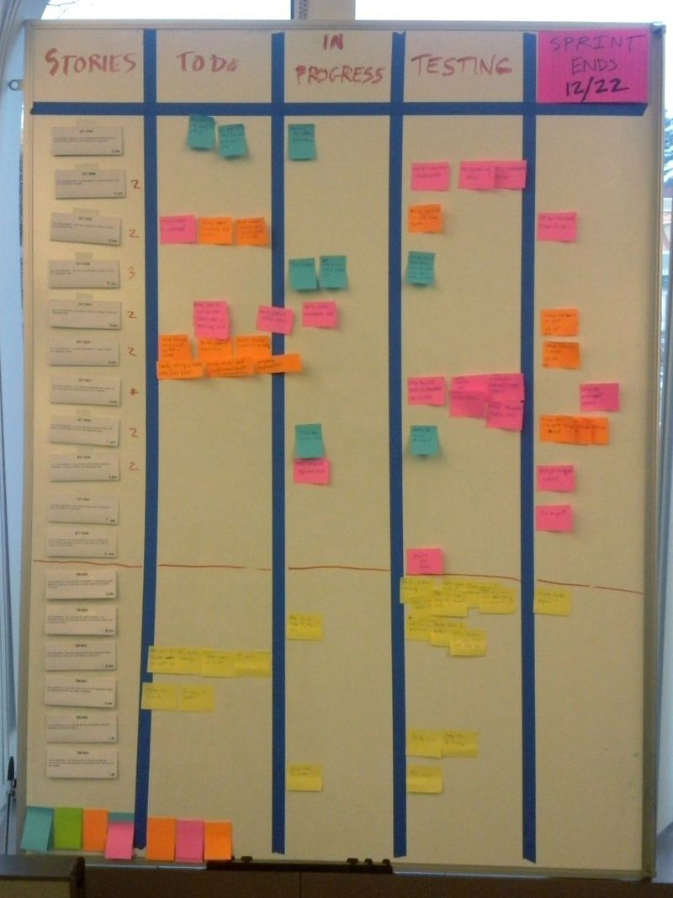
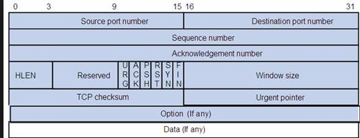
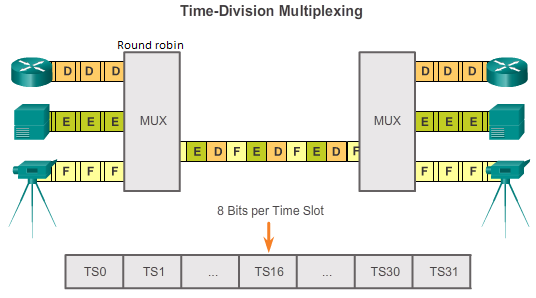
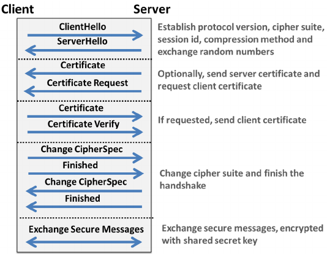
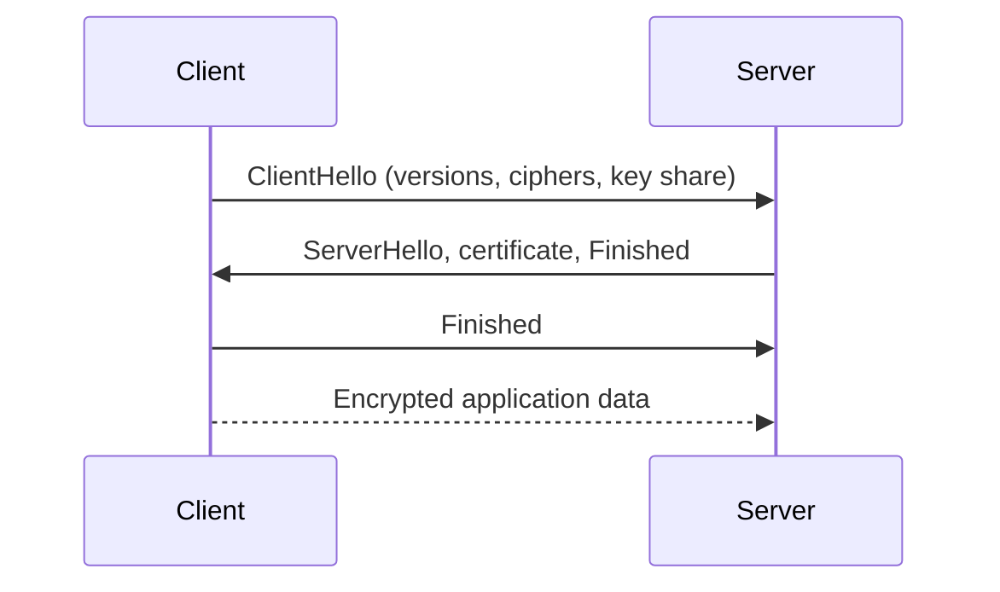
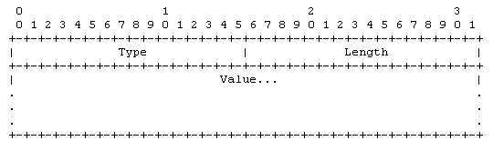
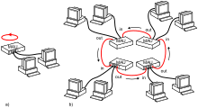

# T

## T-Shirt Sizing
Estimating by sorting items into rough relative sizes, such as extra small, small, medium, large and extra large, rather than giving false precision.

See also: [Relative Estimation](r.md#relative-estimation), [Points](p.md#points).

## Task
A small, distinct unit of work in a project.

See also: [Activity](a.md#activity), [Work Item](w.md#work-item).

## Task Board
A board with columns such as "To do", "In progress" and "Done", on which cards for tasks move as work progresses.

[[CAPTION:Figure]] Task Board.

See also: [Kanban Board](k.md#kanban-board), [Information Radiators](i.md#information-radiators).

## Task Estimate
An estimate for a single task, usually made during planning and tracking and fed into work plans and detailed schedules.

See also: [Project Estimate](p.md#project-estimate), [Estimate](e.md#estimate).

## TCAP
**Transaction Capabilities Application Part.** The SS7 layer that manages dialogues between applications, such as MAP, INAP and CAP, using transaction IDs to run many at once. It encodes messages with ASN.1 BER.

See also: [SS7](s.md#ss7), [MAP](m.md#map), [INAP](i.md#inap), [CAP](c.md#cap).

## Tcl/tk
Tcl is a dynamic scripting language, and Tk is the cross-platform GUI toolkit that grew up with it. Together they offer a quick way to build desktop interfaces, and other languages, such as Python's Tkinter, also use Tk.

## TCP
**Transmission Control Protocol.** The internet's main transport protocol (RFC 9293). It gives applications a reliable, ordered, error-checked byte stream over IP, with flow and congestion control. The web, email and file transfer use it.

[[CAPTION:Figure]] TCP.

See also: [UDP](u.md#udp), [Internet Protocol Suite](i.md#internet-protocol-suite), [Out-of-order delivery](o.md#out-of-order-delivery).

## Tcsh
An enhanced C shell that adds command-line editing and completion. It was long the default shell for the root user on FreeBSD.

See also: [Csh](c.md#csh).

## TDD
**Test-Driven Development.** Writing a failing unit test first, then the simplest code that passes it, then refactoring, in short repeated cycles.

See also: [Unit Testing](u.md#unit-testing), [Refactoring](r.md#refactoring), [BDD](b.md#bdd).

## TDM
**Time-Division Multiplexing.** Sharing a channel by giving each signal its own repeating time slot. Digital telephony carries each call in a 64 kbit/s slot, for example 30 calls on an E1.

[[CAPTION:Figure]] TDM.

See also: [Multiplex](m.md#multiplex), [PDH](p.md#pdh), [SDH](s.md#sdh).

## Team
In agile terms, a small group of people working on the same product or goal, nearly all of them full time.

## Team Room
A space set aside for a team for the length of a project, so that its members, including the product owner, can work together closely.

See also: [Information Radiators](i.md#information-radiators).

## Technical Debt
The future cost of rework caused by choosing a quick solution now over a better one that would take longer. Like money, it gathers interest: left unpaid, it makes every later change harder.

See also: [Refactoring](r.md#refactoring).

## Template
An outline or framework for creating an artefact.

## Test
A single test case, or testing in general.

See also: [Testing](#testing), [Test Case](#test-case).

## Test Activity
A specific test procedure, combining one or more test techniques and test types.

## Test Case
**TC.** The inputs, steps and expected results that check whether a feature works or a requirement is met.

See also: [Test Case Specification](#test-case-specification), [Test Plan](#test-plan).

## Test Case Specification
**TCS.** A document listing the test cases that verify one or more features.

See also: [Test Case](#test-case).

## Test Design
Working out how to test a product: linking test cases to its requirements and design, when testing needs real analysis and structure.

See also: [Test Design Specification](#test-design-specification).

## Test Design Specification
**TDS.** A document recording the test design for a group of test cases.

See also: [Test Design](#test-design).

## Test Level
See [Test Type](#test-type).

## Test Plan
**TP.** A document setting out the scope, approach, resources, test items and schedule of testing.

See also: [Quality Plan](q.md#quality-plan), [Test Case](#test-case).

## Test Technique
The method used in a test activity, such as boundary value analysis or equivalence partitioning.

## Test Type
A category of testing, such as unit, integration, system or acceptance testing, defined by what it tests, how, why and when.

## Testing
Running software to find defects and to show that it meets its requirements.

See also: [Quality Control](q.md#quality-control), [Test Plan](#test-plan).

## Three Amigos
A meeting of the three main perspectives on a piece of work, business, development and testing, to agree what it should do before, during and after development.

See also: [ATDD](a.md#atdd), [BDD](b.md#bdd).

## Three C's
**Card, Conversation, Confirmation.** The three parts of a user story: a short note on a card, the conversation that fills in the detail, and the acceptance tests that confirm it is done.

See also: [User Stories](u.md#user-stories).

## Three Questions
The traditional structure of the daily stand-up: what did I complete, what will I do next, and what is in my way?

See also: [Daily Scrum](d.md#daily-scrum).

## TIA
**Telecommunications Industry Association.** The US trade body, accredited by ANSI, that develops standards such as TIA-568 for structured cabling.

See also: [EIA](e.md#eia), [ANSI](a.md#ansi).

## Timebox
A fixed, agreed period in which a person or team works towards a goal, and which ends on time whether or not everything is done.

See also: [Sprints](s.md#sprints), [Iteration](i.md#iteration).

## TKIP
**Temporal Key Integrity Protocol.** The stop-gap Wi-Fi security protocol, from 802.11i, that replaced WEP on existing hardware. It is no longer secure and was deprecated in 2012.

See also: [WEP](w.md#wep), [WPA2](w.md#wpa2).

## TLS
**Transport Layer Security.** The protocol that encrypts and authenticates connections between applications, such as HTTPS. A handshake authenticates the server, usually with an X.509 certificate, and agrees keys. Symmetric encryption then protects the data. TLS 1.3 (RFC 8446) is current, and it replaced SSL.

[[CAPTION:Figure]] TLS.

[[CAPTION:Figure]] A TLS 1.3 handshake, simplified.

See also: [HTTPS](h.md#https), [DTLS](d.md#dtls), [X.509](x.md#x509), [SSL](s.md#ssl).

## TLV
**Type-Length-Value.** An encoding in which each element has a type code, a length and then the value. Receivers can skip elements they do not understand, so formats can grow. BER, IS-IS and many other protocols use it.

[[CAPTION:Figure]] TLV.

See also: [BER](b.md#ber).

## TOGAF
**The Open Group Architecture Framework.** A widely used enterprise architecture framework. Its Architecture Development Method (ADM) guides architecture work across the business, data, application and technology domains.

See also: [Architecture](a.md#architecture), [ADR](a.md#adr).

## Token Ring
A LAN technology from IBM, standardised as IEEE 802.5. A token passes round a ring of stations, and only the station holding it may transmit. There are therefore no collisions. Ethernet replaced it.

[[CAPTION:Figure]] Token Ring.

See also: [FDDI](f.md#fddi).

## TOML
**Tom's Obvious, Minimal Language.** A configuration file format, created by Tom Preston-Werner, designed to be easy to read and to map clearly to a dictionary. Python's `pyproject.toml` and Rust's `Cargo.toml` use it.

See also: [YAML](y.md#yaml), [JSON](j.md#json).

## Top Level Schedule
See [Business Schedule](b.md#business-schedule).

## Top-Down Estimation
Estimating a whole system first, then dividing the total among its parts.

See also: [Bottom-Up Estimation](b.md#bottom-up-estimation), [Macro Estimation](m.md#macro-estimation).

## Triple DES
**3DES, or TDEA.** DES applied three times to each block with two or three keys, to extend its life after DES's 56-bit key became too short. It is slow and now deprecated in favour of AES.

See also: [DES](d.md#des), [AES](a.md#aes).

## TTY
**Teletypewriter.** Originally an electromechanical typewriter used as a terminal. On Unix the name now means any terminal device, including a terminal emulator window.

See also: [Unix](u.md#unix).

## TrustZone
Arm's hardware security extension that splits a processor into a secure world and a normal world. The secure world holds keys, secure boot and trusted applications, isolated from the main operating system. It exists on Cortex-A and, as Armv8-M, on Cortex-M.

See also: [Root of Trust](r.md#root-of-trust), [Secure Element](s.md#secure-element).

## TUP
**Telephone User Part.** The first SS7 call control protocol, for ordinary telephone calls without ISDN features. ISUP has largely replaced it.

See also: [ISUP](i.md#isup), [SS7](s.md#ss7).

## Twisted pair
Cable in which the two wires of each circuit are twisted together, which cuts interference and crosstalk. It is used for telephone lines and Ethernet.

See also: [Cat 5](c.md#cat-5), [Ethernet over twisted pair](e.md#ethernet-over-twisted-pair).
