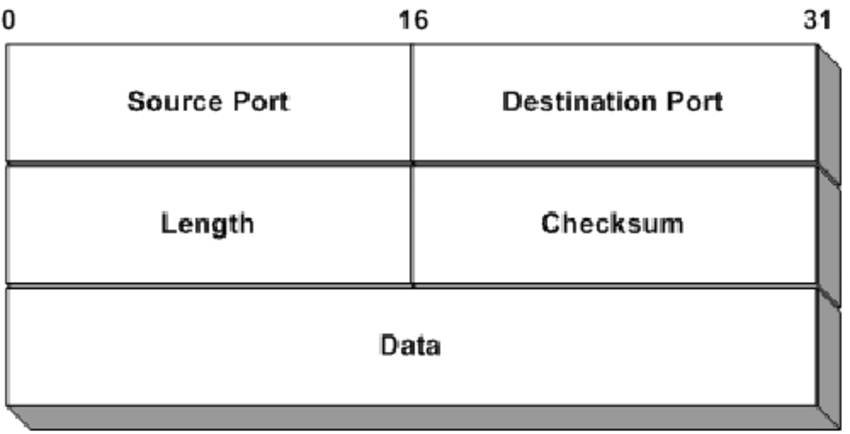
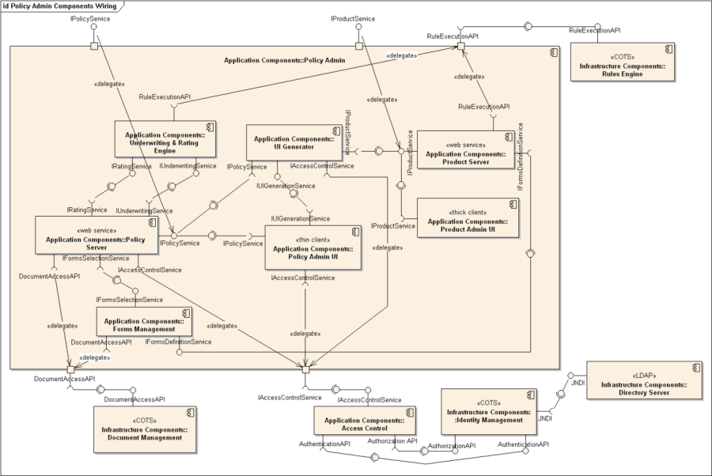
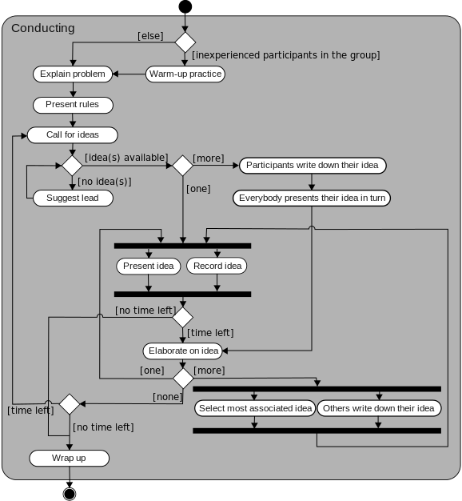
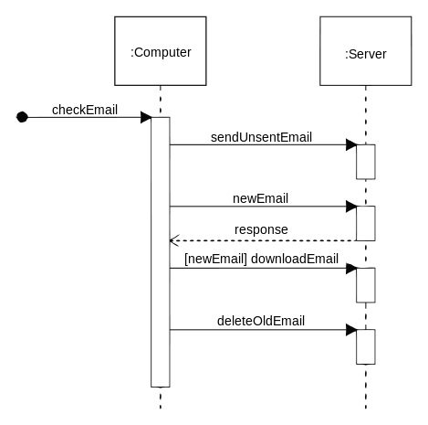
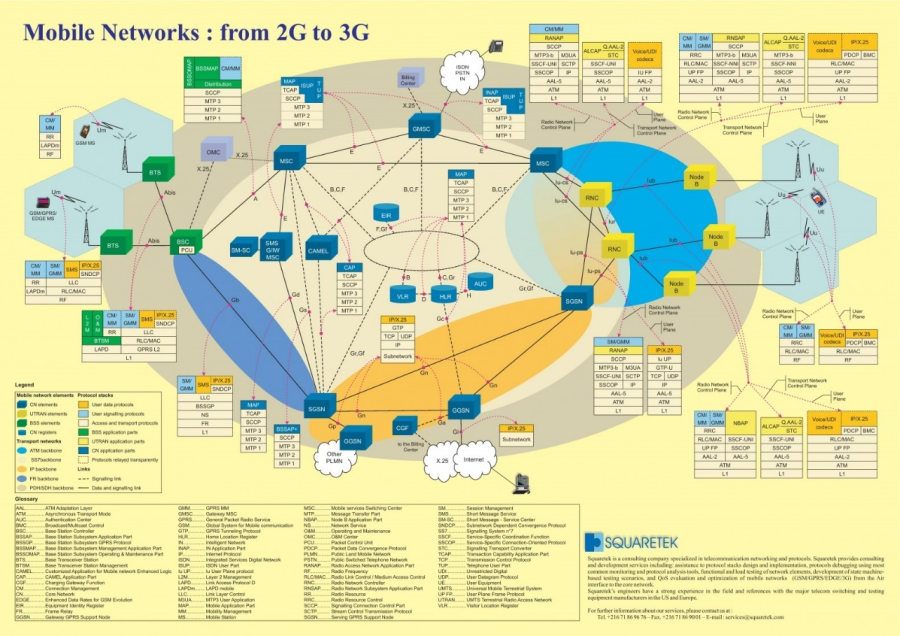
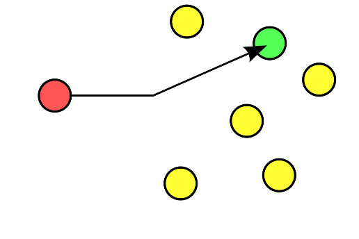
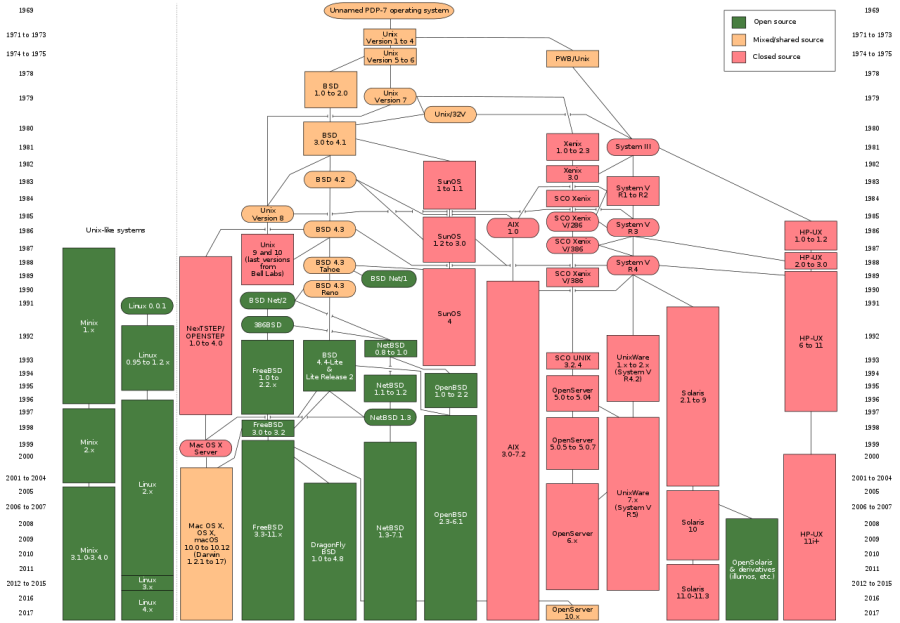
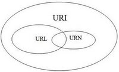
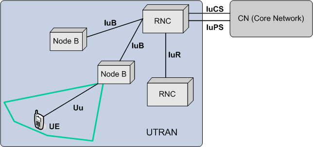
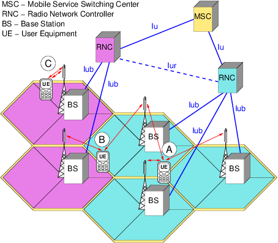

# U

## UA
**User Agent.** Software acting for a user. In HTTP, the browser or client, which names itself in the `User-Agent` header; in SIP, an endpoint that makes or receives calls.

See also: [HTTP](h.md#http), [SIP](s.md#sip).

## Ubiquitous Language
In domain-driven design, a shared vocabulary drawn from the business domain, used consistently by everyone, from conversations and requirements through to the code.

## UDP
**User Datagram Protocol.** A simple, connectionless transport protocol (RFC 768) that sends datagrams with port numbers and a checksum, but no guarantee of delivery or order. DNS, VoIP media and streaming use it, along with protocols that add their own reliability.

[[CAPTION:Figure]] UDP.

[[CAPTION:Table]] The UDP header: four 16-bit fields, then the data.

| Bits 0 to 15 | Bits 16 to 31 |
| --- | --- |
| Source port | Destination port |
| Length | Checksum |
| Data | Data |

See also: [TCP](t.md#tcp), [RTP](r.md#rtp), [DTLS](d.md#dtls).

## UER
**Universal Edge Router.** Juniper's name for its broadband edge routers, which do the job of a BRAS.

See also: [BRAS](b.md#bras), [BNG](b.md#bng).

## UML
<!-- vale PyDoc.Spelling = NO -->
**Unified Modeling Language.**
<!-- vale PyDoc.Spelling = YES -->
The standard graphical language for modelling software systems, maintained by the Object Management Group. It was created by Grady Booch, Ivar Jacobson and James Rumbaugh in the mid-1990s. Its diagrams include class, sequence, activity, state and use case diagrams.

[[CAPTION:Figure]] UML.

[[CAPTION:Figure]] UML.

[[CAPTION:Figure]] UML.

See also: [Class Model](c.md#class-model), [Sequence Model](s.md#sequence-model), [Use Case](#use-case).

## UMTS
**Universal Mobile Telecommunications System.** The 3GPP third-generation (3G) mobile system, which evolved from GSM. It uses wideband CDMA radio, and HSPA later speeded up its data.

[[CAPTION:Figure]] UMTS.

See also: [W-CDMA](w.md#w-cdma), [UTRAN](#utran), [GSM](g.md#gsm), [LTE (4G)](l.md#lte-4g).

## UNI
**User-Network Interface.** The demarcation between a service provider's network and a customer's equipment, where the provider's responsibility ends.

See also: [NNI](n.md#nni), [EVC](e.md#evc).

## Unicast
Sending data from one sender to one receiver, each identified by its own address. Most internet traffic is unicast.

[[CAPTION:Figure]] Unicast.

See also: [Multicast](m.md#multicast), [Broadcast](b.md#broadcast), [Anycast](a.md#anycast).

## Unicode
The standard that gives a unique number, or code point, to every character in the world's writing systems, plus symbols and emoji. It is kept in step with ISO/IEC 10646. UTF-8 and UTF-16 are ways of encoding it.

See also: [UTF-8](#utf-8), [UTF-16](#utf-16), [ASCII](a.md#ascii).

## Unified Communications
**UC.** Bringing an organisation's communication services, such as voice, video, messaging, presence, conferencing and voicemail, together behind one consistent user experience across devices.

See also: [VoIP](v.md#voip), [SIP](s.md#sip).

## Unit Test
The lowest level of component test: a test of one small piece of code on its own.

See also: [Unit Testing](#unit-testing).

## Unit Testing
Writing and running small automated tests, written by the developers, that each check a narrow piece of the code.

See also: [Unit Test](#unit-test), [TDD](t.md#tdd), [Mock Objects](m.md#mock-objects).

## Unix
A family of multi-user, multitasking operating systems descended from the original developed at Bell Labs by Ken Thompson, Dennis Ritchie and others from 1969. BSD, Solaris, AIX and macOS are Unix systems; Linux is Unix-like.

[[CAPTION:Figure]] Unix.

See also: [Linux](l.md#linux), [POSIX](p.md#posix), [Sh](s.md#sh).

## Update
Planned work to bring an artefact up to date with the project's current needs.

See also: [Rework](r.md#rework).

## Upstream
In a project, the early activities and artefacts, such as chartering, planning, requirements and architecture. In networking, the direction from the customer towards the network.

See also: [Downstream](d.md#downstream).

## URI
**Uniform Resource Identifier.** A string that identifies a resource (RFC 3986). URLs, which say where to find it, and URNs, which name it, are both kinds of URI.

[[CAPTION:Figure]] URI.

See also: [URL](#url), [URN](#urn).

## URL
**Uniform Resource Locator.** A URI that says how and where to get a resource: a scheme, such as `https`, a host, a path and optional query and fragment, as in `https://example.com/page?id=1#top`.

See also: [URI](#uri), [URN](#urn), [HTTP](h.md#http).

## URN
**Uniform Resource Name.** A URI that names a resource permanently, without saying where it is, as in `urn:isbn:0451450523`.

See also: [URI](#uri), [URL](#url).

## Usability Testing
Watching real users try to do realistic tasks with a product, to find where it is hard to use.

See also: [User Experience](#user-experience).

## Use Case
A description of how a user (actor) interacts with a system to achieve a goal, including the main path and alternatives.

See also: [Use Case Model](#use-case-model), [Use Case Specification](#use-case-specification), [Nominal Path](n.md#nominal-path).

## Use Case Model
The set of use cases and actors that describes a system's behaviour from the outside.

See also: [Use Case](#use-case), [UML](#uml).

## Use Case Specification
The document that describes one use case in full.

See also: [Use Case](#use-case).

## User Experience
**UX.** The whole of a person's experience of using a product, including but going beyond its user interface: how useful, easy and pleasant it is.

See also: [User Interface](#user-interface), [Usability Testing](#usability-testing), [Personas](p.md#personas).

## User Interface
**UI.** The part of a system through which people interact with it, such as screens, controls and messages.

See also: [User Interface Design](#user-interface-design), [User Experience](#user-experience).

## User Interface Design
Designing how people interact with a system: layout, controls, flows and feedback.

See also: [User Interface](#user-interface), [User Interface Prototype](#user-interface-prototype).

## User Interface Prototype
A prototype built to explore a user interface's behaviour or look and feel.

See also: [High Fidelity Prototype](h.md#high-fidelity-prototype), [Low Fidelity Prototype](l.md#low-fidelity-prototype).

## User Plane
The part of a network that carries users' traffic, as opposed to the control plane, which carries signalling. In routers it is also called the data plane or forwarding plane. In mobile networks, separating the two planes lets each scale on its own.

See also: [Data Plane](d.md#data-plane), [Control Plane](c.md#control-plane), [Management Plane](m.md#management-plane).

## User Stories
Short descriptions of functionality from the user's point of view, agreed with the customer or product owner, that the team uses to divide up the work.

See also: [Role-feature-reason](r.md#role-feature-reason), [INVEST](i.md#invest), [Three C's](t.md#three-cs), [Epic](e.md#epic).

## UTC
**Coordinated Universal Time.** The world's primary time standard, kept by atomic clocks and adjusted with leap seconds to stay close to the Earth's rotation. It has no daylight saving time, and for everyday purposes it is the same as GMT.

See also: [NTP](n.md#ntp).

## UTF-16
A Unicode encoding that uses one 16-bit unit for characters in the Basic Multilingual Plane and two units, a surrogate pair, for the rest. Windows, Java and JavaScript use it internally. UTF-32, by contrast, uses a fixed 32 bits for every code point.

See also: [Unicode](#unicode), [UTF-8](#utf-8).

## UTF-8
The most widely used Unicode encoding, designed by Ken Thompson and Rob Pike. It uses one to four bytes per character, and the first 128 characters are the same as ASCII, so ASCII text is valid UTF-8. It is the default encoding of the web.

See also: [Unicode](#unicode), [UTF-16](#utf-16), [ASCII](a.md#ascii).

## UTRAN
**UMTS Terrestrial Radio Access Network.** The 3G radio access network: the Node Bs and the RNCs that control them.

[[CAPTION:Figure]] UTRAN.

[[CAPTION:Figure]] UTRAN.

See also: [Node B](n.md#node-b), [RNC](r.md#rnc), [UMTS](#umts), [E-UTRAN](e.md#e-utran).
