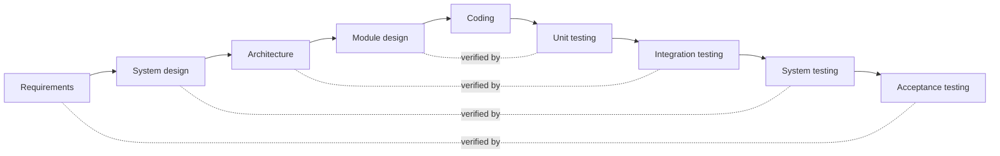

# V

## V Model
A development model that extends waterfall by pairing each specification and design stage with the test stage that checks it. Requirements pair with acceptance testing, and so on down to unit tests. Drawn out, the stages form a V.

[[CAPTION:Figure]] The V model: each design stage is verified by a matching test stage.

See also: [Waterfall](w.md#waterfall), [Testing](t.md#testing).

## V.90 {#v90}
The ITU-T standard, from 1998, for 56 kbit/s dial-up modems. It achieves 56 kbit/s downstream and 33.6 kbit/s upstream by using the digital connection at the network end.

See also: [V.92](#v92).

## V.92 {#v92}
The ITU-T successor to V.90, which raised upstream speed to 48 kbit/s and added quicker connection and modem-on-hold.

See also: [V.90](#v90).

## VAD
**Voice Activity Detection.** Detecting whether speech is present in an audio signal. VoIP and mobile systems use it to stop sending during silence, which saves bandwidth, and generate comfort noise at the other end.

See also: [CNG](c.md#cng), [VoIP](#voip).

## VB
**Visual Basic.** Microsoft's event-driven language and IDE, first released in 1991, for building Windows applications quickly from forms and components. Classic VB became legacy in 2008; VB.NET is its .NET successor.

See also: [BASIC](b.md#basic), [VBS](#vbs), [RAD](r.md#rad).

## VBS
**VBScript.** Microsoft's scripting language based on Visual Basic, used for Windows administration and old web pages. Microsoft is removing it from Windows.

See also: [VB](#vb).

## VC
**Virtual Circuit.** A connection across a packet network that behaves like a dedicated circuit between two endpoints, set up before data flows. X.25, Frame Relay and ATM use virtual circuits.

See also: [PVC](p.md#pvc), [SVC](s.md#svc), [VCI](#vci).

## VCI
**Virtual Channel Identifier.** The 16-bit field in an ATM cell header that, with the VPI, identifies the virtual channel the cell belongs to.

See also: [VPI](#vpi), [ATM](a.md#atm).

## VCID
**Virtual Circuit Identifier.** The identifier that both ends of a pseudowire use to match up the same circuit, for example in an MPLS VPWS.

See also: [PW](p.md#pw), [VPWS](#vpws).

## VDSL
**Very-high-bit-rate DSL.** DSL using frequencies up to 30 MHz on short lines. VDSL2 (G.993.2) gives tens of megabits per second, and up to around 80 Mbit/s downstream from a street cabinet. It is the technology of fibre-to-the-cabinet broadband.

See also: [ADSL](a.md#adsl), [G.Fast](g.md#gfast), [PCP](p.md#pcp).

## Velocity
The amount of work, usually in story points, that a team completes in an iteration. Teams use it to forecast what they can take on next.

See also: [Points](p.md#points), [Burndown Chart](b.md#burndown-chart).

## Verifier
In an inspection, the person who checks that the rework has been done properly.

See also: [Inspection](i.md#inspection).

## Version
A formally released revision of an artefact, recognised by configuration management.

See also: [Revision](r.md#revision), [Semantic Versioning](s.md#semantic-versioning).

## Version Control
Recording every change to files, such as source code, so that any earlier version can be recovered and several people can work in parallel and merge their work. Git is the most widely used tool.

See also: [Git](g.md#git), [Subversion](s.md#subversion), [SCM](s.md#scm).

## VHDL
**VHSIC Hardware Description Language.** A language, standardised as IEEE 1076, for describing and simulating digital hardware, from systems down to logic gates. It came out of the US Very High-Speed Integrated Circuits programme in the 1980s. Verilog is its main alternative.

## VISP
**Virtual ISP.** An internet service provider that sells another ISP's service under its own brand.

See also: [ISP](i.md#isp), [MVNO](m.md#mvno).

## VLAN
**Virtual LAN.** A separate broadcast domain created on shared switches, usually by tagging frames with an 802.1Q VLAN ID, so that one physical network carries several isolated LANs.

See also: [Dot1Q](d.md#dot1q), [Dot1Q trunking](d.md#dot1q-trunking), [Switch](s.md#switch).

## VLR
**Visitor Location Register.** The database, usually built into each MSC, of the subscribers currently in its area. It copies their details from their HLR.

See also: [HLR](h.md#hlr), [MSC](m.md#msc).

## VM
**Virtual Machine.** A software emulation of a computer, on which an operating system and applications run as if on real hardware. A hypervisor shares the physical machine between several VMs.

See also: [Docker](d.md#docker), [IaaS](i.md#iaas).

## VOD
**Video on Demand.** Letting viewers choose and watch video when they want, rather than at a broadcast time, by streaming or downloading.

See also: [IPTV](i.md#iptv), [STB](s.md#stb).

## VoIP
**Voice over IP.** Carrying voice calls over IP networks, with signalling protocols such as SIP to set up calls and RTP to carry the media.

See also: [SIP](s.md#sip), [RTP](r.md#rtp), [SBC](s.md#sbc), [VoLTE](#volte).

## VoLTE
**Voice over LTE.** Voice calls over an LTE network as IP packets, using IMS, following the GSMA IR.92 profile. It needs no circuit-switched network, connects calls faster and supports HD voice.

See also: [IMS](i.md#ims), [LTE (4G)](l.md#lte-4g), [AMR-WB](a.md#amr-wb).

## Vorbis
An open, royalty-free lossy audio codec from the Xiph.Org Foundation, usually used in the Ogg container (Ogg Vorbis). Opus has largely replaced it.

See also: [OPUS](o.md#opus), [MP3](m.md#mp3).

## VPI
**Virtual Path Identifier.** The field in an ATM cell header that identifies a virtual path, a bundle of virtual channels. See [VCI](#vci).

## VPLS
**Virtual Private LAN Service.** A provider service that joins several customer sites into one Ethernet broadcast domain over an MPLS network, using a mesh of pseudowires. It is defined in RFCs 4761 and 4762.

See also: [L2VPN](l.md#l2vpn), [PW](p.md#pw), [VPWS](#vpws).

## VPN
**Virtual Private Network.** A private network built over a shared or public one, such as the internet or a provider's MPLS core. It uses tunnelling and often encryption, so that remote sites or users act as if directly connected.

See also: [IPSec](i.md#ipsec), [L3VPN](l.md#l3vpn), [L2VPN](l.md#l2vpn).

## VPWS
**Virtual Private Wire Service.** A point-to-point layer-2 service, such as Ethernet, carried over an MPLS network by a pseudowire. It is also called a virtual leased line or Ethernet over MPLS (EoMPLS).

See also: [PW](p.md#pw), [VPLS](#vpls), [EPWS](e.md#epws).

## VRF
**Virtual Routing and Forwarding.** Several separate routing tables in one router, so that different customers or networks, even with overlapping addresses, stay apart. It is the building block of MPLS layer-3 VPNs.

See also: [L3VPN](l.md#l3vpn), [CE](c.md#ce).
