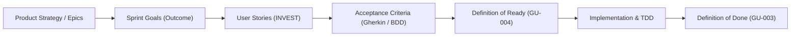
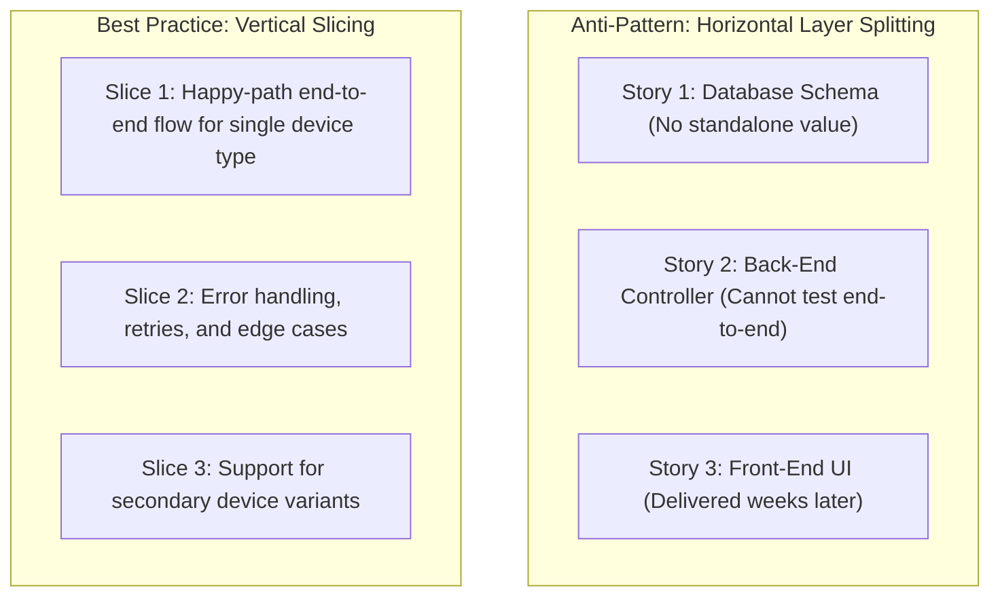

# Agile requirements and user stories

This guideline establishes the engineering standard for defining, sizing, and verifying requirements across agile product delivery teams. It defines the Connextra user story structure, the INVEST validation quality model, Behaviour-Driven Development (BDD) / Gherkin acceptance criteria, and outcome-oriented Sprint Goals.

## 1. Context and Alignment in the Engineering Lifecycle

Requirements represent the contract between product management, systems architecture, and delivery engineers. Ambiguous or poorly decomposed requirements are the leading cause of late-cycle defects, scope creep, and delivery friction.



[[CAPTION:Figure]] Requirements traceability flow from epic outcomes down to automated acceptance tests.

This guideline aligns directly with:
- **[GU-004](../templates/definition-of-ready.md)**: Defines the criteria a user story must satisfy before being committed into a sprint backlog.
- **[GU-003](../templates/definition-of-done.md)**: Defines the engineering checklist required before a completed story can be accepted into a releasable increment.
- **[GU-007](software-design-specification.md)**: Provides the technical design specification for complex stories requiring architectural elaboration.

## 2. User Story Authoring Standard

A user story is an invitation to a conversation, capturing the intent of a feature from the perspective of an entity that derives value.

### 2.1 The Connextra Structure

All user stories must be written using the standard three-part Connextra syntax:

```text
As a <specific persona or system actor>
I want <to perform a specific capability or receive an action>
So that <a measurable business benefit or engineering value is realised>
```

[[CAPTION:Figure]] Standard three-part Connextra user story syntax.

#### Persona Specificity Rules
- **Prohibited**: Generic personas such as `As a user` or `As a developer`.
- **Mandatory**: Concrete personas representing real stakeholders or system boundaries:
  - *Consumer IoT*: `As a homeowner with solar battery storage...`
  - *Firmware / Hardware*: `As a field service technician connecting over BLE...`
  - *Platform / Operations*: `As a site reliability engineer monitoring edge broker latency...`
  - *Security*: `As a compliance auditor verifying cryptographic key rotation...`

### 2.2 The INVEST Validation Model

Every user story committed to a sprint must satisfy the six INVEST criteria:

| Criterion | Definition | Verification Check |
| :--- | :--- | :--- |
| **I: Independent** | The story can be developed, tested, and released in any sequence without hard dependencies on other in-flight stories. | Are blocking dependencies resolved or decomposed into standalone deliverables? |
| **N: Negotiable** | The story captures the goal, leaving implementation mechanics open to engineering refinement. | Does the story avoid dictating rigid implementation details that prevent technical trade-offs? |
| **V: Valuable** | Delivers discernible value to a customer, stakeholder, or downstream system upon completion. | Can the product owner or customer articulate the benefit of this increment alone? |
| **E: Estimable** | The team understands the scope and technical complexity sufficiently to assign relative effort. | Has ambiguity been clarified through spikes or technical designs ([GU-007](software-design-specification.md))? |
| **S: Small** | Sized to fit comfortably within a single sprint, ideally taking 2 to 4 engineering days. | Can the story be completed, tested, and code-reviewed well before the sprint boundary? |
| **T: Testable** | Accompanied by unambiguous acceptance criteria that can be validated objectively. | Can QA or automated test harnesses verify whether the criteria pass or fail? |

[[CAPTION:Table]] INVEST criteria for user story quality assurance.

## 3. Acceptance Criteria and Behaviour-Driven Development (BDD)

Acceptance criteria define the boundary of a story, establishing the conditions that must be true for the product owner and QA to accept the work.

### 3.1 Scenario-Based Criteria (Gherkin Syntax)

For functional flows, user interaction, and integration contracts, acceptance criteria must use the declarative Gherkin syntax (`Given-When-Then`):

- **Given**: The initial static context, system state, or precondition before the action occurs.
- **When**: The trigger, user interaction, external event, or command under test.
- **Then**: The observable outcome, state change, or output assertion.
- **And / But**: Additional preconditions or postconditions refining the scenario.

#### Example 1: IoT Smart Gateway Firmware Over-the-Air (FOTA) Update

```gherkin
Feature: Dual-bank firmware image verification and activation
  In order to maintain security and operational reliability
  As an IoT edge gateway running Zephyr RTOS
  I want to verify and activate newly downloaded firmware images safely

  Scenario: Successful firmware image signature verification
    Given an IoT gateway with active firmware version "2.4.1" on partition Bank A
    And a downloaded firmware payload "firmware-v2.5.0.bin" staged in Bank B
    When the bootloader validates the staged image with public key "pk_prod_secp256r1"
    Then the cryptographic ECDSA signature check returns SUCCESS
    And the bootloader marks Bank B as "pending_test_boot"
    And the system triggers a warm hardware reset into Bank B

  Scenario: Corrupted image fails signature verification
    Given an IoT gateway with active firmware version "2.4.1" on partition Bank A
    And a downloaded firmware payload with an invalid signature in Bank B
    When the bootloader validates the staged image with public key "pk_prod_secp256r1"
    Then the cryptographic signature check returns FAILURE
    And the bootloader erases Bank B to avoid execution of untrusted code
    And the gateway logs a security fault code 0xE004 to local flash
    And the system continues running the verified image in Bank A
```

[[CAPTION:Figure]] Gherkin acceptance test scenarios for an embedded IoT firmware update workflow.

#### Example 2: Telemetry Ingestion API Rate Limiting

```gherkin
Feature: API Gateway Ingestion Rate Limiting
  In order to protect back-end telemetry pipelines from denial-of-service spikes
  As an API Gateway edge proxy
  I want to throttle device requests exceeding contracted tier quotas

  Scenario: Device exceeds per-minute request rate limit
    Given an authenticated IoT device "dev-88492" on the Standard tier (limit: 120 req/min)
    And the device has already submitted 120 requests in the current 60-second window
    When the device submits a POST request to "/v1/telemetry"
    Then the API Gateway rejects the request with HTTP status 429
    And the response header contains "Retry-After: 15"
    And the response body conforms to RFC 9457 Problem Details schema
```

[[CAPTION:Figure]] Gherkin acceptance test scenario for an API rate-limiting contract.

### 3.2 Rule-Based Checklist Criteria

Non-scenario requirements (for example, static code metrics, accessibility, or security standards) may be expressed as explicit checklists:

- [ ] Code changes must satisfy MISRA C:2012 guidelines ([GU-012](../standards/misra-c.md)) with zero mandatory rule violations.
- [ ] Ingestion endpoint p99 latency must remain under 150 ms under a synthetic load of 2,000 requests/sec.
- [ ] All public API parameters must be documented with OpenAPI 3.1 schemas ([GU-020](../standards/api-design.md)).

## 4. Sprint Goal Alignment Standard

Sprint backlogs must not be arbitrary collections of unrelated tasks. Every sprint must formulate a single, cohesive Sprint Goal that guides team focus and trade-offs when unexpected hurdles arise during the sprint.

### 4.1 Sprint Goal Template

Teams must express their Sprint Goal using the following outcome-focused structure:

```text
Our focus is on: <Outcome / Capability to deliver>
We believe it delivers: <Customer or Business Impact>
To: <Target Persona or Consumer>
This will be confirmed when: <Measurable Event, Metric, or Automated Test occurs>
```

[[CAPTION:Figure]] Outcome-focused Sprint Goal template.

#### Concrete Sprint Goal Example

> **Our focus is on**: Implementing zero-touch device provisioning over Bluetooth Low Energy.<br>
> **We believe it delivers**: A 70% reduction in field installation time and eliminates manual credential typing.<br>
> **To**: Field deployment technicians and smart home installers.<br>
> **This will be confirmed when**: A factory-fresh gateway successfully pairs, receives encrypted Wi-Fi credentials over BLE, and establishes its first MQTT connection to the cloud staging cluster in under 45 seconds.

## 5. Story Decomposition and Splitting Patterns

When a story is too large to satisfy the Small criterion in INVEST, teams must split it vertically rather than horizontally. Horizontal splitting (for example, "Story 1: Create DB tables", "Story 2: Build API", "Story 3: Build UI") results in orphaned, non-valuable increments. Vertical slicing delivers thin end-to-end functionality in each increment:



[[CAPTION:Figure]] Horizontal layer splitting anti-pattern versus vertical end-to-end slicing.

### 5.1 Common Vertical Splitting Techniques

- **Workflow Steps**: Split by sequential user actions (for example, first implement device discovery, then implement device registration).
- **Business Rule Variations**: Start with standard default rules, then add complex discount calculations or tiered rates in subsequent stories.
- **Data Variations**: Support a single sensor data format (for example, temperature only) before extending support to humidity and air quality metrics.
- **Platform or Device Slices**: Implement support for BLE commissioning before implementing alternative NFC pairing.
