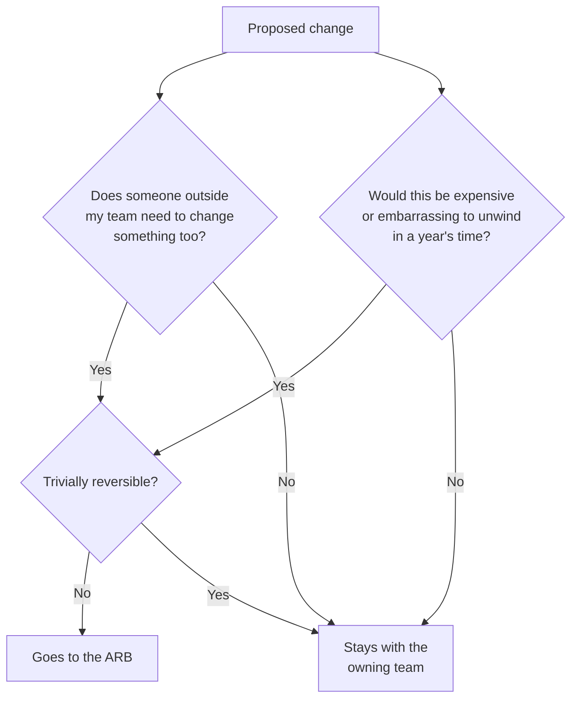
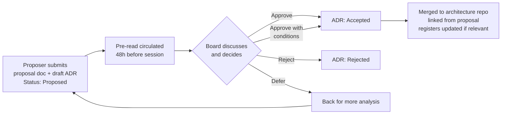
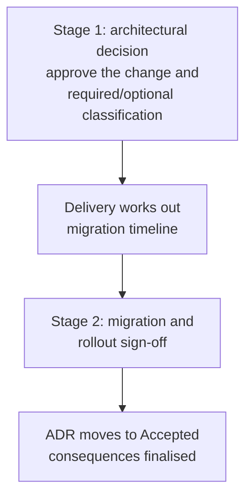
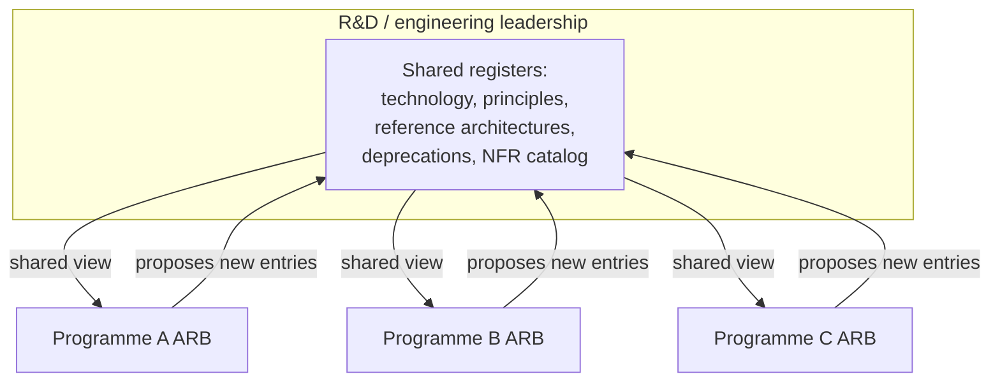
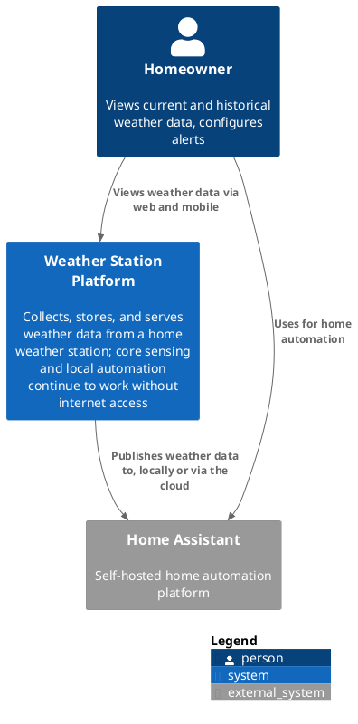
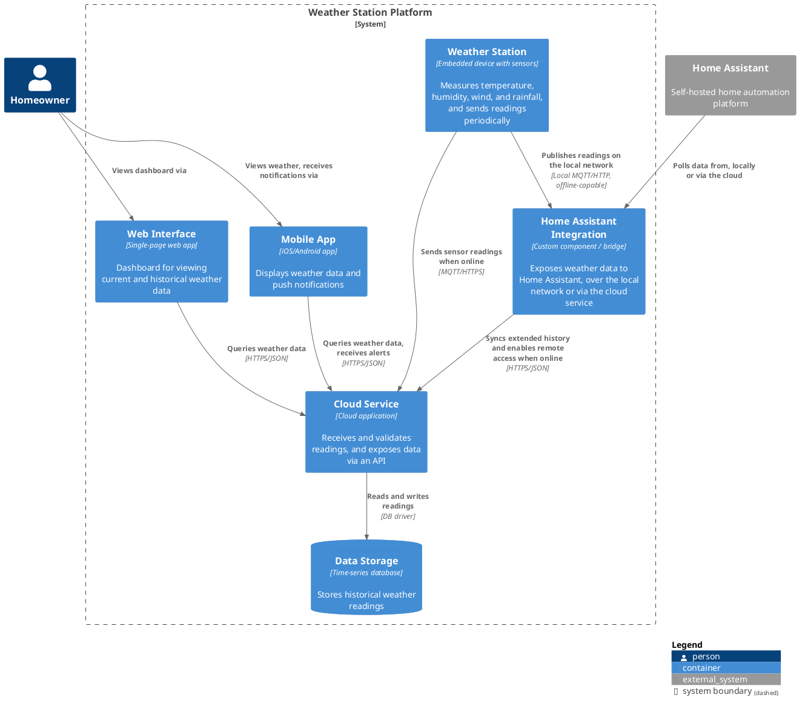

# Running an architecture review board

## Purpose

The Architecture Review Board (ARB) governs architecturally significant decisions. These are the ones that are expensive to unwind once shipped, because they cross a boundary between teams or set the shape of a system for years to come.

Most of this guide is written with a multi-component programme in mind. One common split is a device or edge component, a platform or head-end service, a data layer and a downstream business system. The model applies to any set of components owned by different teams that need to interoperate. The same board also has a job to do on decisions contained entirely within one system, covered in Section 3.

The board owns two things: the seams between systems, and the significant calls inside any one of them. It is not a general design review for each component, a gate for every architectural decision regardless of size, or a substitute for each team's own internal review process.

### Scaling from single team to cross-functional

The same mechanics apply whether there's one team or several. A single team running its own architecture review can use the identical process. A proposal document and a draft ADR are reviewed against the tests in Section 3, decided by a small group and recorded permanently. The difference is only in scale.

Where a single team is the whole picture, the board might just be the tech lead and one or two senior engineers. Most decisions then clear the bar without a formal session at all, since there's no other team to coordinate with. The rest of this guide describes the cross-functional version, with separate architect seats per component. It exists because coordinating several teams needs a slightly heavier process, to make sure nobody's missing from the room. Read the membership and cadence sections as the fuller version and trim them down if there's only one team in scope.

## What goes to the board

###  Two tests, not one

Two separate questions decide whether something belongs at the ARB. Either is sufficient on its own.

**The cross-system test.** Anyone proposing a change should be able to answer this before submitting anything:

> If I change this, does someone outside my team need to change something too?

**The significance test.** Even where the answer above is no, a second question applies:

> Would this be expensive or embarrassing to unwind in a year's time?

A single component can fail this test on its own, with no other team involved. Examples are adopting a new database engine, moving to a different pattern such as event sourcing, or changing its security posture. These go to the ARB too, for the same reason cross-system changes do. Nobody else has to act on them immediately, but getting them wrong is costly, and other teams will likely copy whatever precedent gets set here.

A third question, applied by the chair at intake regardless of which test triggered the submission, narrows things further:

> Is this trivially reversible?

If yes, the full process probably isn't warranted even if one of the two tests above technically fires.



### In scope: cross-system

| Category | Example |
|---|---|
| Shared data model / contract changes | Adding, changing, or deprecating a field or resource in an interface consumed by another component |
| Shared data contracts | Encoding or schema changes affecting more than one consuming system |
| Cross-system security decisions | Trust boundary changes, key or certificate management, mitigations that span subsystems |
| Cross-cutting non-functional requirements | Latency, availability, or throughput budgets that span multiple components |
| Integration pattern changes | Introducing or changing sync vs async communication, new message topics or queues, new API versions between systems |
| End-to-end business flows | Any flow where one component's enforcement or assumptions has to match another's |

### In scope: architecturally significant, single system

| Category | Example |
|---|---|
| Technology or platform adoption | Choosing or replacing a database engine, message broker, or core language/runtime for a component |
| Significant pattern adoption | Moving a component to event sourcing, CQRS, or a materially different structural pattern |
| Security architecture | Changes to authentication, authorisation, or cryptographic approach contained within one system |
| Precedent-setting choices | Anything likely to be copied by other teams once it exists, whether or not it was intended as a template |

### Out of scope

| Category | Example |
|---|---|
| Internal implementation detail | A component's internal caching strategy, provided it doesn't affect SLAs others depend on and isn't a significant pattern shift |
| Component-local decisions | Choice of library or framework within a single component, where the choice is routine rather than significant |
| UI-only changes | Front-end changes with no data model impact |
| Internal refactoring | Refactoring that doesn't touch the shared contract or shift the component's architecture |

### Handling drift

The board may keep reviewing implementation detail within one subsystem, rather than the boundary or the significant call itself. That's a reason to tighten scope, not a reason to give the board more authority. It can also point to a Team Topologies mismatch: a collaboration mode used between teams where an X-as-a-Service relationship would do, or the other way round. Worth raising on its own terms rather than folding into the ARB's remit.

## Membership and roles

### Core voting members

| Role | Represents | Vote |
|---|---|---|
| Chair | Overall architecture coherence, casting vote on deadlock | Yes |
| Architect, Component A | Constraints and design of Component A | Yes |
| Architect, Component B | Constraints and design of Component B | Yes |
| Architect, Component C | Constraints and design of Component C | Yes |
| Architect, Component D | Constraints and design of Component D | Yes |
| Security lead | Cross-cutting threat model and security posture | Yes |

Adjust the number of component architect seats to the actual number of subsystems in scope. Keep voting membership to 6-8 people where possible. Anyone beyond that attends for specific agenda items as a contributor, not as a standing member.

### Non-voting standing attendee: product manager

The PM attends every session but doesn't vote on technical trade-offs. Their role is different from the architects':

- flagging delivery infeasibility, where a technically sound decision can't land in the agreed timeline
- flagging commercial or regulatory constraints already committed to
- surfacing cross-programme dependencies the architects may not be tracking

The PM's role is to raise delivery impact, not to arbitrate technical correctness. If a concern can't be resolved in the session, it escalates above the ARB to whoever owns the delivery-versus-quality trade-off. It does not stall the architectural decision itself.

### Contributors and senior developers

Invited per agenda item where relevant:

- delivery leads for affected teams
- senior developers or tech leads from the team whose change is on the agenda
- test or QA representatives where a change affects cross-system test strategy
- external stakeholders where a decision touches a third-party integration

Whether developers sit as contributors or as the board itself depends on scale. In a single-team setup (Section 1.1), developers and senior engineers usually are the board. There's no separate architect layer to defer to, and adding one just to mirror a cross-functional structure would slow things down for no benefit.

In the cross-functional case, keep voting with the component architects. But bring in the senior developer or tech lead from the affected team whenever their change is on the agenda. They usually wrote the proposal document and drafted the ADR. They're often better placed than the architect to answer questions about feasibility, migration mechanics, or what actually happens to the deployed fleet during rollout. Not giving them a seat in the room when their own change is being discussed tends to produce decisions that look fine on paper and fall apart in delivery.

Where this gets it wrong is treating a senior developer as a junior version of an architect, there to observe rather than contribute. If their input would change the decision, they should be in the room for that item, not relayed through their architect secondhand.

### Decision rights

Ambiguity here is the most common way an ARB fails, so state the model explicitly and revisit it if it stops working.

**Recommended: chair-decides-with-board-input.** The board discusses, each voting member states their position and any dissent, and the chair makes the final call informed by that discussion. Dissent gets recorded in the ADR rather than smoothed over. This tends to move faster than pure consensus across several subsystems with genuinely competing constraints, while still keeping disagreement in the record.

**Alternative: pure consensus.** Slower, and prone to deadlock, but can suit a smaller or newer board that hasn't built trust yet. If used, define an explicit deadlock-breaking mechanism up front, such as escalation to the programme sponsor.

Whichever is chosen, name it in this document. "The board decides" without a mechanism behind it isn't a decision process.

## Intake and decision process

### Standard flow

Every submission needs two things: a proposal document, and a draft ADR. The ADR isn't something written up after the board has decided; it's drafted in Proposed status and reviewed alongside the proposal itself.

The label on the proposal document doesn't matter much. A design doc, an RFC, an interface control document redline or another format all work. It needs to cover the problem, the options considered, the impact and a recommendation, in a form the board can read in a few minutes.



Verification checkpoints along this flow:

- the proposal states which test triggered it (Section 2.1) and the impact on each affected subsystem where relevant
- the draft ADR's Context and Decision match the proposal's recommendation
- nothing gets discussed cold at the meeting
- the ADR is merged, linked, and cross-referenced from any architecture model it affects, and added to the relevant register (Section 6) if it establishes or changes one

### 4.2 Fast-track path

For genuinely urgent decisions that can't wait for the next standing session:

1. A smaller quorum, the chair plus the two most affected architects, reviews a short proposal and draft ADR asynchronously
2. The decision is provisional until ratified at the next standing session
3. The draft ADR is updated at the point of the fast-track decision, not deferred until ratification

Fast-track exists for urgency, not for avoiding scrutiny. If something is routinely fast-tracked because "there wasn't time," that's a planning problem worth raising on its own, not a reason to widen the fast-track path.

### 4.3 Two-stage touchpoint for complex migrations

Some decisions, breaking changes to a shared data model being the clearest example, are better split into two touchpoints rather than resolved in one sitting.



Resolving both in one session tends to rush the migration plan. Or it blocks a sound architectural call on logistics that were never going to be ready in time. Single-system significant decisions (Section 2.3) rarely need this split, since there's no other team's rollout to coordinate with. A large internal migration, such as replacing a database engine, may still warrant it.

## 5. Worked process: breaking changes to a shared data model

Breaking changes to interfaces or data models used by several systems are one of the highest-stakes recurring cases for most programmes. They are hardest where one side of the interface is slow or hard to update, as embedded devices and third-party systems are.

### 5.1 What counts as breaking

Adding a new required field or resource is unambiguously breaking. Every consuming system now has to send or expect it, and anything already deployed without it no longer complies with the updated definition. The same goes for removing a field, changing its type or meaning, or changing encoding in a way existing consumers can't parse.

Adding an optional field is generally non-breaking and doesn't need this full process, though it's still worth a short ADR.

### 5.2 Required artefacts

For this category, the proposal document is the redlined interface document itself rather than a separate free-form write-up. The board sees the actual change in context, and the accompanying draft ADR captures the decision.

| Artefact | Purpose |
|---|---|
| Updated interface document, redlined | The actual diff between current and proposed definitions, shown in context rather than described in prose |
| Draft ADR, status Proposed | Why the change is needed, the change itself and its required-versus-optional classification, and the headline migration impact including which systems implement by when |
| Backward compatibility / migration plan | Deployed-base impact, how many instances are on the old version, dual-version handling during transition, rollout sequencing, and the interface version bump (minor or major) |
| Updated interface or encoding contract | Format diff reviewed alongside the redlined interface document, since an identifier change is only half the contract |
| Updated architecture model | Only if the change alters what flows across a component boundary in a way the existing model doesn't already show |

Once the rollout is non-trivial, keep the migration plan as a separate linked document rather than in the ADR's Consequences section. The ADR itself then stays proportionate (Section 7). The draft ADR isn't a separate document from the final one. It's the same record, moving from Proposed to Accepted, Rejected or Superseded as it goes through the process.

### 5.3 Process sequence

1. Proposer submits the redlined interface document and a draft ADR in Proposed status at Stage 1, with the migration plan attached or linked if complexity warrants it
2. Board reviews the redline and the ADR's Context and Decision, and approves or rejects the change and its required/optional classification
3. Once approved, delivery works out the migration timeline with the affected teams, if not already resolved
4. The migration plan comes back to the board at Stage 2 for a lighter sign-off
5. The ADR moves to Accepted once both stages are complete, with Consequences finalised and the migration plan linked

## 6. Artefacts and registers

### 6.1 Produced by the ARB

- **ADR log**: the core, permanent decision record
- **Cross-system risk register**: where cross-cutting risks, including any threat-modelling findings, that span subsystems are tracked
- **Living context/container diagram**: a C4-style view at levels 1-2, showing subsystem boundaries and their contracts, kept current as decisions land
- **Technology and pattern register**: a running list of approved technologies, frameworks, and architectural patterns, each linked to the ADR that approved it. This is what stops a settled choice, a database engine, a messaging pattern, an authentication approach, being re-argued from scratch every time someone new joins or starts a piece of work. Entries get added whenever Section 2.3 fires, and reviewed periodically rather than treated as permanent; a pattern approved two years ago may no longer be the right default
- **Architecture principles register**: a short set of standing tenets, for example "prefer async over sync unless x," that sit above individual ADRs and let the board judge new proposals against something established rather than reasoning every case from first principles
- **Reference architecture / solution blueprint catalogue**: worked, end-to-end patterns for recurring problem shapes, such as how the organisation does event-driven integration or ingress security, more prescriptive than a radar entry and meant to be copied rather than just consulted
- **API and integration style guide**: naming, versioning, error handling, and encoding conventions, so each new interface doesn't independently re-decide things the register already settled once
- **Approved vendor or product list**: narrower than the technology register, focused on external suppliers and licensed products, often carrying procurement or security sign-off that a general technology entry doesn't need
- **Deprecation or sunset register**: the mirror image of the technology register, listing what's being phased out and by when, so new work doesn't get built on something already scheduled for retirement
- **Quality attribute / NFR catalogue**: standard latency, availability, and throughput targets that get reused across programmes instead of re-derived from scratch each time a new component is scoped

### 6.2 Consumed by the ARB

- Proposal documents submitted by proposers, each with an accompanying draft ADR
- Threat model outputs, where they touch shared components
- Delivery and dependency status from the PM

### 6.3 Not owned by the ARB

Detailed design documents, per-component specifications, and test plans stay with the owning team. The board reviewing these in detail is a scope-creep signal (Section 2.5).

### 6.4 Who owns these registers: this ARB, or R&D as a whole

Where this ARB is the only one, covering the whole engineering organisation, it owns all of the above directly and there's nothing further to decide.

Where several ARBs exist, one per programme or product line, each with its own component architects, ownership shouldn't sit with any single one of them. A database engine or messaging pattern approved by one programme's board and silently re-decided by another's produces exactly the fragmentation these registers were meant to prevent.



In that case the registers belong at the R&D or engineering-leadership level, above any individual ARB. Each programme's ARB still raises new entries through its own intake process (Section 4.1) when Section 2.3 applies. But the entry is escalated up rather than recorded only locally. What each ARB consults day to day is a view onto the shared set, not a document it maintains in isolation.

This mirrors the scaling logic in Section 1.1. As the number of boards grows, some things that were fine to own locally need to move up a level. These registers are usually the first place that becomes obvious.

### 6.5 Dispensations

Sometimes a team needs to depart from an approved entry in one of the registers above, a technology choice, a pattern, a principle, for a specific and time-bound reason. Rather than quietly deviating or blocking delivery on a full register change, request a dispensation.

A dispensation request states:

- which register entry or principle it departs from
- the specific reason, scoped to the system or decision at hand, not a general exemption for the team
- an expiry date; dispensations are never granted indefinitely
- what needs to happen to close the gap and return to the approved standard

The board approves or rejects a dispensation the same way as any other submission (Section 4.1). It is logged as a lightweight entry in the ADR log, not a full proposal and draft ADR. Expiry triggers the follow-up, not anyone remembering to check back in. When a dispensation lapses, the team has either moved to the approved standard or comes back to the board for renewal with an updated reason. If the exception is starting to look like the more common case, the standard itself is revisited.

### 6.6 Structuring the technology register: a radar rather than a list

A flat approved/not-approved list is the simplest way to run the technology register, but it loses information a more established format captures well. Thoughtworks publishes a Technology Radar twice a year. It sorts items into four quadrants (techniques, platforms, tools, and languages and frameworks) and four rings that reflect confidence rather than chronology. The rings are Adopt (seriously consider using), Trial (ready for use but less proven), Assess (worth watching, not yet ready to trial) and Hold (proceed with caution, or actively avoid). Thoughtworks also publish a "build your own radar" tool specifically for organisations wanting to run the same format internally.

Borrowing the ring structure gives the technology register something a flat list can't. It can show a technology moving from Assess through Trial to Adopt as confidence grows, rather than forcing an in-or-out decision before anyone has used it. A component team piloting something new can sit in Trial without that being read as an organisation-wide mandate. Moving something to Hold is a clear, recorded signal to stop starting new work with it, without forcing an immediate rip-out of what's already there.

Two adaptations are worth making if adopting this format internally rather than just reading the public one:

- **Every entry needs a linked ADR.** Thoughtworks' public radar reflects their own consultants' collective experience across the industry; an internal one should reflect this organisation's own decisions. An entry with no ADR behind it is an opinion, not a governance record, and undermines the point of the register.
- **Review on a fixed cadence, not continuously.** A twice-yearly cycle, or aligned to whatever release cadence the organisation already runs on, gives a fixed point to move entries between rings and retire ones that no longer apply, rather than the register drifting out of date between ad hoc edits.

## 7. The ADR: format and proportionality

An ADR's length should match the decision, not a fixed template. A three-sentence ADR for a simple, uncontested change is correct, not incomplete. Optional sections like Alternatives Considered or a separate Rationale only need filling in where the decision actually warrants that level of explanation.

### 7.1 Minimal example

```markdown
# ADR-0042: Add `example_field` as a required field in [Interface X]

- **Status**: Accepted
- **Date**: YYYY-MM-DD
- **Author**: [Name]
- **Context link**: [Proposal document reference, if applicable]

## Context

[Consuming system] needs this value on every message to support
[capability]; making it optional means it can't rely on its presence.

## Decision

Add as a required field in [Interface X] v3.4.0. Instances on v3.3.0
are treated as non-compliant until upgraded.

## Consequences

[Consuming system] has to handle a mixed-version deployed base during
rollout (see migration plan, linked). Owning team implements by
[milestone].
```

Rationale and Alternatives Considered are left out here because the decision didn't need them. Include either section only when there's something worth recording.

### 7.2 When to expand

Expand the ADR only where the decision itself is genuinely more complex. Examples are restructuring how a business flow's data moves across three systems, or adopting a significant single-system pattern (see Section 2.3). Add a Rationale section where the trade-offs need spelling out. Add an Alternatives Considered section where other options were seriously weighed. Both stay optional; don't add them by habit.

### 7.3 When an ADR is required at all

Write a draft ADR for every submission to the ARB, regardless of length and regardless of whether the optional sections get used. Trying to judge "was this significant enough" case by case tends to become its own recurring argument, and a blanket rule avoids that. It also pays off during compliance or audit review. "When and why was this field made required?" is a common question, and a short ADR answers it far better than a long discussion thread.

## 8. Cadence and escalation

### 8.1 Cadence

| Session | Frequency | Duration | Purpose |
|---|---|---|---|
| Standing session | Fortnightly | 60-90 minutes, hard timebox | Proposal and draft ADR review, decisions, backlog triage |
| Fast-track | Ad hoc | As needed | Urgent cross-system decisions, ratified at next standing session |
| Backlog triage | First 10 minutes of standing session | 10 minutes | Sort new submissions before working through existing ones |

### 8.2 Escalation

| Situation | Escalates to |
|---|---|
| PM raises a delivery-infeasibility concern that can't be resolved in-session | Programme board or sponsor |
| Decision-rights deadlock under a consensus model | Programme sponsor |
| Repeated scope drift into implementation detail | Chair, for charter review, not board authority expansion |

## 9. Anti-patterns

Rubber-stamping, where nothing is ever rejected or sent back, means the board isn't doing its job. Becoming a bottleneck, where teams route around it because it's too slow, means scope has crept too far into implementation detail. Decisions without ownership, where an ADR has no named owner for follow-through, undermine the whole point of recording them. A Team Topologies mismatch is when the board keeps making calls that should sit inside one team's boundary. It means the interaction mode between teams needs revisiting, not that the board needs more authority. And gold-plating, writing long ADRs or filling in optional sections out of habit for trivial decisions, defeats the proportionality this guide is built around.

## Appendix A: Draft ADR template

```markdown
# ADR-XXXX: [Short, meaningful title for the decision]

- **Status**: Proposed | Accepted | Rejected | Superseded
- **Date**: YYYY-MM-DD
- **Author**: [Name]
- **Context link**: [Link to proposal document or ticket, if applicable]
- **Supersedes**: [ADR-XXXX] (optional)
- **Superseded by**: [ADR-YYYY] (optional)

## Context

What led to this decision. What problem or scenario required a choice.

## Decision

State the decision clearly and directly.

## Consequences

What changes as a result. Any risks, costs, or follow-up actions.

## Rationale (optional)

Why this decision, and what the trade-offs were. Include only where the
decision needs explaining beyond Context and Decision.

## Alternatives considered (optional)

Other options and why they were rejected. Include only where other
options were seriously weighed.
```

## Appendix B: Open decisions for this charter

These should be settled before adoption, since they change how the rest of the document is applied:

1. Decision-rights model: chair-decides-with-board-input, or pure consensus with a named deadlock-breaker (Section 3.4)
2. For threat-modelling-driven mitigations spanning subsystems, does the board approve the mitigation direction only, or also review the resulting contract change before it ships (Section 4.3)
3. Number and names of core component architect seats, matched to the actual subsystems in the programme (Section 3.1)
4. Whether the migration plan for breaking data model changes is always a separate linked artefact, or folded into the ADR's Consequences for lower-complexity cases (Section 5.2)
5. Which proposal document format, design doc, RFC, ICD redline, or something else, becomes the organisation's default for the general case in Section 4.1
6. Which of the registers in Section 6.1 sit with this ARB versus a broader R&D/engineering-leadership body, based on how many ARBs exist across the organisation (Section 6.4), and who owns each one day to day either way

## Appendix C: Example architecture principles

A starting set for the principles register (Section 6.1). Trim, replace, or extend to match the organisation's own priorities; these are illustrative, not prescriptive.

1. **Prefer boring technology.** Default to proven, well-understood tools unless there's a documented reason not to. Novelty is a cost to be justified, not a default to be assumed.
2. **Data ownership is single and explicit.** Each piece of data has exactly one system of record. Other systems hold copies or projections, never a second write path.
3. **Interfaces are versioned, not mutated.** A breaking change gets a new version rather than an in-place change that quietly breaks existing consumers.
4. **Security is designed in, not bolted on.** Authentication, authorisation, and encryption decisions are made at design time, not retrofitted after an incident.
5. **Favour asynchronous integration by default.** Synchronous coupling between systems is the exception, justified case by case, not the default choice.
6. **Every architecturally significant decision is recorded.** If it isn't in an ADR, it didn't happen, and can't be relied on as precedent.
7. **Design for observability from day one.** A component isn't done until its logs, metrics, and traces are wired into the shared observability tooling.
8. **Reversibility beats prediction.** Where the future is genuinely uncertain, prefer the option that's cheaper to undo over the option that looks theoretically optimal.

## Appendix D: Example pattern catalogue

A starting set for the reference architecture / pattern catalogue (Section 6.1), again illustrative rather than exhaustive.

| Pattern | Use it for | Avoid when |
|---|---|---|
| Event-driven integration | Cross-system notifications where the receiving system doesn't need an immediate response | The caller needs a synchronous result before it can proceed |
| API gateway / edge aggregation | A single entry point handling auth, rate limiting, and routing for external consumers | Internal-only traffic where the extra hop adds latency for no benefit |
| Strangler fig migration | Replacing a component incrementally, routing a growing share of traffic to the new version over time | A clean-slate rebuild with no need to run old and new side by side |
| CQRS (command/query separation) | Read and write load profiles that diverge significantly enough to justify separate models | Simple CRUD workloads, where the added complexity isn't earned |
| Circuit breaker | Wrapping calls to an unreliable dependency so failures fail fast rather than cascade | Calls to dependencies with their own strong reliability guarantees, where the extra layer adds no protection |
| Anti-corruption layer | A translation boundary protecting a component's internal model from a legacy or external system's data shape | Two systems that already share a common, well-governed data model |
| Outbox pattern | Ensuring an event is only published once a database write has committed, avoiding dual-write inconsistency | Systems with no event publication step, where the problem doesn't arise |

## Appendix E: Example C4 diagrams, Level 1 and Level 2

A worked example using a small IoT system: a home weather station reporting to a cloud service. It can be viewed on a web dashboard and a mobile app, and is integrated with Home Assistant for automations. Level 1 shows the system in its environment. Level 2 opens it up to show its containers, including the two paths into Home Assistant. A local network path keeps working without internet access, and a cloud path is used for remote access and longer history. Both diagrams use the C4-PlantUML library from PlantUML's standard library (`!include <C4/C4_Context>`), so nothing needs to be downloaded.

### Level 1: System context



### Level 2: Containers



## References

Works referenced or drawn on in this guide:

- Richards, M. and Ford, N. *Fundamentals of Software Architecture*. O'Reilly. Covers architecture decision records and governance structures directly.
- Richards, M., Ford, N., Rehmer, D. and Sass, Z. *Software Architecture: The Hard Parts*. O'Reilly. Trade-off analysis across team and component boundaries.
- Erder, M., Pureur, P. and Woods, E. *Continuous Architecture in Practice*. Addison-Wesley. Lightweight governance and fitness functions in an agile delivery context.
- Clements, P. et al. *Documenting Software Architectures: Views and Beyond*. Addison-Wesley (SEI series). Source for formal architecture evaluation methods such as ATAM.
- Bass, L., Clements, P. and Kazman, R. *Software Architecture in Practice*. Addison-Wesley (SEI series). The original source for ATAM and related architecture evaluation methods.
- Hohpe, G. *The Software Architect Elevator*. O'Reilly. On the organisational and political mechanics of making architecture governance actually work.
- Skelton, M. and Pais, M. *Team Topologies*. IT Revolution Press. On interaction modes between teams and what it means when a review board keeps making calls that should sit inside one team's boundary.
- Brown, S. *Software Architecture for Developers, Volume 1 and Volume 2*. Leanpub. Source material for the C4 model and its practical use in architecture documentation.
- Starke, G., Simons, M., Zörner, S. and Müller, R.D. *arc42 by Example*. A second documentation framework alongside C4, useful for structuring architecture documentation more broadly.
- Keeling, M. *Design It! From Programmer to Software Architect*. Pragmatic Bookshelf. Covers lightweight architecture decision-making practice directly.
- Millett, S. and Tune, N. *Patterns, Principles, and Practices of Domain-Driven Design*. Wrox. On boundary and pattern decisions that are architecturally significant even within a single system.
- DeMarco, T. and Lister, T. *Waltzing with Bears: Managing Risk on Software Projects*. Dorset House. On risk management practice for software projects.
- Medjaoui, M., Wilde, E., Mitra, R. and Amundsen, M. *Continuous API Management*. O'Reilly. On managing API and integration decisions as they evolve.
- Monson-Haefel, R. (ed.) *97 Things Every Software Architect Should Know*. O'Reilly. Short, aphoristic collective wisdom from practising architects.
- Thoughtworks. *Technology Radar*. Published twice yearly at thoughtworks.com/radar. Source for the ring and quadrant structure discussed as an option for the technology register in Section 6.6.
- The Open Group. *TOGAF Standard*. Source for the Architecture Board, Architecture Compliance review, and dispensation (time-bound waiver) concepts referenced in this guide's governance model.
- Nygard, M. "Documenting Architecture Decisions" (original ADR format, 2011). The source of the ADR format this guide builds on.
