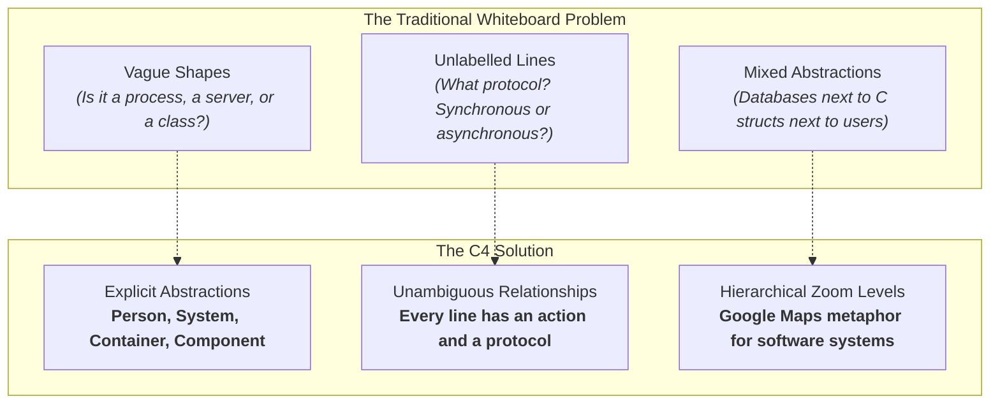
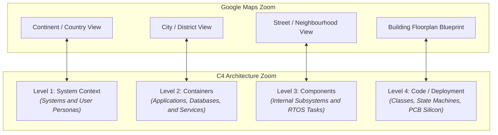
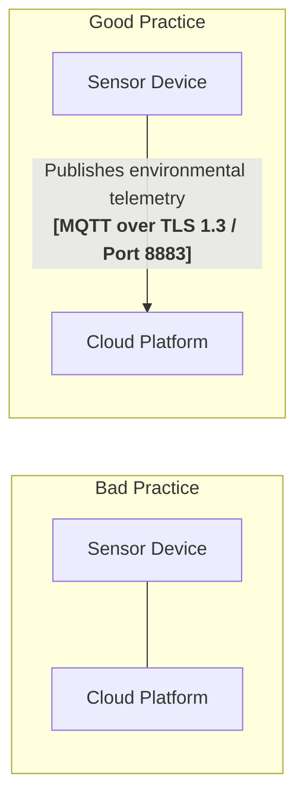
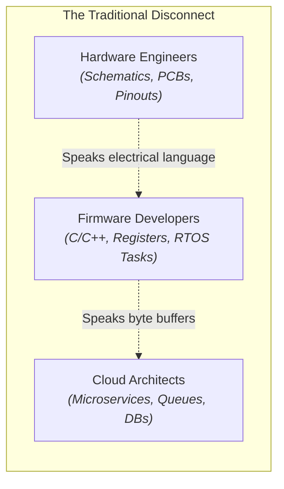

# The C4 Model: Origins, Philosophy, and Core Mechanics

## 1. The Architecture Communication Crisis: Why Traditional Diagrams Fail

Visual communication is essential to software and systems engineering. When technical teams describe a new system, they instinctively sketch boxes and lines on a whiteboard. Yet, across the industry, software architecture documentation frequently suffers from what architect Simon Brown diagnosed as the **architecture communication crisis**:

1. **The "Box-and-Line" Dilemma**: Ad-hoc architectural sketches often feature arbitrary shapes, ambiguous clouds, and unlabelled lines. A line connecting two rectangles might represent a function call, an asynchronous message, an electrical SPI bus, or a vague business relationship.
1. **The UML Fallacy**: In the 1990s and 2000s, the Object Management Group (`OMG`) developed the Unified Modelling Language (`UML`). While UML attempted to standardise software modelling with 14 distinct diagram types, it proved overly academic and heavy for modern fast-paced engineering teams. Developers rarely agreed on the subtle distinctions between aggregation and composition, and comprehensive UML class diagrams quickly drifted out of synchronisation with the codebase.
1. **Mismatched Levels of Abstraction**: A single whiteboard diagram often attempts to show everything at once: high-level business users, cloud servers, individual C header files, and database tables. Mixing architectural abstraction levels overwhelms readers and conceals critical design decisions.

[[CAPTION:Figure]] How the C4 model resolves the classic architectural communication crisis.

## 2. Origins of the C4 Model: Simon Brown's Breakthrough

The **C4 model** was created by independent software architect **Simon Brown** between 2006 and 2018. Brown observed that while agile software methodologies had revolutionised coding, testing, and delivery, teams had largely abandoned architectural documentation because existing tools were too cumbersome.

Brown created C4 to provide a **lightweight, developer-friendly mental model** for describing software architecture. Rather than introducing a complex new notation, C4 focuses on a simple hierarchy of abstractions:

- **Context** (Level 1)
- **Containers** (Level 2)
- **Components** (Level 3)
- **Code** (Level 4)

Crucially, C4 is **notation-independent**. You can render a C4 model using PlantUML, Mermaid, Structurizr, Visio, or a dry-erase whiteboard. The value lies in the clarity of the underlying abstractions and the discipline of explicit communication.

## 3. The Central Metaphor: Maps and Hierarchical Zoom Levels

The defining breakthrough of the C4 model is its analogy to **digital maps** (such as Google Maps or OpenStreetMap). 

When navigating a digital map, you do not view individual street addresses from the continent level. You start at an altitude that shows oceans, countries, and major cities, and zoom in progressively:

[[CAPTION:Figure]] The Google Maps hierarchical zoom metaphor applied to the C4 architecture model.

### Audience-Targeted Communication

Different stakeholders require different altitudes of information. A Level 3 Component diagram will confuse an executive sponsor. A Level 1 System Context diagram gives a firmware engineer too little detail to implement an RTOS task:

| C4 Zoom Level | Target Audience | Key Questions Answered |
| :--- | :--- | :--- |
| **Level 1: System Context** | Product owners, executives, non-technical stakeholders, external integration partners. | What is the product? Who uses it? Which external systems does it integrate with? What is out of scope? |
| **Level 2: Containers** | Software architects, engineering leads, DevOps, security teams, systems engineers. | What are the deployable software units? Where does data live? Which protocols link edge devices to the cloud? |
| **Level 3: Components** | Firmware developers, cloud software engineers, QA automation engineers. | How is a container structured internally? What are the key tasks and modules? Who is responsible for data serialisation? |
| **Level 4: Code & Deployment** | Silicon designers, driver implementers, power optimisation engineers. | How does the state machine transition? How are memory buffers partitioned? How are silicon packages wired? |
[[CAPTION:Table]] Stakeholder mapping across the four C4 abstraction levels.

## 4. Why the C4 Model Works: Core Principles

The success of the C4 model in modern engineering organisations stems from four foundational principles:

### A. Abstraction Over Notation

C4 does not mandate specific colours, line weights, or geometric shapes. Instead, it formalises **four core software building blocks**:

1. **Person**: A human actor who interacts with the software system (for example, a homeowner or field technician).
1. **Software System**: The highest level of software abstraction; something that delivers value to users, whether developed in-house or provided externally.
1. **Container**: A separately runnable, deployable execution unit or data store (for example, a firmware binary on an MCU, a cloud microservice, a database, or a mobile app).
1. **Component**: A structural grouping of related functionality encapsulated behind a clean interface within a container (for example, an RTOS task, a sensor driver module, or a REST controller).

### B. The Golden Rule of Explicit Relationships

In C4, every connecting arrow must be unambiguous. An arrow without a label or protocol is considered an architectural defect:

[[CAPTION:Figure]] The C4 rule of explicit relationships: every connection states intent and transport technology.

Every relationship label must answer two questions:
1. **What is happening?** (Intent: *"Publishes environmental telemetry"*, *"Reads calibration constants"*)
1. **How does it travel?** (Technology: `[MQTT over TLS 1.3]`, `[I2C Bus @ 400 kHz]`, `[HTTPS / REST]`)

### C. Static Structure vs Runtime Behaviour

C4 diagrams primarily model **static structure**—the enduring software constructs that exist in the codebase and infrastructure. 

To show runtime behaviour, timing or life cycle transitions, C4 adds two kinds of diagram to the static views. **Dynamic Diagrams** are sequence diagrams that number the messages in order. **Deployment Diagrams** map software containers onto physical infrastructure and hardware.

## 5. Adapting C4 for Embedded & Connected Systems

In pure enterprise software, containers execute on virtualised cloud servers and interact over HTTP. In **connected IoT and embedded systems**, software containers execute on physical silicon packages, communicate across electrical traces, and interact with the physical environment.

Historically, hardware engineers documented systems using electrical schematics and pinout tables, while cloud software engineers used API specifications and cloud architecture diagrams. This created an engineering disconnect:

[[CAPTION:Figure]] The engineering communication chasm across connected IoT teams.

The C4 model bridges this chasm by establishing a **shared visual lingua franca**:

1. **Hardware as Containers**: Physical sensors, secure elements, and flash memory chips are modelled as hardware containers alongside firmware software containers.
1. **Buses as Protocols**: Peripheral buses (`I2C`, `SPI`, `UART`, `CAN`) are treated with the same architectural rigour as network protocols (`MQTT`, `CoAP`, `HTTPS`).
1. **Concurrency as Components**: RTOS background tasks, interrupt service routines (`ISRs`), and event queues inside the microcontroller firmware are cleanly mapped to Level 3 Components.

By standardising on C4, cross-functional engineering teams can reason about end-to-end latency, security threat models, power consumption budgets, and firmware update mechanisms within a single cohesive framework.
