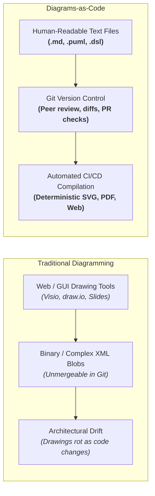
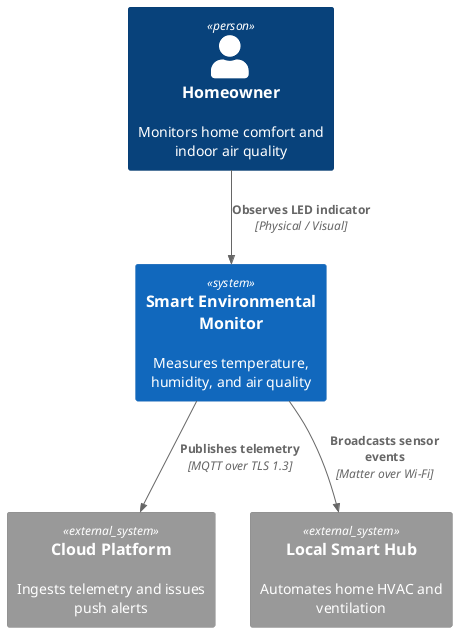
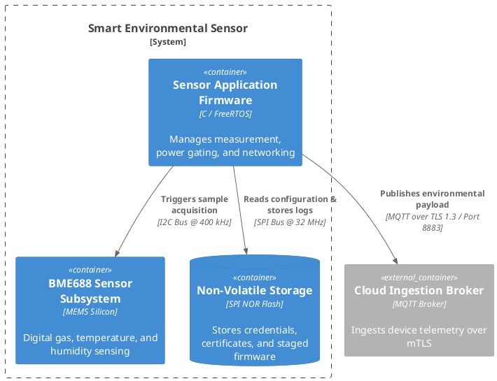
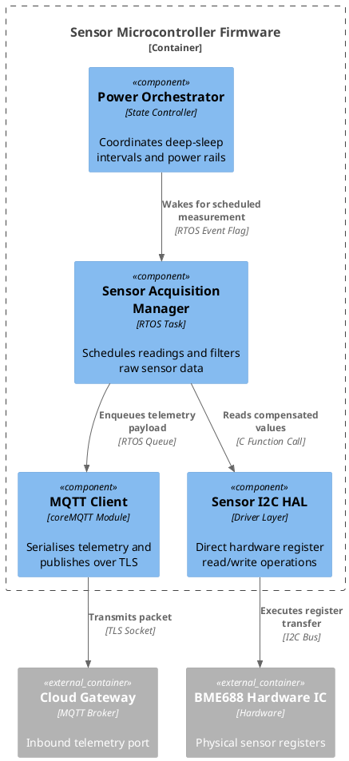
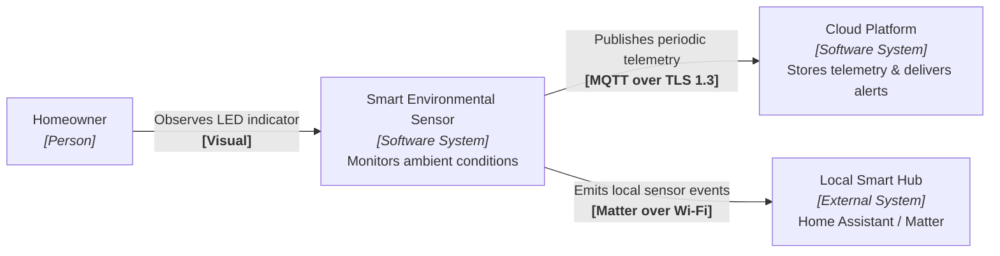
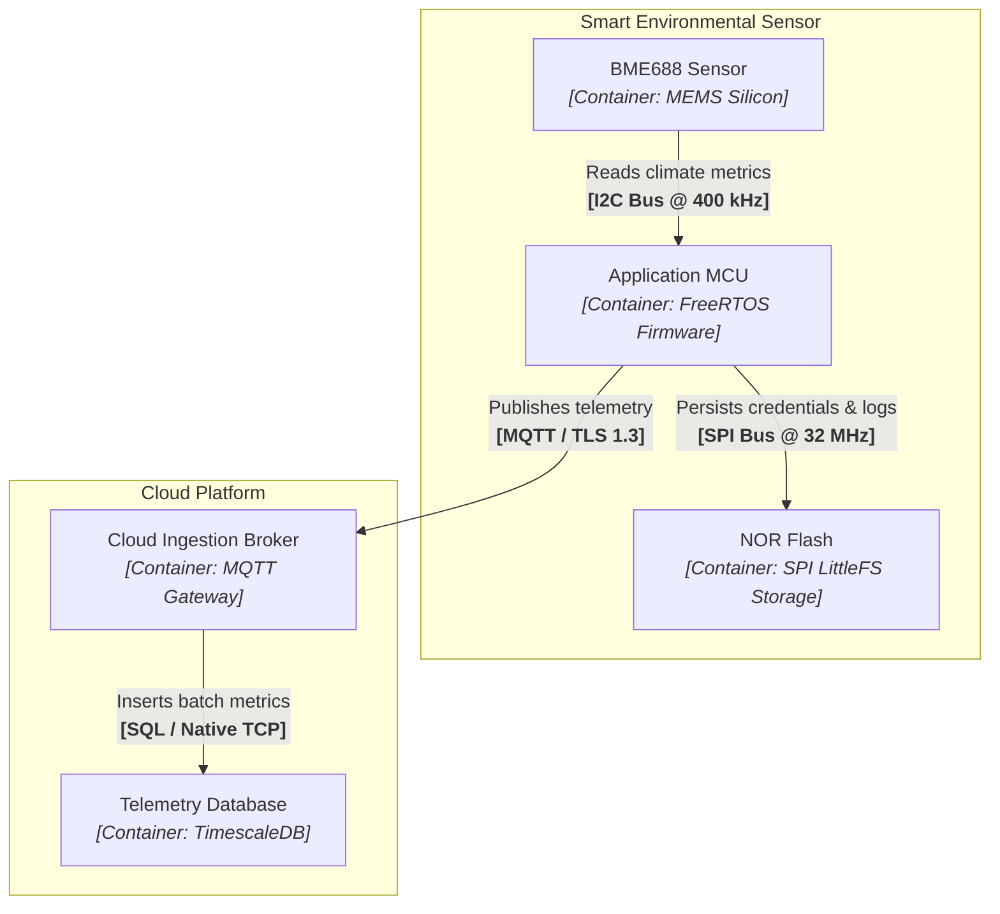
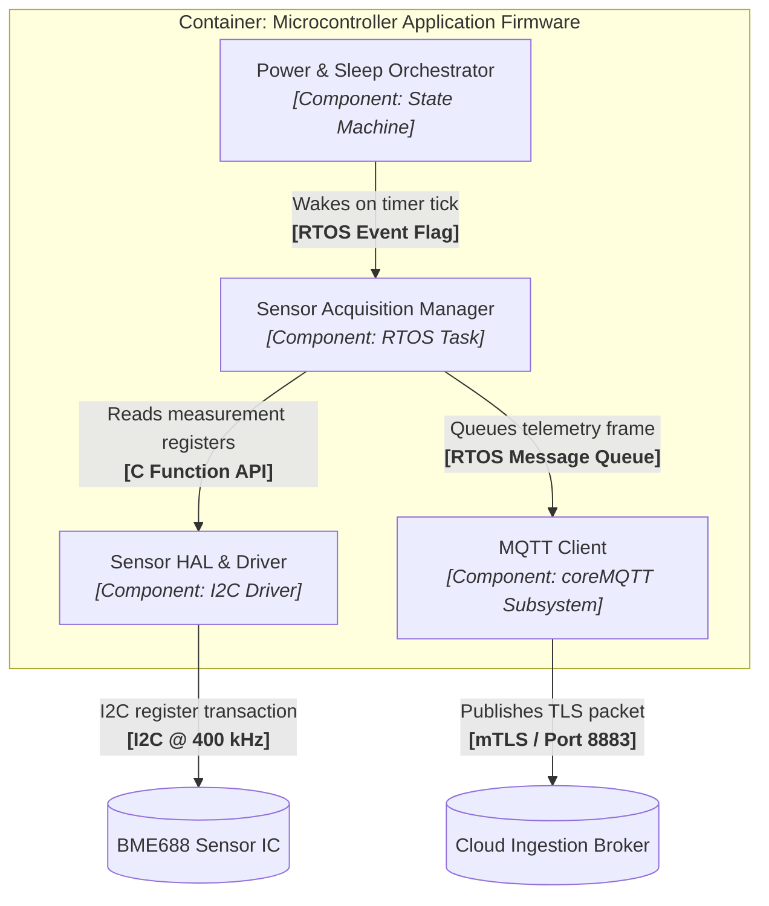
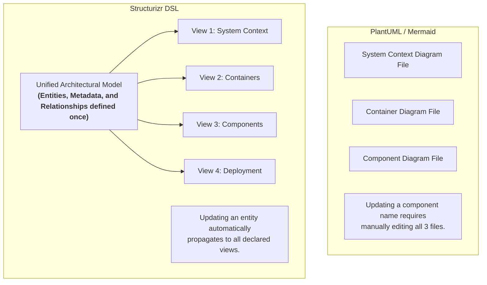

# Diagrams as Code: Tooling, DSLs, and Repository Integration

## 1. The Diagrams-as-Code Paradigm

Historically, engineering teams documented software architectures using visual drawing tools such as Microsoft Visio, Lucidchart, draw.io, or PowerPoint. While graphical editors offer an intuitive drag-and-drop experience, they introduce severe long-term maintenance liabilities in production software environments:

1. **Opaque Binary Files and Unmergeable XML**: Graphical diagram files cannot be easily diffed in pull requests. Two engineers editing the same architecture diagram often encounter irreconcilable merge conflicts.
1. **Architectural Drift**: Because visual drawings live in external web portals or disconnected file shares, developers modify code without updating the architecture diagrams. Within months, documentation becomes obsolete.
1. **Manual Inconsistency**: In a traditional drawing tool, if an MQTT port changes from 1883 to 8883, every single slide and diagram containing that connection must be individually located and manually redrawn.


[[CAPTION:Figure]] The architectural evolution from manual visual drawing to version-controlled Diagrams-as-Code.

The **Diagrams-as-Code** philosophy treats architecture documentation with the same engineering rigor as application source code:

- Architecture diagrams are written in clean, human-readable text.
- Diagrams live inside the same Git repository as the code they describe.
- Every architectural change is reviewed in pull requests alongside code commits.
- Continuous Integration (`CI`) pipelines automatically validate, lint, and compile diagrams into high-resolution graphics.

This repository provides comprehensive support for three complementary Diagrams-as-Code technologies: **PlantUML**, **Mermaid**, and **Structurizr DSL**.

## 2. PlantUML & the C4-PlantUML Standard

[PlantUML](https://plantuml.com/) is a mature, open-source diagramming engine that converts plain text definitions into vector graphics (`SVG`) and raster images (`PNG`) using Graphviz.

### A. How C4-PlantUML Works

Standard PlantUML focuses on traditional UML class, sequence, and component diagrams. To support C4 modelling, the open-source community created **C4-PlantUML**—a comprehensive library of pre-processor macros that provide native C4 visual styles, shapes, and connection semantics.

In this repository, C4-PlantUML templates are vendored under `templates/`:
- `templates/C4_Context.puml`: Level 1 System Context definitions.
- `templates/C4_Container.puml`: Level 2 Container definitions.
- `templates/C4_Component.puml`: Level 3 Component definitions.
- `templates/C4_Deployment.puml`: Level 4 Physical Deployment definitions.

### B. Core C4-PlantUML Macro Reference

The primary macros provided by the library include:

| Macro | Arguments | Purpose |
| :--- | :--- | :--- |
| `Person(alias, label, desc)` | `alias, "Display Name", "Description"` | Defines a human actor. |
| `System(alias, label, desc)` | `alias, "Display Name", "Description"` | Defines an internal software system. |
| `System_Ext(alias, label, desc)` | `alias, "Display Name", "Description"` | Defines an external, third-party software system. |
| `Container(alias, label, tech, desc)` | `alias, "Display Name", "Technology", "Description"` | Defines a software container (for example, firmware, microservice, or web application). |
| `ContainerDb(alias, label, tech, desc)` | `alias, "Display Name", "Technology", "Description"` | Defines a data store or persistent storage partition. |
| `Component(alias, label, tech, desc)` | `alias, "Display Name", "Technology", "Description"` | Defines a structural software component within a container. |
| `Rel(from, to, label, tech)` | `from, to, "Action / Intent", "Protocol / Transport"` | Connects two elements with an explicit directional relationship. |
| `System_Boundary(alias, label) { ... }` | `alias, "Boundary Name"` | Groups containers logically within a system boundary. |
| `Container_Boundary(alias, label) { ... }` | `alias, "Boundary Name"` | Groups components logically within a container boundary. |
| `Deployment_Node(alias, label, type) { ... }` | `alias, "Node Name", "Hardware / Infrastructure Type"` | Defines a physical enclosure, PCB, or cloud hosting environment. |
[[CAPTION:Table]] Core C4-PlantUML macro reference.

### C. PlantUML Examples Across the Top 3 C4 Levels

Below are concise, copy-pasteable PlantUML examples demonstrating how to author each of the top three C4 levels:

#### Level 1: System Context in PlantUML

[[CAPTION:Figure]] PlantUML Level 1 System Context diagram.

#### Level 2: Containers in PlantUML

[[CAPTION:Figure]] PlantUML Level 2 Container diagram.

#### Level 3: Components in PlantUML

[[CAPTION:Figure]] PlantUML Level 3 Component diagram.

### D. Repository Tooling and Automation

This repository provides seamless tooling to build, preview, and test PlantUML diagrams:

1. **Native Windows Batch Wrapper (`tools/bin/plantuml.cmd`)**: Allows executing `plantuml` from any command prompt on Windows without configuring manual Java classpath commands.
1. **Documentation Site Rendering (`mkdocs.yml`)**: The `plantuml_markdown` extension parses ```plantuml fences in markdown files and compiles them into crisp vector SVGs at documentation build time.
1. **Document Generator (`createdocs.py`)**: When building formal DOCX or PDF engineering manuals, `createdocs.py` automatically executes `templates/plantuml.jar` to render and inline all diagrams into the final document.

## 3. Mermaid: Lightweight Markdown-Native Diagramming

[Mermaid](https://mermaid.js.org/) is a JavaScript-based diagramming library designed to render directly inside web browsers.

### A. Strengths of Mermaid

1. **Native GitHub and Web Support**: GitHub, GitLab, and MkDocs render Mermaid diagrams natively without requiring any local compiler, Java runtime, or Graphviz installation.
1. **Zero Toolchain Overhead**: Anyone reading documentation in a web browser or reviewing a pull request sees interactive diagrams rendered instantly.
1. **Broad Diagram Type Support**: Mermaid supports flowcharts (`flowchart TD`), sequence diagrams (`sequenceDiagram`), state machines (`stateDiagram-v2`), and Gantt timelines.

### B. Mermaid Examples Across the Top 3 C4 Levels

While Mermaid does not feature built-in C4 macros like PlantUML, you can cleanly model C4 abstractions using Mermaid's `flowchart` and `subgraph` syntax across all three levels:

#### Level 1: System Context in Mermaid

[[CAPTION:Figure]] Mermaid Level 1 System Context diagram.

#### Level 2: Containers in Mermaid

[[CAPTION:Figure]] Mermaid Level 2 Container diagram.

#### Level 3: Components in Mermaid

[[CAPTION:Figure]] Mermaid Level 3 Component diagram.

### C. Limitations of Mermaid

- **Lack of C4 Semantic Enforcement**: Mermaid treats all nodes as generic flowchart vertices. It does not enforce person shapes, database cylinders, or formal C4 container styling unless manually configured with custom CSS classes.
- **Automated Layout Constraints**: Mermaid computes diagram layout dynamically in the browser. In complex diagrams with hundreds of nodes, layout engines (such as dagre) can produce overlapping links.

## 4. Structurizr DSL: Model-First Architecture as Code

While PlantUML and Mermaid are **diagram-first** tools, the **Structurizr DSL** represents a paradigm shift: **Model-First Architecture as Code**.


[[CAPTION:Figure]] Diagram-First vs Model-First architectural modelling.

### A. The Core Principle: Separation of Model from Presentation

In a diagram-first tool, each diagram file is an isolated graphic. If you change a database technology from SQLite to LittleFS, or update an MQTT endpoint, you must locate and modify every individual diagram file.

In the **Structurizr DSL**, you define the architecture **once** in a single conceptual model:
1. **The Model (`model`)**: Declares people, software systems, containers, components, deployment nodes, and their relationships.
1. **The Views (`views`)**: Declares which subsets of the model to visualise (for example, a Context view showing only external systems, a Container view, or a Component view showing internal modules).
1. **The Styles (`styles`)**: Decouples visual presentation (colours, shapes, icons) from the architectural topology.

### B. Structurizr DSL Grammar Across the Top 3 Levels

A complete Structurizr workspace file demonstrates the top three C4 levels defined within a single model and projected as individual views:

```structurizr
workspace "Smart Sensor System" "Model-first architecture example covering top 3 levels" {

    model {
        # ---------------------------------------------------------------------
        # Level 1: People and Software Systems
        # ---------------------------------------------------------------------
        user = person "Homeowner" "Monitors indoor air quality"
        cloud = softwareSystem "Cloud Platform" "IoT ingestion and analytics backend"

        sensor = softwareSystem "Smart Environmental Sensor" "IoT edge device" {
            # -----------------------------------------------------------------
            # Level 2: Containers inside the Software System
            # -----------------------------------------------------------------
            sensorChip = container "Sensor Hardware IC" "Bosch BME688" "Sensor"
            flashStorage = container "NVS Flash Storage" "SPI NOR Flash" "Database"
            
            sensorFw = container "Application Firmware" "C / FreeRTOS" "Firmware" {
                # -------------------------------------------------------------
                # Level 3: Components inside the Container
                # -------------------------------------------------------------
                acqMgr = component "Sensor Acquisition Manager" "Periodic RTOS Task"
                powerOrch = component "Power Orchestrator" "State Machine Controller"
                mqttClient = component "MQTT Telemetry Client" "coreMQTT Subsystem"
                i2cDriver = component "Sensor I2C Driver" "Peripheral HAL Driver"
            }
        }

        # Relationships across all levels
        user -> sensor "Observes status LED" "Physical / Visual"
        sensor -> cloud "Publishes telemetry" "MQTT over TLS 1.3"
        
        sensorFw -> sensorChip "Triggers measurement" "I2C @ 400 kHz"
        sensorFw -> flashStorage "Reads credentials" "SPI @ 32 MHz"
        
        powerOrch -> acqMgr "Signals measurement wake" "RTOS Event Flag"
        acqMgr -> i2cDriver "Reads data registers" "C Function API"
        i2cDriver -> sensorChip "Executes I2C transfer" "I2C Bus"
        acqMgr -> mqttClient "Enqueues telemetry payload" "RTOS Queue"
        mqttClient -> cloud "Transmits packet" "TLS Socket"
    }

    views {
        # Level 1 View: System Context
        systemContext sensor "Level1_Context" "System Context showing user, sensor, and cloud platform" {
            include *
            autoLayout lr
        }

        # Level 2 View: Containers
        container sensor "Level2_Containers" "Container diagram of the Smart Environmental Sensor" {
            include *
            autoLayout tb
        }

        # Level 3 View: Components
        component sensorFw "Level3_Components" "Component diagram of the application firmware" {
            include *
            autoLayout tb
        }

        styles {
            element "Person" {
                shape Person
                background #08427b
                color #ffffff
            }
            element "Software System" {
                background #1168bd
                color #ffffff
            }
            element "Container" {
                background #438dd5
                color #ffffff
            }
            element "Component" {
                shape Component
                background #5C6BC0
                color #ffffff
            }
            element "Database" {
                shape Cylinder
                background #2E7D32
                color #ffffff
            }
        }
    }
}
```
[[CAPTION:Figure]] Complete Structurizr DSL specification demonstrating Level 1, Level 2, and Level 3 declarations and views.

### C. Structurizr tooling with py-doc

The workspace above is in this repository as [`workspace.dsl`](https://github.com/markbac/markbac.github.io/raw/main/content/guides/c4-model/files/workspace.dsl). [py-doc](https://github.com/markbac/py-doc) works with Structurizr workspaces through its `c4` commands:

1. **Check the model**, as a CI dry run:
   ```bash
   py-doc c4 check content/guides/c4-model/files/workspace.dsl --strict
   ```
1. **Explore it interactively** in Structurizr Local, to zoom from System Context down to Component views and adjust layouts:
   ```bash
   py-doc c4 up content/guides/c4-model/files/workspace.dsl
   ```
1. **Export the views** as images or diagram source (PlantUML, C4-PlantUML, Mermaid and others) for documents and build pipelines:
   ```bash
   py-doc c4 export -f svg mermaid -o build/c4
   ```

## 5. Tooling Selection Matrix

Use the matrix below to select the optimal tool for your project and audience:

| Evaluation Dimension | Mermaid | PlantUML (C4-PlantUML) | Structurizr DSL |
| :--- | :--- | :--- | :--- |
| **Underlying Paradigm** | Diagram-First | Diagram-First | Model-First |
| **Primary File Format** | Markdown fences (```mermaid) | Text files (`.puml`) or fences | Text file (`workspace.dsl`) |
| **Native GitHub Web Rendering** | Native (client-side in browser) | Requires CI pre-rendering or proxy | Requires export to PNG/SVG/Mermaid |
| **C4 Semantic Support** | Generic flowcharts (requires custom classes) | Native macros (`Person`, `Container`, `Rel`) | First-class native C4 object model |
| **Multi-View Consistency** | Manual (must update every diagram) | Manual (must update every diagram) | Automatic (updates in model flow to all views) |
| **Interactive Navigation** | Static diagrams | Static diagrams | Interactive web zoom (Structurizr Lite) |
| **Local Dependencies** | None (renders in browser) | Java and Graphviz | Docker / Java / Python wrapper |
| **Best Suited For** | READMEs, issue discussions, quick PR diagrams | Formal PDF/DOCX reports, detailed engineering docs | Enterprise and multi-team IoT architectures |
[[CAPTION:Table]] Tooling comparison: Mermaid vs PlantUML vs Structurizr DSL.
