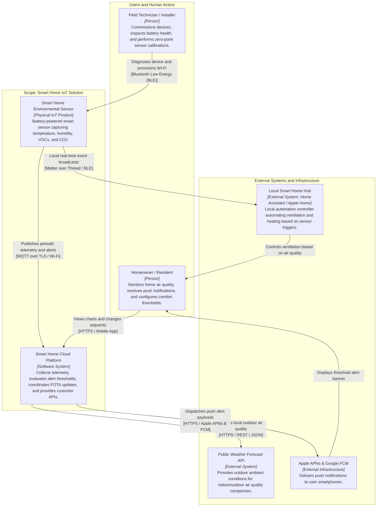

# System Context Diagrams (Level 1)

## 1. Defining the Product Ecosystem Scope

The **System Context diagram** represents the highest level of zoom in the C4 model. It establishes what is inside our product scope and how it connects to people, local home infrastructure, cloud backends, and external third-party services.

In our reference system—the **Smart Home Environmental Monitor**:
- The **Physical Sensor Device** measures ambient temperature, relative humidity, volatile organic compounds (`VOCs`), and CO2 levels in the home.
- The **Smart Home Cloud Platform** ingests real-time metrics, computes historical analytics, manages firmware update rollouts, and pushes alert notifications.
- **External Systems** include local smart home hubs (for example, Home Assistant, Apple Home), third-party weather forecast APIs, and telecommunication carriers.


[[CAPTION:Figure]] System Context diagram (Level 1) for the Smart Home Environmental Sensor ecosystem.

## 2. Matching PlantUML C4 Context Diagram

Below is the matching **PlantUML C4 Context diagram** using the standard `C4_Context.puml` library. The build toolchain automatically resolves the include from the repository's `templates/` folder:

````plantuml
@startuml
!include <C4/C4_Context>

LAYOUT_WITH_LEGEND()

title System Context: Smart Home Environmental Sensor Solution

Person(homeowner, "Homeowner / Resident", "Monitors indoor air quality, views trends, and receives comfort alerts.")
Person_Ext(installer, "Technician / Installer", "Performs initial Wi-Fi provisioning, battery checks, and sensor calibration.")

Enterprise_Boundary(c0, "Smart Home IoT Ecosystem") {
    System(sensor, "Smart Environmental Sensor", "Battery-powered indoor air quality monitor measuring temperature, humidity, VOCs, and CO2.")
    System(cloud, "Smart Home Cloud Platform", "Ingests time-series telemetry, evaluates rules, manages FOTA updates, and exposes REST APIs.")
}

System_Ext(hub, "Local Smart Home Hub", "Home Assistant / Matter controller automating HVAC and ventilation locally.")
System_Ext(weather, "Public Weather Service", "External meteorological service providing outdoor baseline air quality and temperature.")
System_Ext(push, "Push Notification Service", "Apple APNs and Google Firebase Cloud Messaging for urgent threshold alerts.")

Rel(sensor, cloud, "Publishes telemetry & alerts", "MQTT over TLS / Wi-Fi")
Rel(sensor, hub, "Broadcasts local sensor events", "Matter over Thread / BLE")
Rel(installer, sensor, "Provisions Wi-Fi & calibrates", "Bluetooth Low Energy")
Rel(cloud, weather, "Queries outdoor metrics", "HTTPS / REST / JSON")
Rel(cloud, push, "Dispatches alert events", "HTTPS / JSON")
Rel(push, homeowner, "Delivers threshold alerts", "Push Notification")
Rel(homeowner, cloud, "Views analytics & changes settings", "HTTPS / Mobile App")

@enduml
````
[[CAPTION:Figure]] PlantUML C4 Context diagram for the Smart Home IoT ecosystem.

## 3. Key Relationships and Protocol Annotations

On an IoT Context diagram, always annotate connecting arrows with **both the data intent and the transport layer**:

| Interaction Path | Purpose / Description | Protocol & Physical Carrier |
| :--- | :--- | :--- |
| **Sensor $\rightarrow$ Cloud** | Periodic telemetry frames, battery status, and threshold alerts | `[MQTT over TLS / Wi-Fi @ 2.4 GHz]` |
| **Sensor $\rightarrow$ Local Hub** | Real-time sensor state broadcasts for instant local HVAC automations | `[Matter over Thread / 802.15.4]` |
| **Technician $\rightarrow$ Sensor** | Initial credential onboarding, diagnostics, and factory calibration | `[Bluetooth Low Energy (BLE) 5.0]` |
| **Cloud $\rightarrow$ Weather Service** | Ingesting external weather data for predictive heating models | `[HTTPS / REST / JSON]` |
| **Mobile App $\rightarrow$ Cloud** | User dashboard telemetry views and configuration updates | `[HTTPS / GraphQL & WebSockets]` |
[[CAPTION:Table]] Interaction protocols for the Smart Home Sensor context diagram.

## 4. Tips & Tricks for Level 1 IoT Diagrams

1. **Model Both the Device and the Cloud**: A common mistake is drawing *only* the physical hardware or *only* the cloud platform. A true IoT product system context must encompass the hardware edge, the local network, and the cloud services as unified actors.
1. **Differentiate Human Personas**: Separate day-to-day residents from installation technicians. Technicians typically possess administrative privileges, local physical access (BLE/buttons), and different tools.
1. **Capture Offline Capabilities**: In smart homes, cloud connectivity may fail while local automations must continue operating. Showing the local path (`Sensor -> Local Hub`) immediately communicates resilience to stakeholders.
