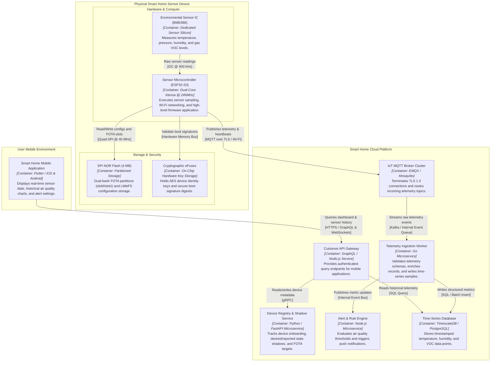

# Container diagrams (level 2)

## 1. End-to-End IoT System Architecture

A **Container diagram** zooms into the systems defined at Level 1 to show the high-level technical architecture. In an Internet of Things (IoT) solution, it captures the whole journey of the data. That runs from the silicon and firmware at the edge, through local networks and cloud microservices, to the user's phone.


[[CAPTION:Figure]] End-to-end Container diagram (Level 2) showing the physical device, cloud microservices, and mobile client app.

## 2. Matching PlantUML C4 Container Diagram

The following **PlantUML C4 Container diagram** represents the identical architecture using standard C4 elements and custom tags:

````plantuml
@startuml
!include <C4/C4_Container>

LAYOUT_WITH_LEGEND()

title Container Diagram: Smart Home Environmental Sensor Solution

System_Boundary(device, "Physical Sensor Device") {
    Container(mcu, "Sensor Microcontroller", "ESP32-S3 Dual-Core @ 240MHz", "Executes sensor sampling, Wi-Fi networking, and high-level firmware application.")
    Container(sensor_ic, "Environmental Sensor IC", "Bosch BME688 Silicon", "Measures ambient temperature, humidity, atmospheric pressure, and VOC gas index.")
    ContainerDb(flash, "SPI NOR Flash Memory", "4 MB SPI Partition", "Stores dual-bank FOTA firmware images (slot0/slot1) and LittleFS configuration store.")
    ContainerDb(efuse, "Hardware eFuses", "On-Chip OTP Memory", "Stores factory cryptographic keys, device MAC, and Secure Boot hashes.")
}

System_Boundary(cloud, "Smart Home Cloud Platform") {
    Container(mqtt, "IoT MQTT Broker Cluster", "EMQX / Mosquitto", "Terminates mTLS sessions and ingests real-time sensor telemetry topics.")
    Container(ingest, "Telemetry Ingestion Worker", "Go Microservice", "Validates binary/JSON telemetry payloads and writes time-series records.")
    Container(registry, "Device Registry & Shadow", "Python / FastAPI", "Manages device activation, configuration shadows, and FOTA campaigns.")
    Container(rules, "Alert & Rules Engine", "Node.js Microservice", "Evaluates indoor air quality thresholds and fires threshold alerts.")
    ContainerDb(tsdb, "Time-Series Database", "TimescaleDB / PostgreSQL", "Stores compressed historical environmental time-series data.")
    Container(api, "Customer API Gateway", "Node.js / GraphQL", "Exposes customer-facing endpoints for mobile dashboards and charts.")
}

Person(user, "Homeowner / Resident", "Monitors air quality via smartphone.")
Container(mobile, "Smart Home Mobile App", "Flutter / iOS & Android", "Renders interactive dashboard dials, historical graphs, and air alerts.")

Rel(sensor_ic, mcu, "Samples raw telemetry", "I2C @ 400 kHz")
Rel(mcu, flash, "Reads/writes config & FOTA blocks", "Quad-SPI @ 40 MHz")
Rel(mcu, efuse, "Validates secure boot signature", "Internal Bus")

Rel(mcu, mqtt, "Publishes telemetry and alert frames", "MQTT over TLS / Wi-Fi")
Rel(mqtt, ingest, "Dispatches raw telemetry stream", "Internal Queue")
Rel(ingest, tsdb, "Inserts telemetry records", "SQL / TimescaleDB")
Rel(ingest, rules, "Sends metric events", "Internal Bus")

Rel(api, tsdb, "Queries telemetry trends", "SQL Query")
Rel(api, registry, "Queries device shadow state", "Internal gRPC")
Rel(mobile, api, "Queries dashboards & sends settings", "HTTPS / GraphQL")
Rel(user, mobile, "Interacts with mobile UI", "Touch")

@enduml
````
[[CAPTION:Figure]] PlantUML C4 Container diagram for the Smart Home IoT ecosystem.

## 3. Container Classifications

A clean Level 2 diagram categorises containers by their functional layer:

| Container | Category | Technology | Responsibility |
| :--- | :--- | :--- | :--- |
| **Sensor Microcontroller** | Edge Compute | ESP32-S3 (Xtensa Dual-Core) | Runs FreeRTOS, sensor drivers, Wi-Fi stack, and application tasks. |
| **Environmental Sensor IC** | Edge Sensor | Bosch BME688 / I2C | Gathers raw analog/digital temperature, humidity, and gas resistance. |
| **Flash Memory Partition** | Edge Storage | SPI NOR Flash (LittleFS) | Retains calibration curves, Wi-Fi credentials, and FOTA staging slots. |
| **IoT MQTT Broker** | Cloud Ingestion | EMQX Cluster / Mosquitto | Handles hundreds of thousands of concurrent TLS socket connections. |
| **Ingestion Worker** | Cloud Processing | Go / Goroutines | High-throughput stream processing validating incoming telemetry. |
| **TimescaleDB** | Cloud Storage | TimescaleDB (PostgreSQL) | Hypertables optimised for high-rate append-only time-series data. |
| **Customer API Gateway** | Cloud API | GraphQL / Node.js / Express | Serves user dashboard requests, user authentication, and mobile tokens. |
| **Mobile Application** | Client UI | Flutter / Dart | Native iOS and Android application displaying real-time graphs and air alerts. |
[[CAPTION:Table]] Container definitions and technologies for the Smart Home IoT solution.

## 4. Tips & Tricks for Level 2 Diagrams

1. **Avoid Over-Splitting Microcontroller Silicon**: Treat the microcontroller running the primary firmware as one execution container. Do not create separate containers for internal RAM, internal registers, or internal timers.
1. **Show Storage Containers Clearly**: Any component that persists data across reboots (such as external SPI flash, LittleFS partitions, or cloud databases) should be represented using container database shapes (`ContainerDb`).
1. **Document Data Protocol Formats**: State both the transport and the serialisation format on communication lines (for example, `[MQTT over TLS / JSON payload]` or `[HTTPS / GraphQL]`).
