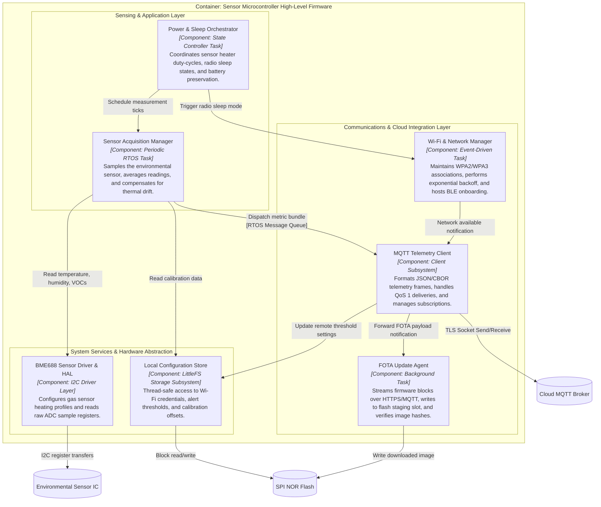
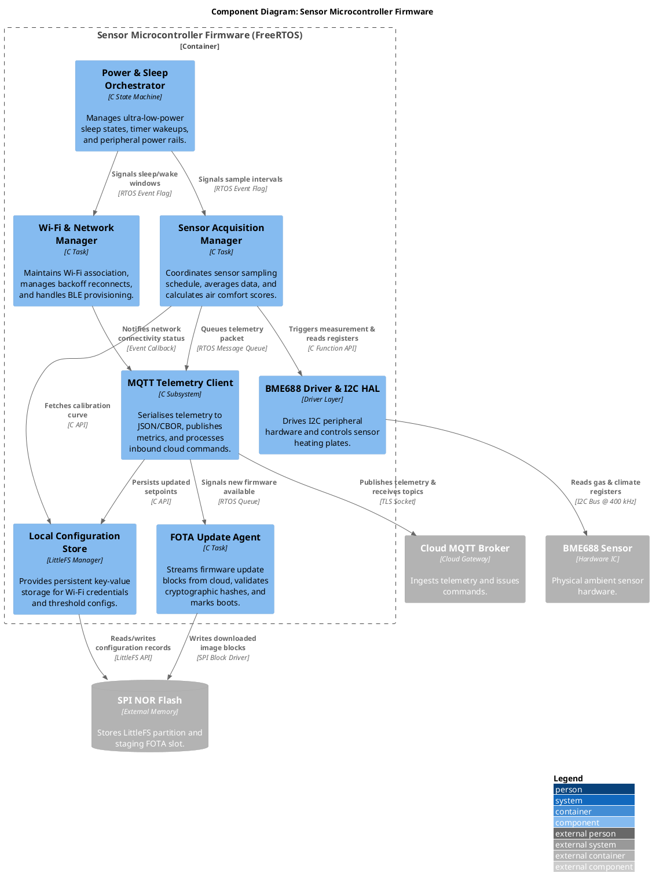
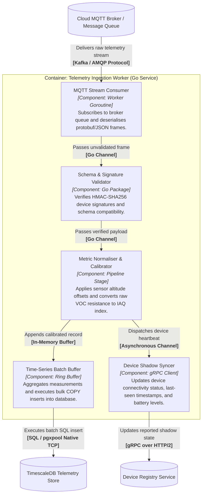
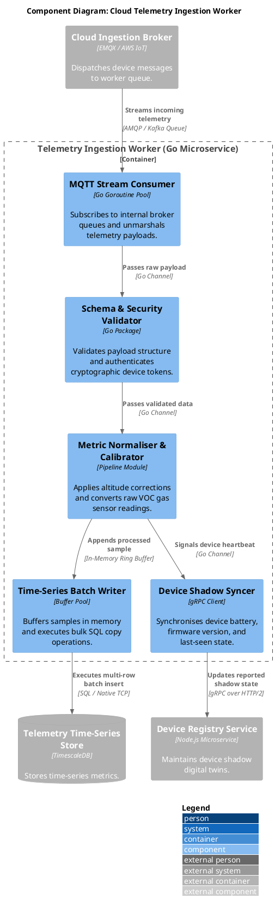

# Component diagrams (level 3)

## 1. Decomposing Containers into Components

A **Component diagram** zooms into an individual container (from Level 2) to reveal its internal modular software architecture. 

In connected systems, components exist both at the physical edge and in the cloud. In this chapter, we explore two complementary Level 3 Component views:
1. **The High-Level Firmware Component Architecture** inside the physical Sensor Microcontroller container.
2. **The Cloud Telemetry Ingestion Worker** inside the cloud microservices layer.

## 2. High-Level Firmware Component Architecture

Within the microcontroller firmware (executing on an RTOS like FreeRTOS or Zephyr), components represent **cohesive functional modules, subsystems, or background tasks** connected by message queues and function interfaces:

[[CAPTION:Figure]] High-level firmware Component diagram (Level 3) for the Smart Home Sensor microcontroller.

## 3. Matching PlantUML C4 Firmware Component Diagram

Below is the matching **PlantUML C4 Component diagram** detailing the firmware subsystems using `C4_Component.puml`:

[[CAPTION:Figure]] PlantUML C4 Component diagram for the sensor firmware.

## 4. Cloud Telemetry Ingestion Worker Component Architecture

Zooming into the cloud tier, the **Telemetry Ingestion Worker** container consumes raw MQTT streams, validates payload signatures, applies calibration curves, and batches samples into the time-series store:

[[CAPTION:Figure]] High-level cloud component diagram (Level 3) for the Telemetry Ingestion Worker microservice.

## 5. Matching PlantUML C4 Cloud Component Diagram

Below is the matching **PlantUML C4 Component diagram** for the cloud Telemetry Ingestion Worker service using `C4_Component.puml`:

[[CAPTION:Figure]] PlantUML C4 Component diagram for the cloud Telemetry Ingestion Worker microservice.

## 6. Component Concurrency & Execution Mapping

In connected architectures, defining how components map to execution units prevents concurrency bottlenecks and race conditions:

| Component | Execution Context | Priority / Scaling | Concurrency Mechanism |
| :--- | :--- | :--- | :--- |
| **Sensor Acquisition Manager** (Firmware) | Periodic RTOS Task | High | Wakes on timer tick; blocks while awaiting I2C completion. |
| **Power & Sleep Orchestrator** (Firmware) | Event-Driven Task | Highest | Coordinates sleep entry when all task queues are empty. |
| **Wi-Fi & Network Manager** (Firmware) | System Event Task | Normal | Handles network state transitions and IP DHCP renewal. |
| **MQTT Telemetry Client** (Firmware) | Networking Task | Normal | Consumes from telemetry queue; blocks on network sockets. |
| **FOTA Update Agent** (Firmware) | Background Task | Lowest | Executes cooperatively; throttled to avoid starving sensing. |
| **BME688 Driver & HAL** (Firmware) | Synchronous Library | Caller Context | Mutex-protected to prevent concurrent I2C bus collisions. |
| **MQTT Stream Consumer** (Cloud) | Goroutine Pool (50 workers) | Autoscaling Pod | Worker pool reading concurrently from partitioned queue. |
| **Time-Series Batch Writer** (Cloud) | Scheduled Flush Goroutine | High Throughput | Flushes ring buffer on 1-second interval or 500-sample limit. |
| **Device Shadow Syncer** (Cloud) | Non-Blocking Goroutine | Normal | Asynchronous gRPC dispatch to prevent blocking ingestion pipeline. |
[[CAPTION:Table]] Concurrency mapping for firmware tasks and cloud ingestion components.

## 7. Tips & Tricks for Level 3 Diagrams

1. **Avoid Over-Diagramming Procedural Utilities**: Do not create components for generic helper utilities like `crc32.c`, `string_utils.c`, or standard math libraries. Focus on cohesive subsystems that own state, background tasks, or worker pools.
1. **Show Concurrency Interactions**: Always specify whether communication occurs via function calls, RTOS message queues, event flags, Go channels, or gRPC streams.
1. **Model Both Edge and Cloud Separately**: Maintain dedicated Level 3 Component diagrams for each major container. Do not merge firmware task diagrams and cloud microservice component diagrams into a single confusing drawing.
