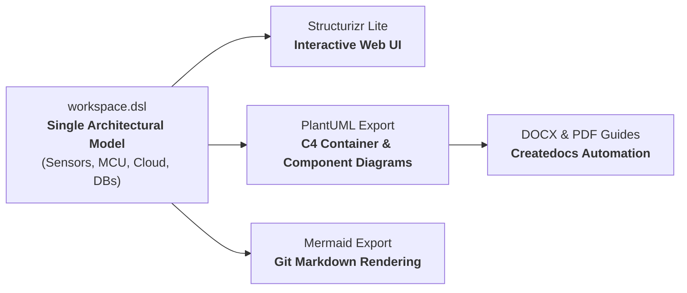
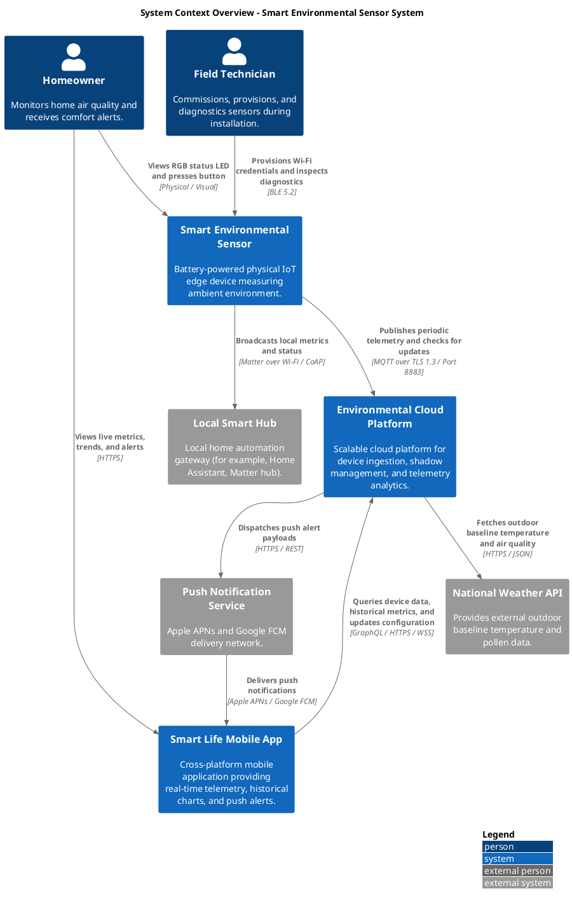
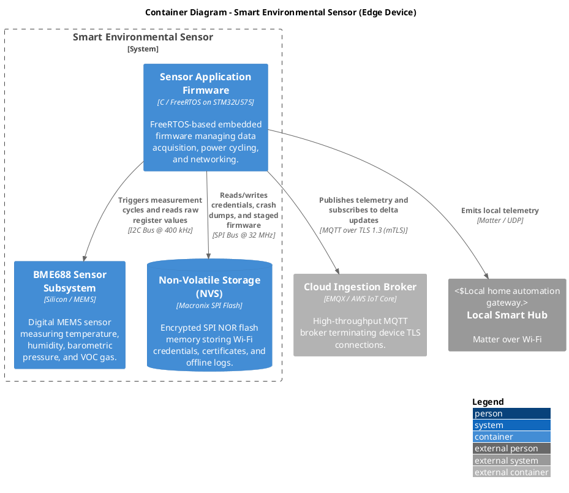
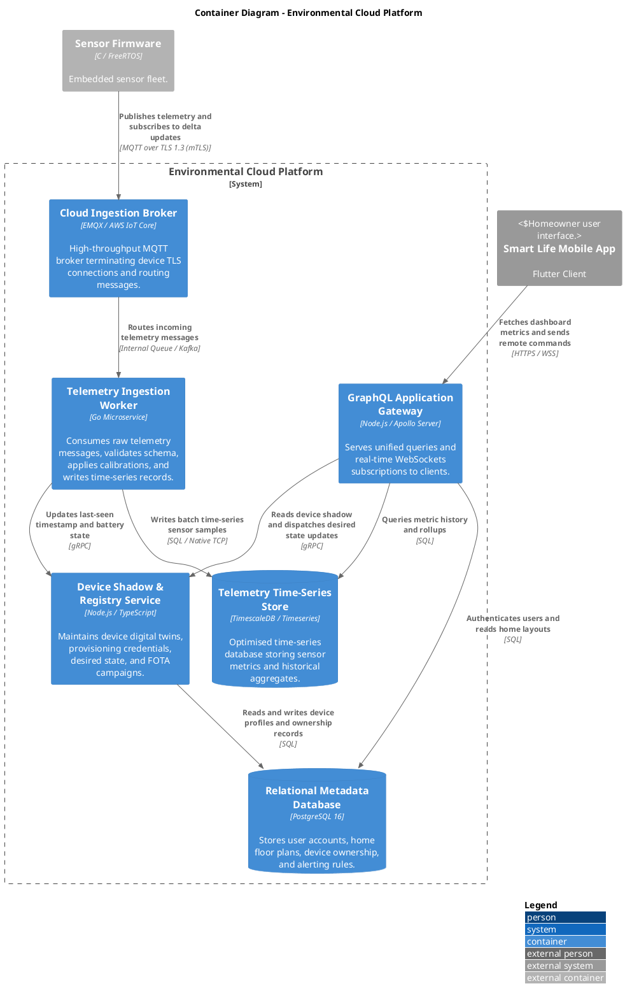
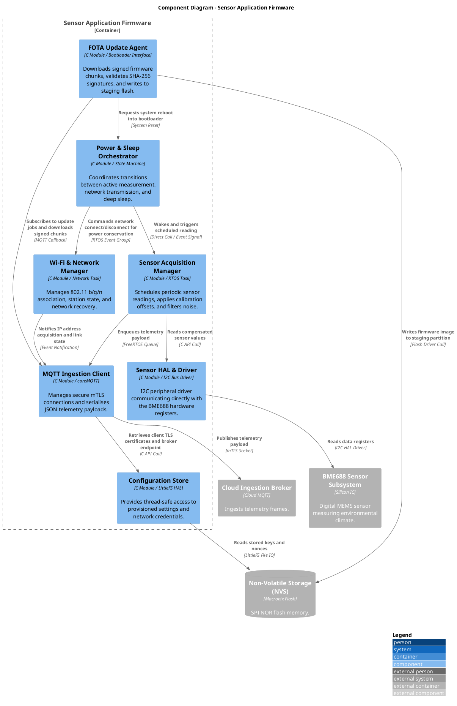
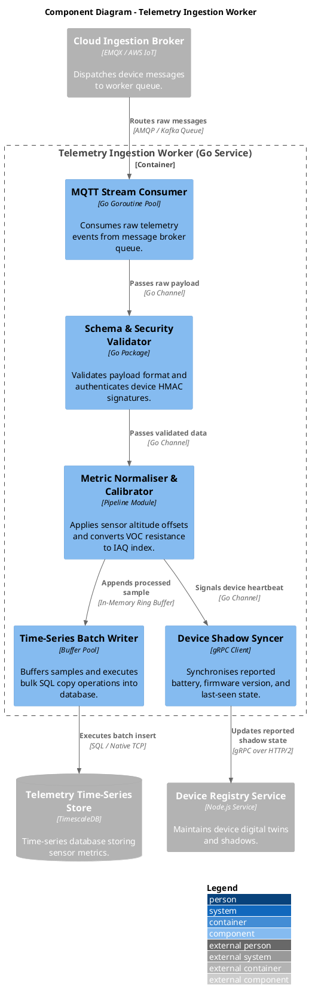
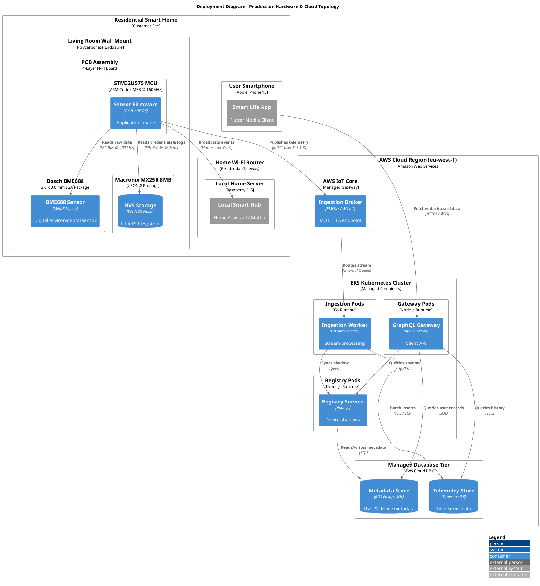

# Structurizr DSL Reference for Connected Systems

## 1. Why Structurizr DSL for IoT Architectures?

When designing connected systems that span physical edge devices, microcontrollers, radio gateways, and cloud microservices, authoring standalone visual diagrams quickly becomes unmaintainable. An update to an MQTT topic format, an ingestion endpoint, or a device hardware component often requires manually redrawing half a dozen diagrams across multiple levels.

The **Structurizr DSL** (Domain Specific Language) solves this problem by enforcing a **single source of truth**:

1. **Model Once, View Anywhere**: You define people, software systems, containers, components, deployment nodes, and their relationships once in an architectural model.
1. **Multiple Perspectives**: You declare views (Context, Container, Component, Deployment, Dynamic) that automatically project subsets of that same unified model.
1. **Format Agnostic**: From one `workspace.dsl` file, you can render interactive web views via **Structurizr Lite**, generate **PlantUML C4 diagrams**, or export **Mermaid** graphics for documentation.


[[CAPTION:Figure]] The Structurizr DSL architecture-as-code workflow for connected IoT systems.

## 2. Complete Smart Home IoT `workspace.dsl`

Below is a complete `workspace.dsl` file that models the whole Smart Home Environmental Monitoring system. It runs from the physical sensor and MCU firmware components to the cloud microservices and the mobile app.

```structurizr
workspace "Smart Home Environmental Monitoring System" "End-to-end architecture model from edge sensor firmware to cloud microservices and mobile user experience." {

    model {
        # =====================================================================
        # People / User Personas
        # =====================================================================
        homeowner = person "Homeowner" "Monitors home air quality and receives comfort alerts." "Person"
        installer = person "Field Technician" "Commissions, provisions, and diagnostics sensors during installation." "Person"

        # =====================================================================
        # External Systems
        # =====================================================================
        localHub = softwareSystem "Local Smart Hub" "Local home automation gateway (for example, Home Assistant, Apple Home, Matter hub)." "External"
        weatherService = softwareSystem "National Weather API" "Provides external outdoor baseline temperature and pollen data." "External"
        pushService = softwareSystem "Push Notification Service" "Apple APNs and Google FCM delivery network." "External"

        # =====================================================================
        # Connected Edge Product: Smart Environmental Sensor
        # =====================================================================
        sensorDevice = softwareSystem "Smart Environmental Sensor" "Battery-powered physical IoT edge device measuring ambient environment." "Device" {
            
            sensorHardware = container "BME688 Sensor Subsystem" "Digital MEMS sensor measuring temperature, humidity, barometric pressure, and VOC gas." "Silicon / MEMS" "Sensor"
            
            configStorage = container "Non-Volatile Storage (NVS)" "Encrypted SPI NOR flash memory storing Wi-Fi credentials, certificates, and offline logs." "Macronix SPI Flash" "Database"
            
            sensorFirmware = container "Sensor Application Firmware" "FreeRTOS-based embedded firmware managing data acquisition, power cycling, and networking." "C / FreeRTOS on STM32U575" "Firmware" {
                
                sensorAcq = component "Sensor Acquisition Manager" "Schedules periodic sensor readings, applies calibration offsets, and filters noise." "C Module / RTOS Task" "FirmwareComponent"
                powerOrch = component "Power & Sleep Orchestrator" "Coordinates transitions between active measurement, network transmission, and deep sleep." "C Module / State Machine" "FirmwareComponent"
                wifiMgr = component "Wi-Fi & Network Manager" "Manages 802.11 b/g/n association, station state, and network recovery." "C Module / Network Task" "FirmwareComponent"
                mqttClient = component "MQTT Ingestion Client" "Manages secure mTLS connections and serialises JSON telemetry payloads." "C Module / coreMQTT" "FirmwareComponent"
                fotaAgent = component "FOTA Update Agent" "Downloads signed firmware chunks, validates SHA-256 signatures, and writes to staging flash." "C Module / Bootloader Interface" "FirmwareComponent"
                configStore = component "Configuration Store" "Provides thread-safe access to provisioned settings and network credentials." "C Module / LittleFS HAL" "FirmwareComponent"
                sensorHal = component "Sensor HAL & Driver" "I2C peripheral driver communicating directly with the BME688 hardware registers." "C Module / I2C Bus Driver" "FirmwareComponent"
            }
        }

        # =====================================================================
        # Cloud Platform
        # =====================================================================
        cloudPlatform = softwareSystem "Environmental Cloud Platform" "Scalable cloud platform for device ingestion, shadow management, and telemetry analytics." "Cloud" {
            
            mqttBroker = container "Cloud Ingestion Broker" "High-throughput MQTT broker terminating device TLS connections and routing messages." "EMQX / AWS IoT Core" "CloudService"
            
            ingestionWorker = container "Telemetry Ingestion Worker" "Consumes raw telemetry messages, validates schema, applies calibrations, and writes time-series records." "Go Microservice" "CloudService" {
                streamConsumer = component "MQTT Stream Consumer" "Consumes raw telemetry events from message broker queue." "Go Goroutine Pool" "CloudComponent"
                payloadValidator = component "Schema & Security Validator" "Validates payload format and authenticates device HMAC signatures." "Go Package" "CloudComponent"
                metricCalibrator = component "Metric Normaliser & Calibrator" "Applies sensor altitude offsets and converts VOC resistance to IAQ index." "Pipeline Module" "CloudComponent"
                batchWriter = component "Time-Series Batch Writer" "Buffers samples and executes bulk SQL copy operations into database." "Buffer Pool" "CloudComponent"
                shadowSyncer = component "Device Shadow Syncer" "Synchronises reported battery, firmware version, and last-seen state." "gRPC Client" "CloudComponent"
            }
            
            deviceRegistry = container "Device Shadow & Registry Service" "Maintains device digital twins, provisioning credentials, desired state, and FOTA campaigns." "Node.js / TypeScript" "CloudService"
            
            telemetryDb = container "Telemetry Time-Series Store" "Optimised time-series database storing sensor metrics and historical aggregates." "TimescaleDB / Timeseries" "Database"
            
            metadataDb = container "Relational Metadata Database" "Stores user accounts, home floor plans, device ownership, and alerting rules." "PostgreSQL 16" "Database"
            
            graphqlApi = container "GraphQL Application Gateway" "Serves unified queries and real-time WebSockets subscriptions to clients." "Node.js / Apollo Server" "CloudService"
        }

        # =====================================================================
        # User Client Applications
        # =====================================================================
        mobileApp = softwareSystem "Smart Life Mobile App" "Cross-platform mobile application providing real-time telemetry, historical charts, and push alerts." "MobileApp"

        # =====================================================================
        # System-Level Relationships (Level 1)
        # =====================================================================
        homeowner -> mobileApp "Views live metrics, trends, and alerts" "HTTPS"
        homeowner -> sensorDevice "Views RGB status LED and presses commissioning button" "Physical / Visual"
        installer -> sensorDevice "Provisions Wi-Fi credentials and inspects diagnostics" "BLE 5.2"
        
        sensorDevice -> cloudPlatform "Publishes periodic telemetry and checks for updates" "MQTT over TLS 1.3 / Port 8883"
        sensorDevice -> localHub "Broadcasts local metrics and status" "Matter over Wi-Fi / CoAP"
        cloudPlatform -> pushService "Dispatches push alert payloads" "HTTPS / REST"
        pushService -> mobileApp "Delivers push notifications" "Apple APNs / Google FCM"
        cloudPlatform -> weatherService "Fetches outdoor baseline temperature and air quality" "HTTPS / JSON"
        mobileApp -> cloudPlatform "Queries device data, historical metrics, and updates configuration" "GraphQL / HTTPS / WSS"

        # =====================================================================
        # Container-Level Relationships (Level 2)
        # =====================================================================
        sensorFirmware -> sensorHardware "Triggers measurement cycles and reads raw register values" "I2C Bus @ 400 kHz"
        sensorFirmware -> configStorage "Reads/writes credentials, crash dumps, and staged firmware" "SPI Bus @ 32 MHz"
        sensorFirmware -> mqttBroker "Publishes telemetry and subscribes to delta updates" "MQTT over TLS 1.3 (mTLS)"
        sensorFirmware -> localHub "Emits local telemetry" "Matter / UDP"

        mqttBroker -> ingestionWorker "Routes incoming telemetry messages" "Internal Queue / Kafka"
        ingestionWorker -> telemetryDb "Writes batch time-series sensor samples" "SQL / Native TCP"
        ingestionWorker -> deviceRegistry "Updates last-seen timestamp and battery state" "gRPC"

        deviceRegistry -> metadataDb "Reads and writes device profiles and ownership records" "SQL"
        graphqlApi -> telemetryDb "Queries metric history and rollups" "SQL"
        graphqlApi -> deviceRegistry "Reads device shadow and dispatches desired state updates" "gRPC"
        graphqlApi -> metadataDb "Authenticates users and reads home layouts" "SQL"

        mobileApp -> graphqlApi "Fetches dashboard metrics and sends remote commands" "HTTPS / WSS"

        # =====================================================================
        # Component-Level Relationships inside Firmware (Level 3)
        # =====================================================================
        powerOrch -> sensorAcq "Wakes and triggers scheduled reading" "Direct Call / Event Signal"
        sensorAcq -> sensorHal "Reads compensated sensor values" "C API Call"
        sensorHal -> sensorHardware "Reads data registers" "I2C HAL Driver"
        
        sensorAcq -> mqttClient "Enqueues telemetry payload" "FreeRTOS Queue"
        powerOrch -> wifiMgr "Commands network connect/disconnect for power conservation" "RTOS Event Group"
        wifiMgr -> mqttClient "Notifies IP address acquisition and link state" "Event Notification"
        
        mqttClient -> configStore "Retrieves client TLS certificates and broker endpoint" "C API Call"
        configStore -> configStorage "Reads stored keys and nonces" "LittleFS File IO"

        fotaAgent -> mqttClient "Subscribes to update jobs and downloads signed chunks" "MQTT Callback"
        fotaAgent -> configStorage "Writes firmware image to staging partition" "Flash Driver Call"
        fotaAgent -> powerOrch "Requests system reboot into bootloader" "System Reset"

        # =====================================================================
        # Component-Level Relationships inside Cloud Ingestion Worker (Level 3)
        # =====================================================================
        mqttBroker -> streamConsumer "Routes raw messages" "AMQP / Kafka Queue"
        streamConsumer -> payloadValidator "Passes raw payload" "Go Channel"
        payloadValidator -> metricCalibrator "Passes validated data" "Go Channel"
        metricCalibrator -> batchWriter "Appends processed sample" "In-Memory Ring Buffer"
        metricCalibrator -> shadowSyncer "Signals device heartbeat" "Go Channel"
        batchWriter -> telemetryDb "Executes batch insert" "SQL / Native TCP"
        shadowSyncer -> deviceRegistry "Updates reported shadow state" "gRPC over HTTP/2"

        # =====================================================================
        # Deployment Environment: Physical Smart Home Deployment
        # =====================================================================
        deploymentEnvironment "Production" {
            deploymentNode "Residential Smart Home" "Physical residence of the homeowner." "Physical Boundary" {
                
                deploymentNode "Living Room Wall Mount" "Physical wall installation point." "Hardware Enclosure" {
                    deploymentNode "PCB Assembly" "Custom 4-layer printed circuit board." "Hardware" {
                        deploymentNode "STM32U575 MCU" "ARM Cortex-M33 running at 160MHz with TrustZone." "Microcontroller" {
                            containerInstance sensorFirmware
                        }
                        deploymentNode "Bosch BME688" "Integrated environmental sensor in 3.0 x 3.0 mm package." "Hardware IC" {
                            containerInstance sensorHardware
                        }
                        deploymentNode "Macronix MX25R 8MB" "External NOR flash memory chip." "Hardware IC" {
                            containerInstance configStorage
                        }
                    }
                }

                deploymentNode "Home Wi-Fi Router" "Standard dual-band residential wireless gateway." "Network Device" {
                    deploymentNode "Local Home Server" "Raspberry Pi 5 home server." "Hardware" {
                        softwareSystemInstance localHub
                    }
                }

                deploymentNode "User Smartphone" "Apple iPhone 15 running iOS 18." "Mobile Device" {
                    softwareSystemInstance mobileApp
                }
            }

            deploymentNode "AWS Cloud Region (eu-west-1)" "Amazon Web Services Ireland data centre." "Cloud Infrastructure" {
                deploymentNode "AWS IoT Core" "Managed cloud MQTT message broker and TLS gateway." "AWS Service" {
                    containerInstance mqttBroker
                }
                deploymentNode "Amazon Elastic Kubernetes Service (EKS)" "Managed container orchestration cluster." "Kubernetes" {
                    deploymentNode "Telemetry Ingestion Pods" "Auto-scaling worker pods." "Container Runtime" {
                        containerInstance ingestionWorker
                    }
                    deploymentNode "Device Registry Pods" "Stateful management pods." "Container Runtime" {
                        containerInstance deviceRegistry
                    }
                    deploymentNode "GraphQL API Pods" "Public gateway service pods." "Container Runtime" {
                        containerInstance graphqlApi
                    }
                }
                deploymentNode "Managed Database Tier" "High-availability managed data tier." "Cloud Database" {
                    deploymentNode "Amazon RDS PostgreSQL" "Multi-AZ relational database." "Database Server" {
                        containerInstance metadataDb
                    }
                    deploymentNode "Amazon Timestream / TimescaleDB" "Scalable time-series storage engine." "Database Server" {
                        containerInstance telemetryDb
                    }
                }
            }
        }
    }

    # =========================================================================
    # Views Definition
    # =========================================================================
    views {
        systemContext sensorDevice "SystemContext_Overview" "Overall system context showing device, users, cloud platform, and third-party integrations." {
            include *
            autoLayout lr
        }

        container sensorDevice "Container_EdgeDevice" "Internal containers of the Smart Environmental Sensor edge device." {
            include *
            autoLayout tb
        }

        container cloudPlatform "Container_CloudPlatform" "Internal microservices and database containers of the Cloud Platform." {
            include *
            autoLayout tb
        }

        component sensorFirmware "Component_FirmwareArchitecture" "Component-level architecture of the FreeRTOS embedded application firmware." {
            include *
            autoLayout tb
        }

        component ingestionWorker "Component_CloudIngestionWorker" "Component-level architecture of the Go Telemetry Ingestion Worker." {
            include *
            autoLayout tb
        }

        deployment sensorDevice "Production" "Deployment_ProductionTopology" "Physical hardware and cloud infrastructure deployment mapping." {
            include *
            autoLayout tb
        }

        # =====================================================================
        # Visual Styling and Tag Configurations
        # =====================================================================
        styles {
            element "Person" {
                shape Person
                background #08427b
                color #ffffff
            }
            element "Software System" {
                background #1168bd
                color #ffffff
            }
            element "Device" {
                shape RoundedBox
                background #2A6F97
                color #ffffff
            }
            element "Cloud" {
                shape RoundedBox
                background #014F86
                color #ffffff
            }
            element "External" {
                background #999999
                color #ffffff
            }
            element "MobileApp" {
                shape MobileDevicePortrait
                background #0077B6
                color #ffffff
            }
            element "Container" {
                background #438dd5
                color #ffffff
            }
            element "Firmware" {
                shape RoundedBox
                background #1E88E5
                color #ffffff
            }
            element "Sensor" {
                shape Hexagon
                background #00897B
                color #ffffff
            }
            element "Database" {
                shape Cylinder
                background #2E7D32
                color #ffffff
            }
            element "CloudService" {
                shape RoundedBox
                background #1565C0
                color #ffffff
            }
            element "FirmwareComponent" {
                shape Component
                background #5C6BC0
                color #ffffff
            }
            element "CloudComponent" {
                shape Component
                background #0288D1
                color #ffffff
            }
            relationship "Relationship" {
                thickness 2
                dashed false
                color #707070
                fontSize 24
            }
        }
    }
}
```
[[CAPTION:Figure]] Complete Structurizr DSL specification (`workspace.dsl`) for the Smart Home Environmental Monitoring system.

## 3. Matching PlantUML C4 Diagrams for DSL Views

When exporting or pairing the Structurizr model with standard PlantUML, each view declared in `workspace.dsl` generates a corresponding PlantUML C4 diagram. Below are the complete matching PlantUML scripts for all six declared views:

### A. View 1: System Context Overview (`SystemContext_Overview.puml`)


[[CAPTION:Figure]] Matching PlantUML C4 script for View 1: System Context Overview.

### B. View 2: Edge Device Container Diagram (`Container_EdgeDevice.puml`)


[[CAPTION:Figure]] Matching PlantUML C4 script for View 2: Edge Device Containers.

### C. View 3: Cloud Platform Container Diagram (`Container_CloudPlatform.puml`)


[[CAPTION:Figure]] Matching PlantUML C4 script for View 3: Cloud Platform Containers.

### D. View 4: Firmware Component Architecture (`Component_FirmwareArchitecture.puml`)


[[CAPTION:Figure]] Matching PlantUML C4 script for View 4: Firmware Components.

### E. View 5: Cloud Ingestion Worker Component Architecture (`Component_CloudIngestionWorker.puml`)


[[CAPTION:Figure]] Matching PlantUML C4 script for View 5: Cloud Ingestion Worker Components.

### F. View 6: Physical and Cloud Deployment Topology (`Deployment_ProductionTopology.puml`)


[[CAPTION:Figure]] Matching PlantUML C4 script for View 6: Physical and Cloud Deployment Topology.

## 4. Running Structurizr Lite Locally

This repository provides built-in tools to launch and export Structurizr DSL models directly without manual Docker configurations:

### A. Launching the Interactive Web Viewer

Run the local helper script from the root of the repository:

```bash
python tools/structurizr/structurizr-local.py docs/guides/c4-model-guide/workspace.dsl
```

This launches Structurizr Lite in a containerised instance. Open your browser to `http://localhost:8080` to interactively pan, zoom, inspect component dependencies, and switch between System Context, Container, Component, and Deployment views.

### B. Exporting Diagrams to PlantUML and Mermaid

To export the views defined in `workspace.dsl` into standard PlantUML C4 files or Mermaid markdown snippets:

```bash
# Using Structurizr CLI export
structurizr-cli export -w docs/guides/c4-model-guide/workspace.dsl -f plantuml/c4plantuml -o docs/guides/c4-model-guide/gen/

# Using the repository automated exporter
python tools/structurizr/structurizr-export.py docs/guides/c4-model-guide/workspace.dsl
```

The exporter generates `.puml` files corresponding to each declared view (for example, `SystemContext_Overview.puml`, `Container_EdgeDevice.puml`, `Component_FirmwareArchitecture.puml`, `Component_CloudIngestionWorker.puml`, `Deployment_ProductionTopology.puml`).

## 5. Best Practices for Structurizr DSL in Embedded Projects

| Practice | Recommendation | Why It Matters |
| :--- | :--- | :--- |
| **Separate Firmware from Hardware** | Model physical sensors as `#Sensor` hardware containers and the application code as `#Firmware` containers. | Clarifies the boundary between physical silicon and executable machine code. |
| **Label Hardware Interfaces** | Specify baud rates, bus standards, and voltages on relations (for example, `"I2C Bus @ 400 kHz"`, `"SPI @ 32 MHz"`). | Eliminates ambiguity for electrical and firmware engineers reviewing pinouts and timing. |
| **Model Power Modes with Tags** | Use custom tags such as `#AlwaysOn` and `#SwitchedPowerRail` on hardware deployment nodes. | Highlights high-current radio peripherals that must be dynamically power-gated to preserve battery life. |
| **Keep Components Architectural** | Model RTOS tasks, worker pools, event queues, and state machines as components. Do not model single helper functions or static utility files. | Prevents diagram bloat and keeps the view focused on system concurrency and data flow. |
[[CAPTION:Table]] Structurizr DSL best practices for embedded and connected systems.
