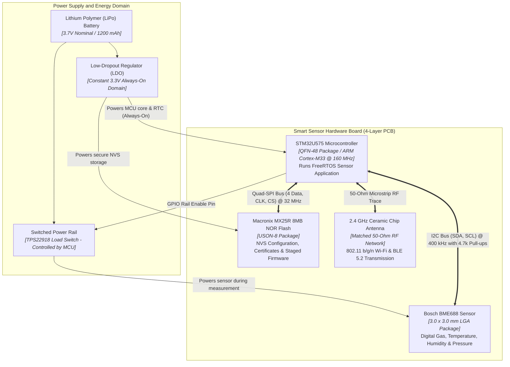
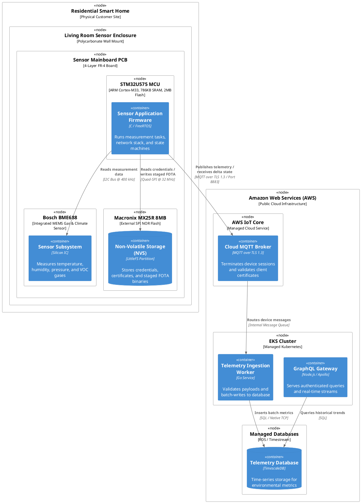
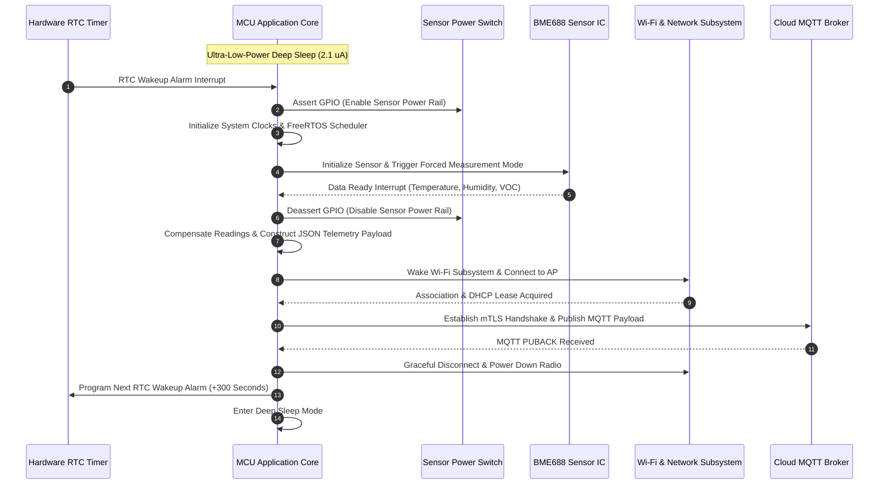

# Deployment, Tips & Tricks, and Anti-Patterns

## 1. Physical Deployment and Hardware Topology

In standard enterprise and web applications, software containers run inside virtual machines, cloud instances, or Kubernetes pods. In **connected IoT and embedded systems**, software containers run on specific silicon packages, connected by printed circuit board (`PCB`) traces. They are powered by batteries or energy-harvesting circuits, and subject to real-world electrical constraints.

A **C4 Deployment Diagram** bridges software containers to their physical hardware execution environment.

### A. Physical Architecture Overview

The Smart Environmental Sensor runs its firmware container on an **STM32U575** microcontroller and reads the **BME688** sensor over an I2C bus. It logs offline data to an external **SPI NOR Flash**, and transmits over an integrated 2.4 GHz radio:


[[CAPTION:Figure]] Physical Deployment and Electrical Topology diagram mapping software containers to hardware silicon, power rails, and peripheral buses.

### B. PlantUML C4 Deployment Diagram

The PlantUML deployment model below formalises the physical hardware topology of the device and the cloud infrastructure:


[[CAPTION:Figure]] PlantUML C4 Deployment diagram showing edge hardware packaging and cloud infrastructure hosting.

## 2. Dynamic Sequences: Modelling Time and Lifecycles

While standard C4 diagrams capture static relationships, connected IoT systems are inherently dynamic. Microcontrollers sleep for 99% of their lifespan to conserve energy, waking periodically to measure sensors, negotiate Wi-Fi associations, publish MQTT telemetry, and immediately return to low-power sleep.

A **C4 Dynamic Diagram** or UML sequence diagram illustrates this runtime sequence:


[[CAPTION:Figure]] Sequence diagram illustrating the sensor acquisition, network transmission, and power-gating lifecycle.

## 3. Practical Architecture Tips & Tricks for IoT Teams

### A. Establish Clear Layer Boundaries

Avoid mixing physical electronics schematics with logical firmware components:

- **Level 2 (Containers)**: Treat the running firmware binary as a software execution unit. Do not draw GPIO pins or pull-up resistors here.
- **Level 3 (Components)**: Focus on software modules, RTOS tasks, message queues, and HAL drivers.
- **Physical Deployment**: Place the PCB, connectors, bus routing, and power supplies strictly in the Deployment view.

### B. Make Communication Protocols Explicit

An unlabelled arrow in an IoT architecture diagram is a major risk. Every relationship arrow must explicitly state:

1. **The application protocol** (for example, MQTT, CoAP, HTTPS, Matter, Modbus).
1. **The security transport layer** (for example, TLS 1.3, DTLS 1.2, AES-128-CCM, plaintext).
1. **The physical or network carrier** (for example, Wi-Fi 802.11 b/g/n, BLE 5.2, Thread, Ethernet, I2C, SPI, UART).

### C. Automate Diagram Validation in CI/CD

Prevent architecture diagrams from becoming obsolete by integrating validation into your development pipeline:

```yaml
# Example GitHub Actions step
- name: Validate C4 Structurizr Model
  run: |
    docker run --rm -v $(pwd):/workspace structurizr/cli \
      validate -w /workspace/docs/guides/c4-model-guide/workspace.dsl
```

Using tools like `tools/docs-check/check_docs.py` and pre-commit hooks ensures that all referenced diagram files, links, and versions are automatically verified whenever code changes are committed.

## 4. Architectural Anti-Patterns to Avoid

When architecting connected systems, watch for these common pitfalls:

| Anti-Pattern | Description | Impact | Recommended Solution |
| :--- | :--- | :--- | :--- |
| **The "Everything is a Container" Trap** | Modelling every C source file, module, or struct as a container at Level 2. | Diagrams become unreadable and lose architectural abstraction. | Restrict containers strictly to separate binaries, isolated cores, auxiliary chips, or storage media. Source modules belong at Level 3. |
| **The "Passive Wire" Trap** | Drawing connecting arrows without labelling the protocol, baud rate, or security transport. | Leaves firmware and cloud teams guessing at message formats and authentication requirements. | Always label relations with protocol and payload (for example, `[MQTT over mTLS 1.3 / Port 8883]`, `[I2C @ 400 kHz]`). |
| **The "Black Box Cloud" Fallacy** | Drawing the entire cloud platform as a single monolithic circle labelled "Cloud". | Hides critical latency, scaling bottlenecks, ingestion brokers, and database boundaries. | Decompose the cloud into distinct containers: Ingestion Broker, Processing Services, Time-Series Storage, and User APIs. |
| **Conflating Physical and Logical** | Showing PCB copper traces and power supplies on a Level 2 software container diagram. | Confuses software developers who need to understand data flow and execution logic. | Keep Level 2 focused on software execution and storage units. Move electrical and PCB wiring to a dedicated Physical Deployment diagram. |
| **Hardware Omission** | Pretending embedded software executes in an environment with infinite RAM, persistent power, and zero latency. | Leads to designs that fail under low-battery, brownout, or intermittent connectivity conditions. | Explicitly model hardware watchdogs, battery constraints, flash write cycles, and offline storage queues. |
| **Abandonware Diagrams** | Treating diagrams as static slide images drawn once during proposal phases and never updated. | Diagrams become obsolete within weeks, leading to architectural debt and confusion. | Keep diagram source text in version control (using Structurizr DSL or PlantUML). Integrate checks into Git pre-commit hooks. |
[[CAPTION:Table]] Anti-patterns and pitfalls in embedded and connected systems architecture modelling.
