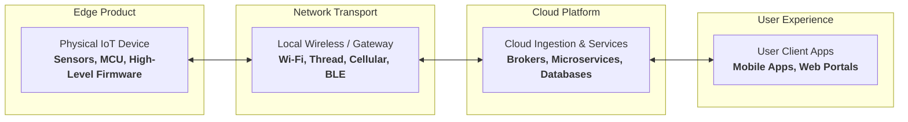
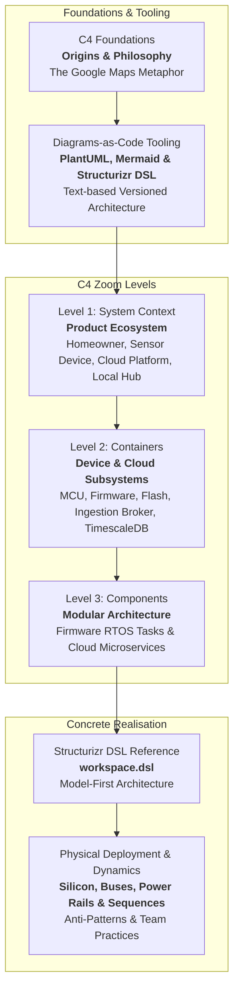

# C4 modelling for IoT and connected systems

## 1. Introduction and Purpose

The C4 model, created by Simon Brown, is a hierarchical, visual way to describe software architecture. It has four levels of abstraction: **System Context (Level 1)**, **Containers (Level 2)**, **Components (Level 3)** and **Code (Level 4)**.

When applied to **Internet of Things (IoT) products and connected devices**, C4 bridges the gap between hardware engineers, firmware developers, cloud architects, and product managers. A complete IoT product is not merely an isolated piece of firmware or a standalone cloud platform; it is an integrated, end-to-end cyber-physical system:

[[CAPTION:Figure]] The end-to-end IoT product scope spanned by C4 architecture modelling.

This guidebook provides an authoritative, practical reference for engineering teams. Throughout this guide we use one reference system, **The Smart Home Environmental Monitor**. It is a connected temperature, humidity and air quality sensor that talks to a cloud platform and a mobile app.

[[CAPTION:Figure]] Complete 7-part engineering roadmap for C4 architecture modelling in connected systems.

## 2. Core Concepts: Translating C4 for IoT Systems

To model connected devices and cloud platforms without getting lost in low-level register minutiae, use these straightforward definitions:

| C4 Level | Enterprise Software Definition | Connected IoT System Adaptation |
| :--- | :--- | :--- |
| **Foundations & Tooling** | Diagramming conventions and tools. | The origins of C4, why traditional diagrams fail, and how to use PlantUML, Mermaid, and Structurizr DSL in version-controlled repositories. |
| **Level 1: System Context** | The system as a black box surrounded by user personas and external systems. | The overall product ecosystem: the homeowner/operator, the physical IoT device, local wireless gateways, cloud platforms, and third-party integrations (for example, Apple Home, Google Home, Home Assistant). |
| **Level 2: Containers** | Separately running processes, executables, or datastores (web app, API, database). | Major execution units across **both the device and cloud**: the device processor running the firmware image, non-volatile flash storage partitions, the cloud MQTT/HTTPS ingestion broker, cloud microservices, time-series telemetry databases, and the mobile application. |
| **Level 3: Components** | Modular groupings of classes/modules within a container. | **Inside Firmware**: Functional subsystems (Sensor Acquisition Manager, Wi-Fi/Network Manager, MQTT Client, Storage Manager, Power/Sleep Controller). **Inside Cloud**: Microservice modules (Ingestion Controller, Device Shadow Manager, Alerting Engine, Notification Dispatcher). |
| **Level 4: Deployment & DSL** | Class diagrams, interfaces, and physical deployment nodes. | High-value state machines (sleep/wake cycles), physical PCB topology (buses, power rails), and complete Diagrams-as-Code implementations in **Structurizr DSL** and **PlantUML**. |
[[CAPTION:Table]] C4 model levels adapted for end-to-end IoT and connected systems.

> [!TIP]
> Keep the firmware view focused on **architecture**, not implementation trivia. At Level 2, treat the microcontroller firmware as a cohesive container. At Level 3, model its major functional subsystems and event queues. Do not model every individual `.c` and `.h` file.

## 3. Guidebook Contents

1. **[The C4 Model: Origins, Philosophy, and Core Mechanics](01-c4-model-foundations.md)**: Historical background, Simon Brown's breakthrough, the Google Maps metaphor, and core principles.
1. **[Diagrams as Code: Tooling, DSLs, and Repository Integration](02-diagrams-as-code-tooling.md)**: Comparing PlantUML, Mermaid, and Structurizr DSL; macro anatomy, repository integration, and selection guide.
1. **[System Context (Level 1)](03-system-context.md)**: Product ecosystem scope, external actors, Mermaid, and matching PlantUML C4 Context diagram.
1. **[Container Diagrams (Level 2)](04-container-diagrams.md)**: End-to-end device and cloud subsystem containers, protocols, and matching PlantUML C4 Container diagram.
1. **[Component Diagrams (Level 3)](05-component-diagrams.md)**: High-level firmware architecture and cloud microservices, with matching PlantUML C4 Component diagram.
1. **[Structurizr DSL Reference](06-structurizr-dsl-reference.md)**: A complete, copy-pasteable `workspace.dsl` file modelling the entire Smart Home IoT ecosystem with custom styles and multi-view declarations.
1. **[Deployment, Dynamics, and Best Practices](07-deployment-and-dynamics.md)**: Physical deployment diagrams, power rails, dynamic sleep/wake sequence diagrams, and architectural anti-patterns to avoid.
