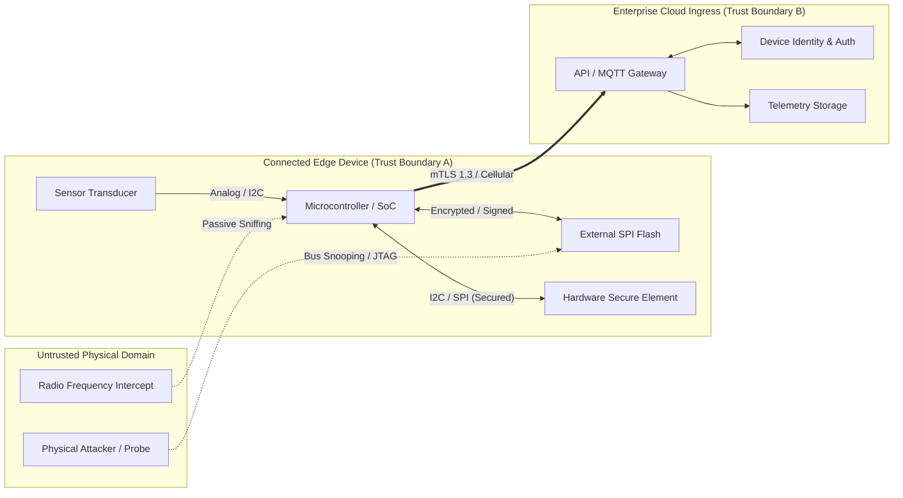
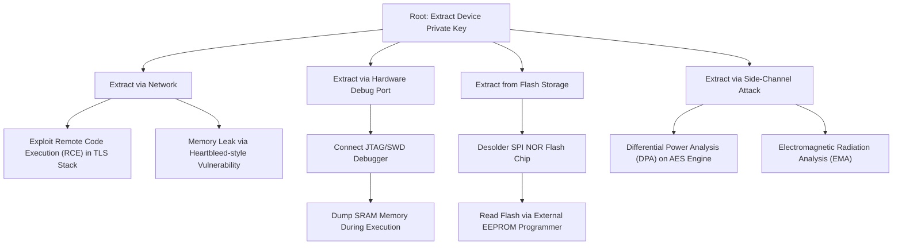

# Threat Modelling Foundations

Threat modelling is a structured engineering process for identifying potential security threats, vulnerabilities, and attack vectors in a system before hardware is manufactured or software is deployed to production.

In connected and IoT systems, threat modelling is essential because:
- **Remediation Costs Escalate**: A silicon or hardware defect discovered after manufacturing can cost millions in hardware recalls.
- **Physical Exposure**: Unlike cloud servers, connected devices operate in unmonitored physical environments accessible to attackers with oscilloscopes, debuggers, and logic analyzers.
- **High Consequence**: Compromised devices can disrupt critical infrastructure, manipulate industrial actuators, leak private telemetry, or pivot into enterprise cloud backends.

---

## 1. The STRIDE Framework for Connected Systems

The STRIDE methodology (originally conceived at Microsoft) categorizes threats relative to key security properties:

| STRIDE Category | Security Property Violated | Connected Systems Manifestation | Mitigating Controls |
|:---|:---|:---|:---|
| **Spoofing** | Authenticity | Rogue device impersonating a legitimate edge sensor to send forged sensor data. | Hardware Root of Trust, per-device X.509 certificates, mTLS 1.3. |
| **Tampering** | Integrity | Modifying firmware in external SPI NOR flash or injecting forged command packets. | Cryptographically signed firmware, secure boot, authenticated encryption (AES-GCM). |
| **Repudiation** | Non-repudiability | Attacker issues an unauthorized valve-close actuation command and deletes local logs. | Append-only audit logging, cryptographically signed actuator transaction logs. |
| **Information Disclosure** | Confidentiality | Sniffing plaintext telemetry over Wi-Fi/cellular or dumping plaintext keys from flash memory. | TLS 1.3 encryption in transit, AES-256-XTS flash encryption at rest, PUF key storage. |
| **Denial of Service** | Availability | Jamming 2.4 GHz RF channels, flooding MQTT broker with QoS 2 bursts, battery exhaustion. | Rate limiting, hardware watchdog timers, low-power duty cycling, RF frequency hopping. |
| **Elevation of Privilege** | Authorisation | Exploiting a buffer overflow in an RTOS packet parser to gain supervisor execution mode. | Memory Protection Units (MPU), stack canaries, ARM TrustZone-M, least privilege execution. |

---

## 2. Trust Boundaries & Data Flow Diagrams (DFDs)

A Data Flow Diagram (DFD) shows how data moves through a system, and marks the **Trust Boundaries**. These are the conceptual or physical barriers where data passes between different levels of privilege or trust.

### Critical Trust Boundaries
1. **Perimeter Physical Boundary (Boundary A)**: Between physical surroundings and the device circuit board. Mitigated by potting, enclosure tamper switches, and disabling debug interfaces.
2. **Chip-to-Chip Interconnect Boundary**: Between the host MCU and external SPI flash / sensor chips. Mitigated by encrypted buses and signed payloads.
3. **Network Boundary (Boundary B)**: Between the device edge transceiver and cloud edge load balancers. Mitigated by mutual authentication and ephemeral TLS handshakes.
4. **Internal Privilege Boundary**: Between unprivileged application tasks and privileged RTOS kernel / secure world (ARM TrustZone).

---

## 3. DREAD Risk Assessment Model

Once threats are cataloged via STRIDE, they must be ranked to prioritize engineering remediation. The DREAD model scores each threat from 1 to 10 across five criteria:

$$\mathrm{Risk\ Score} = \frac{\mathrm{Damage} + \mathrm{Reproducibility} + \mathrm{Exploitability} + \mathrm{Affected\ Users} + \mathrm{Discoverability}}{5}$$

| Metric | High (8–10) | Medium (4–7) | Low (1–3) |
|:---|:---|:---|:---|
| **Damage Potential (D)** | Full system bricking, master secret leakage, physical harm. | Denial of single device service, partial non-sensitive data leak. | Minor informational leak, temporary aesthetic glitch. |
| **Reproducibility (R)** | 100% reliable exploit via automated script. | Requires specific timing, temperature, or transient conditions. | Extremely difficult, probabilistic race condition. |
| **Exploitability (E)** | Script-kiddie level; public proof of concept tool available. | Requires moderate reverse engineering skills and equipment ($500). | Requires state-sponsored lab, decapping chip, FIB equipment ($100k+). |
| **Affected Users (A)** | Entire installed fleet (e.g. 500,000 devices). | A specific hardware batch or geographic subnet. | Single isolated physical unit. |
| **Discoverability (D)** | Obvious in plaintext network traffic or open debug port. | Requires decompiling firmware binaries. | Obscure logic flaw buried deep in proprietary microcode. |

---

## 4. Attack Tree Example: Compromising Edge Device Cryptographic Key

Attack trees provide a formal, hierarchical method to model how an adversary can achieve a specific malicious objective.

### Countermeasure Mapping
- **For B (Debug Port)**: Blow permanent silicon eFuses during production line provisioning to disable JTAG/SWD permanently (`SWD_DISABLE=1`).
- **For C (Flash Extraction)**: Store root keys exclusively inside a hardware Secure Element (e.g., ATECC608, NXP SE050, or STSAFE-A110) where private keys never leave the silicon die.
- **For D (Side-Channel)**: Use crypto co-processors equipped with internal clock jittering, dummy instruction injection, and differential masking logic.
