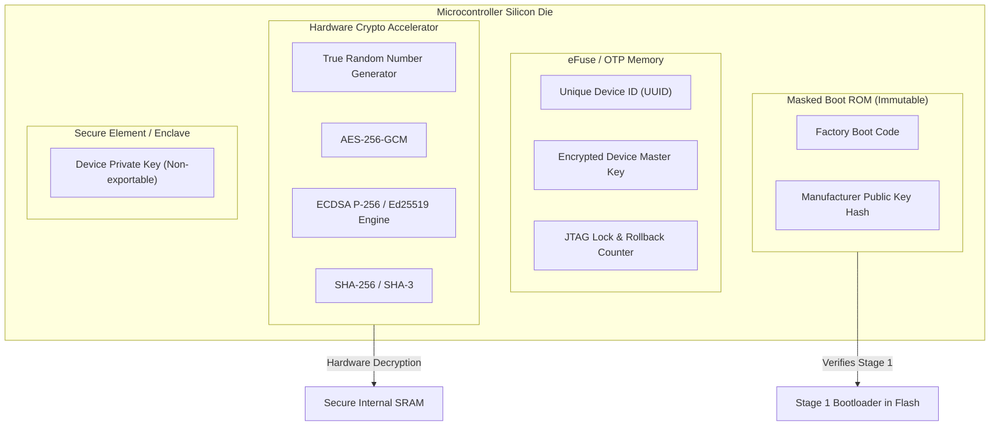
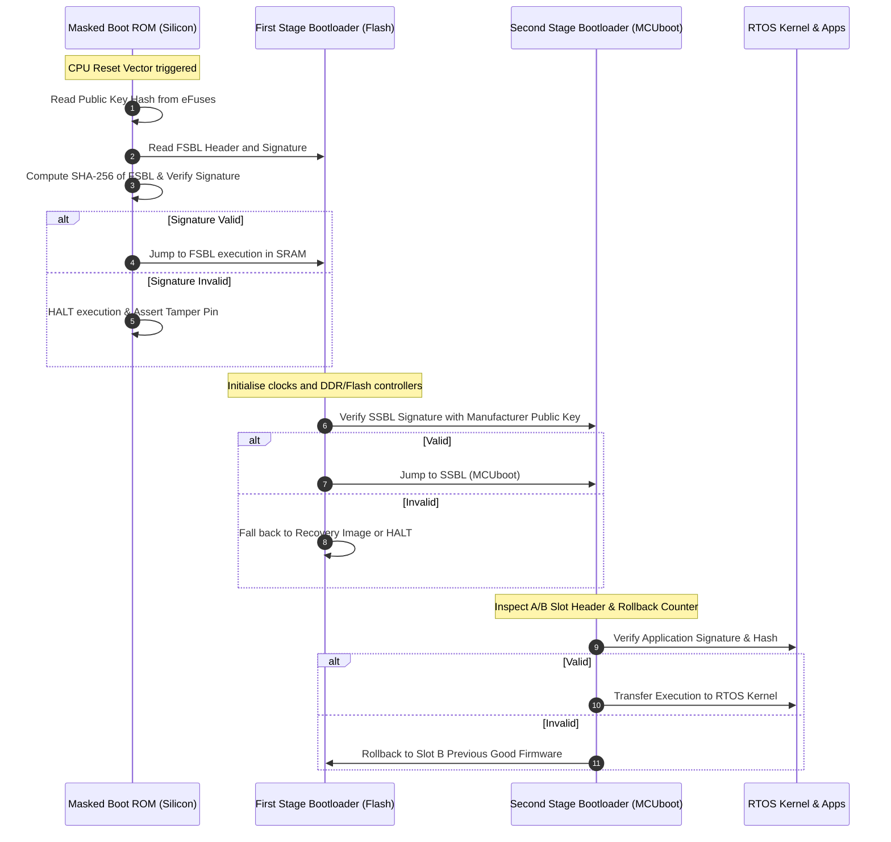

# Hardware and Silicon Security

Software and firmware security guarantees are meaningless if the underlying silicon and circuit board can be compromised. Hardware security forms the immovable anchor of the entire security architecture—known as the **Hardware Root of Trust (RoT)**.

---

## 1. Hardware Root of Trust (RoT) Architecture

A Hardware Root of Trust is an inherently trusted execution block embedded into the silicon die that cannot be modified by software or firmware.



### Core RoT Responsibilities
1. **Initial Execution**: The processor resets exclusively into immutable masked ROM burned during silicon lithography.
2. **Key Storage**: Cryptographic private keys reside in tamper-resistant registers, isolated by hardware memory controllers from standard CPU core reads.
3. **Cryptographic Engine**: Dedicated hardware offload for cryptographic primitives (AES, SHA, ECC, TRNG) isolated from general execution pipelines.

---

## 2. Authenticated Secure Boot Chain

Secure Boot establishes an unbroken chain of trust starting from immutable silicon ROM up to the user-space application tasks.



### Critical Rules for Secure Boot
- **No Signature Bypass**: If signature verification fails, execution must immediately halt; fallback to an unverified recovery mode is strictly prohibited.
- **Constant-Time Verification**: Cryptographic signature validation must run in constant time to prevent timing attacks.
- **Secure Memory Cleansing**: Before execution passes to user code, all bootloader cryptographic keys, hashes, and internal intermediate state in SRAM must be zeroed out.

---

## 3. Silicon eFuses & One-Time Programmable (OTP) Memory

Electronic fuses (eFuses) are microscopic semiconductor elements that can be permanently blown by applying a controlled programming voltage ($V_{PP}$). Once blown, the transition from `0` to `1` is physically irreversible.

| eFuse Block | Typical Bit Size | Function & Lifecycle Purpose |
|:---|:---|:---|
| `MAC_ADDR / UUID` | 48–128 bits | Immutable factory hardware identifier. |
| `PUBKEY_HASH` | 256–384 bits | Cryptographic SHA-256/384 hash of the authorized firmware signing public key. |
| `FLASH_ENC_KEY` | 256 bits | Symmetric key for on-the-fly hardware flash decryption. Generated on first boot and locked from read-back. |
| `DEBUG_DISABLE` | 1–4 bits | Permanently blows JTAG and SWD hardware debug interfaces. |
| `ROLLBACK_COUNTER` | 32–64 bits | Monotonically increasing bit-field preventing downgrade attacks to vulnerable firmware versions. |
| `SECURE_BOOT_EN` | 1 bit | Locks the processor into mandatory signature enforcement permanently. |

> [!CAUTION]
> Blowing eFuses is an irreversible physical operation. Production programming tooling must implement multi-stage sanity checks, voltage verification, and confirmation prompts before committing fuse bits.

---

## 4. Physically Unclonable Functions (PUF)

A Physically Unclonable Function (PUF) exploits microscopic, uncontrollable physical variations introduced during semiconductor wafer fabrication (such as threshold voltage variations in SRAM cell transistor pairs).

- **How It Works**: When an uninitialised SRAM array powers up, each cell randomly settles into a `0` or `1` state with a highly deterministic bias unique to that specific silicon die.
- **Key Generation on Demand**: A helper algorithm and error-correction code (ECC) extract an encryption key from this fingerprint at runtime.
- **Zero Key at Rest**: When the device is powered off, the key ceases to exist anywhere in the physical universe—eliminating flash-memory dumping attacks.

---

## 5. Physical Tamper Resistance & Debug Interface Hardening

### Disabling Debug Ports
Leaving JTAG or Serial Wire Debug (SWD) active in production is a fatal vulnerability. Attackers can halt execution, inspect SRAM registers containing private keys, or inject malicious shellcode.

- **Pre-Production Phase**: Enable password-authenticated debug modes (for example, ARM ADIv5 authentication).
- **Production Phase**: Blow the silicon eFuses (`SWD_DISABLE=1`) to physically disconnect the internal debug multiplexer.
- **Pin Reassignment**: Reconfigure SWDIO/SWCLK GPIO pins as general-purpose I/O or tie them to ground through pull-downs.

### Mitigation Against Fault Injection & Glitch Attacks
Physical attackers use voltage glitching (dropping supply voltage $V_{DD}$ for 50 nanoseconds) or clock glitching to cause the CPU instruction decoder to skip an authorisation conditional jump:

```c
/* Vulnerable Code: susceptible to single-instruction glitch skipping */
if (verify_signature(firmware) == SUCCESS) {
    boot_firmware();
}
```

```c
/* Hardened Defense: Dual-check with complementary state variables */
volatile uint32_t check1 = 0x55555555;
volatile uint32_t check2 = 0xAAAAAAAA;

check1 = verify_signature_stage1(firmware);
insert_random_delay();
check2 = verify_signature_stage2(firmware);

if ((check1 == SIGNATURE_VALID) && (check2 == SIGNATURE_VALID)) {
    // Second check ensures a single skipped instruction cannot bypass verification
    boot_firmware();
} else {
    tamper_alarm_trigger();
    system_hard_reset();
}
```
