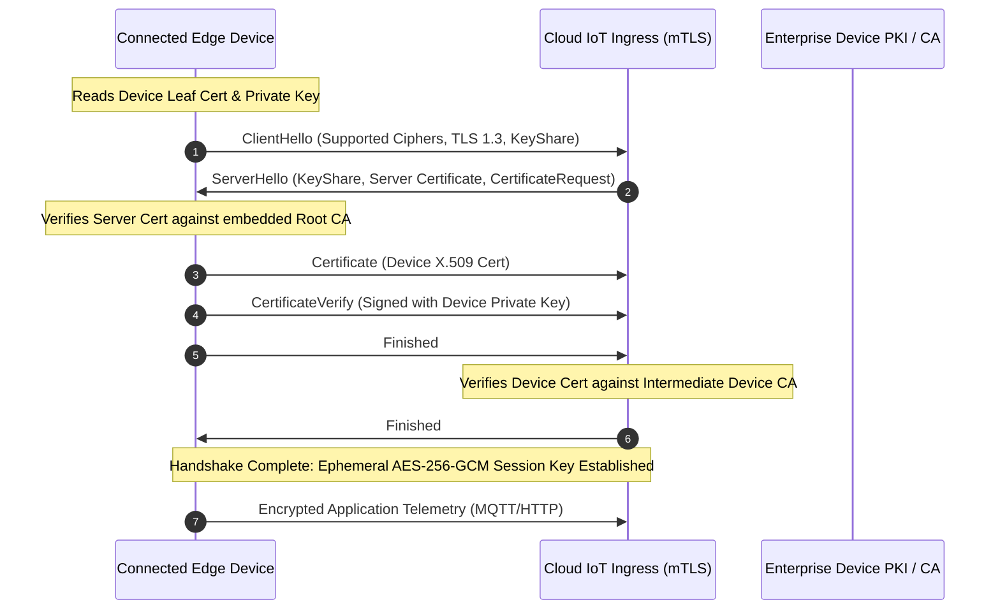
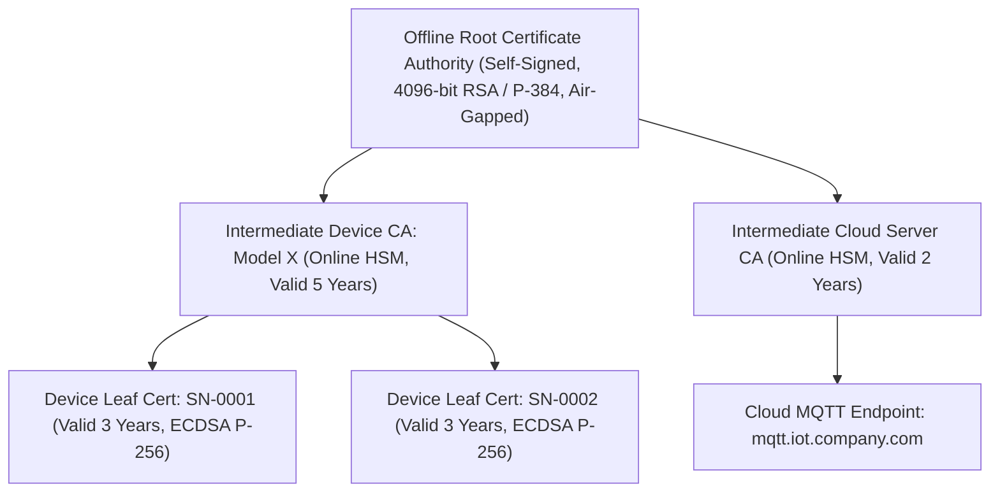

# Transport and Network Security

Edge devices transmit mission-critical telemetry and receive remote actuation commands over public, unmonitored networks (cellular 4G/5G, Wi-Fi, Ethernet, LoRaWAN, satellite). Network communication must assume an untrusted transport medium vulnerable to eavesdropping, packet modification, and man-in-the-middle (MitM) interception.

---

## 1. Mutual TLS (mTLS 1.3) Architecture

Standard web TLS only authenticates the server to the client. In connected systems, **Mutual TLS (mTLS)** is mandatory: both the cloud ingress gateway and the edge device cryptographically prove their identities to each other before any application data is exchanged.

### Why TLS 1.3 is Mandatory over TLS 1.2
- **Zero Insecure Ciphers**: TLS 1.3 permanently eliminates vulnerable legacy algorithms (RC4, 3DES, CBC mode ciphers, MD5, SHA-1, static RSA key exchange).
- **Mandatory Forward Secrecy**: Every connection negotiates ephemeral Diffie-Hellman keys (`ECDHE`). Even if a device's long-term private key is extracted years later, previously recorded network traffic cannot be decrypted.
- **Faster Handshake**: Handshake overhead is reduced from two round trips (2-RTT) to one round trip (1-RTT), saving battery power and cellular bandwidth.

---

## 2. Public Key Infrastructure (PKI) for IoT Fleets

A scalable, secure X.509 Public Key Infrastructure requires strict hierarchical separation:

### Key Provisioning Guidelines
- **Never Share Private Keys**: Each device must generate or be injected with a unique, cryptographically distinct private key. Shared symmetric passwords across a fleet are strictly prohibited.
- **ECC over RSA**: Use Elliptic Curve Cryptography (`secp256r1` or `ed25519`) instead of 2048/4096-bit RSA. A 256-bit ECC key delivers equivalent security to a 3072-bit RSA key with an 85% smaller payload, saving flash space and computational battery life.
- **Air-Gapped Root CA**: The Root CA must never be directly connected to the internet. It exists exclusively to sign Intermediate CAs and CRLs, stored in tamper-proof Hardware Security Modules (HSMs).

---

## 3. Automated Certificate Enrolment (EST & SCEP)

Manual certificate injection during field deployment does not scale and introduces human operational risks. Devices should leverage **Enrolment over Secure Transport (EST, RFC 7030)**:

1. **Bootstrap Phase**: The factory injects an initial Manufacturer Device Identity certificate (IDevID, IEEE 802.1AR) tied to the hardware Root of Trust.
1. **First Cloud Contact**: The device boots, connects to the provisioning server using its IDevID, and issues a Certificate Signing Request (CSR) via EST over HTTPS.
1. **Operational Issuance**: The PKI validates the hardware identity, generates an operational Local Device Identity certificate (LDevID), and installs it securely on the device.
1. **Automated Renewal**: Before certificate expiration (for example, 30 days remaining), the firmware automatically requests a renewed leaf certificate via EST without requiring manual physical servicing.

---

## 4. Secure Application Protocols

### MQTT over TLS (Port 8883)
MQTT is the dominant publish-subscribe protocol for resource-constrained edge telemetry.

| Feature | Standard (Unsafe) MQTT | Hardened Enterprise MQTT Standard |
|:---|:---|:---|
| **Port & Wire Security** | Port 1883 (Plaintext TCP) | Port 8883 (Encrypted mTLS 1.3) |
| **Client Authentication** | Static username/password | Client X.509 certificate subject matching Common Name (UUID) |
| **Topic Authorisation** | Unrestricted wildcards (`#`, `+`) | Fine-grained Access Control Lists (ACLs) per device UUID |
| **Topic Namespace** | Global shared topics (`sensors/data`) | Isolated tenancy: `devices/{client_id}/telemetry` |
| **Payload Integrity** | Unchecked raw bytes | Protobuf / JSON schema with optional HMAC-SHA256 signature |

### CoAP over DTLS (RFC 7252 / RFC 7925)
For extremely resource-constrained devices communicating over UDP, Constrained Application Protocol (CoAP) secured with Datagram Transport Layer Security (DTLS 1.2 / 1.3) provides:
- Low-overhead binary message headers (4 bytes base header).
- Connection ID (CID) support to survive network NAT rebinding and IP address changes without renegotiating full handshakes.
- Pre-shared Key (PSK) or lightweight raw public key (RPK) cipher suites where full X.509 certificate chains exceed packet MTU limits.

---

## 5. Network Microsegmentation & Zero Trust Edge

Connected devices must operate under a **Zero Trust** architecture:

1. **No Inbound Open Ports**: Devices must never listen on open public TCP/UDP ports (for example, Telnet or unauthenticated HTTP servers). All communication channels must be outbound connections initiated by the device toward cloud endpoints.
1. **Local Interface Isolation**: If a device includes multiple network interfaces (for example, an Ethernet port for an industrial sensor bus and a cellular modem for cloud reporting), the interfaces must be strictly isolated via kernel network namespaces and packet filtering rules (`iptables` / `nftables`). Bridging or forwarding packets between untrusted local networks and enterprise networks is forbidden.
1. **DNS-over-TLS (DoT) / DNSSEC**: Guard against DNS poisoning and redirect attacks by encrypting DNS lookups or using hardcoded, verified server public keys.
