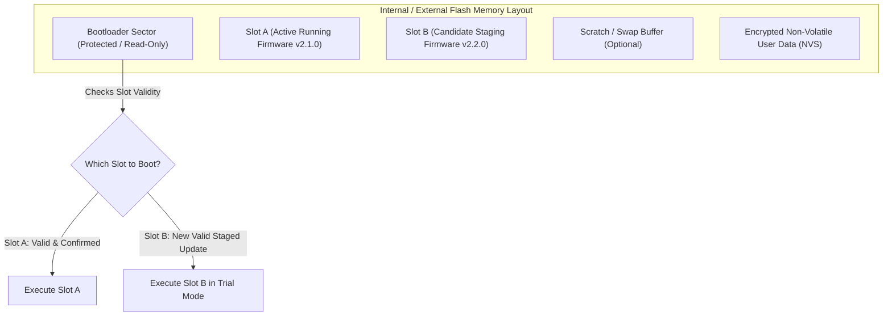
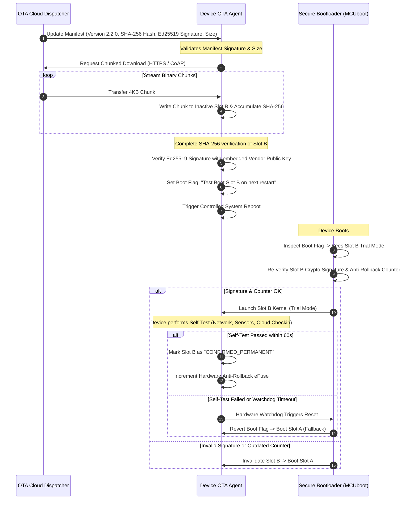

# Secure Firmware Updates & OTA

Over-the-Air (OTA) firmware updates are the single most critical capability in connected systems engineering. Without reliable, secure OTA update mechanisms, a newly discovered zero-day vulnerability in an RTOS or crypto library renders an entire deployed fleet permanently exposed, potentially necessitating costly physical recalls.

However, the update mechanism itself is often the most dangerous attack vector: an adversary who compromises the OTA pipeline can push malicious firmware to hundreds of thousands of devices simultaneously.

---

## 1. Dual-Slot A/B Partition Architecture

To guarantee high availability and prevent device bricking due to sudden power loss or corrupted downloads, production hardware must implement a symmetric dual-bank (A/B) flash partition layout.

### Partition Sizing & Invalidation Rules
- **Physical Isolation**: Slot A and Slot B must each be sized to accommodate 100% of the maximum allowable application binary size plus the crypto header.
- **Power-Loss Atomicity**: Flash programming writes data sequentially. If power drops mid-transfer, Slot B remains in an invalid state. The bootloader detects this (via checksum or broken signature) and continues booting Slot A unimpeded.

---

## 2. Cryptographic Signature Verification Flow

Every firmware update bundle must be signed offline in a secure build environment before distribution.

---

## 3. Monotonic Anti-Rollback Counter Enforcement

A **downgrade attack** occurs when an attacker intercepts a legitimate, authentically signed older firmware version that contains a known, patchable vulnerability and flashes it onto the target device. Because the old binary is signed by the manufacturer, simple signature checks will pass.

### Silicon Monotonic Counters
To defeat downgrade attacks, devices must track a hardware-enforced **Security Version Number (SVN)**:

1. **Firmware Header Declaration**: Each firmware header embeds a monotonically increasing integer (`security_version = 7`).
1. **Hardware Counter Check**: During boot, the bootloader compares the binary's `security_version` against the silicon eFuse counter value ($C_{\mathrm{fuse}}$).
   - If $\mathrm{security\_version} < C_{\mathrm{fuse}}$: **REJECT & HALT**. (Downgrade attack detected).
   - If $\mathrm{security\_version} \ge C_{\mathrm{fuse}}$: **PERMIT**.
1. **Fuse Burning on Confirmation**: Once the new firmware completes its post-boot self-tests and is confirmed stable, the device permanently burns additional eFuse bits to raise $C_{\mathrm{fuse}}$ to match the new security version.

---

## 4. Fault-Tolerant Trial Mode & Watchdog Timers

A major risk in remote updates is a build that passes boot verification but fails 5 seconds later, for example by failing to connect to the cellular network. The device is then permanently unreachable.

### The Self-Test / Confirmation Pattern
1. **Unconfirmed State**: When a new image boots for the first time, it enters state `STATE_TRIAL`.
1. **Hardware Watchdog Countdown**: An internal hardware watchdog timer is primed for 120 seconds.
1. **Connectivity Verification**: The application must:
   - Initialise all hardware drivers without fault.
   - Establish network connectivity.
   - Complete an authenticated handshake with the cloud service.
1. **Marking Permanent**: Only when all checks succeed does the application call `boot_set_confirmed()`.
1. **Automatic Fallback**: If the application hangs, panics, or suffers an assert failure before confirming, the hardware watchdog resets the processor. On the subsequent boot, the bootloader observes that the trial image failed to confirm and automatically restores the previous working firmware in Slot A.

---

## 5. Fleet Deployment Strategies & Blast Radius Control

Never deploy a firmware update to 100% of an active fleet in a single batch. Deployments must follow a phased **Ring Deployment Model**:

| Phase / Ring | Target Audience | Fleet % | Soak Time | Gate Criteria |
|:---|:---|:---|:---|:---|
| **Ring 0: Canary Lab** | Internal test benches & automated hardware rigs | 0.1% (50 units) | 48 hours | Zero crash dumps, 100% test harness pass rate. |
| **Ring 1: Internal Dogfood** | Internal company deployments & employee units | 1% (500 units) | 7 days | Battery drain metrics within ±3% of baseline. |
| **Ring 2: Pilot Fleet** | Selected beta customers with low-impact workloads | 5% (2,500 units) | 14 days | Error log rate below 0.01% of transactions. |
| **Ring 3: Staged Rollout** | General customer fleet partitioned by geographic timezone | 25% $\to$ 50% $\to$ 100% | 21 days | Continuous monitoring of cloud reconnection latencies. |

> [!TIP]
> Always implement an automated cloud **Emergency Pause Circuit-Breaker**. If the crash report rate for a candidate version exceeds a predetermined threshold (for example, >0.1%), the cloud OTA service must instantly halt all in-progress downloads across the fleet.
