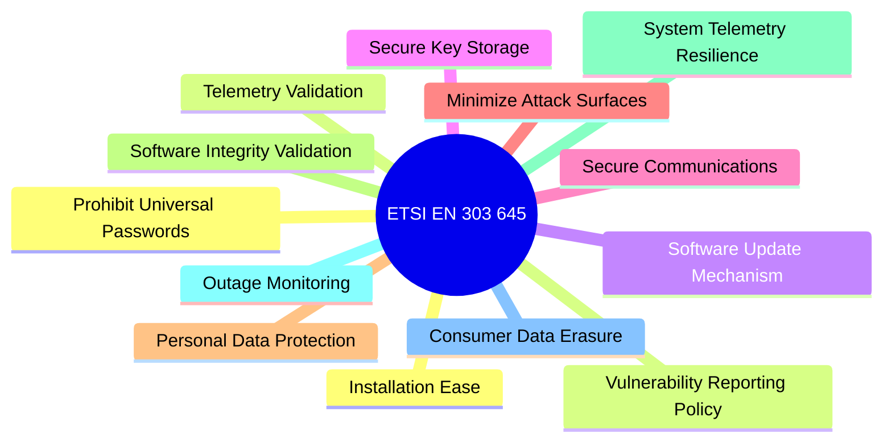

# Standards & Regulatory Compliance

Connected systems and IoT engineering have transitioned from an era of voluntary best-practice recommendations into a regime of strict, legally binding statutory regulations. Failure to comply with international product security standards now carries severe penalties, including market bans, mandatory product recalls, and multi-million pound fines.

This chapter details the primary international cybersecurity standards and provides actionable compliance checklists for engineering teams.

---

## 1. ETSI EN 303 645: European Standard for Consumer IoT

ETSI EN 303 645 is the recognized global baseline standard for consumer and commercial Internet of Things devices. It specifies 13 baseline security provisions:



### Top 3 Mandatory Technical Provisions
1. **Provision 5.1-1: No Universal Default Passwords**: Pre-set, factory-wide default passwords (for example, `admin`/`admin` or `root`/`password`) are banned. Devices must either require the user to configure a unique password on first setup or generate a unique random password per device printed on a tamper-evident label.
1. **Provision 5.2-1: Implement a Vulnerability Disclosure Policy (VDP)**: The manufacturer must provide a publicly accessible contact channel (for example, a security email address or web portal) for ethical security researchers to report vulnerabilities, with acknowledged receipt within 5 business days.
1. **Provision 5.3-1: Secure Software Updates**: Software updates must be cryptographically signed, verified before installation, and delivered over authenticated channels (see Chapter 4).

---

## 2. UK PSTI Act 2022 (In Force 2024)

The **UK Product Security and Telecommunications Infrastructure (PSTI) Act 2022** is legally enforceable legislation covering all internet-connectable products manufactured, imported, or sold in the United Kingdom.

### The Three Core Legal Mandates
1. **Unique Passwords**: Passwords must be unique per product or force the user to set a strong password during initial onboarding.
1. **Vulnerability Disclosure Point of Contact**: A dedicated public URL and security email must be published to receive vulnerability reports.
1. **Defined Minimum Support Period**: Manufacturers must state at the point of sale (on product packaging and product websites) the exact minimum calendar date until which the product will receive security updates (for example, *"Guaranteed security updates until at least December 2031"*).

> [!WARNING]
> Non-compliance with the UK PSTI Act carries fines of up to **£10 million or 4% of worldwide gross revenue**, alongside mandatory product seizures and sales bans enforced by the Office for Product Safety and Standards (OPSS).

---

## 3. EU Cyber Resilience Act (CRA)

The **EU Cyber Resilience Act (CRA)** introduces comprehensive, mandatory cybersecurity requirements for all "products with digital elements" sold within the European Single Market.

### Key CRA Requirements
- **CE Marking**: Products without formal cybersecurity conformity assessment cannot bear the CE mark and cannot legally be sold in the European Union.
- **Security Throughout Lifecycle**: Mandatory security support and vulnerability patching for the expected product lifetime or a minimum of 5 years.
- **24-Hour Vulnerability Reporting**: Manufacturers must report actively exploited vulnerabilities to the EU Cybersecurity Agency (ENISA) and the relevant national CSIRT within 24 hours of becoming aware of them.
- **Software Bill of Materials (SBOM)**: Manufacturers must maintain machine-readable SBOMs (CycloneDX or SPDX format) cataloging every open-source library, RTOS kernel, and third-party driver embedded in the firmware.

---

## 4. Standards Comparison Matrix

| Regulatory Standard | Jurisdiction | Enforcement | Scope | Core Technical Focus |
|:---|:---|:---|:---|:---|
| **ETSI EN 303 645** | Global / Europe | Voluntary baseline & regulatory benchmark | Consumer & commercial IoT | 13 cybersecurity provisions: no default passwords, VDP, signed updates. |
| **UK PSTI Act** | United Kingdom | Legally binding (Statutory Law) | All connectable consumer devices | Unique passwords, public VDP, declared minimum support date. |
| **NIST IR 8259A/B** | United States | Federal guidance & IoT labeling benchmark | IoT devices & federal procurement | 6 device capabilities: device ID, configuration, data protection, logical interfaces, updates, cybersecurity state. |
| **EU Cyber Resilience Act (CRA)** | European Union | Legally binding (EU Regulation) | All hardware & software products | CE mark requirement, SBOM, 24-hour vulnerability notification, secure by default. |
| **IEC 62443-4-2** | Global Industrial | Contractual & certification standard | Industrial automation & control systems (IACS) | Security Levels (SL 1–4): hardware tamper defence, role-based access, network segmentation. |

---

## 5. Vulnerability Disclosure Policy (VDP) & `security.txt`

To comply with ETSI EN 303 645 and UK PSTI, every product organisation must publish an RFC 9116 compliant `security.txt` file at the root of their public web domains (`https://example.com/.well-known/security.txt`):

```ini
# Production Security Vulnerability Reporting Policy
Contact: mailto:security@example.com
Encryption: https://example.com/pgp-key.asc
Acknowledgments: https://example.com/security/hall-of-fame
Preferred-Languages: en
Canonical: https://example.com/.well-known/security.txt
Policy: https://example.com/security-policy.html
Expires: 2027-12-31T23:59:59.000Z
```

### Response SLA Commitments
1. **Initial Acknowledgment**: Send confirmation receipt to the reporting researcher within 48 hours.
1. **Triage Assessment**: Complete initial vulnerability reproduction and severity scoring (CVSS v3.1) within 5 business days.
1. **Remediation & Patch**: Develop, test, sign, and release an OTA security patch within 30–90 days (depending on CVSS severity).
1. **Coordinated Disclosure**: Publish a public Security Advisory (CVE) simultaneously with patch availability to protect the user base.
