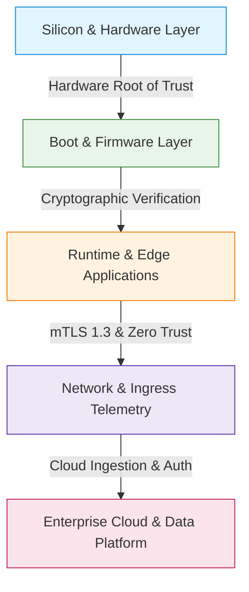

# Cyber security and threat modelling for connected systems

## Executive Summary

Connected devices, IoT edge nodes, and industrial telemetry systems operate in hostile physical and logical environments. Unlike traditional cloud microservices protected behind perimeter firewalls and managed data centers, edge hardware is subject to physical tampering, intermittent untrusted networks, constrained compute budgets, and multi-decade deployment lifecycles.

This guide establishes an end-to-end engineering standard and threat modelling methodology for architecting, building, and operating secure connected systems.

---

## Scope & Target Audience

This guide applies across all connected systems and embedded software projects, serving:

- **System & Software Architects**: Designing trust boundaries, cryptosystems, and threat models.
- **Embedded & Firmware Engineers**: Implementing secure boot, hardware RoT, memory protection, and OTA pipelines.
- **DevOps & Cloud Engineers**: Managing public key infrastructure (PKI), device provisioning, and fleet telemetry.
- **Security & Compliance Auditors**: Auditing products against ETSI EN 303 645, UK PSTI, NIST IR 8259, and EU CRA mandates.

---

## Guide Structure

| Chapter | Topic | Core Focus Areas |
|:---|:---|:---|
| **[01. Threat Modelling Foundations](01-threat-modeling-foundations.md)** | Methodology & Analysis | STRIDE framework, DREAD scoring, Trust Boundaries, Data Flow Diagrams (DFDs), and attack trees. |
| **[02. Hardware & Silicon Security](02-hardware-and-silicon-security.md)** | Edge Device Hardening | Hardware Root of Trust (RoT), Secure Boot, eFuse/OTP, PUFs, crypto engines, JTAG lock, and side-channel defence. |
| **[03. Transport & Network Security](03-transport-and-network-security.md)** | Secure Communications | Mutual TLS (mTLS 1.3), X.509 device certificates, automated enrolment (EST/SCEP), MQTT/TLS, and network isolation. |
| **[04. Secure Firmware Updates & OTA](04-secure-firmware-updates-ota.md)** | Fleet Lifecycle Maintenance | Dual-slot A/B flash partitions, Ed25519/ECDSA signature verification, anti-rollback monotonic counters, and phased rollouts. |
| **[05. Standards & Regulatory Compliance](05-standards-and-compliance.md)** | Governance & Certification | ETSI EN 303 645, UK PSTI Act 2022, NIST IR 8259, EU Cyber Resilience Act (CRA), and Vulnerability Disclosure Policies (VDP). |

## Key Engineering Principles

1. **Security by Design, Not by Patch**: Security controls must be embedded into silicon, hardware schematics, and protocol designs from day zero.
1. **Assume Breach at the Edge**: Physical possession of a device must never compromise fleet-wide master secrets or cloud service credentials.
1. **Defence in Depth**: Every layer (silicon, bootloader, RTOS, application, transport, cloud) must enforce independent security barriers.
1. **Automated Cryptographic Agility**: Hardware and firmware architectures must accommodate key rotations, certificate renewals, and cipher suite upgrades over the full product lifetime.
