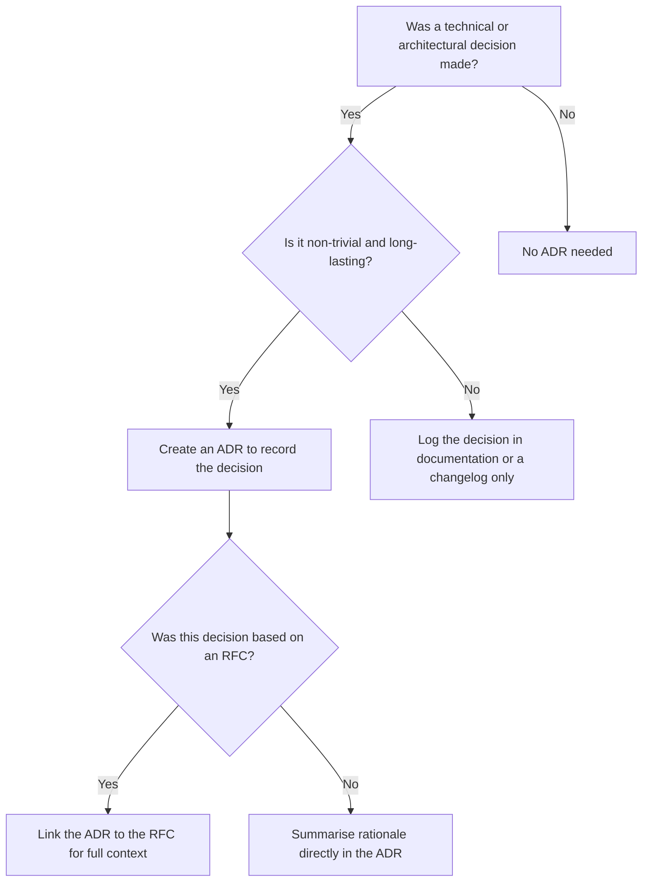
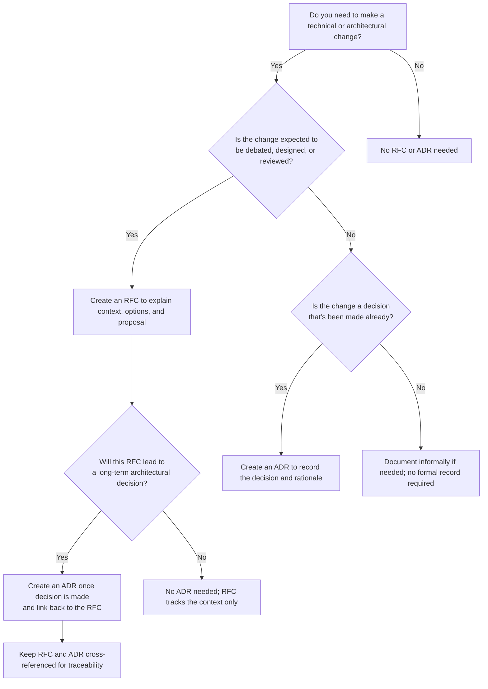

# Writing ADRs and RFCs

An RFC proposes a significant change and gathers views before anyone decides. An ADR records a decision once it is made, with the context that led to it. The rules for both are in [EG-008](../guidelines/decision-records.md); this guide is about writing them well.

## Architecture decision records

This part explains **what an ADR is**, **when to write one** and what to **include**. It also covers how to use ADRs well in projects that follow docs as code or a structured architecture practice.

### What Is an ADR?

An **ADR (Architecture Decision Record)** is a short, focused document that captures:

- A **decision** that was made
- The **context** in which it was made
- The **reasoning** behind the decision

Think of it as the historical logbook of your architecture. It replaces tribal knowledge with written rationale.

### When to Write an ADR

Write an ADR when:

- A **non-trivial decision** has been made about architecture, design, tooling, process, or standards
- The decision has **long-term impact**
- You want to **record alternatives considered**
- You want others to understand **why** something was done

You don't need an ADR for:

- Obvious or universally accepted patterns
- Reversible or low-impact choices

### ADR vs RFC

An RFC drives debate on potential solutions; an ADR records the chosen outcome. See companion standard [Writing ADRs and RFCs](decision-records.md).

| Dimension | RFC (Request for Comments) | ADR (Architecture Decision Record) |
| :--- | :--- | :--- |
| **Primary Purpose** | Propose options, solicit feedback, drive consensus | Record final, agreed architectural choice and rationale |
| **Stage in Lifecycle** | Early / exploratory (pre-decision) | Concluding / binding (post-decision) |
| **Mutability** | Mutable (evolves during review and debate) | Immutable (historical log once accepted) |
| **Scope of Alternatives** | Explores multiple viable options in depth | Summarises chosen option vs rejected alternatives |
| **Typical Flow** | RFC drafted ➔ Reviewed by stakeholders | RFC accepted ➔ ADR recorded into catalogue |

### The template

Use the [ADR template](../templates/adr.md) in the Templates section.

### Context

> What led to this decision? What problem or scenario required a choice to be made?

### Decision

> State the decision clearly and succinctly. Be direct.

### Rationale

> Why this decision? What were the trade-offs?
> Include supporting facts, reasoning, constraints, and priorities.

### Consequences

> What will change as a result? Are there any risks, costs, or follow-up actions?

### Alternatives Considered

> (Optional) List other options considered and why they were rejected.

### Related

> Link to related RFCs, ADRs, diagrams, repos, or documents.

```

## When to Use an ADR (Decision Tree)



## Tips

- Keep it short and focused — one ADR = one decision
- Use consistent naming, like `ADR-0042-use-jwt-for-auth.md`
- Store ADRs in a `/adr` directory in your repo
- Number them chronologically
- Never delete ADRs — if a decision changes, supersede it

## Requests for comments

This part explains **what an RFC is**, **when to write one**, what to **include** and how it **relates to ADRs**, with diagrams to help standardise technical proposals.

### What Is an RFC?

An RFC (Request for Comments) is a lightweight document used to:

- Propose technical or architectural changes
- Discuss ideas with the team before implementation
- Drive consensus around design decisions
- Act as historical documentation of thought process and context

### When to Write an RFC

Write an RFC when:

- You are proposing a **non-trivial change** to design, process, or system architecture
- You want input or buy-in from other teams or stakeholders
- You want to explore **multiple options** before making a decision
- The change will have **broad or long-term impact**

Do **not** write an RFC for:

- Trivial changes or bug fixes
- Changes already fully decided and documented (in that case, use an ADR)

### RFC vs ADR

An RFC drives debate on potential solutions; an ADR records the chosen outcome. See [Architecture decision records](#architecture-decision-records) above.

| Dimension | RFC (Request for Comments) | ADR (Architecture Decision Record) |
| :--- | :--- | :--- |
| **Primary Purpose** | Propose options, solicit feedback, drive consensus | Record final, agreed architectural choice and rationale |
| **Stage in Lifecycle** | Early / exploratory (pre-decision) | Concluding / binding (post-decision) |
| **Mutability** | Mutable (evolves during review and debate) | Immutable (historical log once accepted) |
| **Scope of Alternatives** | Explores multiple viable options in depth | Summarises chosen option vs rejected alternatives |
| **Typical Flow** | RFC drafted ➔ Reviewed by stakeholders | RFC accepted ➔ ADR recorded into catalogue |

You can **write both**:  
An RFC is accepted → it leads to an ADR that records the final decision.

### The template

Use the [RFC template](../templates/rfc.md) in the Templates section.

### Summary

> One-paragraph summary of the problem and proposal.

### Motivation

> Why this RFC exists. What problem or opportunity it addresses.

### Proposal

> The proposed change, including diagrams, APIs, architecture, etc.

### Alternatives Considered

> Options evaluated and why they were not chosen.

### Impact

> What changes as a result? Compatibility, performance, security?

### Migration Strategy

> How to implement this safely and in stages, if applicable.

### Open Questions

> Areas needing input or still under debate.

### Future Considerations

> Forward-looking notes and how this might evolve.

---

### Changelog

- YYYY-MM-DD: Initial draft
- YYYY-MM-DD: Updates after review
```

## Decision Tree: RFC vs ADR



## Tips

- Use clear, non-jargon language
- Include diagrams where it helps
- Break down proposals into **logical parts**
- Ask for review and assign an owner
