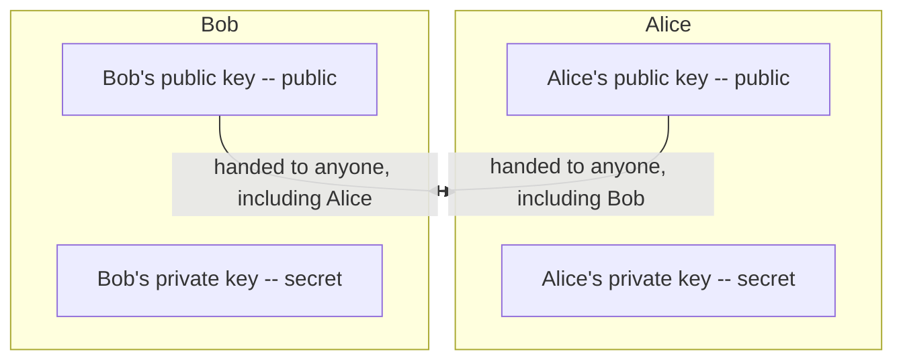
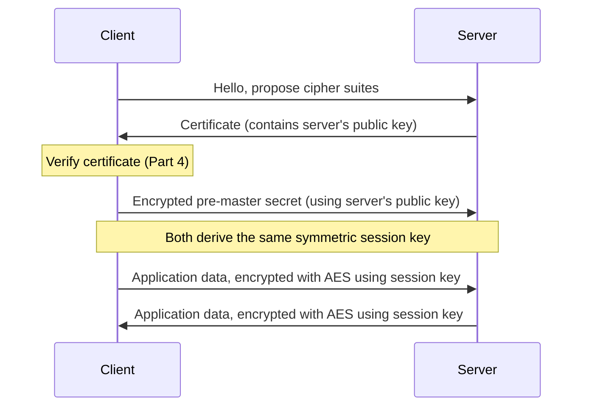
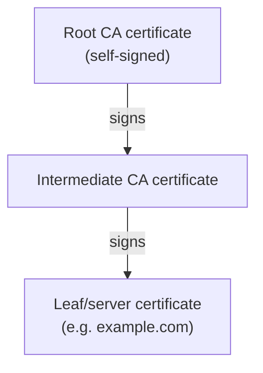
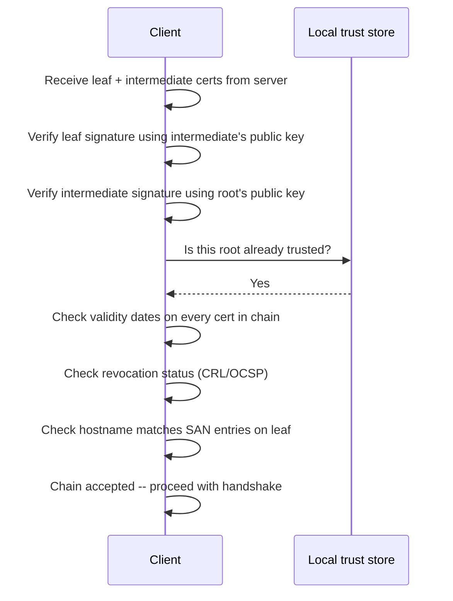
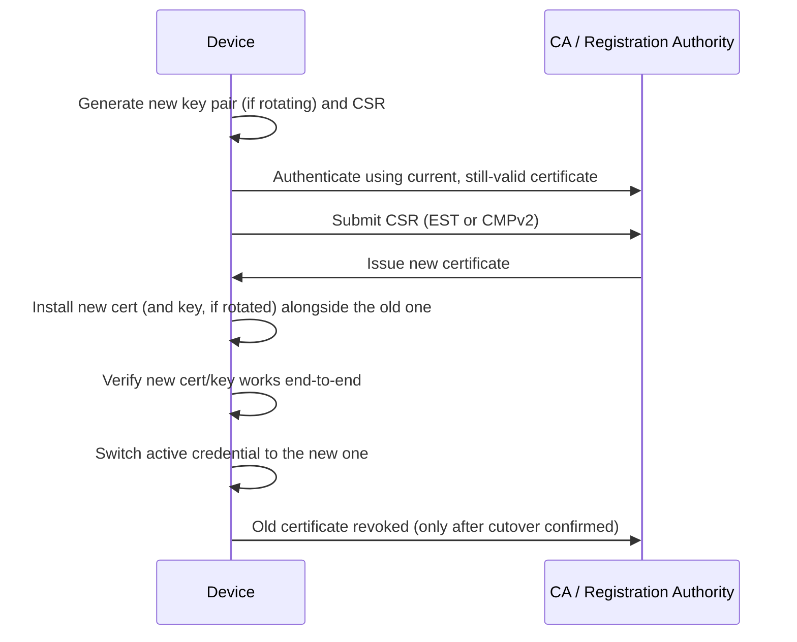

# Certificates and keys

## Why this document exists

PKI, X.509, certificate chains, PSK, GMAC -- these terms are usually taught as a pile of unrelated acronyms. They are not unrelated. Each mechanism exists because the previous one had a specific, nameable weakness. This document works through that chain of reasoning in logical order: from the first problem (two parties want to communicate secretly) through to the last (how a device or browser decides, algorithmically, whether to trust a certificate it has never seen before).

Read top to bottom. Each section assumes the previous one.

## Key vs certificate: the distinction that matters most

These two terms get used almost interchangeably in casual conversation, but they are different classes of object.

- **A key** is a piece of cryptographic material -- a number, or a pair of mathematically related numbers -- used directly by an algorithm to encrypt, decrypt, sign, or verify. A key on its own carries no identity information. It is just math.
- **A certificate** is a data structure that *makes a claim about* a public key: specifically, that this public key belongs to this named entity. A certificate contains a public key as one of its fields, plus identity information, validity dates, and a signature from an issuer vouching for the binding between the two. A certificate without the corresponding private key held elsewhere is inert -- it proves nothing by itself; it is only useful when paired with an entity that can prove possession of the matching private key.

In short: a key is the cryptographic object; a certificate is a signed statement that binds a specific public key to a specific identity. Part 1 and Part 2 below are about keys and what they do mathematically. Part 4 introduces certificates, once the reason for needing them (proving whose key it is) has been established.

## Part 1: The core problem -- confidentiality needs a shared secret

Two parties, call them a client and a server, want to exchange data that a third party cannot read. The mathematically simple way to do this is symmetric encryption: both sides hold the *same* secret key, and use it with an algorithm such as AES to turn plaintext into ciphertext and back again.

This is fast and well understood. AES-128 or AES-256 in an authenticated mode is not the weak point of modern systems. The weak point is the phrase "both sides hold the same secret key." How did the key get onto both devices in the first place, without an eavesdropper also obtaining it?

### Pre-shared keys (PSK): the honest, limited answer

A pre-shared key is exactly what it sounds like: the key is provisioned onto both endpoints out-of-band, before the encrypted session starts -- flashed into firmware at manufacture, entered manually, or distributed over some separately-secured channel. There is no cryptographic cleverness here. It works precisely as well as the out-of-band distribution process works.

> **Note:** PSK is not a lesser cousin of PKI. It is a correct and often superior choice when the number of endpoints is small and known in advance -- a factory-provisioned fleet of embedded devices talking to one back-end, for instance. The problems start when the endpoint population grows, when keys need to be provisioned to devices you have never physically touched, or when a single compromised key needs to be revoked without also having to physically revisit every other device.

The failure modes of PSK are entirely operational, not mathematical:

- **Distribution at scale.** Getting a unique secret onto ten thousand devices without it transiting an insecure channel is a logistics problem, not a crypto problem.
- **Revocation.** If one device is compromised and its key extracted, every other device sharing that key (if keys are shared across a batch, which they often are for practicality) is now also compromised.
- **No third-party introduction.** PSK only works between parties who have *already* met, out-of-band. It cannot help a browser trust a web server it has never seen before, run by an organisation it has never dealt with.

That last limitation is what forces the next step. The internet needed a way for parties who have never met to establish a shared secret over a channel that is, by default, insecure and observed. That requirement is what asymmetric cryptography was built to solve.

## Part 2: Asymmetric cryptography -- splitting the key in two

The mathematical trick of asymmetric (public-key) cryptography is a key pair with an asymmetric relationship: a public key and a private key, mathematically linked, where:

- data encrypted with the public key can only be decrypted with the matching private key, and
- data signed with the private key can be verified by anyone holding the public key, without them being able to forge a new signature.

The public key can be handed to a stranger, printed on a business card, or published on a website. It is not a secret and does not need out-of-band protection. Only the private key needs protection, and it never has to leave the device that generated it.

This solves the "never met before" problem for exchanging a secret. It does not, by itself, solve the "am I actually talking to Bob, or to someone impersonating Bob" problem. That distinction matters and is picked up again in Part 4. For now, treat the mechanics as sound and look at what algorithms actually implement them.

### RSA

RSA's security rests on the difficulty of factoring the product of two large primes. Key generation produces a public/private pair from two large primes; encryption and signing are modular exponentiation operations using those keys. RSA is old, extremely well analysed, and slow relative to the alternatives below -- both in key generation and in per-operation cost, and it needs large keys (2048-bit minimum today, 3072 or 4096 for longer-term assurance) to remain secure, which makes it a poor fit for constrained devices.

### Elliptic Curve Cryptography (ECC) and ECDSA

ECC achieves equivalent security to RSA with much smaller keys, because its hard problem (the elliptic curve discrete logarithm problem) scales more favourably than integer factorisation. A 256-bit ECC key gives roughly the same security margin as a 3072-bit RSA key. This matters enormously for embedded and IoT contexts: smaller keys mean smaller certificates, less flash storage, less time spent in expensive modular arithmetic on a constrained MCU, and less data transiting a narrowband link.

ECDSA is the signature scheme built on ECC. It is what most modern TLS certificates actually use for the signing operation, in preference to RSA, for exactly the size and speed reasons above.

> **Note:** ECDSA has a well-known operational hazard: signature generation requires a fresh, high-quality random nonce for every signature. Reuse the nonce (or use a poor RNG) across two signatures and the private key can be recovered algebraically from the two signatures alone. This is not a theoretical concern -- it is the mechanism behind several real-world private key recoveries. Deterministic nonce generation (RFC 6979) removes the dependency on the RNG at signing time and is the safer default where the library supports it.

### EdDSA (Ed25519 / Ed448)

EdDSA is a newer signature scheme, also elliptic-curve-based, designed specifically to remove the nonce-reuse hazard above: the nonce is derived deterministically from the private key and the message, so there is no RNG call at signing time to get wrong. It is also faster than ECDSA for both signing and verification on the same curve size. Adoption in X.509 and TLS is growing but is behind ECDSA, mostly for compatibility reasons with older infrastructure.

### The asymmetric operations are still too slow for bulk data

Every one of the algorithms above is orders of magnitude slower than AES for encrypting bulk data. Nobody encrypts an entire video stream with RSA or ECC directly. Instead, asymmetric crypto is used for exactly one job: to let two strangers agree, over an insecure channel, on a *symmetric* session key -- which then does the actual bulk encryption using AES. This is the point of a TLS handshake, and it is why Part 1 and Part 2 are not competing approaches but two stages of the same pipeline.

## Part 3: Integrity -- hashing, MACs, and GMAC

Confidentiality (Part 1 and 2) answers "can a third party read this." It does not answer "has this data been altered in transit, and did it really come from who it claims to have come from." That is the job of hashing and message authentication.

### Hash functions

A cryptographic hash function (SHA-256, SHA-384) takes an arbitrary-length input and produces a fixed-length digest, with three properties that matter here: it is effectively impossible to find two different inputs producing the same digest (collision resistance), impossible to reconstruct the input from the digest (pre-image resistance), and any change to the input, however small, produces an unpredictably different digest (the avalanche effect). A hash alone proves nothing about *who* produced the data -- anyone can hash anything. It only proves that data matches a digest computed earlier.

### MACs: adding a shared secret to the hash

A Message Authentication Code takes a hash-like construction and mixes in a secret key, so that only someone holding the key could have produced that specific tag for that specific message. HMAC is the standard construction: it runs the message through a hash function twice, with the key mixed in both times, in a specific nested pattern designed to resist length-extension attacks that would otherwise apply to naive key-then-hash constructions.

### GMAC: authentication as a side effect of the cipher itself

GMAC is the authentication-only variant of GCM (Galois/Counter Mode), an AES mode of operation that was designed to give both encryption and authentication from a single pass over the data, rather than needing a separate encrypt step and a separate HMAC step. GCM encrypts using AES in counter mode (turning the block cipher into a stream cipher) and simultaneously computes an authentication tag using multiplication in a Galois field (GF(2^128)) over the ciphertext blocks. GMAC is what you get if you take that authentication tag computation on its own, without the encryption -- useful when you need to authenticate data that does not itself need to be kept confidential, such as packet headers alongside an encrypted payload.

> **Warning:** GCM/GMAC security depends critically on the nonce (IV) never repeating for a given key. Reuse a nonce with the same key and an attacker can recover the authentication key and forge subsequent messages -- this is a catastrophic, well-documented failure mode, not a minor one. Any system using AES-GCM needs a nonce management strategy (counter-based, ensuring uniqueness across restarts) that is at least as carefully engineered as the key management itself.

The practical reason GCM/GMAC has displaced separate encrypt-then-HMAC constructions in most new protocol design is performance: one pass over the data instead of two, and the Galois field multiplication is amenable to hardware acceleration, which matters on constrained silicon as much as on servers.

At this point the toolbox is complete: symmetric ciphers for bulk confidentiality, asymmetric ciphers to bootstrap a shared symmetric key between strangers, and hash/MAC constructions for integrity and authenticity. What remains unsolved is the identity problem flagged at the end of Part 2: when a server hands over its public key, how does the client know that key genuinely belongs to the organisation it claims to belong to, rather than to an attacker sitting in the middle of the connection?

## Part 4: The identity problem -- why a public key alone is not enough

Handed a bare public key, a client has no way to distinguish "this is really example.com's key" from "this is an attacker's key, and the attacker is intercepting the connection and presenting their own key instead." Asymmetric crypto guarantees that whoever holds the matching private key can decrypt or sign -- it says nothing about who that someone is.

The fix is to have a trusted third party vouch for the binding between "this public key" and "this identity," in a way the client can verify without having to trust the server making the claim about itself. That vouching mechanism is a digital certificate, and the infrastructure that issues, distributes, and revokes them is Public Key Infrastructure.

### X.509: the certificate as a structured, signed statement

An X.509 certificate is, at its core, a data structure containing:

- the subject's identity (a distinguished name, and for modern web certificates, a list of the domain names it covers via the Subject Alternative Name extension)
- the subject's public key
- the issuer's identity (who is vouching for this binding)
- a validity period (not-before / not-after)
- a serial number, unique per issuing CA
- extensions -- key usage constraints, whether the subject is itself permitted to act as a CA (the Basic Constraints extension), certificate revocation and OCSP endpoint locations, and so on
- a digital signature over all of the above, produced using the *issuer's* private key

That last point is the entire mechanism. The certificate is not self-asserted. It is a claim signed by someone else's private key, which means verifying it requires the issuer's public key -- which itself typically arrives in another certificate, signed by yet another issuer. This is where the chain comes from.

### The chain of trust, and where it has to stop

Each certificate is verified using the public key from the certificate above it in the chain. This cannot recurse forever -- something has to be trusted axiomatically, not proven. That something is a small set of root CA certificates, self-signed, pre-installed in the operating system, browser, or embedded device's trust store by the platform vendor. Trusting a root CA is a decision made once, out of band, by whoever curates that trust store -- it is the same "trust established out of band" idea as a pre-shared key in Part 1, just applied at a much larger scale and pushed as far up the chain as possible so it only has to happen for a handful of root certificates rather than for every server on the internet.

Intermediate CAs exist mainly for operational and risk-management reasons: the root CA's private key is kept offline in as close to permanent isolation as is achievable, because if it is ever compromised every certificate the CA has ever issued is suspect. Intermediates are the working keys, used day-to-day to sign leaf certificates, and can be revoked and rotated without touching the root.

### Verifying a chain, algorithmically

Given a leaf certificate and the intermediates the server sends alongside it, a client:

1. checks the leaf certificate's signature against the intermediate's public key
2. checks the intermediate's signature against the next certificate up the chain
3. repeats until it reaches a certificate that matches one already present in its local trust store
4. checks that every certificate in the chain is within its validity period
5. checks that no certificate in the chain has been revoked (via a Certificate Revocation List, or an OCSP query to the issuer)
6. checks that the leaf certificate's subject (specifically its Subject Alternative Name entries) matches the hostname the client actually asked for

Failure at any single step is meant to fail the whole connection, not degrade gracefully. This is the correct behaviour and the reason certificate errors in browsers are hard blocks rather than warnings for most classes of failure -- a broken chain is indistinguishable, from the client's point of view, from an active machine-in-the-middle attack.

> **Important:** Revocation checking is the weakest link in this whole sequence in practice. CRLs can be large and stale by the time they are fetched; OCSP requires an extra round trip to the issuer (and issuers historically have had patchy uptime, which is why "OCSP soft-fail" -- proceeding anyway if the check times out -- became common, quietly undermining the guarantee). OCSP stapling, where the server itself periodically fetches and presents a signed, time-stamped OCSP response alongside its certificate, exists specifically to remove the client's dependency on reaching the CA's OCSP responder at connection time.

## Part 5: Encoding -- PEM, DER, and what the file extensions actually mean

Everything above describes what a key or certificate *is* logically. None of it describes the bytes on disk, and this is where a lot of avoidable confusion happens in practice.

- **DER (Distinguished Encoding Rules)** is the binary encoding. It is the canonical, unambiguous byte representation of the ASN.1 structure that a key or certificate is defined as. Compact, not human-readable.
- **PEM (Privacy-Enhanced Mail)** is not a different structure -- it is DER, base64-encoded, wrapped in a plain-text header and footer such as `-----BEGIN CERTIFICATE-----` and `-----END CERTIFICATE-----`. PEM exists so the data can be pasted into a text field, emailed, or stored in a text-based config file without corruption. Decode the base64 body of a PEM file and the DER bytes underneath are identical to a DER file of the same certificate.

> **Note:** File extensions are a naming convention, not a format guarantee. A `.crt` or `.cer` file might contain PEM text or raw DER binary -- the only reliable way to know is to open it and check for the `-----BEGIN` header. This inconsistency is a frequent source of "invalid certificate" errors when a tool expecting one encoding is handed the other.

| Extension | Typically contains | Encoding |
| --- | --- | --- |
| `.pem` | Certificate, key, or chain | PEM (text) |
| `.crt` / `.cer` | Certificate | PEM or DER -- check the file |
| `.der` | Certificate or key | DER (binary) |
| `.key` | Private key | PEM or DER -- check the file |
| `.csr` | Certificate Signing Request -- the unsigned request sent to a CA, containing the public key and requested identity | PEM (usually) |
| `.p12` / `.pfx` | PKCS#12 bundle -- certificate, private key, and chain together in one encrypted, password-protected binary container | Binary (PKCS#12) |
| `.jks` | Java KeyStore -- Java-specific bundle format, conceptually similar to PKCS#12 | Binary (proprietary) |

`.p12`/`.pfx` is worth calling out separately: it is the one common format that bundles the private key alongside the certificate in a single file, which makes it convenient for import/export between systems but also means the file itself is as sensitive as the private key it contains.

## Part 6: Where the private key actually lives -- HSM, TPM, and secure elements

Every mechanism described so far assumes the private key never leaks. That assumption is doing a lot of work, and it is worth being explicit about what actually enforces it.

The naive option is a private key stored as a file on the device's filesystem or flash, protected only by OS file permissions or, on an embedded device, by nothing in particular beyond physical access being difficult. If an attacker gets code execution or physical flash access, the key is gone, and everything built on top of it (Part 2 onward) is undermined -- the maths was never the weak point.

The alternative is to generate and hold the private key inside dedicated hardware that is designed so the key can never be read out, only used:

- **HSM (Hardware Security Module).** A dedicated, often rack-mounted or PCIe device used primarily server-side and by CAs. Root and intermediate CA private keys are the canonical use case -- generated inside the HSM, used to sign via an API call, and never exposed outside its tamper-resistant boundary.
- **TPM (Trusted Platform Module).** A standardised chip (or firmware equivalent) found on most PCs and increasingly on embedded boards, providing secure key storage plus attestation -- proof to a remote party of what firmware/software state the device booted into.
- **Secure element (SE).** A small, low-cost dedicated chip aimed squarely at embedded and IoT applications (Microchip ATECC608, NXP SE050, and similar parts) -- generates and stores keys, performs ECDSA/ECDH operations on-chip, and is designed to resist physical extraction attempts. This is the relevant option for metering and similar constrained-device deployments, where an HSM is impractical but a bare flash-stored key is not an acceptable risk.

> **Important:** The common thread across all three is that the private key is generated inside the boundary and never leaves it in plaintext form. Signing and decryption operations are requested via an API and performed internally; the result comes out, the key does not. This is what "hardware-backed" key protection actually means, and it is the difference that matters when assessing whether a device's key material could survive firmware extraction or a supply-chain compromise.

## Part 7: Updating keys and certificates on a deployed device

Everything above establishes trust once. Real deployments need a way to change that trust over time -- because a certificate expires, an algorithm is deprecated, a key is suspected compromised, or policy simply mandates periodic rotation. There are two distinct things that can be updated, and it matters which one is meant:

- **Certificate renewal**: the same key pair continues to be used; only the certificate (identity claim, validity period, signature) is replaced. Cheaper and lower-risk, since the private key never moves or changes.
- **Key rotation**: a new key pair is generated, and a new certificate is issued for the new public key. Necessary if the old key is suspected compromised, or if migrating to a stronger algorithm (e.g. RSA to ECC).

### Standard protocols for in-field renewal

Rather than inventing a bespoke mechanism, two standard protocols exist specifically so a device can request renewal itself, over the network, using its *existing* (still-valid) certificate as proof of who it is:

- **EST (Enrollment over Secure Transport, RFC 7030)** -- a simple HTTPS-based protocol for certificate enrollment and re-enrollment, widely supported and relatively lightweight to implement on constrained devices.
- **CMPv2 (Certificate Management Protocol)** -- an older, more feature-complete IETF protocol covering initial enrollment, renewal, revocation, and key update, common in telecoms and industrial deployments.

Both follow the same basic shape: the device authenticates to the CA/registration authority using its current certificate, submits a certificate signing request (containing either the same public key for renewal, or a newly generated one for rotation), and receives a newly signed certificate in response.

> **Warning:** The critical safety property is "make before break": the new credential is installed and verified working *before* the old one is disabled or revoked. A device that deletes its only working certificate before confirming the replacement is reachable and functional has bricked its own trust relationship, and for a remotely deployed device with no physical access, that can mean a truck roll to recover it.

### Manufacturer identity vs operational identity

Many device PKI designs deliberately separate two certificates with different lifecycles:

- an **IDevID** (Initial/Manufacturer Device Identity) -- installed at the factory, signed by the manufacturer's CA, used only to bootstrap trust and prove the device's provenance
- an **LDevID** (Local/Operational Device Identity) -- issued once the device is deployed and enrolled with the operator's own PKI, used for day-to-day operational authentication, and rotated independently of the manufacturer certificate

This separation means the operator can rotate operational certificates on whatever schedule it needs, without ever having to touch or re-issue the manufacturer-installed identity that proves the device is genuine.

### Updating a pre-shared key

For PSK-based deployments (Part 1), "updating the key" usually means one of two things: a full re-provisioning event (physically re-flashing or re-entering a new PSK, which has all the same distribution problems as the original provisioning), or deriving a new session key from the existing PSK using a key derivation function (KDF) combined with a fresh nonce or counter -- rotating the working key without ever having to redistribute the underlying secret. The latter is far more common in practice, precisely because out-of-band redistribution at scale is the expensive part.

## Part 8: Putting it all back together

The sequence, end to end:

1. Bulk data needs confidentiality → symmetric encryption (AES) is fast enough but needs a shared secret.
2. Getting that shared secret onto two strangers' devices without an eavesdropper seeing it is hard → PSK solves it out-of-band for small, known populations; asymmetric cryptography (RSA / ECC / EdDSA) solves it over the insecure channel itself, for arbitrary strangers.
3. A public key on its own proves nothing about *whose* key it is → X.509 certificates bind a public key to an identity via a signature from an issuer.
4. Trusting the issuer's signature just pushes the same problem up a level → certificate chains resolve this by delegating trust upward to a small, pre-trusted set of root CAs, verified once out of band and baked into the trust store.
5. Meanwhile, every message exchanged once the session key is established still needs tamper detection → HMAC or, more commonly today, AES-GCM/GMAC, giving integrity and authenticity either alongside or as part of the same operation as the encryption.
6. None of this matters if the private key can simply be read off the device → HSMs, TPMs, and secure elements exist so the key is used but never extracted.
7. Trust established once still needs to change over time → certificate renewal, key rotation, and standard protocols like EST/CMPv2 let a device update its own credentials in the field, without ever breaking the working connection before the replacement is confirmed.

Every mechanism in this document exists because the mechanism before it left one specific gap open. That is the thread to hold onto -- the acronyms are not a list to memorise, they are a sequence of patches, each one closing the hole the last one left.

## Glossary

| Term | Definition |
| --- | --- |
| Key | A piece of cryptographic material used to encrypt, decrypt, sign, or verify. Carries no identity information by itself. |
| Certificate | A signed data structure binding a public key to a claimed identity, plus validity dates and issuer information. |
| PSK | Pre-Shared Key -- a symmetric key provisioned onto both endpoints out-of-band, before any session starts. |
| PKI | Public Key Infrastructure -- the systems, roles, and processes for issuing, distributing, and revoking certificates. |
| X.509 | The standard defining the structure of a digital certificate. |
| CA | Certificate Authority -- an entity that signs certificates, vouching for the identity-to-key binding. |
| Root CA | A self-signed CA certificate trusted axiomatically, pre-installed in a trust store. |
| Intermediate CA | A CA certificate signed by a root (or another intermediate), used for day-to-day signing so the root key can stay offline. |
| Certificate chain | The ordered sequence of certificates from a leaf certificate up to a trusted root. |
| CSR | Certificate Signing Request -- an unsigned request containing a public key and identity details, submitted to a CA. |
| CRL | Certificate Revocation List -- a signed list of revoked certificate serial numbers, published by a CA. |
| OCSP | Online Certificate Status Protocol -- a real-time query to check whether a specific certificate has been revoked. |
| OCSP stapling | The server itself fetches and presents a signed OCSP response alongside its certificate, avoiding a client-side round trip. |
| SAN | Subject Alternative Name -- the certificate extension listing the hostnames a certificate is valid for. |
| RSA | An asymmetric algorithm based on the difficulty of factoring large primes. |
| ECC | Elliptic Curve Cryptography -- asymmetric cryptography using elliptic curve mathematics, giving smaller keys for equivalent security. |
| ECDSA | The digital signature algorithm built on ECC; requires a fresh random nonce per signature. |
| EdDSA | A newer elliptic-curve signature scheme (Ed25519/Ed448) using deterministic nonce generation. |
| Hash | A one-way function producing a fixed-length digest of arbitrary input data, used for integrity checks. |
| HMAC | A keyed hash construction proving both integrity and authenticity using a shared secret. |
| GCM | Galois/Counter Mode -- an AES mode providing encryption and authentication together in a single pass. |
| GMAC | The authentication-only variant of GCM, used when data needs authenticating but not encrypting. |
| Nonce / IV | A value used once per key in a cipher mode; reuse under the same key breaks the security guarantee (critical for ECDSA, GCM, and GMAC). |
| HSM | Hardware Security Module -- dedicated hardware that generates and holds private keys, performing operations without ever exposing the key. |
| TPM | Trusted Platform Module -- a standardised chip providing secure key storage and attestation, common on PCs and some embedded boards. |
| Secure element | A small dedicated chip for embedded/IoT devices, generating and storing keys with on-chip crypto operations. |
| PEM | A text encoding: base64 with header/footer lines, wrapping an underlying DER structure. |
| DER | The binary encoding of a certificate or key's underlying ASN.1 structure. |
| PKCS#12 | A binary, password-protected container bundling a certificate, private key, and chain together (`.p12`/`.pfx`). |
| IDevID | Initial/Manufacturer Device Identity -- a factory-installed certificate proving device provenance. |
| LDevID | Local/Operational Device Identity -- an operator-issued certificate used for day-to-day authentication, rotated independently of the IDevID. |
| EST | Enrollment over Secure Transport (RFC 7030) -- an HTTPS-based protocol for certificate enrollment and renewal. |
| CMPv2 | Certificate Management Protocol -- an IETF protocol covering enrollment, renewal, revocation, and key update. |
