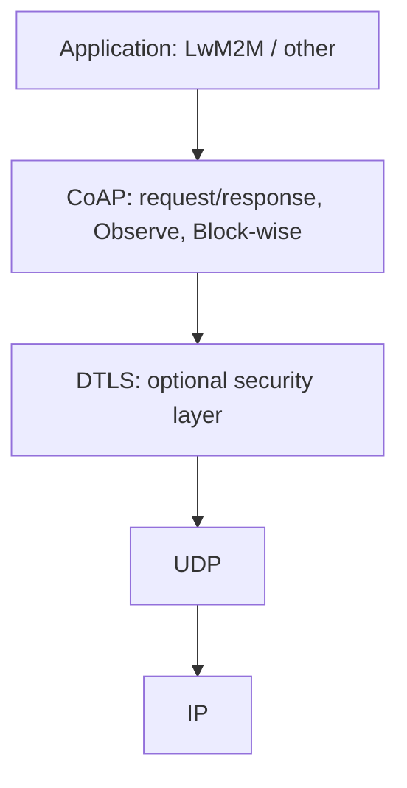
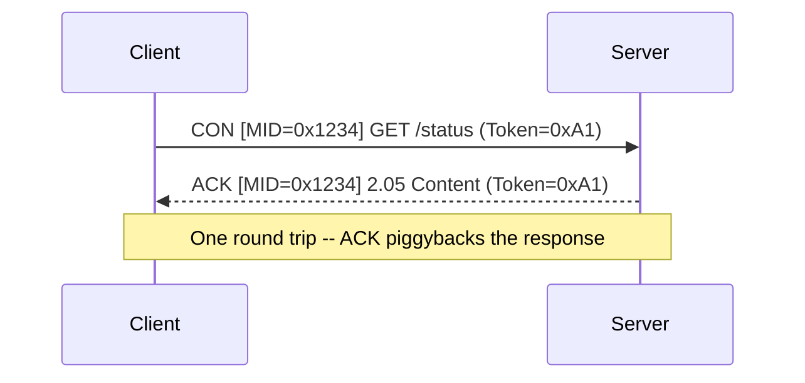
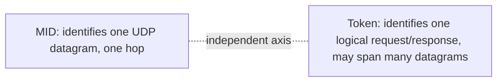
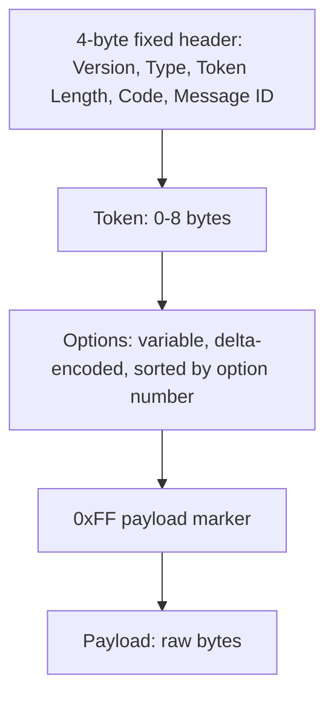
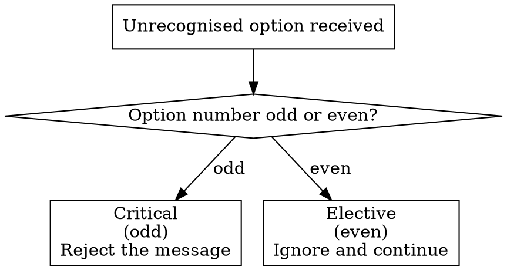
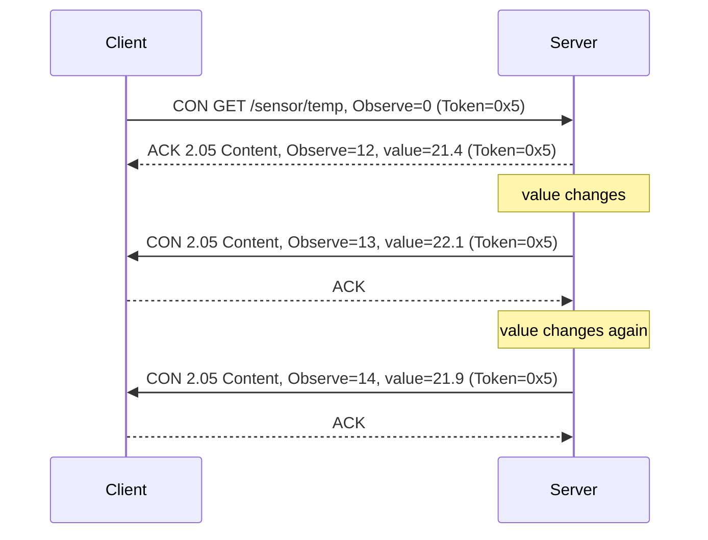
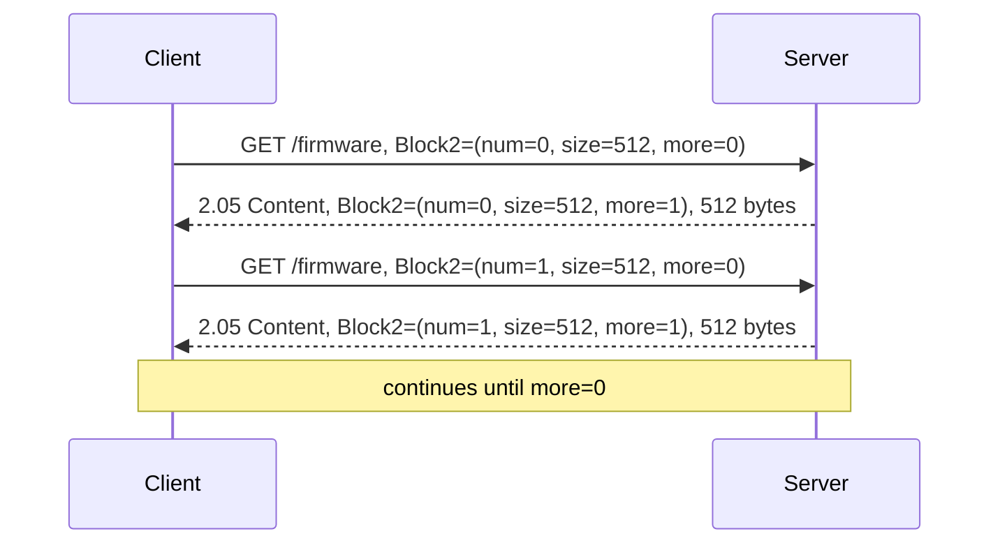

# CoAP

## Purpose and scope

This document explains the Constrained Application Protocol (CoAP) at a mechanism level: the message format, the reliability model, and the extensions (Observe, Block-wise) that let it stand in for a full application protocol on constrained devices. It is a companion document to *LwM2M: A Deep Explainer*, which builds its transaction model directly on top of what is described here, and to *CBOR: A Deep Explainer*, which covers the payload encoding CoAP carries. It assumes familiarity with general networking concepts (IP, UDP, TCP) but not prior exposure to constrained-device protocols.

## 1. Why CoAP exists

HTTP is not a good fit for constrained devices. A typical HTTP/1.1 request/response pair, even without a body, runs to hundreds of bytes of ASCII headers, and HTTP assumes a reliable, ordered, connection-oriented transport (TCP) with the overhead that implies -- a three-way handshake, congestion control state, and a socket held open per connection.

CoAP (RFC 7252) keeps the parts of HTTP that made it a good application model -- methods, response codes, URIs, content negotiation -- and re-implements them as a compact binary protocol over UDP. The design goals are:

- A message header of 4 bytes, not hundreds
- No mandatory connection state
- Optional reliability built into the protocol itself, rather than borrowed from the transport
- A one-to-one mapping to HTTP semantics, so it can be proxied to and from HTTP at a gateway
- Native support for asynchronous notification (Observe) and multicast, neither of which HTTP does well

> **Note:** CoAP is often described as "REST over UDP." That is a reasonable one-line summary, but the reliability, deduplication, and congestion control CoAP builds on top of UDP are real protocol machinery, not something you get for free -- this is most of what this document covers.

## 2. Where CoAP sits in the stack



CoAP normally runs on UDP port 5683 (unencrypted) or 5684 (over DTLS, "coaps://"). Because it sits directly on UDP, there is no connection setup latency before the first request can be sent -- a meaningful saving on high-latency, high-cost radio links like NB-IoT, where every round trip costs airtime and battery.

## 3. The two-layer model

CoAP separates concerns into two layers that are easy to conflate but serve different purposes:

- **Message layer** -- handles deduplication and optional reliability over UDP, using Message IDs
- **Request/response layer** -- handles the REST-style semantics (method, URI, response code), using Tokens

A single CoAP exchange uses both: the message layer gets the bytes there reliably (if Confirmable), and the request/response layer matches the reply to the right in-flight request.

### Message types

Every CoAP message carries one of four types:

| Type | Meaning |
|---|---|
| CON (Confirmable) | "Please acknowledge this." Retransmitted until ACKed or it times out. |
| NON (Non-confirmable) | Fire-and-forget. No retransmission, no ACK expected. |
| ACK (Acknowledgement) | Confirms receipt of a CON message. May carry the actual response as a "piggybacked" reply. |
| RST (Reset) | "I received this but cannot process it" -- e.g. the recipient has no idea what this Message ID refers to. |

The most common pattern is a CON request answered by a piggybacked ACK: the ACK both confirms delivery and carries the response payload in one message, saving a round trip.



When the server cannot answer immediately (it needs to do work first), it may separate the ACK from the response: an empty ACK confirms the message arrived, and a later CON carrying the real response arrives independently, itself requiring its own ACK.

### Message IDs and deduplication

Every message carries a 16-bit Message ID (MID), chosen by the sender. A CON message and its ACK/RST share the same MID -- this is purely a message-layer concept, scoped to one hop and one direction of retransmission. If the same CON message arrives twice (because an ACK was lost and the sender retransmitted), the receiver recognises the repeated MID and re-sends its cached ACK without reprocessing the request.

> **Warning:** MID deduplication is per-endpoint and time-windowed (EXCHANGE_LIFETIME, nominally around 247 seconds by the RFC 7252 defaults). Do not assume MIDs are unique forever, and do not use them as an application-layer identifier -- that is what Tokens are for.

### Tokens and request/response matching

The Token (0-8 bytes, chosen by the client) identifies a request/response pair independently of the message layer. This matters because a single logical request/response exchange can span multiple underlying messages (a separate response, or a Block-wise transfer spanning many blocks) -- the Token stays constant across all of them, while the MID changes on every individual message.



### Retransmission and congestion control

For CON messages, the sender retransmits on a randomised exponential backoff, starting from ACK_TIMEOUT (default 2 seconds, randomised up to 3 seconds) and doubling on each retry, up to MAX_RETRANSMIT (default 4) attempts. This is deliberately similar in shape to TCP's backoff, so that many CoAP endpoints on a shared, congested link (a cellular NB-IoT cell, for instance) do not collectively hammer it.

## 4. Message format

A CoAP message is a compact binary structure, not a text header block. The overall layout is a fixed 4-byte header followed by variable-length fields:



The fixed header itself packs five fields into 32 bits:

```wavedrom
{reg: [
  {bits: 2, name: 'Ver'},
  {bits: 2, name: 'T'},
  {bits: 4, name: 'TKL'},
  {bits: 8, name: 'Code'},
  {bits: 16, name: 'Message ID'}
], config: {bits: 32, lanes: 1}}
```

That is a 2-bit version, 2-bit type (CON/NON/ACK/RST), 4-bit Token Length, an 8-bit Code, and a 16-bit Message ID -- exactly 4 bytes, with no padding. Everything after that is variable-length: the Token (as many bytes as Token Length said), then zero or more Options, then -- if a payload is present -- a single `0xFF` marker byte followed by the raw payload bytes.

### Codes

The Code field reuses HTTP's class/detail split but packs it into a single byte as `c.dd` (3-bit class, 5-bit detail), so `2.05` is "Success, Content" and `4.04` is "Client Error, Not Found" -- deliberately readable as the HTTP status codes they mirror.

```wavedrom
{reg: [
  {bits: 5, name: 'Detail (dd)'},
  {bits: 3, name: 'Class (c)'}
], config: {bits: 8, lanes: 1}}
```

| Code | Meaning | HTTP equivalent |
|---|---|---|
| 0.01 -- 0.04 | Request methods | GET, POST, PUT, DELETE |
| 2.01 | Created | 201 |
| 2.02 | Deleted | 204 |
| 2.04 | Changed | 204 |
| 2.05 | Content | 200 |
| 4.00 | Bad Request | 400 |
| 4.04 | Not Found | 404 |
| 4.05 | Method Not Allowed | 405 |
| 5.00 | Internal Server Error | 500 |

### Options

Options carry everything HTTP would put in a header: Content-Format, Uri-Path, Uri-Query, Max-Age, ETag, and so on. Rather than naming each option in the wire format, CoAP encodes an **option number** and relies on **delta encoding** -- each option's header carries the difference from the previous option's number, not the absolute number -- because options must be transmitted in ascending numeric order. This keeps small option numbers (the common ones) to a single nibble of overhead.

Options are also marked **critical** or **elective** by convention (odd option numbers are critical, even are elective): if a recipient does not understand a critical option, it must reject the message; an unrecognised elective option can simply be ignored. This is how CoAP extensions (Observe, Block-wise, both discussed below) stay backward-compatible -- they are defined as options, and an endpoint that predates them either understands the option number as critical and correctly rejects an exchange it cannot support, or ignores it if defined as elective.



## 5. Observe: subscribe instead of poll

Plain CoAP is request/response, same as HTTP. The **Observe** option (RFC 7641) turns a single GET into a standing subscription: the client sets the Observe option (value 0) on a GET, and the server, instead of returning one response, keeps the "request" open and pushes a new response every time the observed resource's state changes -- each notification reusing the same Token, with an increasing Observe sequence number so the client can discard stale, out-of-order notifications.



This is the mechanism LwM2M's Information Reporting interface builds on directly: an LwM2M "Observe" on a resource is, at the wire level, exactly this CoAP Observe relationship.

> **Note:** Observe relationships are soft state. A server that reboots forgets all its subscriptions; a well-behaved client re-subscribes when it notices notifications have stopped (or on any transport-level reset, such as an RST for a stale MID).

## 6. Block-wise transfer

UDP datagrams -- and NB-IoT's radio frames beneath them -- have practical size limits well below what a firmware image or a bulk data payload needs. **Block-wise transfer** (RFC 7959) splits a large payload across multiple CoAP messages, each carrying a Block1 (request body) or Block2 (response body) option that encodes a block number, a "more blocks follow" flag, and the block size (a power of two from 16 to 1024 bytes).



Each block is its own independent CoAP request/response (its own MID, though typically the same Token), so any single block can be retransmitted on its own without re-sending the whole transfer -- important on a lossy radio link where re-sending an entire firmware image because of one dropped datagram would be wasteful. This is the mechanism behind LwM2M firmware push/pull over the Firmware Update object.

The Block1/Block2 option value itself is a single packed field (1-3 bytes depending on how large NUM needs to be), not three separate options:

```wavedrom
{reg: [
  {bits: 3, name: 'SZX'},
  {bits: 1, name: 'M'},
  {bits: 20, name: 'NUM'}
], config: {bits: 24, lanes: 1}}
```

`SZX` encodes the block size as a power of two (0 = 16 bytes, up to 6 = 1024 bytes), `M` is the "more blocks follow" flag, and `NUM` is the block number -- all three squeezed into as few bytes as the current NUM value needs, which is why the option's wire length varies as a transfer progresses past block 15, then block 4095, and so on.

## 7. Security: CoAP over DTLS

CoAP's security is provided by DTLS (Datagram TLS) underneath it, not by CoAP itself -- `coaps://` on port 5684 is CoAP running inside a DTLS session, structurally identical to how HTTPS is HTTP inside TLS. LwM2M defines four security modes for this channel (NoSec, PSK, RPK, Certificate); the certificate chain, key formats, and handshake mechanics are covered in *Certificates and Keys: A Deep Explainer* and are not repeated here -- the relevant point for CoAP itself is simply that DTLS sits directly below it in the stack, unaware of CoAP's message semantics, so everything above (Message IDs, Tokens, Observe, Block-wise) works identically whether or not DTLS is present.

## 8. CoAP compared to alternatives

| | CoAP | MQTT | HTTP/1.1 |
|---|---|---|---|
| Transport | UDP (usually) | TCP | TCP |
| Model | Request/response + Observe | Publish/subscribe | Request/response only |
| Header overhead | ~4 bytes + options | ~2 bytes + variable | Hundreds of bytes (text) |
| Connection state | None required | Persistent broker connection | Persistent or per-request |
| Broker/server needed | No (direct client-server) | Yes (broker) | No |
| Multicast | Native support | No | No |
| Typical use | Device management, sensors | Telemetry, messaging | Web |

CoAP's advantage over MQTT for device management specifically is that it needs no broker and no persistent connection -- a device can go dormant between NB-IoT PSM windows and still be addressable by URI when it wakes, whereas MQTT needs its TCP session and subscriptions re-established. This is the main reason LwM2M is built on CoAP rather than MQTT.

## 9. Why this matters for LwM2M

Everything LwM2M does maps directly onto the mechanisms above:

- LwM2M **Read/Write/Execute** operations are CoAP GET/PUT-or-POST/POST
- LwM2M **Observe/Notify** is CoAP's Observe option, unmodified
- LwM2M **firmware push and pull** use Block-wise transfer
- LwM2M's four **security modes** are DTLS configurations sitting below an otherwise unchanged CoAP layer
- LwM2M's compact **object/resource path** model (`/3/0/1`) is simply the Uri-Path option, structured by convention

The LwM2M deep dive builds on this document rather than re-deriving it -- if a CoAP mechanism looks unfamiliar while reading that document, it is explained here.
