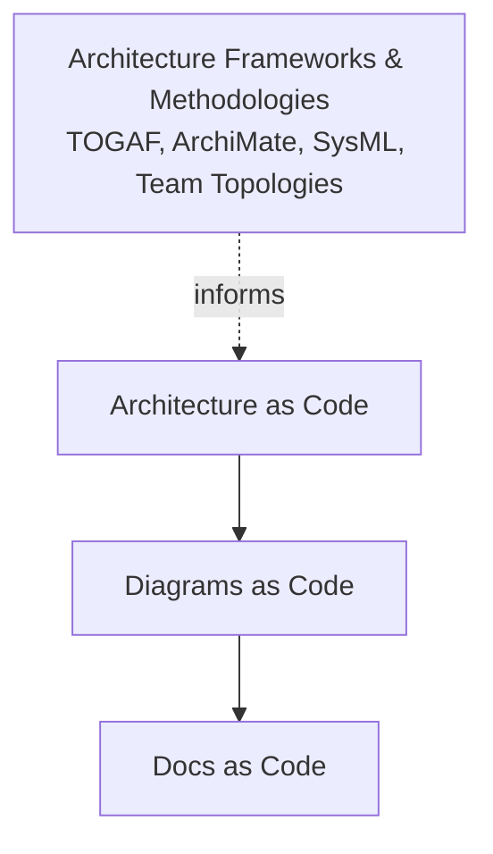

# Docs, diagrams and architecture as code

## 1. Overview

Three related practices, one underlying idea: treat documentation, diagrams, and architecture models as plain-text artefacts that live in version control and are built into publishable output by a pipeline, rather than edited by hand in a proprietary tool.

- **Docs as code** -- prose treated like source code
- **Diagrams as code** -- visuals generated from a textual definition
- **Architecture as code** -- the architecture model itself expressed as a structured, queryable, version-controllable definition, from which diagrams and prose are derived

Alongside these, there's a fourth thing worth keeping distinct: **architecture frameworks and methodologies** (TOGAF, ArchiMate, Zachman, SysML, Team Topologies, and similar). These describe *what* to model, *how* to categorise it, or *how to think about* a system's structure. They are not, in themselves, code -- most predate the "as code" movement and most of their common tooling is GUI-driven or repository-based rather than text-and-diff based. Some can be *implemented* using as-code tooling (an ArchiMate model can be authored in Archi and stored as versionable XML; a Wardley Map can be written as text), but the framework itself is a way of thinking, not an artefact format.

This document surveys the landscape in each category -- what exists and what it's for -- rather than prescribing a specific pipeline.

> **Note:** the dotted line matters. Frameworks inform *what* an architecture model should contain; they don't dictate that the model must be text-based and version-controlled. That's a separate, tooling-level choice.

## 2. Docs as Code: The Landscape

### 2.1 The movement and its philosophy

"Docs as code" originated as a community position, not a single tool. The **Write the Docs** community is its main gathering point, and the underlying argument is: documentation quality improves when writers use the same tools, workflows, and review discipline as developers (version control, pull requests, CI, issue tracking), rather than a separate wiki or CMS with no review trail.

Related philosophies worth knowing:

- **README-driven development** -- write the README (and usage docs) before the code, as a design step
- **Docs-like-code vs docs-in-code** -- a distinction between documentation stored alongside source (in-repo Markdown) versus documentation *generated from* source (docstrings, code comments) -- the two are complementary, not competing
- **Minimum viable documentation** -- an argument (associated with Google's internal engineering practices) for documenting only what's load-bearing, avoiding documentation debt from over-specification

### 2.2 Structuring frameworks (what content goes where, not code themselves)

These frameworks answer "how should the documentation set be organised", independent of markup or tooling. Like the architecture frameworks discussed later, they are conceptual templates rather than artefact formats.

| Framework | Origin/domain | Core idea |
| --- | --- | --- |
| **Diátaxis** | Web/software docs (Django docs origin) | Splits all documentation into four types: tutorials, how-to guides, reference, and explanation -- each with different writing rules |
| **arc42** | Software architecture (German-speaking enterprise/embedded world) | A 12-section template for architecture documentation specifically (context, constraints, building blocks, runtime, deployment, risks, decisions, glossary) |
| **DITA (Darwin Information Typing Architecture)** | Technical publishing, aerospace/defence, regulated industries | An OASIS XML standard for topic-based authoring: content is written as reusable "topics" (concept, task, reference) and assembled into different outputs via "maps" -- this one *does* double as a genuine as-code format, since DITA content is XML and version-controllable, unlike the other frameworks in this table |
| **Divio documentation system** | General software docs | A close relative/precursor of Diátaxis, same four-part split |
| **Google Developer Documentation Style Guide** | Style, not structure | A widely referenced house style (voice, terminology, formatting conventions) rather than a document skeleton |
| **Microsoft Writing Style Guide** | Style, not structure | Microsoft's equivalent; commonly used as a base for corporate style guides |

### 2.3 Markup and authoring formats

| Format | Character | Typical use |
| --- | --- | --- |
| **CommonMark / GitHub Flavored Markdown (GFM)** | Lightweight, widely supported | General docs, READMEs, wikis |
| **MyST Markdown** | Markdown extended with reStructuredText-like directives | Technical/scientific docs needing cross-references, admonitions, and Sphinx integration without full reST |
| **AsciiDoc** | More expressive than Markdown (native tables, includes, conditionals, cross-references) | Larger technical manuals, books, arc42 templates are often authored in AsciiDoc |
| **reStructuredText (reST)** | Python ecosystem standard, verbose syntax | Sphinx-based documentation, especially Python project docs |
| **DITA XML** | Structured, topic-based, verbose | Enterprise/regulated technical publishing with heavy reuse requirements |
| **Textile** | Lightweight, older | Largely superseded by Markdown, still seen in legacy systems |

### 2.4 Static site generators and publishing tooling

| Tool | Language/ecosystem | Notable for |
| --- | --- | --- |
| **MkDocs** (+ Material theme) | Python | Simple, fast, popular for technical/engineering docs; Material theme adds strong navigation and search |
| **Sphinx** | Python | The Python ecosystem standard; strong cross-referencing, extension ecosystem (autodoc for code-derived docs) |
| **Docusaurus** | JavaScript/React | Versioned docs, i18n, strong for open-source project documentation |
| **Antora** | JavaScript, AsciiDoc-based | Purpose-built for multi-repository documentation sets -- pulls docs from many repos into one site, common in arc42/enterprise contexts |
| **Hugo** | Go | General-purpose static site generator, very fast builds, used for docs and general sites alike |
| **Jekyll** | Ruby | Older, GitHub Pages' original native generator |
| **Docsify / VuePress / GitBook** | JavaScript | Lighter-weight alternatives, GitBook has a hosted SaaS offering |
| **mdBook** | Rust | Common for Rust-ecosystem docs and technical books |
| **Zola** | Rust | Single-binary static site generator, no dependency management overhead |
| **Read the Docs** | Hosting platform | Not a generator itself -- hosts Sphinx/MkDocs output with automatic versioned builds triggered from git |

### 2.5 API documentation as code

A specialised branch, since API references are usually generated from a machine-readable contract rather than written by hand.

| Standard/tool | Purpose |
| --- | --- |
| **OpenAPI Specification (formerly Swagger)** | The dominant standard for describing REST APIs as a YAML/JSON contract |
| **AsyncAPI** | Equivalent standard for event-driven/async APIs (message queues, webhooks) |
| **Redoc** | Renders an OpenAPI spec into a polished reference site |
| **Swagger UI** | Interactive OpenAPI explorer, "try it out" style |
| **Slate / Stoplight** | Alternative API doc renderers with a more narrative, three-column layout |

### 2.6 Doc quality and linting

| Tool | Checks |
| --- | --- |
| **Vale** | Prose style linting (configurable to enforce a house style guide, catches passive voice, banned terms, etc.) |
| **markdownlint** | Markdown formatting/syntax consistency |
| **alex** | Catches insensitive or inconsiderate phrasing |
| **write-good / textlint** | General prose quality heuristics |

## 3. Diagrams as Code: The Landscape

### 3.1 General-purpose diagramming languages

| Tool | Underlying model | Strengths |
| --- | --- | --- |
| **Graphviz (DOT)** | Directed/undirected graphs, automatic layout | The foundational layout engine; many higher-level tools compile down to DOT |
| **Mermaid** | Text syntax rendered client-side or via CLI | Flowcharts, sequence, class, state, ER, Gantt, and C4-ish diagrams; renders natively in GitHub, GitLab, Notion |
| **PlantUML** | Text syntax, Java-based renderer | Strong UML support (all diagram types), mature ecosystem, C4-PlantUML extension |
| **D2** (Terrastruct) | Text syntax, modern renderer | More visually polished default output than Mermaid/PlantUML, good for architecture-style diagrams |
| **Nomnoml** | Lightweight text syntax | Simple UML-ish class/box diagrams |
| **Ditaa** | ASCII-art to diagram | Converts hand-drawn-looking ASCII boxes into cleaner rendered diagrams |
| **svgbob** | ASCII-art to SVG | Similar niche to Ditaa, Rust-based |

### 3.2 UML-specific tooling

- **PlantUML** covers the full UML spec (class, sequence, activity, state, component, deployment, use case)
- **yUML** -- a simpler, URL-based UML sketching tool, good for quick embeds
- **UMLet** -- has a text/DSL mode alongside its GUI

### 3.3 Cloud and infrastructure diagrams

| Tool | Approach |
| --- | --- |
| **Diagrams** (Python library, "diagrams" on PyPI) | Python code with provider-specific icon sets (AWS, Azure, GCP, Kubernetes) renders architecture diagrams -- popular because the diagram source is executable Python |
| **Cloudcraft** | SaaS, isometric AWS architecture diagrams, some automation from live AWS accounts |
| **AWS CDK / Terraform visualisation plugins** | Not diagramming tools per se, but some IaC tooling can generate a dependency graph as a diagram from the deployed infrastructure definition |

### 3.4 Sequence, timing, and network-family diagrams

| Tool | Diagram type |
| --- | --- |
| **WaveDrom** | Digital timing diagrams (bit/signal waveforms) -- relevant in embedded/hardware contexts |
| **js-sequence-diagrams** | Lightweight sequence diagrams, precursor to Mermaid's sequence support |
| **blockdiag family** (blockdiag, seqdiag, actdiag, nwdiag, rackdiag) | A Python-based family covering block diagrams, sequence, activity, network, and rack diagrams from similar-looking text syntax |

### 3.5 Data model and entity-relationship diagrams

| Tool | Notes |
| --- | --- |
| **dbdiagram.io / DBML** | A dedicated markup language (Database Markup Language) for ER diagrams, popular for quick schema sketches |
| **SchemaSpy** | Generates ER diagrams and documentation directly from a live database's metadata (reverse-engineering rather than hand-authored) |
| **Mermaid ER diagrams** | Built into Mermaid, adequate for simpler schemas |

### 3.6 Whiteboard-style diagrams and Wardley Maps

| Tool | Purpose |
| --- | --- |
| **Excalidraw** | Primarily a GUI whiteboard tool, but supports a JSON/text scene format that can be scripted or templated |
| **Eraser.io** | SaaS with a text-to-diagram DSL alongside a whiteboard canvas |
| **OnlineWardleyMaps** | A genuine text syntax for **Wardley Mapping** -- plots components on a value chain against an evolution axis (genesis to commodity); this is one of the few strategy-oriented approaches with a real as-code implementation, unlike most other strategic frameworks (see section 5) |

### 3.7 Academic/embedded-adjacent tooling

| Tool | Context |
| --- | --- |
| **TikZ/PGF** | LaTeX-native diagramming, common in academic papers and formal specifications |
| **Asymptote** | A vector graphics language, sometimes used for precise technical illustration in academic/embedded documentation |

## 4. Architecture as Code: The Landscape

This section covers tools where the architecture model itself is a text (or otherwise diffable) artefact that generates views, as opposed to frameworks that describe what a model should contain (covered separately in section 5).

### 4.1 C4 model implementations

| Tool | Character |
| --- | --- |
| **Structurizr DSL** | The reference implementation of the C4 approach -- one model, multiple derived views (context, container, component, deployment, dynamic); plain text, version-controllable |
| **C4-PlantUML** | A set of PlantUML macros/includes that let you draw C4-style diagrams within existing PlantUML tooling, without adopting a separate DSL or model -- closer to diagrams-as-code than a true single-model system, since each view is drawn independently rather than derived from one shared model |
| **LikeC4** | A TypeScript-based alternative to Structurizr DSL, open source, with a VS Code extension and its own web viewer; genuinely text-first |
| **IcePanel** | A browser-based, GUI-first C4 modelling tool (SaaS); the model lives in IcePanel's own store rather than a text file, so it sits closer to a hosted model repository than a strict "as code" artefact, though it can export data |

### 4.2 Decision records and service catalogues as code

| Tool/format | Notes |
| --- | --- |
| **Architecture Decision Records (ADRs)** | Short Markdown/text documents capturing one decision, its context, and consequences -- genuinely as-code, since they're plain text files reviewed like any other change |
| **Michael Nygard's original ADR format** | Title, Status, Context, Decision, Consequences -- the template most others derive from |
| **MADR (Markdown Architecture Decision Records)** | A more structured template, adds sections for considered options and decision drivers |
| **adr-tools** | A small CLI for creating and numbering ADRs following a consistent naming convention |
| **log4brains** | Generates a browsable, searchable static site from a folder of ADRs |
| **Backstage** (Spotify, now CNCF) | Each service/component described by a `catalog-info.yaml` file -- architecture-as-code at the "who owns what, what depends on what" level, aggregated across repos into a browsable catalogue |

### 4.3 Infrastructure as code (adjacent, often conflated)

Worth distinguishing clearly: these describe the *deployed infrastructure*, not the *software architecture*, though they're frequently mentioned in the same breath.

| Tool | Scope |
| --- | --- |
| **Terraform** | Cloud-agnostic infrastructure provisioning via HCL |
| **AWS CloudFormation** | AWS-native infrastructure provisioning via YAML/JSON |
| **Pulumi** | Infrastructure provisioning using general-purpose programming languages rather than a DSL |
| **AWS CDK** | Infrastructure defined in TypeScript/Python/etc., synthesises to CloudFormation |

> **Important:** infrastructure-as-code tools describe what gets *deployed*. Architecture-as-code tools (Structurizr, LikeC4) describe how the *system is structured and reasoned about*. A deployment view in Structurizr might reference the same environment that Terraform provisions, but the two serve different audiences and rarely share a single source file.

## 5. Architecture Frameworks and Methodologies (Not Code)

These are ways of thinking about architecture, not artefact formats. None of them require a text-based, version-controlled model, though some can be implemented that way with the right tooling. They're included here because they're commonly discussed alongside architecture-as-code, and it's worth being clear about which is which.

### 5.1 Enterprise architecture frameworks

| Framework/tool | Character |
| --- | --- |
| **TOGAF** | The dominant enterprise architecture methodology; defines an Architecture Development Method (ADM) and a broad set of artefact types -- a process and a set of deliverable categories, not a modelling notation or a code format |
| **ArchiMate** (language) + **Archi** (open-source tool) | A modelling *notation* for expressing TOGAF-style enterprise architecture across business, application, and technology layers. Archi stores models as `.archimate` XML, which is technically version-controllable -- but the authoring workflow is GUI-first (drag-and-drop modelling), and diffs on the underlying XML are not human-readable the way a Structurizr DSL diff is. Best thought of as "model-based" rather than "as code" |
| **Zachman Framework** | A classification grid (who/what/when/where/why/how across stakeholder perspectives) for organising enterprise architecture artefacts -- a taxonomy, not a notation or a tool |

### 5.2 Systems engineering

| Framework/tool | Character |
| --- | --- |
| **SysML** (Systems Modelling Language) | A UML dialect extended for systems engineering -- requirements, behaviour, structure, and parametrics for systems that include hardware, not just software |
| **MBSE tooling** (e.g. Cameo Systems Modeler, Rational Rhapsody) | Commercial Model-Based Systems Engineering tools built around SysML, common in aerospace, defence, and automotive; models typically live in a proprietary repository with GUI editing, not plain text -- SysML v2 introduces a textual notation, which may close this gap over time |

### 5.3 Organisational and strategic frameworks

| Framework | Character |
| --- | --- |
| **Team Topologies** | A framework for organisational design (stream-aligned, platform, enabling, complicated-subsystem teams) -- describes how teams should be shaped around a system's architecture; no code artefact of its own, though team-boundary diagrams are often drawn using the diagrams-as-code tools in section 3 |
| **Domain-Driven Design (DDD) context maps** | Diagrams showing bounded contexts and their relationships (partnership, customer/supplier, anticorruption layer, etc.) -- a modelling *technique*, typically rendered with general-purpose diagrams-as-code tools (Mermaid, PlantUML) rather than a dedicated DSL |
| **Event Storming** | A workshop technique producing a timeline of domain events, usually captured live as sticky notes -- not code, though the output is sometimes transcribed afterwards into a diagram for permanence |
| **Wardley Mapping** | The one exception in this section with a genuine as-code implementation (see section 3.6) -- included here too because the mapping *technique* itself (reasoning about value chains and evolution) is the methodology, while the text syntax is just one way of producing the artefact |

## 6. How the Categories Compare

| | Docs as code | Diagrams as code | Architecture as code | Frameworks/methodologies |
| --- | --- | --- | --- | --- |
| **What it is** | Narrative content | A rendered visual | A structured, diffable model | A way of thinking about structure |
| **Is it itself code?** | Yes | Yes | Yes | No -- may be *implemented* using as-code tooling, but isn't code by definition |
| **Primary audience** | Anyone consuming the documentation | Anyone reading a specific view | Architects, and tools/queries that consume the model | Architects and stakeholders reasoning about the system |
| **Typical source format** | Markdown, AsciiDoc, reST, DITA | Mermaid, PlantUML, D2, DOT, DBML | Structurizr DSL, LikeC4, ADRs, `catalog-info.yaml` | Documents, workshops, GUI model repositories |
| **Reuse across outputs** | Low | Medium (one source, multiple render formats) | High (one model, many derived views) | N/A -- describes intent, not an artefact |

## 7. Choosing Between Approaches (Considerations, Not a Recipe)

- **Regulated/embedded/defence contexts** tend to gravitate toward heavier tooling for documentation reuse (DITA) and systems modelling (SysML/MBSE), often alongside enterprise architecture governance (TOGAF/ArchiMate) mandated at organisational level -- these frameworks and their tooling are frequently GUI/repository-based rather than plain-text, which is a genuine tooling trade-off, not an oversight
- **Web/product engineering teams** more often favour lightweight text formats (Markdown, Mermaid, Structurizr/LikeC4) and static site generators, prioritising low friction and diffability over formal traceability
- **Enterprise architecture governance** (TOGAF/ArchiMate) and **software architecture-as-code** (Structurizr/LikeC4) address different altitudes and aren't substitutes -- larger organisations often run both, connected loosely (an ArchiMate application layer element might correspond to a Structurizr software system) rather than through a single shared tool
- **Strategic framing approaches** (Wardley Mapping, Team Topologies, DDD context maps) are almost always additive to whichever architecture-as-code tool is in use -- they explain *why* the structure exists, and only Wardley Mapping among them has a mainstream text-based implementation
