# Git internals

## Overview

Git is often described as a "version control system", but its core is simpler and stranger than that phrase suggests: it is a content-addressable object store, with a directed acyclic graph (DAG) of commits layered on top. Understanding those two ideas -- content addressing and the DAG -- explains almost everything else: why hashes look the way they do, why branches are so cheap, and what actually happens during a merge.

## What Is a Commit?

A commit is a snapshot, not a diff. Each commit points at a tree object recording the complete state of every file at that moment, plus a pointer to its parent commit(s) and metadata (author, committer, timestamp, message). Git computes differences on demand, by comparing two snapshots, when you run something like `git diff` or `git log -p`. A diff is never stored inside a commit; it's derived at the point you ask for it.

Getting from a changed file to a commit goes through an intermediate step: the staging area (also called the index). Running `git add` doesn't create a commit; it copies the current state of a file into the staging area, which is Git's draft of the *next* tree object. `git commit` then takes whatever is in the staging area, writes it as a tree, and wraps it in a new commit object. This is why partial commits are possible: you can `git add` only some of your changes and commit just those, leaving the rest unstaged.

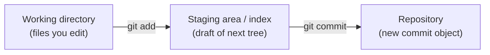

## Adding, Changing and Deleting Files

Git tracks a file's state relative to the last commit as one of: untracked (new, unknown to Git), modified (tracked but changed since the last commit), or staged (copied into the index, ready to be part of the next commit). What actually happens in the object database depends on which of these three actions you take, and none of them ever edit an existing object in place.

### Added (new file)

The file starts untracked. Staging it (`git add`) computes a blob hash from its full content and adds an entry for that path to the staged tree. The next commit's tree gains that entry; nothing in the object database referenced the file before this point.

### Changed (existing file)

The file shows as modified in the working directory. Staging it hashes the new content, producing a new blob -- the old blob is untouched and remains referenced by every earlier commit that had it. The next commit's tree entry for that path points at the new blob instead of the old one, and every tree above it on the path to the root also changes, since a tree's own hash depends on the hashes of everything it contains.

> **Note:** the new blob holds the file's complete new content, not a diff against the old version. Git has no "old blob plus changed lines" object; each blob is a full, standalone snapshot of one file's content, with a header (`blob <size>\0`) prepended before hashing, then compressed for storage. Compact storage comes later, when Git packs similar objects together in a packfile; that's an on-disk optimisation, not a change to the logical model.

### Deleted

Staging a deletion (`git rm`, or `git add` after removing the file) removes that path's entry from the staged tree entirely. The next commit's tree simply has no entry for that path. The blob for the old content is not deleted; it still sits in the object database and is still referenced by every earlier commit that had the file, so checking out an older commit brings it straight back.

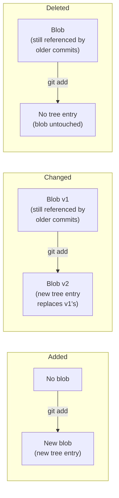

The common thread across all three: nothing is ever edited in place. Every add, change or delete produces a new blob and/or a new set of tree objects, never modifies an old one, and only becomes permanent once wrapped in a new commit.

## The Commit DAG

Every commit points to one or more parent commits (except the very first commit, which has none). Because a commit can never point forward in time to something that doesn't exist yet, and history only ever grows backwards through parent links, the structure is acyclic -- there are no loops.

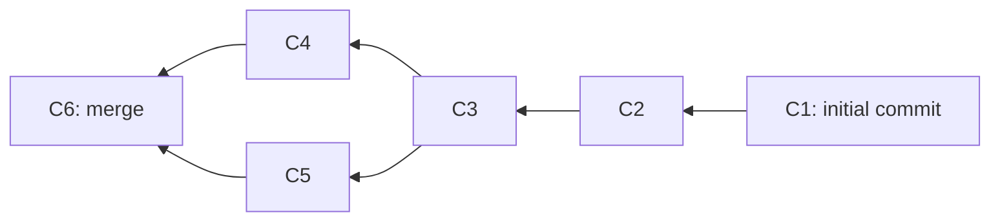

A few things to notice:

- Arrows point *backwards*, from child to parent, because a commit is created after its parent and records that parent's hash at creation time.
- `C3` has two children (`C4` and `C5`), which happens when a branch is created at that point and both lines of development continue independently.
- `C6` has two parents (`C4` and `C5`), which is what a merge commit is -- a single commit that records two prior histories as both being its ancestors.

The DAG is the entire "shape" of a repository's history. Branches, tags and `HEAD` are just labelled pointers into this graph; they don't change its shape, they just mark positions within it.

## What a Hash Actually Represents

Git's object database stores four kinds of objects, and every one of them is identified by the SHA-1 (or SHA-256, on newer repositories) hash of its own content. This is what "content-addressable" means: the name of an object is derived mathematically from what's inside it, not assigned by a human or a counter.

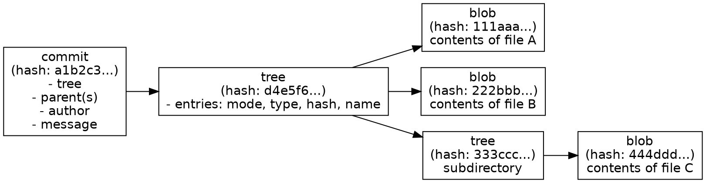

The consequences of this design are what give Git its distinctive behaviour:

- A `blob` is just file contents. If two files anywhere in the repository (or across its whole history) have identical contents, they are stored as the *same* blob, referenced from multiple places. Renaming a file with no content change doesn't create a new object.
- A `tree` is a directory listing: a set of names, modes and the hashes of the blobs or subtrees they point to. If a directory's contents are unchanged between two commits, both commits' trees can point at the exact same tree object.
- A `commit` object is small: it holds a pointer to one tree (the complete snapshot of the repository at that moment), pointers to zero or more parent commits, and metadata (author, committer, timestamp, message).
- Because the hash is computed from content, changing anything -- a single character in a file, the commit message, the author's name, the parent pointer -- produces a completely different hash. This is also why hashes are how Git detects corruption: if content and hash ever disagree, something is wrong.

The diagram below makes deduplication concrete: two commits where only one file changed between them end up sharing every object except the one blob that differs, the tree that contains it, and the two commit objects themselves.

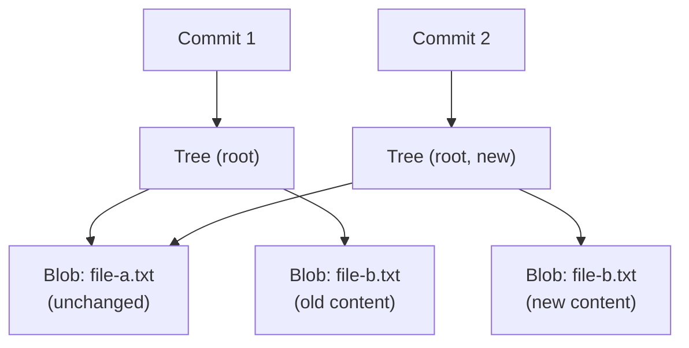

`file-a.txt` didn't change, so both commits' trees point at the exact same blob. `file-b.txt` changed, so it gets a new blob, which forces a new tree (since the tree's own content, and therefore its hash, includes the list of blob hashes it points to), which forces a new commit. Nothing else in the repository needs to be duplicated.

So when people say "commit `a1b2c3`", they mean: the unique fingerprint of one exact snapshot of the whole repository at one point in the DAG, plus the metadata describing how it got there.

### Long hash versus short hash

There is only one hash per object, either 40 hex characters (SHA-1) or 64 (SHA-256, on newer repositories). The abbreviated hashes you see in `git log --oneline` or `git show` are not a separate identifier; they're a display shorthand. Git starts with 7 characters and checks whether that prefix uniquely identifies one object in the current repository; if there's a collision, it uses more characters until the prefix is unique. Internally, Git always expands a short hash back to the full one before using it.

> **Note:** the short hash is not stable across all repositories or forever. As a repository grows, a prefix that was unique yesterday can collide with a new object tomorrow, at which point Git will start showing more characters for it.

## Packing: How Objects Are Actually Stored

Everything so far describes the logical model: every object (blob, tree, commit, tag) is a full, independent, content-addressed unit. Physically, Git stores objects in one of two forms, and it's worth being clear that switching between them never changes an object's hash or content, only how many bytes it takes up on disk.

A newly created object starts as a loose object: one file per object, named after its hash, held in `.git/objects/`, compressed individually with zlib. This is simple but wasteful, since many blobs in a repository's history are near-identical (a file changed by a few lines still produces a wholly new blob).

Periodically -- during `git gc`, when pushing or fetching over a threshold, or when `git repack` is run directly -- Git bundles loose objects into a packfile. Inside a pack, Git finds similar objects and stores most of them as a delta against a chosen base object, rather than storing their full content again. An accompanying index file (`.idx`) records where each object's data starts inside the pack, so looking up an object by hash is still fast even though the objects themselves are no longer one-file-each.

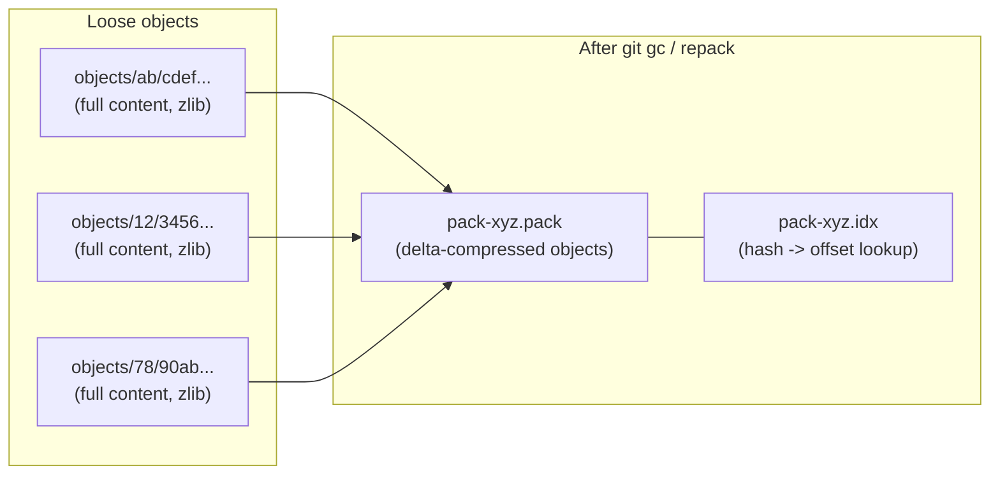

> **Important:** delta compression here is purely a storage-layer trick for making the pack file smaller; it's unrelated to the diffs `git diff` shows you, and it doesn't change what a blob logically contains. A packed blob still decompresses back to the exact same full content, and still has the exact same hash, as it did when loose.

## Branches Are Just Pointers

A branch is not a container for commits. It's a small file containing a single 40-(or 64-)character hash: the commit it currently points to. `HEAD` is similarly just a pointer, usually to a branch name, which in turn points to a commit.

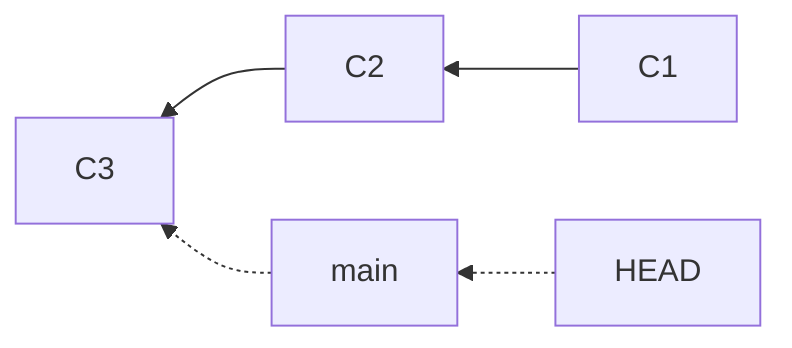

Creating a branch is cheap for exactly this reason: it's writing one line to one small file, not copying any commit data. When a new commit is made on a branch, Git:

1. writes the new commit object, with its parent set to whatever the branch currently points to
2. moves the branch pointer forward to the new commit's hash

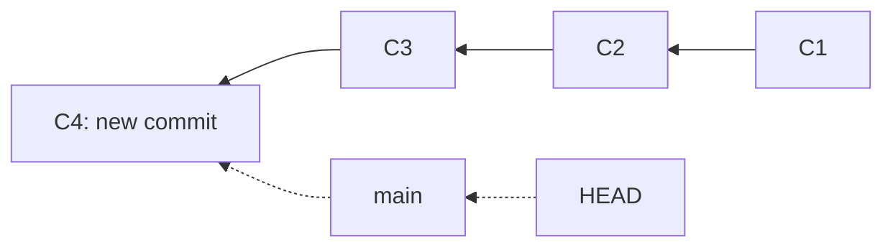

Note that `C3` still exists in the object database; only the pointer moved. This is also why deleting a branch is safe in the short term (the commits are only garbage-collected once nothing references them and enough time has passed) but can make history hard to find later, since the label pointing at it is gone.

> **Note:** unreferenced commits aren't deleted immediately. Git periodically packs loose objects into packfiles for storage efficiency, and a separate garbage collection pass (`git gc`) removes objects that are both unreachable from any branch, tag or `reflog` entry, and older than a grace period (a couple of weeks, by default). The `reflog` in particular is what makes "deleted" commits recoverable for a while: it's a local log of everywhere `HEAD` has pointed, independent of the DAG's own reachability.

> **Important:** it's possible to check out a commit directly, by hash, rather than a branch name. `HEAD` then points straight at that commit instead of at a branch, a state Git calls "detached HEAD". New commits made in this state still get written to the object database, but no branch pointer moves to follow them, so they become unreachable and eligible for garbage collection the moment you check out something else, unless you create a branch to point at them first.

## Tags

A tag is another kind of pointer into the DAG, but with a different intent to a branch: it marks a specific point permanently (typically a release), rather than tracking the tip of ongoing work. Git supports two kinds.

A lightweight tag is exactly like a branch pointer: a name pointing directly at a commit hash, with nothing else attached. It never moves on its own (nothing commits "onto" a tag), but it's just as easy to move or delete as a branch.

An annotated tag is its own object in the database, with its own hash, distinct from the commit it points to. It carries a tagger name, timestamp, message, and optionally a GPG signature, which is why annotated tags are the recommended choice for releases: the tag itself is a verifiable, dated record, not just a label.

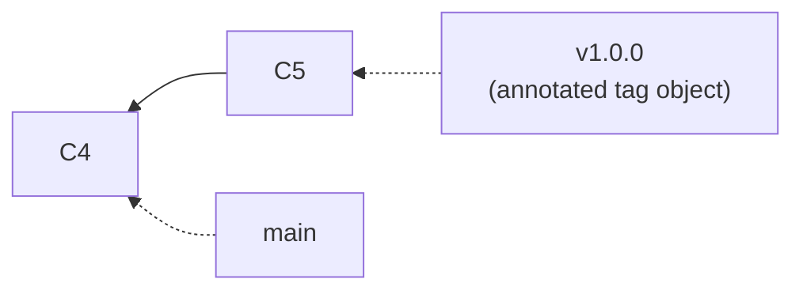

## Remote-Tracking Branches

A remote-tracking branch such as `origin/main` is a third category of pointer, easy to confuse with a local branch because it looks similar in `git branch -a` and `git log`. It records where a branch was on a given remote, last time Git talked to it (`fetch`, `pull`, `push`). It is not a pointer you commit onto directly; it only moves when Git talks to the network.

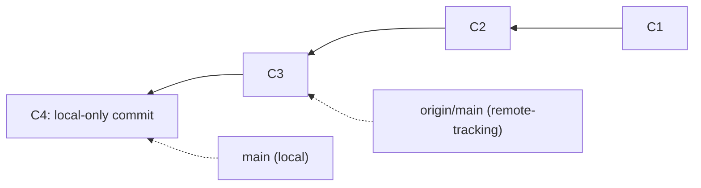

Here, `main` has moved on with a local commit that hasn't been pushed yet, so `origin/main` still points at the last commit Git knows the remote had. Running `git push` would move `origin/main` forward to match; running `git fetch` updates `origin/main` to wherever the remote server's `main` actually is, without touching your local `main` or your working directory at all.

## Merging

When two branches have diverged -- each has commits the other doesn't -- Git needs a way to bring them back together. There are two common outcomes, depending on the shape of the DAG at the time.

### Fast-forward merge

If the branch being merged in is a direct descendant of the current branch (no divergence at all), Git can simply move the pointer forward. No new commit is created.

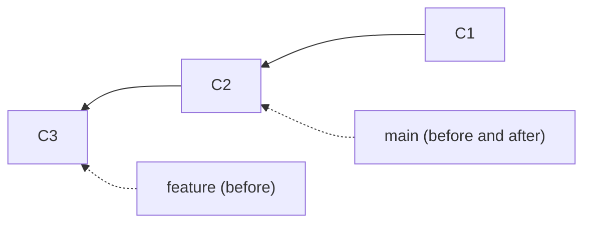

After merging `feature` into `main` here, `main` simply becomes another pointer at `C3`. The history is linear; nothing was combined because there was nothing to combine.

### Three-way merge (merge commit)

If both branches have new commits since they diverged, Git performs a three-way merge, comparing:

- the common ancestor commit (where the branches split)
- the tip of the current branch
- the tip of the branch being merged in

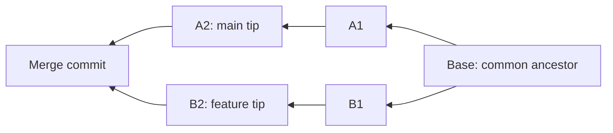

For each file, Git compares the version at the base with the versions on each branch:

- if only one side changed a file relative to the base, that side's version wins automatically
- if both sides changed the same file in the same way, or one side didn't touch it, it resolves cleanly
- if both sides changed the *same lines* differently, that's a conflict, and a human has to choose the result

Once every file is resolved, Git creates a new commit -- the merge commit -- whose tree reflects the resolved result and whose parents are both `A2` and `B2`. That single commit is what makes the DAG show two lines of history converging, as in the very first diagram of this document.

### The two outcomes side by side

The difference between the two comes down to a single question: does the current branch's tip already sit on the line of history leading to the other branch's tip? If yes, fast-forward; if no, a merge commit is required.

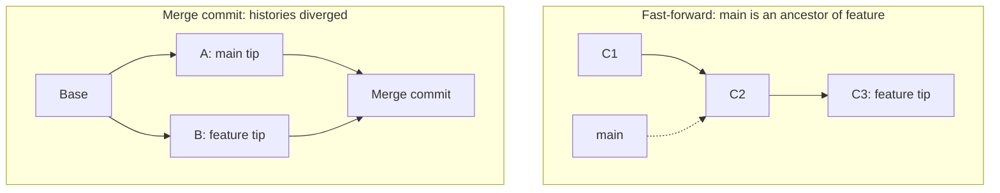

On the left, `main` only needs to move; there is no divergence to reconcile. On the right, both sides added commits the other doesn't have, so a new commit is the only way to represent "both of these histories are now part of the same line".

## Rebase, Briefly

Rebase is the other common way to reconcile diverged branches, and it produces a different shape of history to a merge rather than a different result. Instead of creating a merge commit that has two parents, rebase rewrites the commits on one branch so they appear to have started from the other branch's current tip, one at a time, as if they'd been written there from the start.

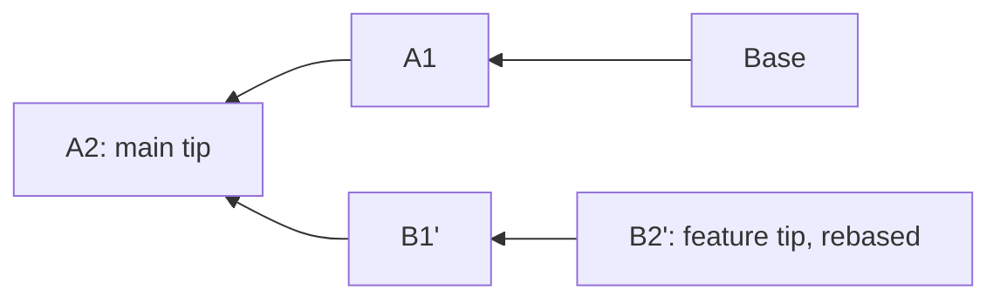

Compare this to the three-way merge diagram: there, `Base`, `A1`/`A2` and `B1`/`B2` all remain in the DAG, joined by a new merge commit. Here, `B1` and `B2` are replaced entirely by new commits `B1'` and `B2'`, which have the same changes but different parents, and therefore different hashes. This is why rebase is described as rewriting history: the original `B1` and `B2` still exist in the object database until garbage-collected, but no branch points at them any more, and anyone else who already had a copy of them now has a different, incompatible set of commits to yours. That's the standard reason for the advice not to rebase commits that have already been pushed and shared.

## What's Actually in a Repository Directory

Everything described so far, objects, the DAG, branches, tags, remote-tracking branches, packing, lives inside a single `.git` directory at the root of a working copy. That directory is the repository; the rest of the files you edit are just a checked-out snapshot of one tree object.

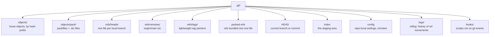

A few points worth calling out directly:

- `objects/` holds loose objects, each in a subdirectory named after the first two hash characters, plus `objects/pack/` for packfiles and their `.idx` companions, as covered above.
- `refs/heads/main` is literally a text file containing the 40- (or 64-) character hash `main` currently points to. `refs/remotes/origin/main` is the same idea for a remote-tracking branch. Once a repository has many refs, Git may bundle them into a single `packed-refs` file for efficiency, functionally equivalent to lots of small files.
- `HEAD` is a text file too, normally containing something like `ref: refs/heads/main` (a pointer to a branch, itself a pointer to a commit) rather than a commit hash directly; in detached HEAD state, it holds the commit hash itself.
- `index` is the binary file backing the staging area described earlier: the draft tree for the next commit.
- `logs/` holds the reflog: a local, time-ordered record of everywhere `HEAD` and each branch have pointed, which is how `git reflog` can recover commits that no ref currently points at.
- `hooks/` contains scripts (disabled by default, just example files) that Git can run automatically at points like before a commit or after a merge.

None of this is exposed as part of the DAG or the object model; it's the filesystem scaffolding that makes the DAG, the pointers, and the working directory all work together as one repository.

## Comparison with Other Version Control Systems

Git's design choices stand out more clearly against other systems, past and present.

### RCS (legacy, file-level, no networking)

RCS predates the idea of a shared repository. It manages version history for a single file at a time, on a single machine, using reverse deltas (the latest version is stored in full, older versions as diffs back from it). There's no concept of a commit spanning multiple files, no branching model beyond simple file-level revision trees, and no client-server or distributed operation. Tools like CVS were built on RCS-like storage to add multi-file, networked repositories, but inherited its per-file delta model.

### Subversion (centralised, directory-versioned)

Subversion (SVN) versions the whole repository tree, closer to Git's snapshot model than RCS's per-file deltas, but it is centralised: there's one authoritative repository on a server, and every commit requires network access to it. History is linear and identified by an incrementing global revision number rather than a content hash, so two people's local checkouts never disagree about what revision 4021 is. Branches and tags are directory copies within the same tree (`svn copy`), which is a lightweight operation on the server but conceptually heavier than a movable pointer, and merge tracking has to be layered on top explicitly rather than falling out of a DAG.

### Mercurial (distributed, comparable model)

Mercurial (`hg`) is the closest cousin to Git: distributed, snapshot-based, with commits identified by content hash and a DAG of changesets. The main differences are more in default workflow and tooling philosophy than in underlying model. Mercurial favours a simpler, more restricted command set and historically discouraged history rewriting (no built-in rebase until an optional extension), whereas Git exposes rewriting commands (`rebase`, `commit --amend`, `filter-branch`) as first-class, and treats branches as far more disposable, cheap, short-lived pointers by convention.

### Perforce (centralised, file-locking, large binary assets)

Perforce (P4) is centralised like Subversion but built for a different problem: very large repositories, including large binary assets (game art, media), where full distributed clones of the whole history would be impractical. It uses a central server as the single source of truth, supports exclusive file locking (useful for binary files that can't be merged line-by-line), and organises work through "changelists" rather than a DAG of hash-identified commits. It scales well for huge monorepos with big binaries, a case where Git historically struggles without extensions such as Git LFS.

### The underlying distinction

The dividing line that matters most is centralised versus distributed, and content-hash-identified versus sequential-number-identified:

- centralised systems (SVN, Perforce) need a server to define what "the current state" is, and history is a single line of numbered revisions
- distributed, hash-based systems (Git, Mercurial) let every clone hold the full history and compute the same hash for the same content independently, so two people can work offline and later reconcile via merge, with no central authority needed to agree on what came first

## Putting It Together

The reason this design holds together is that all four ideas are really one idea viewed from different angles:

- content-addressing (hashes) makes objects immutable and easy to deduplicate
- the DAG is simply what you get when immutable commits point at their immutable parents
- a branch is a cheap, movable label on a point in that graph
- a merge is a new commit added to the DAG with two parents instead of one, created after resolving the differences between the histories those parents represent

Everything else in Git -- rebasing, cherry-picking, `reflog`, tags -- is built from these same primitives: objects addressed by content, and pointers that move around a graph of them.
