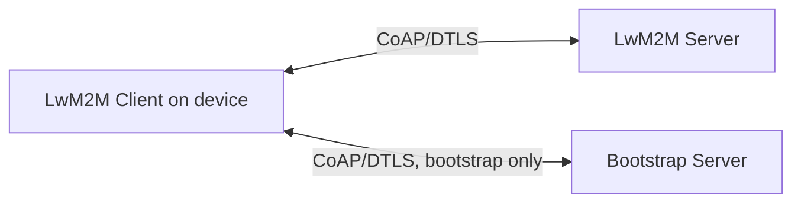
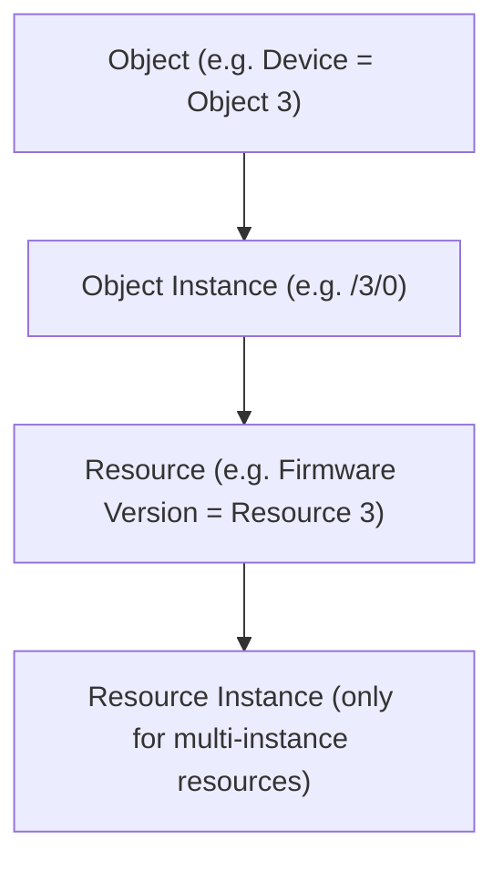
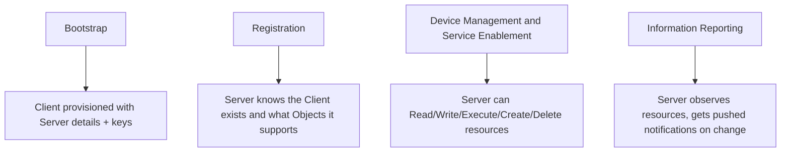
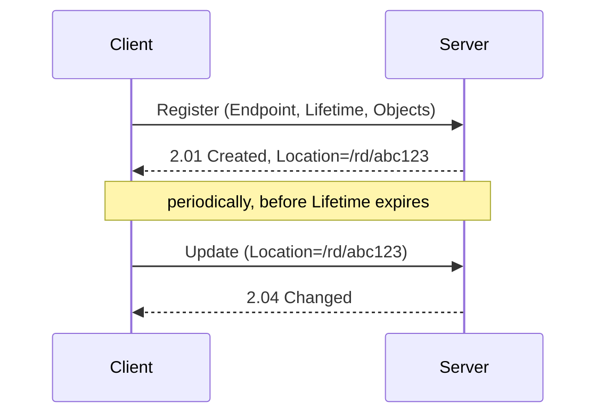
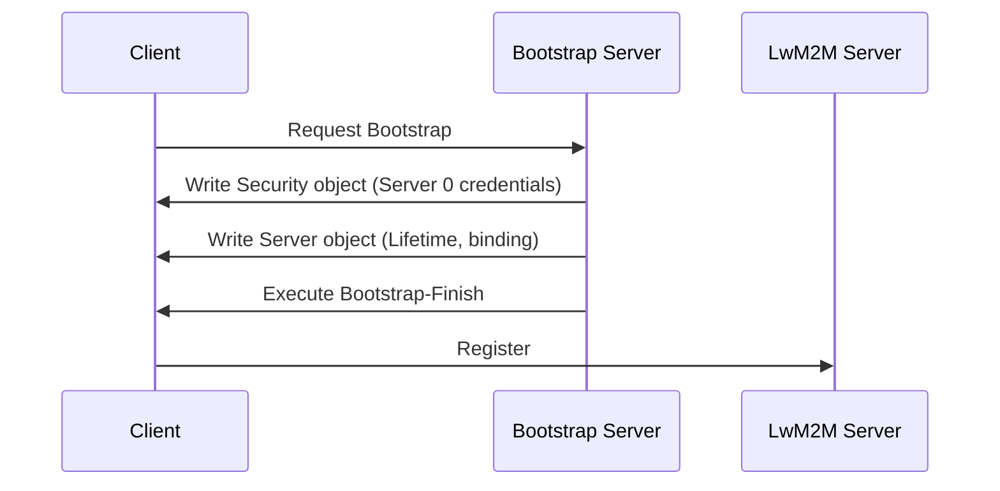
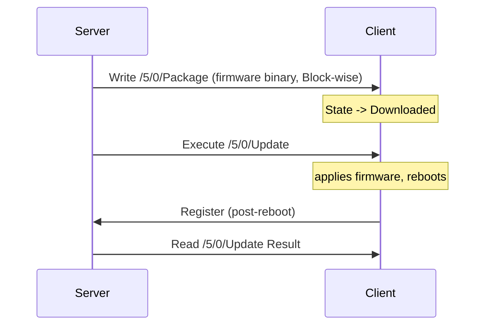

# LwM2M

## Purpose and scope

This document explains Lightweight M2M (LwM2M) at a mechanism level: the object model, the four interfaces, bootstrapping, and how firmware update fits into the protocol. It is the third of three companion documents -- *CoAP: A Deep Explainer* covers the transport LwM2M is built on, and *CBOR: A Deep Explainer* covers the payload encoding LwM2M uses for structured data -- and assumes both as read. Where a mechanism here is really a CoAP or CBOR mechanism wearing an LwM2M label, this document says so and points back rather than re-deriving it. It assumes general familiarity with embedded/firmware concepts but not prior exposure to device management protocols.

## 1. What problem LwM2M solves

A fleet of IoT devices in the field needs to be: registered so a server knows they exist, configured and reconfigured over their lifetime, monitored for health and connectivity, and updated with new firmware -- all over a link that may be high-latency, low-bandwidth, and only intermittently available (a device on NB-IoT PSM may only be reachable for seconds at a time). LwM2M (specified by OMA SpecWorks, currently at version 1.2) is a device management protocol built specifically for that environment, in contrast to protocols built for always-on, high-bandwidth links.

| | LwM2M | TR-069 (CWMP) | Custom MQTT-based |
|---|---|---|---|
| Transport | CoAP/UDP (usually) | SOAP/HTTP | MQTT/TCP |
| Designed for | Constrained radio (cellular IoT, LPWAN) | Fixed-line CPE (routers, gateways) | Whatever the implementer chose |
| Data model | Standardised Object/Resource registry | Standardised but XML/SOAP-heavy | Ad hoc |
| Typical payload overhead | Very low (CoAP + CBOR/TLV) | High (XML) | Depends |
| Bootstrapping | Standardised | Standardised (ACS) | Ad hoc |

LwM2M's contribution over a hand-rolled MQTT scheme is a standardised **Object/Resource model** -- so "battery level" or "firmware version" means the same thing, at the same path, on every conformant client and server, rather than being reinvented per project.

## 2. Architecture: three roles



- **LwM2M Client** -- runs on the device. Holds the Object/Resource data, responds to server operations, initiates registration.
- **LwM2M Server** -- the device management platform. Reads/writes resources, observes them, issues Execute operations, receives registration updates.
- **Bootstrap Server** -- a distinct, more privileged role used only to provision a device with its Server connection details and security credentials, before the device has ever spoken to its actual Server. A device may not need one on every connection (see section 6) but the role always exists conceptually.

A single device typically has a relationship with one Bootstrap Server and one (or occasionally more) LwM2M Server; the security details of each relationship are held in the client's own Security object (Object ID 0), described in section 8.

## 3. The object model

LwM2M structures all device data into a strict four-level hierarchy:



- **Object** -- a defined data structure with an Object ID, describing one area of device functionality (Device, Connectivity Monitoring, Firmware Update, and so on). Object IDs 0-10 and a growing standardised range are reserved by OMA SpecWorks; vendors may define custom objects starting from ID 10000 upwards for functionality the standard registry does not cover.
- **Object Instance** -- a concrete instantiation of an Object. Most Objects support multiple instances (e.g. multiple Connectivity Monitoring instances for a multi-bearer device); the instance number is the second path segment.
- **Resource** -- a single data point or executable action within an Object Instance, identified by a Resource ID defined in that Object's specification.
- **Resource Instance** -- only exists where a Resource itself is multi-instance (an array-valued resource); otherwise the Resource IS the value, with no further nesting.

This gives every piece of data in the system a stable path, exactly analogous to a filesystem path or a URI:

```
/3/0/3
 |  |  |
 |  |  +-- Resource 3 (Firmware Version)
 |  +----- Object Instance 0
 +-------- Object 3 (Device)
```

That path is, at the wire level, the CoAP Uri-Path option from the companion CoAP document -- an LwM2M Read of `/3/0/3` is a CoAP GET with Uri-Path segments `3`, `0`, `3`.

### Standard Objects (illustrative, not exhaustive)

| Object ID | Name | Purpose |
|---|---|---|
| 0 | LwM2M Security | Server URIs, security mode, keys/certificates per server relationship |
| 1 | LwM2M Server | Lifetime, binding mode, notification storing behaviour |
| 3 | Device | Manufacturer, model, firmware version, reboot/factory-reset Execute resources |
| 4 | Connectivity Monitoring | Signal strength, bearer type, cell ID |
| 5 | Firmware Update | Package delivery, update trigger, update state/result |
| 6 | Location | GPS coordinates, timestamp |
| 7 | Connectivity Statistics | Data volume sent/received |

Vendors extending this registry for device-specific functionality (custom telemetry, application-specific configuration, and so on) follow the same four-level model on custom Object IDs -- the mechanism does not change, only which IDs are in use.

## 4. The four interfaces

LwM2M defines exactly four logical interfaces between Client and Server. Each is a distinct set of operations, though all of them are, underneath, CoAP request/response or Observe exchanges.



### Bootstrap

Covered in detail in section 6.

### Registration

The Client initiates a **Register** operation (CoAP POST to `/rd`) once it has its Server connection details, sending its Endpoint Name, a requested **Lifetime**, its supported Binding mode (which transport bindings it will accept -- UDP, SMS, non-IP, etc), and an Object/Object Instance list describing what it supports. The Server replies with a Location path identifying this registration.

Before the Lifetime expires, the Client must send an **Update** (a lighter-weight CoAP POST to the Location path from registration) to keep the registration alive; if it doesn't, the Server considers the Client's registration stale and treats it as offline. A clean disconnect uses **De-register**.



Lifetime is a direct trade-off against battery and airtime: a short Lifetime means the Server notices a dropped device quickly but the Client spends more radio time re-registering; a long Lifetime saves battery but means a genuinely dead device may look "registered" for longer than it has actually been reachable.

### Device Management and Service Enablement

This is the interface most people mean when they say "LwM2M operations" -- the Server acting on a specific resource path:

| Operation | CoAP method | Meaning |
|---|---|---|
| Read | GET | Retrieve current value(s) |
| Write | PUT or POST | Set value(s) |
| Write-Attributes | PUT | Set Observe notification conditions (min/max period, thresholds) |
| Execute | POST | Trigger an action with no persistent value (e.g. Reboot) |
| Create | POST | Create a new Object Instance |
| Delete | DELETE | Remove an Object Instance |
| Discover | GET | Retrieve the Object/Resource structure supported |

Each of these is literally the CoAP method named in the table, sent to the resource's Uri-Path, with the payload (where present) encoded in one of the content formats described in section 5.

### Information Reporting

This is CoAP's Observe option (see the CoAP companion document), used unmodified: the Server sends a Read with the Observe option set, and the Client keeps pushing new values as they change, governed by the Write-Attributes set on that resource (minimum period between notifications, maximum period forcing a notification even if unchanged, and value-change thresholds). This is how a Server monitors, say, signal strength or a sensor reading continuously without polling.

## 5. Data formats (payload encodings)

The Device Management operations above need a way to encode a resource's value (or several resources' values) into the CoAP payload. LwM2M supports several Content-Format options, negotiated the same way any CoAP Content-Format is:

| Format | Use case |
|---|---|
| Plain Text | A single Resource, primitive type, human-readable |
| Opaque | A single Resource, raw binary (e.g. a firmware package) |
| TLV | Multiple Resources/Instances in one compact binary payload, LwM2M-specific encoding |
| SenML JSON | Multiple Resources, text-based, timestamped, human-readable |
| SenML CBOR | Multiple Resources, binary, timestamped, most compact |

TLV was LwM2M's original compact binary format, defined before CBOR was standardised; SenML CBOR has since become the preferred compact format for new deployments because it reuses a general IETF standard (see the CBOR companion document) rather than an LwM2M-specific scheme, and because SenML's record structure natively carries a timestamp per value, useful for Information Reporting notifications that batch several readings together.

Unlike SenML CBOR, TLV is an LwM2M-specific byte format rather than a general one, so it is worth showing its Type byte structure directly:

```wavedrom
{reg: [
  {bits: 3, name: 'Length (if Length Type = 00)'},
  {bits: 2, name: 'Length Type'},
  {bits: 1, name: 'ID Length'},
  {bits: 2, name: 'Type of ID'}
], config: {bits: 8, lanes: 1}}
```

Reading this: the top 2 bits say what kind of thing this TLV entry is (Object Instance, Resource, multi-Resource, or Resource with a value); the next bit says whether the Identifier that follows is 8 or 16 bits; the next 2 bits say whether the Length that follows is encoded directly in the remaining 3 bits of this same byte, or needs its own following 8/16/24-bit field. A short Resource value (a battery percentage, say) can fit Type, Identifier, and Length into 2-3 bytes total; a large value (a firmware Opaque blob) spills its length into the following bytes rather than this one.

A SenML CBOR payload is, at the byte level, exactly what the CBOR document describes: an array of maps, each map using short integer keys (by SenML convention, `0` for base name, `2` for value, `6` for time, and so on) rather than the human-readable string keys used in that document's worked examples -- the byte-level rules (major types, additional info, map encoding) are identical, only the key/field convention is LwM2M/SenML-specific.

## 6. Bootstrapping

A device fresh from manufacture has no Server relationship yet -- bootstrapping is how it gets one. LwM2M defines several bootstrap modes:

- **Factory Bootstrap** -- Security and Server object instances are provisioned at manufacture time, baked into the device. No bootstrap exchange happens at all in the field.
- **Client-Initiated Bootstrap** -- the device, on first boot (or after a factory reset), contacts a pre-configured Bootstrap Server, which then Writes the Security and Server object instances the device needs, then instructs the device (via a Bootstrap-Finish Execute) to proceed to Registration with its real Server.
- **Server-Initiated Bootstrap** -- the Bootstrap Server, rather than waiting to be contacted, pushes bootstrap data to a device it already knows about, e.g. to rotate credentials or point it at a new Server.
- **Smartcard Bootstrap** -- bootstrap data is provisioned via SIM/smartcard rather than over the air, relevant where the SIM provisioning process already exists for network attach.



The Bootstrap Server's own connection to the Client uses its own entry in the Security object (a distinct Object Instance from the one describing the eventual LwM2M Server), so the bootstrap channel can use a different security mode or credential set than the operational one it is provisioning.

## 7. Security

Object 0 (Security) holds, per Server relationship (one Object Instance per Server, including the Bootstrap Server itself), the Server URI, which of four security modes applies, and the corresponding keys:

| Mode | Mechanism |
|---|---|
| 0 -- Pre-Shared Key (PSK) | DTLS PSK cipher suites; a shared secret per device |
| 1 -- Raw Public Key (RPK) | DTLS with a bare public key, no certificate chain |
| 2 -- Certificate | Full X.509 certificate chain, DTLS certificate-based handshake |
| 3 -- NoSec | No DTLS at all -- plain CoAP, generally only acceptable for lab/test |

The certificate formats, chain validation, and key types behind modes 1 and 2 are covered in *Certificates and Keys: A Deep Explainer* and are not repeated here; from LwM2M's perspective, the Security object simply selects which DTLS configuration the underlying CoAP layer should use for that Server relationship, exactly as described in the CoAP companion document's security section.

## 8. Firmware Update (Object 5)

Firmware Update is worth walking through in detail because it exercises almost every mechanism covered above and in the two companion documents.

Object 5 exposes (among others) a **Package** resource (Opaque, for pushing the firmware binary directly via Write), a **Package URI** resource (a URL the Client can pull the package from), an **Update** Execute resource (triggers the actual flash/apply step), and **State**/**Update Result** resources the Server can Read or Observe to track progress.

### Push delivery



Because a firmware image is far larger than a single UDP datagram, the Write of the Package resource uses CoAP Block-wise transfer (see the CoAP companion document) -- each block is its own CoAP exchange, individually retransmittable, which matters on a lossy NB-IoT link where re-sending an entire image because of one dropped block would be wasteful of both airtime and battery.

### Pull delivery

Alternatively, the Server Writes a URI to Package URI rather than the binary itself, and the Client fetches the package on its own schedule (over CoAP, or another protocol such as HTTP, depending on what the URI scheme and the Client's capabilities support) -- useful where the Client wants to control exactly when it spends the airtime, rather than the Server pushing at a time that may not suit the device's power/connectivity window.

### State machine

The State and Update Result resources track progress through a small state machine (roughly: Idle, Downloading, Downloaded, Updating), with Update Result recording the outcome (success or a specific failure reason) once an Execute /Update has run. A Server observing these resources (Information Reporting again) sees firmware rollout progress across a fleet without polling each device.

## 9. Practical considerations on constrained links

- **Payload size vs radio link.** Every LwM2M exchange is ultimately a CoAP exchange, so the CE-level/repetition trade-offs from the NB-IoT explainer apply directly -- a large Write or a firmware Block still costs proportionally more airtime and battery on a device in a poor-coverage CE level.
- **Lifetime vs battery.** A short Registration Lifetime keeps the Server's view of "online" accurate but costs more periodic Update traffic; this is a deployment-level tuning decision, not a protocol default to leave unexamined.
- **Queue Mode binding.** For devices that sleep between radio windows (PSM), the Server cannot simply send a request whenever it likes -- Queue Mode binding means the Server queues operations and only delivers them when the Client next wakes and re-registers/updates, rather than assuming the Client is always reachable.
- **Custom Objects.** Anything the standard registry does not cover -- device-specific configuration, application data -- follows the same four-level Object/Instance/Resource/Resource-Instance model on a custom Object ID; the mechanism never changes, only which IDs and Resource definitions are in use for a given deployment.
