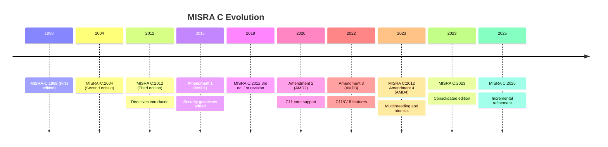
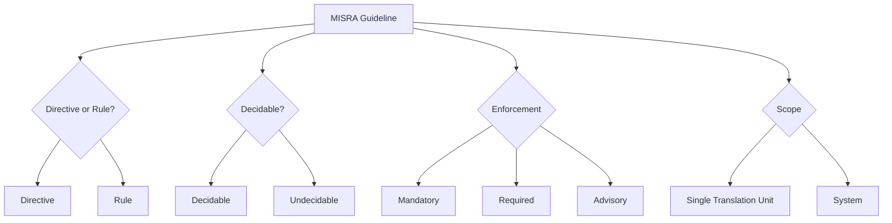

# MISRA C in depth

## 1. What MISRA C Is and Why It Exists

MISRA C is a set of software development guidelines for the C language, produced by the MISRA Consortium (Motor Industry Software Reliability Association). The goal is not "good style" in the abstract -- it is removing constructs from C that are ambiguous, undefined, unspecified, or implementation-defined, so that the same source code behaves identically across compilers, targets, and optimisation levels.

C was never designed for safety-critical use. It trusts the programmer completely: pointer arithmetic, implicit conversions, undefined behaviour on overflow, and a preprocessor that can rewrite the language itself. MISRA C constrains this trust. It defines a *subset* of C that is safe to reason about statically, both by a human reviewer and by a static analysis tool.

> **Note:** MISRA C is a coding guideline, not a language variant. Code that violates MISRA C still compiles and runs -- MISRA C is about eliminating behaviours that are technically legal C but practically dangerous.

> **Important:** The MISRA C document itself is copyrighted and commercially licensed, not freely reproducible. A rule number and one-line summary from a static analyser's report is not the guideline -- the actual document contains the rationale, the exact wording of the requirement, compliant/non-compliant code examples, and cross-references to related rules. A team relying purely on a shared PDF, a colleague's memory, or tool tooltips will misapply rules and mis-scope deviations. Every developer who writes code that has to be MISRA compliant should have their own licensed copy (or paid-for organisational access) of the current edition, both to understand *why* a rule exists -- essential for writing sound deviation rationale -- and because MISRA's own licensing terms require it for compliant use in a professional context.

## 2. History and Origins

MISRA originated in the UK automotive sector. Two of its founding members, Ford and Land Rover, discovered independently that they were each developing in-house coding guidelines for embedded C used in engine control units. MISRA C originated when two of the original members of the MISRA project, Ford and Land Rover, became aware they were working separately on coding guidelines for embedded C. This led to a collaborative, cross-industry standard rather than two competing internal ones.

Timeline of major editions:

Key structural change: for the first two editions (1998, 2004), every guideline was a "Rule". With the publication of MISRA C:2012 a new category of Guideline was introduced -- the Directive, whose compliance is more open to interpretation, or relates to process or procedural matters. This Rule/Directive split still exists today.

MISRA C has since spread well beyond its automotive origins. Although originally specifically targeted at the automotive industry, MISRA C has evolved as a widely accepted model for best practices in sectors including automotive, aerospace, telecom, medical devices, defence, railway, and others. It is also referenced by other standards -- for example, ISO 26262-6:2018 Part 6 cites MISRA C:2012, and the AUTOSAR General Software Specification requires that BSW modules written in C shall conform to MISRA C.

## 3. Why Use It: Pros and Cons

### Pros

- **Undefined/unspecified behaviour elimination.** Most rules target specific clauses of the ISO C standard that are undefined, unspecified, or implementation-defined -- the exact bugs that are invisible in testing but appear on a different compiler, target, or optimisation flag.
- **Portability.** A MISRA-compliant module behaves the same on GCC, IAR, or Keil, which matters when you have firmware families sharing a codebase across silicon vendors.
- **Auditable process, not just style.** MISRA Compliance:2020 defines Guideline Enforcement Plans (GEP) and Deviation Records, giving you a documented trail for functional safety assessors (ISO 26262, IEC 61508, DO-178C-adjacent audits).
- **Tooling maturity.** Every major static analyser (LDRA, Parasoft, Perforce QAC/Klocwork, Polyspace, PC-lint/PC-lint Plus, Cppcheck premium) has first-class MISRA support, so adoption doesn't require inventing your own checker.
- **Industry lock-in effect.** If you supply automotive, aerospace, medical, or rail customers, MISRA compliance is frequently a contractual gate, not a nice-to-have.

### Cons

- **False sense of safety.** MISRA compliance proves the *absence of certain classes of undefined behaviour*. It says nothing about whether the logic is correct, whether the requirements are right, or whether concurrency design is sound.
- **Volume and friction.** 200+ guidelines is a lot to internalise. New team members hit a wall of unfamiliar restrictions (no recursion, no dynamic allocation in some profiles, restricted pointer arithmetic) that can feel arbitrary until the rationale is understood.
- **Legacy codebase cost.** Retrofitting MISRA onto an existing non-compliant codebase can produce thousands of violations, most low-risk. This is exactly why baselining and risk-based prioritisation exist as a stated best practice -- teams "set baselines" and "prioritize violations based on risk" rather than fixing everything at once.
- **Tooling divergence.** Not every tool implements every rule identically, particularly the more "undecidable" ones requiring manual review (for example Directive 1.1 on implementation-defined behaviour documentation). Two compliant tool reports for the same codebase can disagree.
- **Deviation overhead.** Legitimate deviations (raw pointer arithmetic in a memory-mapped register driver, for instance) need formal justification, review, and sign-off, which is process overhead some teams resent.

## 4. Alternatives and How They Relate

MISRA C is not the only C/C++ coding standard, and it is common to combine it with others rather than choose one exclusively.

| Standard | Focus | Relationship to MISRA C |
|---|---|---|
| CERT C | Security vulnerabilities (buffer overflow, integer overflow, format string attacks) | Complementary -- CERT C is security-first, MISRA C is safety/portability-first. Significant overlap but different emphasis. |
| CWE/SANS Top 25 | Catalogue of common weakness types, not a style guide | Used to cross-map static analysis findings; not a coding standard to write against directly. |
| JPL C Coding Standard | NASA/JPL, derived partly from MISRA, adds "Power of Ten" rules (no recursion, no dynamic memory after init, bounded loops) | Stricter subset in places, aimed at flight software rather than general embedded/automotive. |
| Barr Group Embedded C Coding Standard | Practical embedded C style guide, less formal than MISRA | Lighter-weight, no formal deviation/compliance framework -- more a house style than an audit standard. |
| AUTOSAR C++14 | Automotive C++ guidelines pre-2023 | Largely superseded by MISRA C++:2023 for coding rules, though AUTOSAR still governs broader architecture/toolchain concerns. |
| MISRA C++:2023 | The C++ sibling standard | Same governing body, developed jointly with AUTOSAR, targets C++17. |

> **Important:** MISRA C and CERT C are frequently applied together in practice, particularly where a project needs both functional safety sign-off and security hardening (for example, connected embedded devices like NB-IoT gas meters, where an attacker on the network is a realistic threat model alongside classic safety hazards).

## 5. Rule Categories and Classification

MISRA guidelines are classified along several independent axes, and a given rule carries values on all of them simultaneously.

### 5.1 Guideline type

- **Directive** -- guidance where compliance requires judgement, process, or information outside the source text itself (for example, "document all implementation-defined behaviour relied upon").
- **Rule** -- guidance that is, in principle, fully decidable from the source code alone.

### 5.2 Decidability

- **Decidable** -- a tool can determine compliance with certainty from the translation unit(s) in scope.
- **Undecidable** -- compliance cannot be fully automated; manual review is required even with best-in-class tooling.

### 5.3 Enforcement category (severity)

- **Mandatory** -- no deviation permitted, ever. Violating a Mandatory rule means the code is not MISRA compliant, full stop.
- **Required** -- compliance is expected; deviations are permitted but must be formally recorded and justified.
- **Advisory** -- best practice, non-compliance does not need a formal deviation record, though good practice is to still note it.

### 5.4 Scope

- **Single translation unit** -- checkable by looking at one `.c` file (with its includes) in isolation.
- **System** -- requires whole-programme/link-time analysis (for example, checking that a function is only ever called with values in a certain range across the entire codebase).

## 6. Deviations

A deviation is the formal mechanism for permitting a documented violation of a Required or Advisory guideline (Mandatory guidelines cannot be deviated from at all).

The framework, defined in MISRA Compliance:2020, distinguishes two related artefacts:

- **Deviation Record** -- a project-specific, instance-level justification: which guideline, which line(s) of code, why the violation is safe in this context, and who approved it.
- **Deviation Permit** -- a pre-approved, reusable justification for a recurring pattern (for example, "pointer arithmetic on a memory-mapped peripheral register block is permitted under Rule 18.4 across this driver layer"), so every instance doesn't need a fresh record.

A typical deviation record captures:

1. The guideline number and short description
1. The specific file/function/line(s) affected
1. The technical rationale for why the violation does not introduce the risk the rule exists to prevent
1. Any compensating control (additional review, test coverage, runtime check)
1. Approval sign-off (name, role, date)

> **Warning:** A deviation record that just says "required for performance" or "legacy code" without a technical safety argument is not a deviation -- it is an unmanaged violation with paperwork attached. Auditors will reject it.

Guideline Enforcement Plans (GEP) and Guideline Compliance Summaries (GCS) sit above individual deviations: the GEP states, per guideline, how it will be enforced (tool, manual review, or a combination) and to what confidence; the GCS is the final report showing compliance status guideline-by-guideline, including deviation counts.

## 7. Tooling

Static analysis is the practical enforcement mechanism for the majority of rules, with manual review reserved for undecidable guidelines.

Commonly used MISRA-capable tools:

- **LDRA tool suite** -- long-standing MISRA working group contributor, same-day support for new releases
- **Parasoft C/C++test** -- claims full guideline coverage including MISRA C++:2023
- **Perforce QAC / Klocwork** -- widely used in automotive supply chains
- **Polyspace (MathWorks)** -- pairs static analysis with formal/abstract interpretation, useful for provable absence of runtime errors, not just MISRA text-matching
- **PC-lint Plus** -- lighter-weight, common in smaller embedded teams
- **Cppcheck (premium/MISRA add-on)** -- open-source core with a commercial MISRA rule add-on
- **IAR C-STAT** -- static analysis bundled directly into IAR Embedded Workbench, useful where the toolchain is already IAR-based since it needs no separate build integration

Practical tooling guidance that recurs across vendor material:

1. **Know your version.** Rule numbers are not stable across editions -- a tool flagging "Rule 21.2" against MISRA C:2023 will not necessarily mean the same thing as the equivalent numbered rule elsewhere, particularly given MISRA C:2025 permanently retiring renumbered rule identifiers rather than reusing them.
1. **Continuous checking beats periodic sweeps.** Catching a violation at commit time is cheaper than during a pre-release compliance sweep across a mature codebase.
1. **Baseline legacy code.** Suppress/accept existing violations as a known baseline, then gate new code strictly, rather than blocking all delivery until a legacy backlog is cleared.
1. **Risk-weight the backlog.** Not all violations carry equal risk; triage by guideline severity (Mandatory > Required > Advisory) and by the safety criticality of the affected module.
1. **Fix tool version and configuration.** Because some guidelines are undecidable or tool-interpretation-dependent, the specific tool version used for compliance claims should be fixed and documented, not left to float.

> **Note:** MISRA explicitly treats AI-generated code the same as handwritten code for compliance purposes -- there is no exemption or separate rule set for machine-authored source.

### 7.1 Enforce compliance at code review, not after the fact

A static analysis report that nobody is required to act on is decoration, not compliance. MISRA compliance only means something operationally if it is a gate, not a report:

- New/changed code should be run through the static analyser as part of CI, and the pull request should fail (or be flagged for explicit override) on any new Mandatory or Required violation.
- Reviewers should treat a new, unexplained violation the same way they'd treat a failing unit test -- it blocks merge until it's fixed or a deviation is raised and approved.
- Deviations should be proposed and reviewed *in* the pull request (linking to the Deviation Record or Permit), not retrofitted weeks later during a separate "compliance sweep".
- Baseline violations in legacy code are tracked separately and don't block unrelated changes, but any line a PR *touches* is fair game for enforcement -- this is how legacy debt gets paid down incrementally rather than all at once or never.

Checking compliance only at a release milestone turns MISRA into an audit exercise that generates a large, late, demoralising backlog. Checking it at review time turns it into a habit.

### 7.2 Why tools cannot check everything

Not every guideline is mechanically decidable from source text alone, even with the best commercial analyser. A few guidelines that require human judgement no tool can fully substitute for:

- **Directive 1.1** -- that all implementation-defined behaviour relied upon is documented and understood. A tool cannot know what the developer understands, only what's written down.
- **Directive 4.14** -- that values received from external sources are validated before use. A tool can confirm *some* check exists on a variable, but not whether it's the *correct* check for that value's valid range, or whether it covers every path that consumes the value.
- **Directive 4.1** -- that run-time failures are minimised, covering things like resource exhaustion and hardware fault handling. Whether a given design adequately "minimises" failure is a judgement call, not a syntactic property.

This is exactly why Directives (as opposed to Rules) exist as a distinct category, and why a Guideline Enforcement Plan has to state, per guideline, whether it's enforced by tool, by manual review, or both.

## 8. MISRA C:2012 to MISRA C:2023: What Changed

MISRA C:2012 was extended over a decade through four amendments before being folded into a single consolidated edition.

- **AMD1 (2016)** -- added new security-focused guidelines, bringing the total to 156 rules and 17 directives (173 guidelines).
- **AMD2 (2020)** -- added two new rules covering C11 core functionality, for 175 guidelines total.
- **AMD3 (2022)** -- added 24 new rules and 1 new directive covering C11/C18 features previously blocked outright by Rule 1.4, bringing the total to 200 guidelines.
- **AMD4 (March 2023)** -- added Rules and Directives for multithreading and atomic types, plus clarifications aligning guidance with how developers actually use the language.

In May 2023 MISRA published MISRA C:2023 (MISRA C Third edition, Second revision), which incorporates Amendments 2 to 4 and Technical Corrigendum 2, and adds support for C11 and C17 language features. In other words, MISRA C:2023 is not a from-scratch rewrite -- it is the four amendments plus corrigenda, consolidated into one authoritative document so teams no longer need to track a base edition plus a stack of separate amendment PDFs.

## 9. MISRA C:2023 to MISRA C:2025: What Changed

MISRA C:2025 was released two years after MISRA C:2023 and, although a less substantive update than its predecessor, built on the efficiency of MISRA C:2023 with policy changes, enhancements, and new guidelines. It was announced at the Embedded World event in Nuremberg, Germany, in March 2025.

Headline numbers: MISRA C:2023 had 221 guidelines; MISRA C:2025 contains 224 guidelines in total, with 4 new rules introduced, 2 rules removed, 1 rule disapplied by default, 3 rules renumbered, and 13 rules modified.

The substantive changes:

### New rules

- Four new rules address tentative definitions in headers (8.18), external declarations inside source files (8.19), implicit pointer-to-NULL comparisons (11.11), and reading inactive union members (19.3).
- Rule 19.3 in particular loosens a previously blanket prohibition: it eases the use of unions by separating consistent use of one variant member from the stricter, genuinely unsafe case of changing the active member and reading a different one, with regular "safe" reads now advisory rather than forbidden outright.

### Retired/relaxed rules

- The long-standing single-point-of-exit rule (historically Rule 15.5, restricting multiple return statements per function) is now **disapplied**. MISRA no longer expects compliance with it, although other safety standards such as IEC 61508 and ISO 26262 may still require similar practices in specific project contexts.
- For the first time, the release introduces deleted and disapplied rules as distinct categories, and rule numbers that are deleted will not be reused in future versions -- so a tool report referencing an old rule number can never be ambiguous about which edition's rule it meant.

### Extended/clarified rules

- Pointer conversion rules (11.3, 11.4, 11.6) now account for the intptr_t family, giving more headroom for working with integers and the integer representation of addresses -- relevant for anything doing pointer tagging or low-level memory-mapped access, which was previously blocked under a blanket address-manipulation prohibition.
- Directive 4.6, which requires size- and signedness-indicating typedefs in place of basic numerical types, has had floating point types removed from its scope, because their characteristics extend beyond just size.
- Example code that previously included `<stdlib.h>` purely to obtain the definition of `NULL` has been updated to use `<stddef.h>`, which is universally available across implementations.
- Developers now have increased flexibility to terminate switch clauses (for example with return or continue), reducing audit friction.

### Practical effect for legacy compliance work

By removing obsolete rules, the standard reduces compliance overhead that previously bogged down development teams -- for example, certain restrictions on declaration placement have been relaxed when they don't affect safety, making refactoring simpler. This reorganisation effort is explicitly framed as laying groundwork for the next version rather than being an end state in itself.

> **Note:** MISRA C:2025 does not drop C90/C99 support. It continues to cover C90, C99, and C11/C18, so a project pinned to an older C standard is not forced onto newer language features by upgrading the guideline edition.

## 10. Key Rules Worth Knowing

A non-exhaustive set of rules that come up constantly in practice, useful as a mental checklist rather than a substitute for the full text. Guidelines that are **new in MISRA C:2025** are marked explicitly; everything else marked "(Required)"/"(Mandatory)" with no version tag has been carried forward from MISRA C:2023 (or earlier) unchanged in substance.

- **Rule 1.3 (Required)** -- no undefined or critical unspecified behaviour anywhere in the programme. *Carried forward from MISRA C:2023.*
- **Rule 2.2 (Required)** -- no dead code with no effect on programme behaviour. *Carried forward from MISRA C:2023.*
- **Rule 8.4/8.5/8.6 family** -- consistent, single declarations for objects and functions across translation units. *Carried forward from MISRA C:2023.*
- 🆕 **Rule 8.18 -- NEW IN MISRA C:2025** -- restricts tentative definitions in headers, closing ambiguity about whether a declaration is acting as a definition.
- 🆕 **Rule 8.19 -- NEW IN MISRA C:2025** -- restricts external declarations inside source files, for the same reason as 8.18.
- **Rule 9.1 (Mandatory)** -- no read of an object with automatic storage duration before it has been initialised. *Carried forward from MISRA C:2023.*
- **Rule 10.x series** -- the "essential type model": implicit conversions between essentially different types (char, signed, unsigned, float, bool) are restricted, catching a large class of silent truncation/sign-extension bugs. *Carried forward from MISRA C:2023.*
- **Rule 11.3/11.4/11.6** -- restrictions on casting between pointer types and between pointers and integers. *Carried forward from MISRA C:2023, but the scope was extended in MISRA C:2025 to accommodate the intptr_t family.*
- 🆕 **Rule 11.11 -- NEW IN MISRA C:2025** -- no implicit comparison of a pointer to NULL; comparisons must be explicit.
- **Rule 14.4 (Required)** -- the controlling expression of an if/iteration statement shall have essentially Boolean type. *Carried forward from MISRA C:2023.*
- ⚠️ **Rule 15.5 -- DISAPPLIED IN MISRA C:2025** -- formerly restricted multiple return points per function (the "single point of exit" rule); MISRA no longer expects compliance with it at all, though downstream safety standards (IEC 61508, ISO 26262) may still require similar practice on specific projects.
- **Rule 17.2 (Required)** -- no recursion, direct or indirect. *Carried forward from MISRA C:2023.*
- **Rule 18.1/18.4 family** -- restrictions on pointer arithmetic, particularly arithmetic that could run off the end of an array. *Carried forward from MISRA C:2023.*
- 🆕 **Rule 19.3 -- NEW IN MISRA C:2025** -- restricts reading a union member other than the one last written, but with an exception carved out for consistent, safe single-member use (this is a loosening as well as a new rule -- see Section 9).
- **Rule 21.x series** -- restrictions or outright bans on standard library functions with well-known undefined-behaviour footguns (`gets`, unchecked `sprintf`, certain `<stdlib.h>` allocation patterns). *Carried forward from MISRA C:2023.*
- **Directive 1.1 (Required)** -- any implementation-defined behaviour the programme's output depends on must be documented and understood. *Carried forward from MISRA C:2023.* This is the canonical example of an undecidable Directive requiring manual review rather than tooling alone (see Section 7.2 for a worked example of an undecidable guideline).
- **Directive 4.6** -- use of sized/signedness-explicit typedefs (`uint16_t`, `int32_t`) in place of `int`, `short`, `long`. *Carried forward from MISRA C:2023, but narrowed in MISRA C:2025 to exclude floating point types from its scope.*

> **Note:** MISRA C:2025 also renumbered three existing guidelines into more appropriate sections and deleted two rules outright (folding their intent into other guidelines). Deleted/renumbered rule numbers are permanently retired and will not be reused, so an old rule number in a legacy tool report always refers unambiguously to the pre-2025 guideline.

## 11. Summary

- MISRA C exists to remove undefined, unspecified, and implementation-defined behaviour from C, not to enforce a house style.
- It splits guidelines into Directives (judgement/process) and Rules (code-derivable), each further tagged Mandatory/Required/Advisory and Decidable/Undecidable.
- MISRA C:2023 consolidated a decade of amendments (AMD1 through AMD4) into one document; MISRA C:2025 is a deliberately incremental refinement adding 4 rules, removing 2, disapplying 1 (single point of exit), and clarifying roughly a dozen more.
- Deviations are the formal, auditable mechanism for permitted violations of Required/Advisory rules; Mandatory rules admit no deviation.
- Compliance is a tooling-plus-process exercise: static analysis handles decidable rules, manual review and documentation (Guideline Enforcement Plans, Deviation Records) handle the rest -- and some guidelines (Directive 4.14 being the clearest example) can never be fully mechanised, because a tool can confirm a check exists without knowing whether it's the *right* check.
- Compliance only works as a gate if it's enforced at code review/CI time on every change, not as a one-off pre-release sweep against a growing backlog.
- The guideline text itself is licensed, not freely reproducible -- every developer writing MISRA-relevant code needs their own copy of the current edition, not just a tool's one-line rule summaries.
- MISRA C is commonly paired with CERT C for security, and sits alongside stricter derivatives like the JPL Power of Ten rules for the most safety-critical domains.
