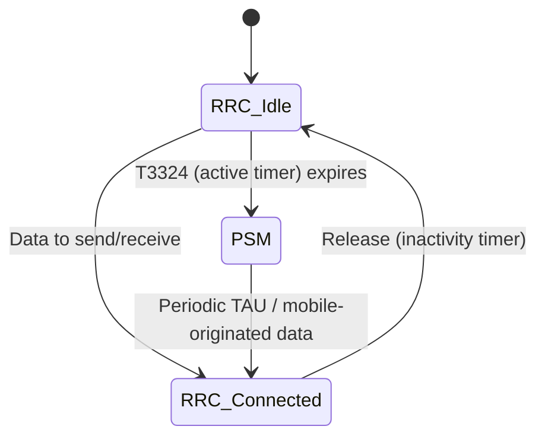
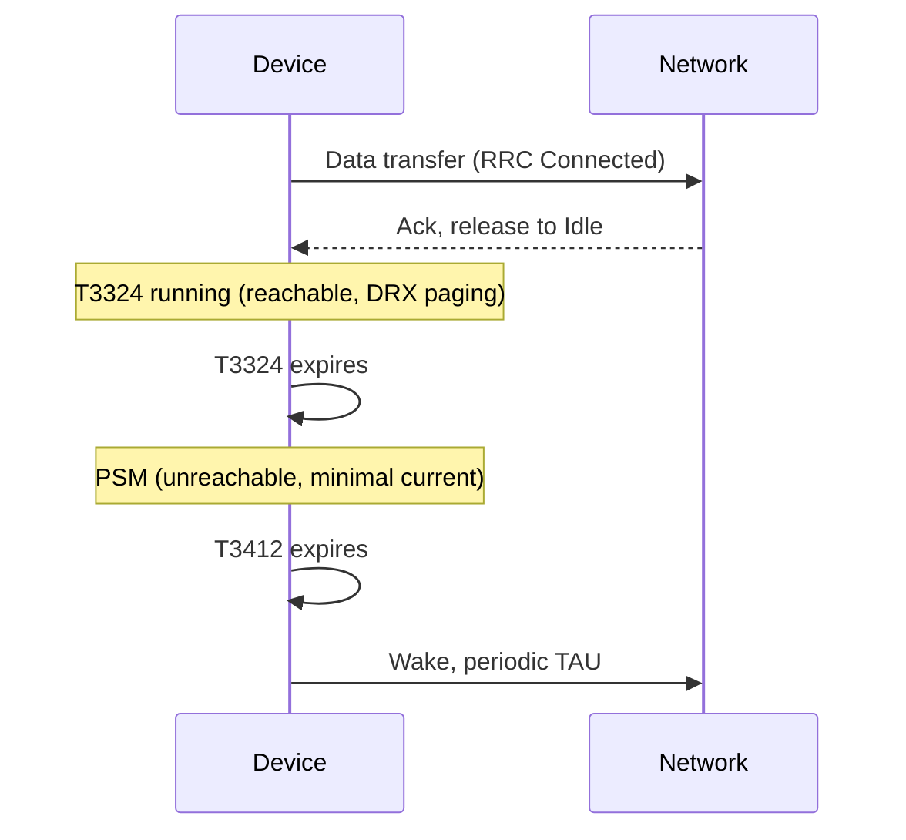

# NB-IoT and cellular fundamentals

## Purpose and scope

This document explains how cellular LPWAN technologies work at a mechanism level, and what it actually takes to get a device from a radio design onto a live network. It starts with the physical layer, moves through the technology choices and their trade-offs, and finishes with the practical layer most explainers skip: SIM provisioning, APN configuration, certification, and spectrum. It assumes familiarity with general embedded/firmware concepts but not prior cellular radio knowledge.

## 1. Where NB-IoT sits in the LPWAN landscape

NB-IoT (Narrowband IoT) is a 3GPP-standardised Low Power Wide Area Network (LPWAN) technology, first specified in **Release 13** (2016) and extended through subsequent releases. It is one of three cellular-based LPWAN variants:

| Technology | Bandwidth | Typical data rate | Mobility | Voice | Typical use |
|---|---|---|---|---|---|
| NB-IoT | 180 kHz | ~20-250 kbit/s | Stationary/low mobility | No | Metering, sensors |
| LTE-M (Cat-M1) | 1.4 MHz | ~1 Mbit/s | Full mobility, handover | Optional (VoLTE) | Asset tracking, wearables |
| Sigfox/LoRaWAN | Non-3GPP, unlicensed spectrum | Very low (<1 kbit/s effective) | Stationary | No | Ultra-low-power sensors |

NB-IoT trades throughput and mobility support for **deep coverage penetration** (it can close a link at roughly 20 dB better Maximum Coupling Loss than GPRS, which matters for meters in basements, metre boxes, or dense masonry) and **very low modem power draw**, both of which are the deciding factors for gas metering.

> **Note:** NB-IoT does not support handover between cells while in an active data session. A device that moves between cells will drop back to idle and perform cell reselection, not a seamless handover. This is irrelevant for a fixed metre, but worth remembering if debugging odd reconnection behaviour on the network side.

## 2. NB-IoT deployment modes

NB-IoT reuses existing LTE spectrum in one of three ways. The network operator chooses this, not the device:

- **Standalone** -- deployed in previously unused (often refarmed GSM) spectrum, using a full 200 kHz channel. No LTE carrier alongside it.
- **Guard-band** -- deployed in the unused guard-band spectrum between two LTE carriers.
- **In-band** -- deployed within an existing LTE carrier's resource blocks, coexisting with normal LTE traffic on a reserved Physical Resource Block (PRB).

The deployment mode is transparent to the application layer but affects link budget and interference, which is why the same hardware can show materially different signal quality across UK network operators.

## 3. NB-IoT physical layer basics

### Channel structure

NB-IoT occupies a single 180 kHz channel (one LTE PRB), split into:

- **Downlink**: OFDMA, 15 kHz subcarrier spacing, 12 subcarriers -- structurally identical to one LTE PRB.
- **Uplink**: SC-FDMA, either 15 kHz spacing (multi-tone) or 3.75 kHz spacing (single-tone, for extreme coverage cases).

Modulation is deliberately simple -- QPSK only, no adaptive higher-order modulation -- because the design goal is coverage robustness, not spectral efficiency.

### Repetition and coverage

The core mechanism that gives NB-IoT its coverage advantage is **repetition**. Rather than transmitting a message once at high power, the modem retransmits the same data block up to 2048 times (downlink) or 128 times (uplink) at low power, and the receiver combines the repeated copies to recover a signal that would otherwise be below the noise floor. This is a direct power/time trade: better coverage costs more airtime and more battery, which is why CE level matters so much for battery life modelling and, later in this document, for latency.


## 4. NB-IoT Coverage Enhancement (CE) levels

The network classifies each device into a **CE level** based on measured downlink signal quality, and this determines how many repetitions it will use:

| CE Level | Typical use case | Repetition behaviour |
|---|---|---|
| CE0 | Normal coverage | Minimal/no repetition |
| CE1 | Extended coverage | Moderate repetition |
| CE2 | Extreme coverage (deep indoor, basements) | Maximum repetition |

A metre in a cellar or dense-brick metre box will commonly sit at CE1 or CE2. This is diagnostic gold: if a device sits persistently at CE2, that is the underlying reason for slower registration and higher battery drain, not a fault condition in itself.

## 5. Signal quality parameters

These parameters are defined once here because the underlying radio measurements are identical across NB-IoT and LTE-M; only the typical values and how actively the network uses them differ, which is called out where relevant in Section 8. You will see them reported by modem AT commands (e.g. u-blox `AT+NUESTATS`, `AT+CESQ`) or network-side diagnostics.

### RSRP (Reference Signal Received Power)

The average power of the LTE/NB-IoT reference signal across resource elements, measured in dBm. This is the primary indicator of raw signal strength -- how strong the signal is, independent of interference.

| RSRP (dBm) | Interpretation |
|---|---|
| > -80 | Excellent |
| -80 to -90 | Good |
| -90 to -100 | Fair |
| -100 to -110 | Poor (typical CE1 territory) |
| < -110 | Very poor (typical CE2 territory) |

### RSRQ (Reference Signal Received Quality)

A ratio of RSRP to total received power (RSSI), adjusted for the number of resource blocks, expressed in dB. RSRQ captures **interference and congestion**, not just strength -- a device can have strong RSRP but poor RSRQ if the cell is congested or there is strong co-channel interference. Typical usable range is roughly -3 dB (excellent) to -20 dB (very poor).

### RSSI (Received Signal Strength Indicator)

The total wideband received power, including signal, interference and noise, in dBm. RSSI alone is of limited diagnostic value because it doesn't distinguish wanted signal from noise -- it's mainly used as an input to derive RSRQ.

### SNR / SINR (Signal-to-Noise / Signal-to-Interference-plus-Noise Ratio)

Expressed in dB, this is the ratio of wanted signal power to the combined noise and interference floor. It is the parameter that most directly predicts whether a given modulation and coding scheme will decode successfully. Low SNR with high RSRP is a classic sign of interference (e.g. in-band deployment sharing a carrier with heavy LTE traffic) rather than a coverage problem, and points you towards a different fix (operator/channel investigation) than low RSRP does (physical placement).

> **Important:** RSRP tells you the signal is *there*. SNR tells you whether it's *usable*. A troubleshooting flow that only looks at RSRP will misdiagnose interference-limited sites as coverage-limited ones.

### CQI (Channel Quality Indicator)

A 4-bit index (0-15) the device reports to the network summarising the highest modulation/coding scheme it can reliably decode, derived internally from SINR. On NB-IoT this is of limited relevance, since modulation is fixed at QPSK and the network manages link quality mainly via repetition count rather than adaptive modulation. On LTE-M, by contrast, CQI is actively used to drive adaptive modulation and coding, since LTE-M supports higher-order schemes -- see Section 8.

### ECL (Extended Coverage Level)

The u-blox/vendor-facing name for the device's own view of its CE level (0, 1 or 2), reported alongside RSRP/SNR in `AT+NUESTATS`. Functionally the same concept as CE level above, just reported at the device rather than inferred network-side.

## 6. Power-saving mechanisms

Battery life for a 15-year gas metre deployment is dominated by two things: how often the modem wakes to transmit, and how long it stays reachable for incoming pages after each transmission. NB-IoT and LTE-M define two complementary mechanisms to minimise the latter, and these same mechanisms are usually the real constraint on end-to-end responsiveness discussed in Section 11.

### RRC states



- **RRC Connected**: active data transfer, highest power draw.
- **RRC Idle**: registered, not transmitting, but still monitoring paging channel at normal DRX intervals (typically ~1.28-2.56 s cycle) -- moderate power draw.
- **PSM (Power Saving Mode)**: the modem is unreachable and effectively powered down at the radio level, drawing near-zero current, while remaining registered on the network without needing to re-attach.

### PSM (Power Saving Mode)

PSM is negotiated with the network via two timers exchanged at attach/TAU (Tracking Area Update):

- **T3324 (Active Timer)**: how long the device remains reachable (in RRC Idle, monitoring paging) after finishing a data transaction, before entering PSM.
- **T3412 (Periodic TAU timer, extended in NB-IoT as T3412-ext)**: the maximum interval before the device must wake and re-register with the network, regardless of whether it has data to send. This can be extended to hours or days, which is the mechanism that permits multi-year battery life.

While in PSM the device is **not reachable for mobile-terminated (network-initiated) traffic at all** -- if the network needs to reach the device, it must wait until the device wakes on its own schedule. This is the key architectural constraint PSM imposes on any mobile-terminated command design.



### eDRX (Extended Discontinuous Reception)

eDRX addresses the middle ground: it extends the *paging cycle* while the device remains in RRC Idle (reachable), rather than going fully unreachable as in PSM. Instead of checking for pages every ~1.28-2.56 s, the device negotiates a much longer eDRX cycle (up to ~3 hours for NB-IoT, up to ~44 minutes for LTE-M in idle mode, longer again for LTE-M's connected-mode eDRX variant), waking briefly at each cycle to check a Paging Time Window (PTW) for incoming pages, then sleeping again.

| | PSM | eDRX |
|---|---|---|
| Reachable for mobile-terminated traffic | No | Yes, at each eDRX wake window |
| Power draw | Lowest | Low, but higher than PSM |
| Wake interval | Only own schedule (T3412) or MO data | Configurable eDRX cycle (device negotiates) |
| Typical use | Devices that only report periodically (metre reads) | Devices needing occasional network-initiated contact without full PSM latency |

> **Note:** PSM and eDRX are not mutually exclusive; a device can use eDRX for the RRC Idle period before it drops into PSM. Network support for both, and the actually-granted timer values, depend on the operator -- the device requests values, the network can grant shorter ones, so firmware should always read back the granted timers rather than assuming the requested values were accepted.

## 7. NB-IoT cell selection and mobility

NB-IoT does not support handover. Instead, a device performs **cell (re)selection**: it camps on the strongest suitable cell based on RSRP/RSRQ thresholds, and only re-evaluates this when idle (not mid-transaction). For a fixed metre this happens rarely after initial deployment, but is worth checking if a device is unexpectedly bouncing between two similarly-sited cells (a "ping-ponging" pattern visible as repeated re-registration in network logs), which usually indicates the reselection hysteresis parameters are too tight for a borderline signal location rather than a device fault.

## 8. LTE-M (Cat M1/M2) in depth

LTE-M is the other 3GPP LPWA variant, also first specified in Release 13. Everything in Sections 2-7 has a direct LTE-M counterpart; this section works through each in turn.

### 8.1 Deployment mode

Where NB-IoT can be deployed standalone, in-band, or in a guard-band, LTE-M's 1.4 MHz channel requires six contiguous PRBs, which in practice means it is **almost always deployed in-band**, occupying a reserved slice of an existing LTE carrier (5, 10, 15 or 20 MHz). Standalone or guard-band deployment is not a realistic option for LTE-M in the way it is for NB-IoT, simply because there isn't usually six contiguous PRBs of otherwise-unused spectrum to place it in outside an existing carrier.

### 8.2 Physical layer

LTE-M uses the same OFDMA downlink / SC-FDMA uplink structure as NB-IoT, with 15 kHz subcarrier spacing, but across 6 PRBs (1.4 MHz) rather than NB-IoT's single 180 kHz PRB. The bandwidth difference is the direct cause of most of the throughput and latency advantage over NB-IoT.

The other structural difference is modulation: LTE-M supports **adaptive modulation and coding**, including higher-order schemes such as 16QAM, rather than NB-IoT's fixed QPSK. This is why CQI (Section 5) is actively used on LTE-M -- the network uses it to select the best modulation/coding combination for current conditions, trading spectral efficiency against robustness dynamically, rather than relying on repetition alone.

### 8.3 Repetition and CE Modes

LTE-M uses the same repetition principle as NB-IoT but names it differently and caps it lower:

| CE Mode | Typical use case | Repetition behaviour |
|---|---|---|
| CE Mode A | Normal coverage | Minimal/no repetition, full adaptive modulation available |
| CE Mode B | Extended coverage | Heavy repetition, falls back to more robust, lower-order modulation |

LTE-M's maximum repetition count is lower than NB-IoT's, which is the direct mechanism behind its slightly worse maximum coupling loss (~156 dB vs NB-IoT's ~164 dB): it simply cannot push repetition as far, in exchange for the throughput and latency it gains from the wider channel and adaptive modulation.

### 8.4 Signal quality in practice

RSRP, RSRQ, RSSI and SNR are measured and interpreted identically to NB-IoT (Section 5) -- same definitions, same rough thresholds. The practical difference is that CQI-driven adaptive modulation means a marginal LTE-M link degrades more gracefully than NB-IoT: rather than only falling back to more repetitions, it can also fall back to a more robust modulation scheme at the cost of throughput, giving the network two independent levers instead of NB-IoT's one.

### 8.5 Power-saving mechanisms

PSM and eDRX work identically in mechanism to Section 6 (same T3324/T3412 timers, same RRC state machine), since PSM was in fact specified for LTE-M first and then extended to NB-IoT. The one practical difference worth noting is that LTE-M's idle-mode eDRX cycle is capped shorter (~44 minutes maximum) than NB-IoT's (~3 hours), and LTE-M additionally supports **connected-mode DRX (C-DRX)** with more granular short/long cycle configuration, reflecting its design bias towards devices that need to stay more readily reachable than a typical NB-IoT metre.

### 8.6 Mobility and handover

This is the fundamental behavioural difference from NB-IoT. Where NB-IoT devices only ever perform idle-mode cell reselection, an LTE-M device in RRC Connected can be **handed over between cells without dropping the session**, using the same mechanism as ordinary LTE:

1. The network configures the device with measurement reporting rules (e.g. an A3 event: "neighbour cell is offset dB stronger than serving cell for a defined time").
2. The device continuously measures RSRP/RSRQ of neighbouring cells while connected and sends a measurement report when a configured event triggers.
3. The network decides whether to hand over, prepares the target cell in advance (via the operator's core/X2 or Xn interface between base stations), and sends the device an RRC reconfiguration message with the new cell's parameters.
4. The device retunes to the target cell and resumes the session, with a brief (tens of milliseconds) interruption rather than a full re-attach.

This is what makes LTE-M suitable for genuinely mobile assets (vehicle tracking, portable equipment) in a way NB-IoT is not, and it is also the mechanism that underpins LTE-M's optional **VoLTE** support, which relies on maintaining a continuous session across cell boundaries in exactly the way a moving phone call does on ordinary LTE.

## 9. LTE Cat 1 and Cat 1bis

LTE Cat 1 is not an IoT-optimised technology at all -- it is one of the original LTE UE categories from 3GPP Release 8, predating NB-IoT and LTE-M by several years. It has become relevant to IoT deployments mainly as the **replacement for 2G/3G fallback modules** as operators shut down legacy networks, because it runs on standard LTE infrastructure with no special network-side configuration required.

Mechanically, Cat 1 uses a full LTE carrier (up to 20 MHz), full-duplex FDD, and originally required 2-antenna MIMO reception. **Cat 1bis** is a later variant that drops the MIMO requirement (single receive antenna), reducing module cost and board area to be closer to NB-IoT/LTE-M module pricing while keeping the same throughput -- this is the variant most commonly used in new IoT hardware designs today rather than original Cat 1.

Cat 1 has **no coverage-enhancement/repetition mechanism**. It gets whatever coverage a normal LTE cell provides, which is materially worse in deep-indoor or basement scenarios than NB-IoT or LTE-M CE Mode B. PSM and eDRX support exist in later 3GPP releases but are less consistently implemented in Cat 1 modules and networks than in NB-IoT/LTE-M, since Cat 1's original design assumptions were smartphone-like (mains-powered or frequently-charged), not multi-year battery operation.

## 10. Cross-technology comparison

| Parameter | NB-IoT | LTE-M (Cat M1) | LTE Cat 1 / Cat 1bis |
|---|---|---|---|
| Channel bandwidth | 180 kHz | 1.4 MHz | Up to 20 MHz |
| Duplex | Half-duplex | Half or full-duplex FDD | Full-duplex FDD |
| Modulation | Fixed QPSK | Adaptive, up to 16QAM | Full LTE adaptive modulation |
| Mobility/handover | No (reselection only) | Yes | Yes |
| Peak throughput (DL/UL) | ~127/159 kbit/s (typ.) | ~1 Mbit/s / 1 Mbit/s | ~10 Mbit/s / 5 Mbit/s |
| Latency (typical, good coverage) | 1.6-10 s | Tens of ms to ~1 s | 10-50 ms |
| Max coupling loss (deep coverage) | ~164 dB | ~156 dB | Standard LTE (~142-146 dB) |
| Voice (VoLTE) | No | Optional | Yes |
| PSM / eDRX | Yes, core design feature | Yes, core design feature | Later releases, inconsistent support |
| Typical module cost | Lowest | Low-medium | Medium (lower with Cat 1bis) |
| Typical use case | Static, deep-coverage, high-density (metering, sensors) | Mobile/tracked assets, wearables, telematics | 2G/3G fallback replacement, higher-throughput IoT, non-battery-critical devices |

> **Note:** The latency figures above are for the network round trip once the modem has already attached and is transmitting; they do not include the wake-up time out of PSM, which for a sleeping device can dominate total end-to-end latency regardless of technology (see Section 11).

### Pros and cons summary

**NB-IoT**

- Pros: deepest coverage penetration, lowest module cost and power draw, ideal for static high-density deployments like metering.
- Cons: half-duplex only, no mobility support, highest latency, lowest throughput, not suitable for voice or firmware-over-the-air updates of any significant size.

**LTE-M**

- Pros: supports mobility/handover and voice, materially lower latency and higher throughput than NB-IoT, graceful degradation via adaptive modulation as well as repetition, still supports PSM/eDRX for multi-year battery life.
- Cons: larger/costlier module than NB-IoT, slightly worse deep-indoor coverage than NB-IoT, higher power draw per transaction.

**LTE Cat 1 / Cat 1bis**

- Pros: highest throughput and lowest latency of the three, full duplex, voice support, runs on any standard LTE network with no special configuration, natural replacement for legacy 2G/3G fallback hardware.
- Cons: no coverage enhancement mechanism (worst deep-coverage performance of the three), least consistent PSM/eDRX support, highest power draw and typically higher module cost than NB-IoT (Cat 1bis narrows this gap).

## 11. When latency actually matters

The three technologies above were all designed around periodic, delay-tolerant reporting. A different class of device -- an alarm panel that must guarantee cloud delivery within a second, for instance -- has a different constraint, and it's worth being clear about where that constraint actually lives.

For this kind of requirement, **LTE Cat 1/Cat 1bis kept in a normally-connected (or short-cycle idle) state** is the practical choice among the technologies covered here: sub-1s delivery is routinely achievable on a healthy LTE link, whereas NB-IoT's repetition-based coverage mechanism and multi-second wake cycles make a *guaranteed* sub-1s bound difficult to promise, even though typical-case latency can be lower. Beyond Cat 1, 5G RedCap and URLLC network slices push latency down further still where the operator supports them, and private 5G, Wi-Fi, or wired Ethernet with TSN remove the public RAN from the picture entirely if the device doesn't need wide-area mobility.

The detail that matters more than the technology choice, though, is this: **PSM and eDRX are latency's real enemy, not the air interface**. A device sitting in PSM is simply unreachable until it wakes on its own schedule, and a device using a long eDRX cycle only checks for pages at each window -- so a "guaranteed under 1 second" requirement effectively rules out PSM and long eDRX for the alarm path, regardless of which radio technology carries it. In practice this means keeping the device in RRC Connected or a short-cycle Idle state (at a battery cost), or using mobile-originated signalling only, where the device itself decides when to raise the alarm rather than waiting to be paged. This is a general sizing point rather than something to over-engineer around; most alarm-class designs solve it by simply accepting the higher standby power draw of staying reachable, rather than trying to force PSM/eDRX to hit a hard latency guarantee.

## 12. Getting a device onto a network: SIM, eSIM and IMSI

Everything above assumes the device can already authenticate to a network. That authentication is anchored in the SIM.

A **SIM** stores the device's **IMSI** (International Mobile Subscriber Identity -- a unique identifier built from Mobile Country Code, Mobile Network Code, and a subscriber number) along with a secret key used to authenticate against the home network's core. The physical form factor is largely irrelevant to how any of this works; what matters is who can reprogram it and how.

- **Removable SIM**: standard, replaceable, but physically inaccessible once a metre or sensor is sealed and deployed for a decade or more.
- **eSIM (eUICC)**: a soldered, non-removable chip that can still have its network profile **remotely reprovisioned** over the air via an SM-DP+ server, without physical access to the device. This is the practical reason eSIM matters for long-life IoT: it decouples "which operator this device is on" from "can someone get to the device," which matters a great deal once a device is behind a metre box for fifteen years.
- **iSIM**: takes this a step further by integrating the SIM function directly into the modem/SoC silicon rather than as a separate chip, saving board space and cost at high volume.

**Multi-IMSI SIMs** store several IMSI profiles on one physical or embedded SIM and can switch between them, typically to select whichever home network gives the best signal at a given site, or as a fallback if the primary network becomes unavailable.

**Roaming** lets a device operate on a network other than its home network via commercial roaming agreements between operators, which is how many "global" IoT SIMs work in practice -- a single IMSI with a home network in one country, roaming permanently onto local networks elsewhere. Two things are worth flagging: some countries restrict *permanent* roaming for security or data-sovereignty reasons, which can block a roaming-only SIM strategy in those markets; and roaming signalling is sometimes routed back via the home network's core before reaching local breakout to the internet, which adds a fixed latency and routing cost on top of anything discussed in Section 11.

## 13. APN configuration

The **APN (Access Point Name)** is the configuration that tells the operator's core network how to connect the device's session to an external network, and it is where a lot of the practical security and routing decisions for a fleet actually get made:

- A **public APN** routes the device out to the public internet, typically with a shared or dynamically-allocated IP, the simplest option but the least controlled.
- A **private APN** keeps device traffic off the public internet entirely, routing it via a dedicated tunnel or leased connection straight into the customer's own network (e.g. a utility's back-office platform). This is the common choice for metering and other critical infrastructure, since it removes public internet exposure as an attack surface for the device fleet.

The APN is provisioned against the SIM/IMSI, not the device hardware, which is why changing an APN is usually a SIM/network-side operation rather than a firmware change.

## 14. Certification

Before a device can legally be sold and connected, it has to clear two largely independent certification hurdles.

### Network/conformance certification

- **GCF (Global Certification Forum)**: certifies a device against 3GPP conformance test cases, and is required or strongly preferred by most operators worldwide before they will allow a device onto their network.
- **PTCRB**: functionally equivalent certification used mainly for North American operators.
- **Operator-specific approval**: many operators layer their own additional testing on top of GCF/PTCRB before formally approving a specific module/firmware combination for their network, particularly for critical infrastructure like metering.

### Regulatory (radio equipment) certification

- **RED (Radio Equipment Directive, 2014/53/EU)**: the EU legal framework a radio device must satisfy before it can carry a CE mark and be placed on the market, covering spectrum use, EMC, and health/safety. The UK equivalent post-Brexit uses the same technical standards under a UKCA mark, overseen by Ofcom.
- **FCC**: the equivalent US regulatory certification.
- **ISED (formerly Industry Canada/IC)**: the equivalent Canadian regulatory certification.

A device intended for a specific market needs both the relevant network/conformance certification (GCF/PTCRB, plus operator approval) and the relevant regulatory certification (RED/UKCA, FCC, ISED, etc.) for that market before deployment.

## 15. Spectrum and bands

Band choice is an operator/regulatory decision, but it directly shapes coverage, since **lower frequencies propagate further and penetrate buildings better** than higher ones, for a given transmit power.

| Technology | Common UK/EU bands | Notes |
|---|---|---|
| NB-IoT | B20 (800 MHz), B8 (900 MHz), B3 (1800 MHz) | Sub-1 GHz bands (B20/B8) preferred for deepest coverage |
| LTE-M | B20, B8, B3, B1 (2100 MHz) | Similar low-band preference to NB-IoT for coverage-critical deployments |
| LTE Cat 1/Cat 1bis | Whatever LTE bands the operator has deployed (B1, B3, B7, B20, B28, etc.) | No special low-band preference, since there's no repetition mechanism relying on it |
| 5G RedCap | Existing 5G NR bands, e.g. n78 (3.5 GHz mid-band), n1, n3, n28 | Early RedCap deployment is mid-band first; sub-1 GHz NR coverage bands will follow as operators roll them out |

Exact bands and their availability vary by country and operator, so this table should be read as "what to expect," not as a substitute for checking the specific target network's band plan.

## 16. Practical diagnostics (device-side)

A typical u-blox NB-IoT module exposes signal diagnostics via AT commands:

```text
AT+NUESTATS
+NUESTATS:
"Signal power",-8814
"Total power",-8760
"TX power",  240
"TX time",   3120
"RX time",   9840
"Cell ID",   "1A2B3C"
"ECL",       1
"SNR",       31
"EARFCN",    3684
"PCI",       215
"RSRP",      -9812
"PagingUERxs", 12
```

Fields of interest for troubleshooting:

- **Signal power / RSRP**: raw strength (see thresholds in Section 5).
- **SNR**: interference/usability (see Section 5) -- typically reported as (actual dB + 20) x 4 by convention on some modules, so check the specific module's datasheet for the scaling before comparing raw values across vendors.
- **ECL**: current coverage enhancement level (0/1/2) -- directly correlates to repetition count and therefore to transmission time and battery draw for that session.

> **Warning:** Different vendors scale and offset SNR and RSRP differently in their AT command output. Always confirm the conversion formula in the specific module's AT command manual before comparing raw register values across hardware revisions or suppliers.

## 17. Glossary

| Term | Meaning |
|---|---|
| APN | Access Point Name; operator-side configuration determining how a device's data session is routed |
| Cat 1 / Cat 1bis | LTE UE Category 1; full-throughput LTE variant used for 2G/3G fallback replacement (Cat 1bis: single-antenna, lower-cost variant) |
| Cat M1 / M2 | LTE-M UE categories; M1 ~1 Mbit/s, M2 ~4 Mbit/s with wider bandwidth |
| CBRS | Citizens Broadband Radio Service; US shared spectrum band commonly used for private LTE/5G |
| C-DRX | Connected-mode DRX; short/long paging-style cycle configuration while in RRC Connected, used by LTE-M |
| CE Level / CE Mode | Coverage Enhancement level (NB-IoT: 0/1/2) or mode (LTE-M: A/B); determines repetition count |
| CQI | Channel Quality Indicator |
| DRX | Discontinuous Reception |
| eSIM / eUICC | Embedded, non-removable SIM that can be remotely reprovisioned with a new network profile |
| FDD | Frequency Division Duplex; separate uplink/downlink frequencies allowing full-duplex operation |
| GCF | Global Certification Forum; 3GPP conformance certification widely required by operators |
| IMSI | International Mobile Subscriber Identity; unique subscriber/device identifier used for network authentication |
| iSIM | SIM function integrated directly into modem/SoC silicon rather than a separate chip |
| MCL | Maximum Coupling Loss; link budget measure of deep-coverage capability |
| MIMO | Multiple Input Multiple Output; multi-antenna transmission/reception |
| PSM | Power Saving Mode; fully unreachable, minimal power state |
| PTCRB | North American equivalent of GCF conformance certification |
| PTW | Paging Time Window; wake window within an eDRX cycle |
| RED | Radio Equipment Directive (EU); regulatory certification for radio devices (UK equivalent: UKCA) |
| RedCap | Reduced Capability; 3GPP Release 17 5G NR device class positioned between LTE-M/Cat 1 and full 5G |
| RRC | Radio Resource Control (connection state machine) |
| RSRP | Reference Signal Received Power |
| RSRQ | Reference Signal Received Quality |
| RSSI | Received Signal Strength Indicator |
| SNR/SINR | Signal-to-(Interference-plus-)Noise Ratio |
| T3324 | Active timer (RRC Idle duration before PSM) |
| T3412 | Periodic TAU timer (maximum time before mandatory wake) |
| TAU | Tracking Area Update |
| TSN | Time-Sensitive Networking; Ethernet standards providing deterministic low-latency delivery |
| URLLC | Ultra-Reliable Low-Latency Communication; 5G NR network feature/slice for single-digit-ms latency |
