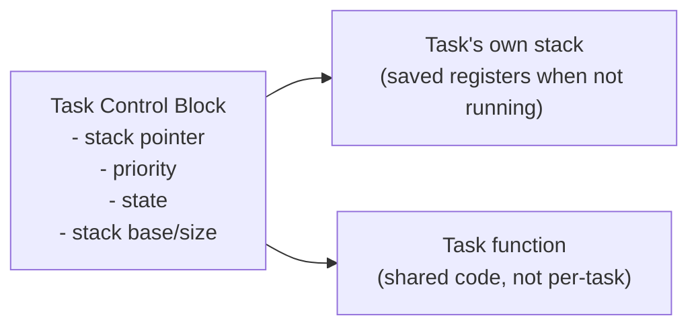
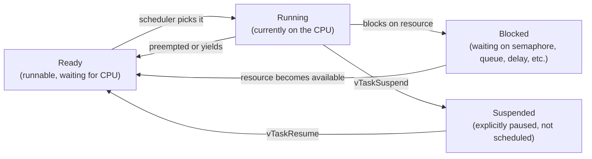
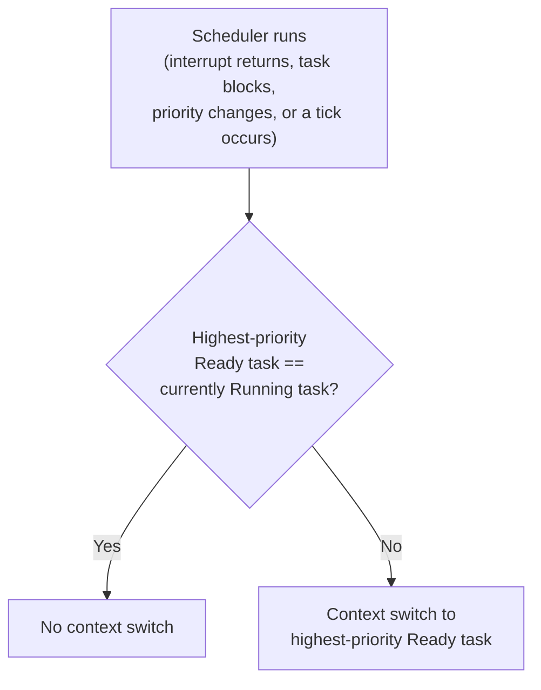
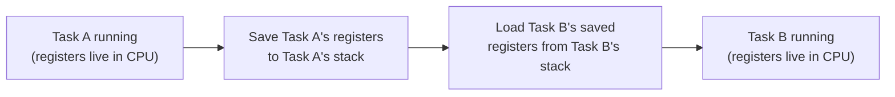
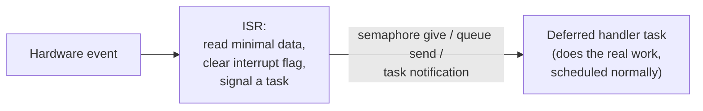
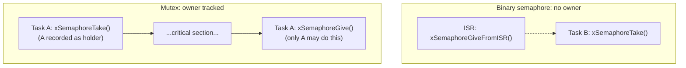
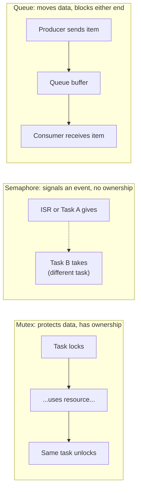
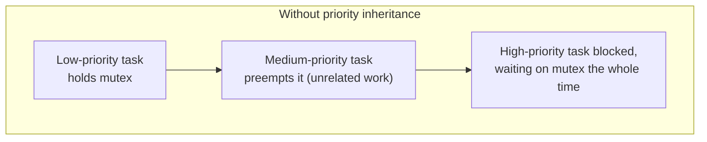
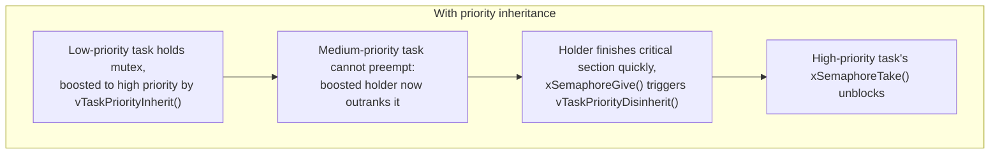
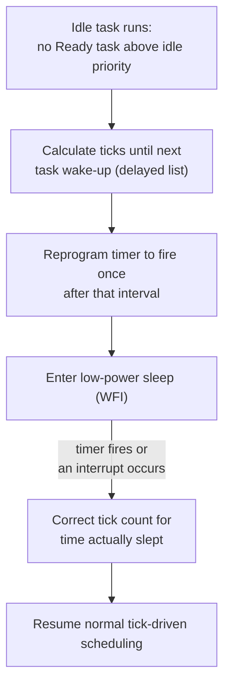

# RTOS internals

## Overview

A real-time operating system is often described as "a small OS for embedded devices", but that undersells what actually makes it different. The core idea is simpler and more specific: an RTOS exists to make the timing of execution predictable, not just the outcome. A general-purpose OS like Linux optimises for throughput and fairness across many competing processes; an RTOS optimises for a task meeting its deadline, even if that means starving lower-priority work indefinitely. Understanding that single goal explains almost everything else: why scheduling is priority-based rather than fair, why context switches are measured in microseconds, and why synchronisation primitives carry so much ceremony around priority.

Throughout, FreeRTOS is used as the worked example, since its API is what most embedded engineers meet first. The final section broadens out to compare FreeRTOS, Zephyr, Eclipse ThreadX, PX5 RTOS and SEGGER embOS as five complete kernels, rather than feature by feature.

## What Is a Task

A task (also called a thread, though RTOS literature tends to say "task") is an independent thread of execution with its own stack, its own saved register state, and a priority. Unlike a process on a general-purpose OS, tasks on most RTOSes share a single flat memory space; there is no virtual memory, no per-task page table, and usually no memory protection unless the silicon has an MPU and the RTOS is configured to use it.

Each task is represented internally by a Task Control Block (TCB): a small structure holding the task's saved stack pointer, its priority, its current state, and a pointer to its stack memory. The TCB is what the scheduler actually manipulates; the task's code and data are just memory the TCB points at.



A task's stack is not scratch space in the way a single-threaded programme's stack is. Every task has its own, sized at creation time, and that size has to be estimated correctly: too small and a deep call chain or interrupt landing on that stack corrupts adjacent memory silently; too large and RAM, often the scarcest resource on a microcontroller, is wasted per task.

## Task States

A task is always in exactly one of a small number of states, and the scheduler's whole job is deciding which ready task actually runs.



Only one task is ever in the Running state on a single core. Everything else waiting to run sits in Ready; everything waiting on something (a timer, a mutex, data on a queue) sits in Blocked and consumes no CPU time at all while there. A blocked task costs nothing, so it is normal to have many tasks, most of them blocked most of the time, waiting for their particular event.

## The Scheduler

The scheduler decides, at every scheduling point, which Ready task becomes the Running task. Almost all RTOSes used in industrial and consumer embedded work use priority-based preemptive scheduling as the default: the highest-priority Ready task always runs, and it runs immediately, interrupting a lower-priority task if necessary.

This is a deliberately different goal to a general-purpose OS scheduler. Linux's completely fair scheduler tries to give every process a proportionate share of CPU time over some window; an RTOS scheduler makes no such promise. A low-priority task can be starved indefinitely if higher-priority tasks are always Ready, and that is treated as correct behaviour, not a bug, because the entire premise is that priority reflects real deadline urgency.



A preemptive scheduler can interrupt a running task at any scheduling event, without that task's cooperation. A cooperative scheduler only switches tasks when the running task explicitly yields, which is simpler to reason about but means one badly behaved task can block everything else indefinitely. Most modern RTOSes default to preemptive, but many also support cooperative or "run to completion" scheduling for specific low-priority tasks.

When two or more Ready tasks share the same priority, most schedulers apply round-robin time slicing between them: each gets a fixed slice before being rotated to the back of the queue for that priority level. This only ever happens within a priority level; a lower-priority task never gets a slice while a higher-priority task is Ready.

## Context Switching

A context switch is the mechanical act of saving one task's CPU register state to its own stack and restoring another's. On a typical Cortex-M target, this is a fixed, small sequence: push the remaining general-purpose registers not already saved by the hardware exception entry, save the stack pointer into the outgoing task's TCB, load the stack pointer from the incoming task's TCB, and pop its registers back off. This cost, multiplied by however often it happens, is pure overhead the application never sees as useful work.



This is also why an RTOS cares so much about worst-case interrupt latency and context-switch time as headline numbers: they are the tax paid on every single scheduling decision, and a real-time deadline has to account for that tax on top of the actual work.

## Interrupts and Deferred Processing

An Interrupt Service Routine (ISR) runs outside the normal task scheduling entirely; it preempts whatever task is running regardless of that task's priority, because interrupts sit above the RTOS's own priority scheme at the hardware level. The rule that keeps a system predictable is: keep the ISR short. An ISR that does substantial work delays every task in the system, including higher-priority ones, for as long as it runs.

The standard pattern is to defer the real work out of the ISR and into a task:



In FreeRTOS, the signalling step is deliberately one of the cheapest calls available, `xSemaphoreGiveFromISR()` or a direct-to-task notification via `xTaskNotifyGiveFromISR()`, precisely because it happens inside an ISR, where every cycle counts double.

## Synchronisation Primitives

Tasks running concurrently need to coordinate: protect shared data, signal that an event happened, or pass data between each other. The primitives look similar on the surface but solve different problems, and FreeRTOS's API makes a good concrete reference for how they differ mechanically.

### Mutex

A mutex protects a shared resource by enforcing mutual exclusion: only the task that locked it can unlock it, and most RTOS mutexes support priority inheritance specifically because ownership is a well-defined concept. Use a mutex when the question is "only one task at a time may touch this data or hardware peripheral".

In FreeRTOS, a mutex is created with `xSemaphoreCreateMutex()`. It starts full (available immediately) and tracks ownership internally: only the task that called `xSemaphoreTake()` successfully may call `xSemaphoreGive()` to release it, and FreeRTOS will not release a mutex on behalf of a task that never took it. This ownership tracking is the entire mechanism priority inheritance depends on, covered below.

```c
SemaphoreHandle_t xMutex = xSemaphoreCreateMutex();

if (xSemaphoreTake(xMutex, portMAX_DELAY) == pdTRUE) {
    /* critical section: only this task may proceed */
    xSemaphoreGive(xMutex);
}
```

### Binary semaphore

A binary semaphore has no concept of ownership; any task can give it, and any task can take it. It is a signalling mechanism, not a protection mechanism: the classic use is an ISR giving a semaphore to wake a waiting task. Using a semaphore to protect shared data instead of a mutex is a common mistake, because without ownership there is no priority inheritance, and priority inversion can recur.

In FreeRTOS, this is `xSemaphoreCreateBinary()`, which starts empty (must be given once before it can be taken).



> **Important:** `xSemaphoreCreateBinary()` never provides priority inheritance, even used in a mutex-like pattern (one task always gives, another always takes back). If a shared resource needs protection and priority inversion is a concern, the fix is `xSemaphoreCreateMutex()`, not extra care with a binary semaphore.

### Counting semaphore

A counting semaphore generalises the binary case to a count of available resources (buffer slots, pool entries), decremented on take and incremented on give, with tasks blocking when the count reaches zero. In FreeRTOS this is `xSemaphoreCreateCounting(uxMaxCount, uxInitialCount)`.

### Queue

A queue passes actual data between tasks, copying fixed-size items in and out, with tasks able to block on either end. This is the standard way to hand data from an ISR or producer task to a consumer task without them sharing memory directly. In FreeRTOS, `xQueueCreate(uxQueueLength, uxItemSize)` creates the queue, and `xQueueSend()` / `xQueueReceive()` (or their `FromISR` variants) move items with an optional blocking timeout. A queue of length one holding no meaningful data is, internally, exactly how FreeRTOS builds a binary semaphore; both semaphores and mutexes sit on top of the same underlying queue structure.



### Mailboxes and lightweight signalling

Some kernels add a further primitive, often called a mailbox or postbox, for cases a full queue is comparatively expensive for: handing a single value or wake-up signal directly to one specific task. FreeRTOS's version is the task notification, which lives inside the receiving task's own TCB rather than as a separate kernel object, so there is nothing to allocate or size:

```c
xTaskNotifyGive(xTaskHandle);                    /* ISR or task: send */
ulTaskNotifyTake(pdTRUE, portMAX_DELAY);          /* task: receive, clearing count */
```

Giving a task notification is measurably faster and uses less RAM than either a binary semaphore or a queue of length one. The trade-off is that a task notification can only ever have one recipient, whereas a queue can be read by any number of consumer tasks that happen to call receive on it. How other kernels implement this same idea, and how their terminology diverges, is covered in the comparison section.

## Priority Inversion and Priority Inheritance

Priority inversion occurs when a high-priority task is blocked waiting for a resource held by a low-priority task, and an unrelated medium-priority task, which needs no such resource, preempts the low-priority task and runs freely. The high-priority task ends up waiting on the medium-priority one indirectly, which is exactly backwards from what the priority scheme was meant to guarantee.



This is not a hypothetical for firmware with mixed-criticality tasks: a low-priority logging task holding a mutex over a shared I2C bus, preempted by an unrelated medium-priority housekeeping task, can leave a high-priority sensor-read task blocked far longer than its deadline allows, even though the housekeeping task has nothing to do with the I2C bus at all.

The standard fix is priority inheritance: when a high-priority task blocks on a mutex held by a lower-priority one, the RTOS temporarily raises the holder's priority to match the highest-priority waiter, for exactly as long as it holds the mutex.

FreeRTOS's mutex implementation includes this automatically; it is not an opt-in feature or a separate API. When `xSemaphoreTake()` is called on a mutex already held by a lower-priority task, FreeRTOS calls its internal `vTaskPriorityInherit()` on the holder, temporarily raising its priority to match the blocked, higher-priority caller. When the holder calls `xSemaphoreGive()`, FreeRTOS calls `vTaskPriorityDisinherit()`, restoring the holder's original priority (or the next-highest priority still waiting, if more than one task was blocked).



> **Note:** priority inheritance bounds the inversion; it does not eliminate the wait entirely. The high-priority task still waits for the critical section to finish, which is correct and unavoidable -- the point is that the wait is now bounded by the holder's own critical-section length, not by however long an unrelated medium-priority task chooses to run.

> **Warning:** `vTaskPrioritySet()` called manually on a task that also participates in mutex-protected sections can interact awkwardly with inheritance bookkeeping if not done carefully; in most application code it is better to leave priority management to the inheritance mechanism rather than adjusting priorities directly around mutex use.

Because priority inheritance depends on the RTOS knowing who the holder is, in FreeRTOS it only exists for `xSemaphoreCreateMutex()` (and the recursive variant, `xSemaphoreCreateRecursiveMutex()`). It categorically does not exist for `xSemaphoreCreateBinary()` or `xSemaphoreCreateCounting()`, because neither tracks ownership. Other kernels make this optional, add a second mechanism entirely, or support a different protocol (priority ceiling) alongside inheritance; the comparison section covers each approach.

## Memory: Static Versus Dynamic Allocation

Most RTOSes offer a choice between allocating tasks, queues, and semaphores statically (fixed at compile time, memory reserved in `.bss`) or dynamically (via the RTOS's own heap, usually a purpose-built allocator rather than the standard C library one). Static allocation is deterministic and avoids fragmentation entirely, at the cost of having to size everything up front; dynamic allocation is more flexible but reintroduces the classic embedded worry of heap fragmentation over long uptimes.

> **Note:** this is a large part of why safety-critical and long-uptime firmware, including metering firmware, tends to default to static allocation wherever the RTOS supports it, reserving dynamic allocation for genuinely variable-sized, short-lived cases.

## Tickless Idle

An RTOS normally runs a periodic tick interrupt (in FreeRTOS, `configTICK_RATE_HZ`, commonly 1000 Hz) to drive time-slicing and to wake tasks whose delays have expired. On a battery- or PSM-constrained device, waking the CPU on every tick even when every task is blocked is wasted energy; that periodic wake-up is the entire cost tickless idle exists to remove.

In FreeRTOS, with `configUSE_TICKLESS_IDLE` set to `1`, the idle task, instead of just spinning, calls the port-specific `portSUPPRESS_TICKS_AND_SLEEP()`. This function:

1. calculates the number of tick periods until the next task is due to wake, from the delayed-task list
1. reprograms the SysTick (or an equivalent low-power timer) to fire once, after that calculated interval, rather than on every tick
1. puts the CPU into a low-power sleep mode (`WFI` on Cortex-M, or a deeper stop mode on some parts) for that interval
1. on waking, either because the timer fired or because an interrupt occurred early, corrects the tick count for time actually slept and resumes normal ticking



> **Important:** an early wake caused by an unrelated interrupt still requires the tick count correction step, because real time passed during the sleep regardless of why the CPU woke. Skipping this step is a common source of subtly wrong delays and timeouts in a tickless configuration, since every blocked task's remaining delay is computed from the tick count.

Tickless idle only ever engages when the idle task is the highest-priority Ready task, meaning no other task, mutex holder or otherwise, has anything left to do. A task incorrectly left runnable (spinning on a semaphore instead of blocking with a timeout) will prevent tickless idle from ever engaging, which tends to show up as unexpectedly high idle power draw rather than a scheduling bug. Other kernels take different positions on how central tickless operation is to the design, covered below.

## Comparison with Other Execution Models

The simplest alternative to an RTOS is no scheduler at all: a single `while (1)` loop that calls each subsystem's handling function in turn, with interrupts doing the minimum and setting flags the loop polls. This is entirely deterministic and has zero context-switch overhead, but every piece of work shares the same implicit priority (loop order), and a slow iteration in one subsystem delays every other subsystem's next check by exactly that long. It scales poorly as the number of independent concerns grows, which is the usual trigger for moving to an RTOS.

Linux's default scheduler (CFS) optimises for fairness and throughput across processes that mostly don't have hard deadlines; it has virtual memory, per-process address space isolation, and a scheduler tick and context-switch cost orders of magnitude larger than a typical RTOS. Linux does have real-time scheduling classes (`SCHED_FIFO`, `SCHED_RR`) that borrow the RTOS priority model, and `PREEMPT_RT` patches push determinism further, but the underlying kernel still carries far more machinery than an RTOS kernel, which is often only a few thousand lines of code in total.

The underlying distinction: a superloop has no scheduler at all, so priority does not exist as a concept. An RTOS has a scheduler whose entire purpose is enforcing priority order deterministically, at the cost of task and primitive bookkeeping. A general-purpose OS has a scheduler whose entire purpose is fairness and throughput across untrusted, isolated processes, with determinism as an optional extra.

## Five RTOS Kernels Compared

Everything above describes the general model, with FreeRTOS as the worked example. FreeRTOS, Zephyr, Eclipse ThreadX, PX5 RTOS, and SEGGER embOS all implement the same underlying model: priority-based preemptive scheduling, round-robin time slicing at equal priority, and mutex/semaphore/queue primitives. At the scheduling-algorithm level, all five are close to identical, so that is not a meaningful axis of comparison. What actually differs is each kernel's design ethos: what it is optimising for as a product, and why a team would pick it. Each is summarised as a whole below.

### FreeRTOS

FreeRTOS's ethos is minimalism and ubiquity. The kernel itself is small, the primitive set stays deliberately narrow (semaphores and mutexes are both implemented as special cases of the same queue mechanism, rather than as separate machinery), and priority inheritance on mutexes is automatic and non-optional, so there is nothing to configure to get correct behaviour by default.

Its key benefit is reach: FreeRTOS is MIT licensed and ported across a huge range of MCU vendors and toolchains, so most vendor SDKs already ship a working port. For a team that wants the smallest possible dependency and the widest possible hardware choice, without needing a rich built-in subsystem stack, FreeRTOS is usually the path of least resistance.

### Zephyr

Zephyr's ethos is "batteries included": it positions itself less as a bare kernel and more as a full embedded platform, with networking stacks, Bluetooth, USB, filesystems and device-tree-based hardware description built in alongside the scheduler. Governed by the Linux Foundation and Apache 2.0 licensed, it is designed for teams building genuinely connected products who would otherwise have to integrate several separate libraries on top of a bare-metal kernel themselves.

Its key benefit is breadth: one codebase and build system (`west`, CMake, device tree) spans a very wide range of silicon, with the connectivity and driver subsystems most IoT products need already present. The trade-off is a larger footprint and a steeper learning curve than a bare scheduler, which is the price of that breadth.

### Eclipse ThreadX

ThreadX's ethos is proven, certified determinism at very small size. It has one of the longest deployment histories of any RTOS, widely cited at around ten billion devices, mostly accumulated while it was a commercial product (Express Logic, then Microsoft's Azure RTOS) before being open sourced under the Eclipse Foundation. It also offers preemption-threshold, a scheduling-level tool distinct from priority inheritance, giving it a genuinely different option for controlling preemption that most other kernels do not offer.

Its key benefit is maturity: an extremely long track record in the field, a deep history of safety certifications, and a small footprint despite that history, making it a common default choice for safety-critical or certification-heavy programmes.

### PX5 RTOS

PX5's ethos is portability through standards. Rather than a proprietary API, it is built natively around POSIX pthreads, so application code written against PX5 shares far more directly with Linux-side code than a proprietary-API kernel would allow. It is a newer product from the original author of ThreadX and Nucleus, aimed squarely at safety-certified use.

Its key benefit is a combination that is unusual to find together: POSIX-standard code portability, one of the smallest footprints and fastest documented API/context-switch times of the five, run-time integrity checking (Pointer/Data Verification), and safety certifications including IEC 61508 SIL 4 and ISO 26262 ASIL D. The trade-off is a much shorter field track record than ThreadX, given how recently it launched.

### SEGGER embOS

embOS's ethos is commercial simplicity backed by strong tooling. It is a straightforward, general-purpose kernel whose biggest differentiator is not the kernel itself but its integration with SEGGER's own ecosystem: J-Link debug probes, SystemView real-time tracing, and Embedded Studio. Priority inheritance and idle-time power saving are both built in by default rather than requiring configuration.

Its key benefit is the debugging and tracing experience for teams already using SEGGER hardware, plus a straightforward commercial licensing model. The trade-off is that its differentiation is mostly at the tooling layer rather than the kernel design itself, since the underlying scheduling model is unremarkable next to the other four.

> **Note:** none of these differences make one kernel strictly better; they reflect different target markets and different things each vendor chose to optimise for. FreeRTOS trades on ubiquity and vendor support, Zephyr on subsystem breadth for connected IoT, ThreadX on deployment scale and certification history, PX5 on POSIX portability and footprint, and embOS on tool integration. The right choice depends on which of those trade-offs matters for the specific product, not on which kernel implements the underlying scheduling and synchronisation model "more correctly" -- at that level, all five are close to identical.
