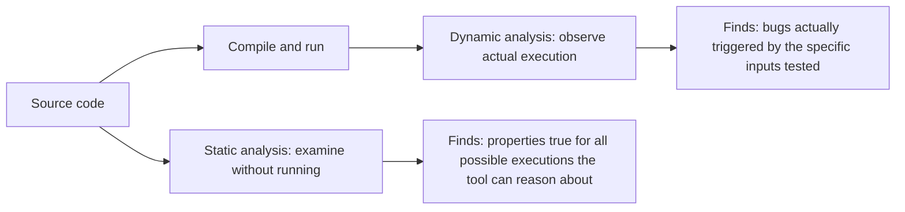
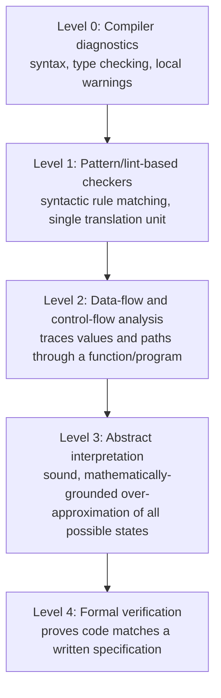
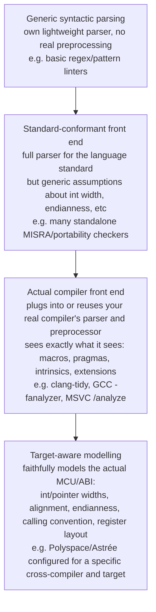
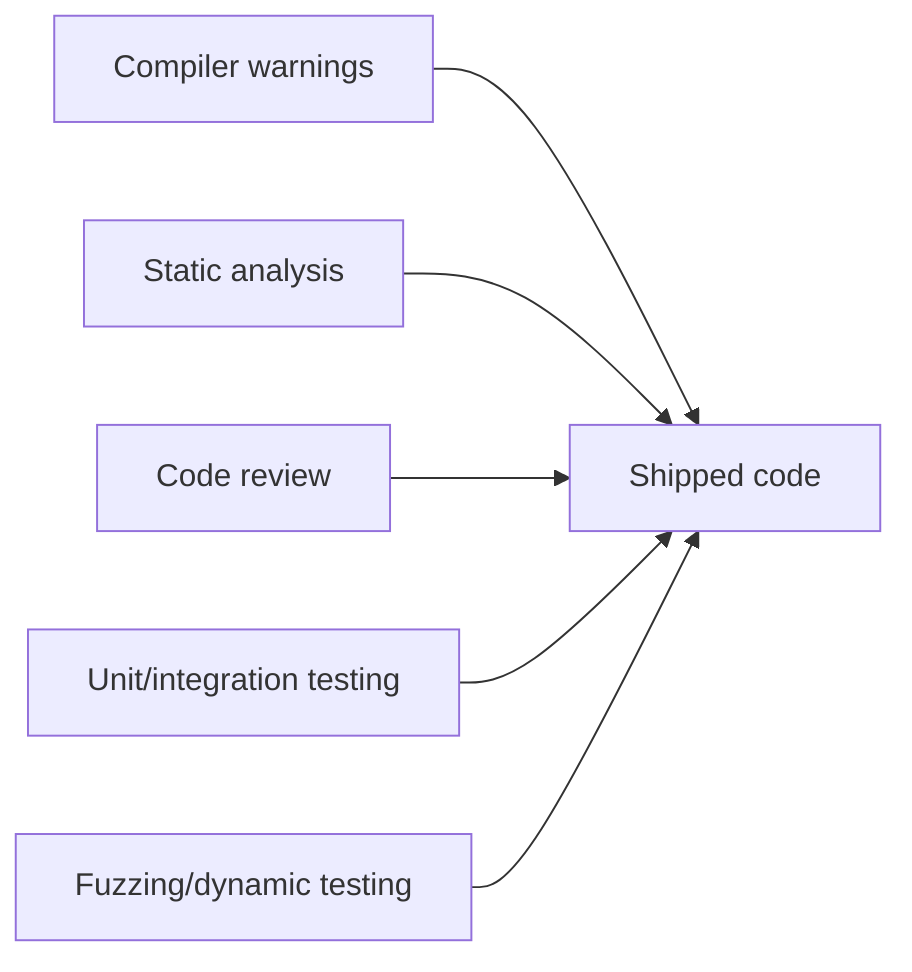
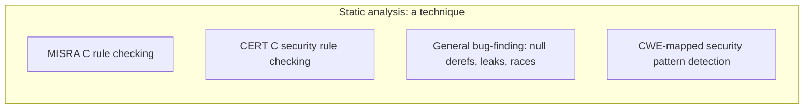

# Static analysis

## Purpose and scope

This document explains static analysis as a technique and a tool category: what it actually does, the different levels of rigour tools operate at, and where it sits alongside compiler warnings, code review, and testing in an overall code quality picture. It specifically addresses a common conflation -- treating "MISRA compliant" and "statically analysed" as the same thing -- and covers why static analysis matters for de-risking software security specifically, not just general code quality. It is a companion document to *MISRA C: A Deep Dive*, which covers one specific rule set that static analysis tools are commonly used to check; this document covers the technique itself, independent of any one rule set.

## 1. What static analysis actually is

Static analysis means examining source code (or, for some tools, compiled binaries or intermediate representations) **without executing it**, to find properties that are true or false regardless of what input the programme eventually receives. This is the defining contrast with dynamic analysis -- testing, fuzzing, sanitizers -- which observes the programme's actual behaviour while it runs, on specific inputs.

Neither approach subsumes the other. Static analysis can, in principle, reason about every code path including ones no test ever exercises; but it reasons about an *approximation* of the programme's behaviour, and can be wrong in both directions -- flagging something that can never actually happen (a false positive) or missing something that can (a false negative). Dynamic analysis is ground truth for whatever it actually observes, but only for the inputs and paths a test run happens to exercise.

## 2. The levels of static analysis

"Static analysis" is not one technique -- it is a spectrum of increasingly sophisticated approaches to the same underlying question (what can this code do?), each level trading analysis cost and false-positive rate for depth of reasoning.

### Level 0: Compiler diagnostics

Every compiler performs a basic level of static analysis as a side effect of compiling: type checking, detecting an uninitialised variable used before assignment in an obvious case, an unreachable `return`, a signed/unsigned comparison mismatch. This is fast (it runs on every build, for free) and shallow -- confined largely to a single translation unit, and limited to what the compiler's own front-end already computes while generating code.

### Level 1: Pattern/lint-based checkers

Tools such as a basic linter or Cppcheck's default mode look for known bad patterns syntactically -- a `strcpy` call (a classic buffer-overflow-prone function), a comparison of a value against itself, an assignment where a comparison was likely intended (`=` vs `==`). These checks are fast and easy to reason about, but they are pattern matches, not analyses of what the code actually does at runtime -- they don't trace a value's possible range or follow it across function boundaries.

### Level 2: Data-flow and control-flow analysis

This is where most commercial static analysis tools (Coverity, Klocwork, Perforce QAC) do their real work: building a control-flow graph of the programme and tracing how values flow through it -- can this pointer be NULL at this dereference, can this array index exceed its bounds, can this value reach this sink without being validated (taint analysis). This requires modelling the programme's possible states across function calls and, for whole-programme analysis, across translation units, which is considerably more expensive than Level 1 but catches genuine logic bugs Level 1 pattern matching cannot see.

### Level 3: Abstract interpretation

Tools such as Polyspace Code Prover or Astrée go further: rather than exploring representative paths, they compute a mathematically sound *over-approximation* of every value a variable could ever take, at every point in the programme, across all possible inputs. "Sound" here has a precise meaning (see section 5) -- if the tool says a runtime error is impossible, that is a proof, not a heuristic. The cost is a higher false-positive rate on legitimately safe code the abstraction is too coarse to fully understand, and significantly higher analysis time.

### Level 4: Formal verification

At the far end, tools like SPARK Ada, Frama-C, or CBMC do not just check for the *absence* of runtime errors (null derefs, overflows, out-of-bounds access) -- they prove that code satisfies a **written specification** of what it should do, using formal proof techniques (model checking, SMT solvers). This requires the specification to be written formally in the first place, which is a substantial upfront cost, and is typically reserved for the highest-assurance components of a system (a cryptographic primitive, a safety interlock) rather than applied wholesale.

> **Note:** These levels are not mutually exclusive tiers you graduate through -- a mature pipeline typically runs several simultaneously (compiler warnings on every build, a Level 2 tool in CI, perhaps Level 3 on a safety-critical module), because each level catches a different, only partially overlapping, class of problem.

## 3. A second axis: how faithfully the tool models your actual compiler and target

Section 2 covered levels of *analytical depth* -- how far a tool reasons about programme behaviour. There is a second, largely independent axis worth covering explicitly: how faithfully the tool models the **specific compiler and target** the code will actually be built for, as opposed to a generic model of "C" or "C++" as a language standard describes it.

This matters specifically because a large fraction of what MISRA C (and C generally) worries about is **implementation-defined and unspecified behaviour** -- the size of `int`, signedness of `char`, struct padding and alignment, how a signed integer overflow actually behaves on a given ABI. These are, by definition, not fixed by the language standard -- they are fixed by the actual compiler, flags, and target architecture in use. A tool reasoning about generic "C" without reference to any of that can only ever tell you what is *portable* to worry about, not what your build *actually does*.

- **A generic parser** (the shallow end) may not even fully tokenise the exact dialect your codebase uses -- vendor-specific keywords, compiler intrinsics, or unusual preprocessor macro patterns can trip up a lightweight standalone parser that was never built against your compiler's actual grammar.
- **A standards-conformant front end** parses correctly against the C/C++ standard itself, but still has to *assume* answers to implementation-defined questions (a common default: `int` is 32-bit, two's complement, little-endian) unless separately configured -- which is fine for portability-focused checks (exactly MISRA's original goal, see the MISRA companion document) but can silently produce wrong or irrelevant findings if your actual target differs from the tool's default assumptions.
- **Tools built directly on the real compiler's front end** -- clang-tidy and GCC's `-fanalyzer` are the clearest examples, since both reuse the actual Clang/GCC parser and preprocessor rather than a separate reimplementation -- see precisely what your real build sees: the same macro expansions, the same `#pragma` handling, the same compiler-specific extensions and intrinsics. This eliminates an entire class of false positive/negative caused by the analysis tool and the real compiler simply disagreeing about what a piece of code even parses to.
- **Target-aware modelling** goes one step further again: a tool like Polyspace or Astrée, correctly configured for your actual cross-compiler and MCU, doesn't just parse identically to your toolchain -- it reasons about value ranges, overflow, and undefined behaviour using your target's *actual* integer widths, alignment rules, endianness, and calling convention, rather than a generic default. This is the difference between "this could theoretically overflow on some C implementation" and "this overflows given the EFM32-class target and compiler flags this project actually ships with" -- a materially more precise (and more directly actionable) finding.

> **Note:** this axis and the depth axis in section 2 combine, they don't replace each other. A tool can be deep (Level 3, abstract interpretation) but still configured with generic target assumptions if nobody has told it the real target's integer widths and calling convention -- in which case its mathematically sound proofs are sound proofs about the *wrong machine*. Getting the target configuration right is a prerequisite for the deeper levels' guarantees to actually mean what they claim about your shipped binary, not an optional refinement.

## 4. A tool landscape at a glance

Sections 2 and 3 named specific tools as they came up against each axis separately. Pulled into one table, against both axes at once:

| Tool | Depth (section 2) | Front-end/target fidelity (section 3) | What it actually does | Licensing |
| --- | --- | --- | --- | --- |
| GCC / Clang `-Wall -Wextra` | Level 0 | Is the actual compiler | Syntax, type, and local flow warnings as a side effect of compiling | Free |
| Cppcheck (default/free mode) | Level 1 | Own standalone parser, generic assumptions | Pattern-based bug detection (known-bad constructs), no build integration needed | Free |
| clang-tidy | Level 1-2 (style checks plus some Clang Static Analyzer dataflow checks) | Actual Clang front end | Style/modernisation checks, plus genuine dataflow-based bug checks when the static analyzer checks are enabled | Free |
| GCC `-fanalyzer` | Level 2 | Actual GCC front end | Intraprocedural dataflow -- use-after-free, double-free, leaks, some null-deref paths | Free |
| Semgrep | Level 1 (pattern matching with light semantic awareness) | Own parser per language | Fast, rule-authorable pattern matching, popular for CWE-mapped security rules in CI | Free/commercial tiers |
| SonarQube/SonarCloud | Level 1-2 | Own parser per language | Broad code-quality plus security rule coverage across many languages, dashboarded over time | Free/commercial tiers |
| Coverity (Synopsys) | Level 2 | Build-captured, tuned to match your real compiler's view of the build | Whole-programme interprocedural dataflow and taint analysis | Commercial |
| Klocwork (Perforce) | Level 2 | Similar build-capture approach to Coverity | Whole-programme dataflow, MISRA/CERT rule checking built in | Commercial |
| Perforce QA·C / QAC | Level 2, MISRA-focused | Configurable to target compiler/architecture | Deep C/C++ dataflow with strong MISRA rule coverage specifically | Commercial |
| Parasoft C/C++test | Level 2 | Configurable to target | Dataflow analysis, MISRA/CERT checking, integrates with unit test/coverage tooling | Commercial |
| LDRA | Level 2 | Configurable to target | Dataflow analysis, MISRA/CERT, plus certification-focused coverage and traceability tooling | Commercial |
| CodeSonar (GrammaTech) | Level 2, moving toward Level 3 in places | Configurable to target | Whole-programme dataflow with some abstract-interpretation-style range analysis | Commercial |
| Polyspace Bug Finder | Level 2 (deliberately unsound, low-noise) | Configurable to compiler/target | Finds likely bugs with a low false-positive rate; the "find real bugs fast" counterpart to Code Prover | Commercial |
| Polyspace Code Prover | Level 3 | Configurable to compiler/target, used deliberately for fidelity | Sound abstract interpretation -- proves absence of specific runtime error classes (overflow, out-of-bounds, div-by-zero) given the configured target | Commercial |
| Astrée (AbsInt) | Level 3 | Very high target fidelity, built specifically for this | Sound abstract interpretation, widely used in aerospace/automotive for proving absence of runtime errors on real embedded targets | Commercial |
| Frama-C | Level 3 (EVA plugin) to Level 4 (WP plugin) | Configurable, ACSL specification-driven for the WP plugin | Open framework: value analysis (EVA) for abstract interpretation, or deductive proof (WP) against formally written ACSL contracts | Free/open source |
| CBMC | Level 4 (bounded model checking) | Compiles against the real C source | Proves assertions hold up to a bounded loop/recursion depth, or finds a concrete counterexample | Free/open source |
| SPARK Ada / GNATprove | Level 4 | Sound, Ada/SPARK language subset | Proves code satisfies formally written contracts; used in the highest-assurance rail/aerospace/security contexts | Community edition free, commercial support available |

> **Note:** this table is illustrative of the landscape, not an endorsement or a procurement recommendation -- tool capability, pricing, and MISRA/target support all change over time, so treat specific product claims as something to verify against current vendor documentation before a tool selection decision, not something to take as fixed from this document.

## 5. Soundness and completeness: the trade-off underneath every tool

Two formal properties explain why static analysis tools behave so differently from each other, and why "the tool found nothing" never means "there is nothing to find":

- **Sound** -- if the tool reports no issue of a given kind, that is a guarantee: no such issue exists (within the scope the tool analysed). A sound tool may still produce false positives (flagging something that cannot actually happen) because it over-approximates to stay safe.
- **Complete** -- if an issue actually exists, the tool will report it. A complete tool may produce false negatives if it is not also sound, by under-approximating to reduce noise.

Almost no practical tool is both fully sound and fully complete for a language as permissive as C -- doing so runs into undecidability results from theoretical computer science (the general problem of "will this code ever divide by zero" is equivalent to the halting problem). Tool vendors therefore choose a point on this trade-off deliberately: Level 3 abstract-interpretation tools bias hard toward soundness (accepting more false positives to guarantee no false negatives for the specific error classes they target); Level 1/2 tools typically bias toward completeness-in-practice and low noise, accepting that some real bugs will be missed, in exchange for a report a human can actually act on.

> **Important:** knowing which side of this trade-off a specific tool sits on changes how you should read its output. A sound tool's clean report on a specific property (no possible buffer overflow, say) is a genuine guarantee. An unsound tool's clean report is "we didn't find one," which is a much weaker claim, even though both may present as an equally confident-looking green checkmark.

## 6. Where static analysis sits among the other quality practices

Static analysis is one layer in a defence-in-depth model, not a replacement for the others. Each layer catches a different class of problem, and -- critically -- each layer has holes that the other layers are positioned to catch instead.

| Practice | What it catches | What it structurally cannot catch |
| --- | --- | --- |
| Compiler warnings | Local syntax/type issues, some uninitialised-use cases | Anything requiring cross-function or whole-programme reasoning |
| Static analysis (lint/dataflow/abstract interpretation) | Logic bugs, undefined behaviour, security-relevant patterns, all reachable paths within its model | Whether the requirements themselves are correct; design-level and architectural problems; anything outside its language/scope model |
| Code review | Design intent, requirement correctness, readability/maintainability, "is this the right approach", domain knowledge a tool has no model of | Subtle multi-step logic errors a reviewer's attention doesn't happen to trace through; scales poorly with reviewer fatigue |
| Unit/integration testing | Confirms specific behaviours work as intended, on the inputs actually tested | Anything outside the test cases written -- a test suite only proves the paths it exercises |
| Fuzzing/dynamic testing (ASan, UBSan, fuzzers) | Real, triggered runtime faults (memory corruption, crashes) on whatever inputs the fuzzer generates | Coverage is probabilistic, not exhaustive -- an unfuzzed path is simply unfuzzed |

This is sometimes called the "Swiss cheese model" of defence in depth (borrowed from safety engineering): each layer has holes, but the holes in different layers are rarely in the same place, so a problem has to slip through several independent layers simultaneously to reach production. A team that runs only compiler warnings and code review, and calls that "quality assurance," is missing entire classes of problem (deep data-flow bugs, memory-safety issues under specific input combinations) that no amount of careful human review reliably catches, because humans are not good at manually tracing value ranges across dozens of call sites.

## 7. MISRA and static analysis are not the same thing

This is worth stating directly because the two get conflated constantly in casual conversation, usually as "we run static analysis, so we're MISRA compliant" or the reverse, "we're MISRA compliant, so static analysis is covered."

**MISRA is a rule set** -- a specification of which C constructs are permitted, written down independently of any tool, whose rationale and correct application requires the licensed document itself (see the MISRA companion document). **Static analysis is a technique/tool category** that can be pointed at many different rule sets, MISRA being one of them.

The conflation breaks in both directions:

- **A static analysis tool running with no MISRA rule set enabled still finds real bugs** -- null pointer dereferences, memory leaks, uninitialised reads -- that have nothing to do with MISRA at all. Static analysis is useful, and used, in codebases that have never adopted MISRA.
- **Running a static analysis tool with MISRA rules enabled does not, by itself, make a codebase MISRA compliant.** As the MISRA companion document covers, a meaningful fraction of MISRA guidelines are classified **undecidable** -- Directive-level guidance requiring judgement, process, or information outside the source text (documenting implementation-defined behaviour relied upon, for instance) that no tool, however sophisticated, can fully automate. A tool's clean report covers only the **decidable, Rule-level** subset it implements; genuine MISRA compliance additionally requires the manual review, deviation records, and Guideline Enforcement Plan process the MISRA Compliance:2020 framework defines.
- **Different tools implement MISRA differently.** As the MISRA companion document notes, tooling divergence is a known, documented limitation -- two "MISRA-compliant" reports from two different tools on the same codebase can legitimately disagree, because the rule text itself does not always reduce to one unambiguous, universally-agreed check.

The practically important consequence: a codebase can be "clean" under a specific static analysis tool's default configuration while still containing security vulnerabilities the tool's rule set was never configured to look for (see section 8), and a codebase can be fully MISRA-Rule-compliant by a tool's report while still failing genuine MISRA compliance on the undecidable Directives that report never checked.

## 8. Why this matters for de-risking software security specifically

Static analysis used for security purposes is usually called **SAST** (Static Application Security Testing) to distinguish the security-focused use case from general code-quality static analysis, though the underlying technique (sections 1-3) is identical -- the difference is which rule set/finding categories are enabled and how findings are triaged.

The case for static analysis as a security practice, specifically, rests on a few properties dynamic testing and code review don't share:

- **It runs before the code executes anywhere, including in a test environment.** A vulnerability class like a buffer overflow reachable only under a specific combination of inputs may never get exercised by a test suite or a fuzzer's finite run, but a data-flow-level static analyser reasons about the code path directly, independent of whether any test happens to trigger it.
- **It scales to the whole codebase on every commit,** where a human security review of every line, on every change, is not realistic at normal engineering velocity.
- **It maps directly onto known weakness catalogues.** Modern SAST tools tag findings against CWE (Common Weakness Enumeration) identifiers, which is what lets a finding be prioritised by known real-world severity and cross-referenced against the same taxonomy vulnerability disclosures and CVEs use.
- **The cost of finding a defect shifts dramatically depending on when it's found** -- the "shift left" argument. A buffer overflow found by static analysis in a pull request costs a code change. The same defect found after a firmware image has shipped to a fleet of field devices costs a FOTA campaign (see the LwM2M deep dive's Firmware Update section) across potentially thousands of units on constrained radio links, plus, if it was exploited before the fix shipped, an incident response and disclosure process.

> **Important:** for connected embedded devices specifically, this isn't an abstract argument -- it's the direct rationale behind the Cyber Resilience Act's emphasis on "security by design" and vulnerability handling covered in the SBOM/CBOM companion document. Static analysis is one of the practical mechanisms that lets a "security by design" requirement mean something concrete in a development process, rather than a phrase in a compliance document with no corresponding engineering practice.

Static analysis findings and SBOM/CBOM data are complementary, not overlapping: static analysis reasons about the code you wrote; SBOM/CBOM (see the companion document) inventories the components and cryptographic assets you depend on. A vulnerability in your own logic is a static analysis finding; a vulnerability in a third-party library version you shipped is an SBOM query. A fully secure development practice needs both, because neither one sees the other's blind spot.

## 9. The wider static/dynamic analysis family

Static analysis and SAST sit alongside several related but distinct categories, worth distinguishing clearly since the acronyms get used loosely:

| Category | What it analyses | When it runs |
| --- | --- | --- |
| **SAST** (Static Application Security Testing) | Source code, without executing it | Build/CI time |
| **DAST** (Dynamic Application Security Testing) | A running application, from the outside, probing for exploitable behaviour | Against a deployed/staged instance |
| **IAST** (Interactive Application Security Testing) | Instrumented code observed while running real test traffic | During test execution, combining static instrumentation with dynamic observation |
| **SCA** (Software Composition Analysis) | Third-party/open-source dependencies specifically, matched against known vulnerability databases | Build time, or against an existing SBOM |
| **Fuzzing** | A running programme fed randomised/mutated inputs, often paired with sanitizers (ASan, UBSan) to detect memory corruption the moment it occurs | Dedicated fuzzing campaigns, continuous or periodic |

SCA in particular is worth noting as the direct link back to the SBOM/CBOM companion document: SCA tooling is what actually populates and continuously checks an SBOM against newly disclosed CVEs, rather than the SBOM being a static document someone remembers to re-check manually.

## 10. Practical considerations for running static analysis well

- **Baselining on legacy code.** Turning on a serious static analysis tool against an existing, previously unanalysed codebase routinely surfaces thousands of findings. The practical approach -- exactly as the MISRA companion document describes for retrofitting a rule set -- is to baseline the existing findings, gate only *new* code against a "zero new findings" policy, and work through the backlog risk-prioritised rather than attempting to fix everything before shipping anything.
- **False positive management is a first-class cost, not an afterthought.** A tool with a high false-positive rate that nobody triages quickly trains engineers to ignore its output entirely -- at which point it provides zero value regardless of how sound its underlying analysis is. Suppression/waiver mechanisms need the same review discipline as MISRA deviation records: a documented reason, not a silent dismissal.
- **CI gating vs advisory reporting.** Deciding which findings block a merge (typically: anything new, above a severity threshold) versus which are surfaced as advisory-only is a policy decision that determines whether static analysis actually changes what ships, or becomes a report nobody reads.
- **Tool choice should match the level you actually need.** Running a Level 3 abstract-interpretation tool across an entire large codebase for every commit may be prohibitively slow; a common pattern is Level 1/2 tools in every CI run, with Level 3 reserved for specific safety- or security-critical modules where the higher assurance justifies the cost.
- **No single tool covers every level.** A realistic static analysis practice is usually a stack of tools (compiler warnings always on, a Level 2 dataflow tool in CI, MISRA-specific rule checking as its own configured pass, perhaps a Level 3 tool on the most critical modules) rather than one tool assumed to cover everything the term "static analysis" could mean.
