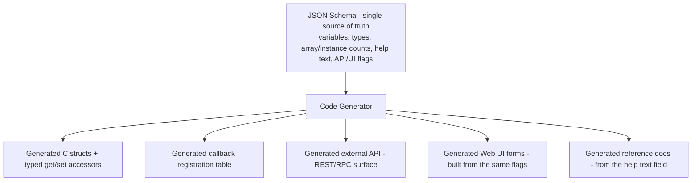
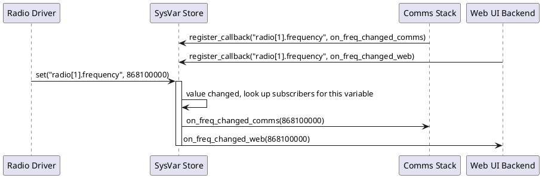
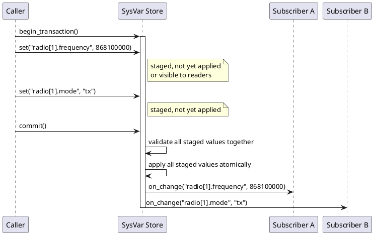
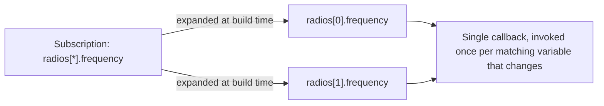

# SysVars: a schema-driven system variable store

## 1. Overview

Section 2.2 of the companion document (*Layered Firmware Architecture, HAL, and RTOS*) introduced "data storage / persistence with callbacks" as an example of a vertical, cross-cutting service -- infrastructure that every horizontal layer of a firmware stack can call into directly, rather than a rung in the layered ladder itself.

This document covers one well-proven way to build exactly that: a **system variable store** (often shortened to "sysvars"). It is a single, schema-defined data model that every layer can read, write, and subscribe to, with the C code, external API, and even a web UI all generated from one source of truth rather than hand-written and kept in sync manually.

## 2. The Core Idea

- Every piece of shared state (a config value, a live sensor reading, a radio setting) is declared once, in a JSON schema, not hand-coded as an ad hoc global or struct field
- A code generator turns that schema into C structs, typed accessor functions, and a registration table
- Any component (application, middleware, HAL driver) can **register a callback** against a specific variable; when that variable is set, every registered callback fires, so producers and consumers are decoupled -- the radio driver that sets a value has no idea who else cares about it
- The schema supports **arrays of instances** of the same structure, so "radio" can be declared once and instantiated as `radio[0]`, `radio[1]`, ... each with its own `frequency`, `mode`, and so on, without duplicating the definition
- Each field can carry **metadata**: help text, units, read-only/writable flags, whether it is exposed over an external API, whether it should appear in a web UI, and how -- and that metadata is what drives the generated API and UI, not separate hand-maintained code

## 3. From Schema to Generated Artefacts



This is the same principle as any docs-as-code or schema-first approach: define structure once, generate every downstream artefact from it, so the C code, the API, the UI, and the documentation cannot silently drift apart from each other -- they are all outputs of the same build step, not independently maintained.

## 4. Runtime Behaviour: Set, Notify, Multiple Subscribers



Neither the radio driver nor the store itself needs to know how many subscribers exist or what they do with the value; new consumers can subscribe later without the producer changing at all. This is the same decoupling principle a message broker gives you at the system level, applied inside a single piece of firmware.

## 5. Where It Sits in a Layered Architecture

A sysvar store is exactly the kind of vertical service described in section 2.2: application code, middleware, and HAL drivers can all set and subscribe to variables directly, and it has its own lifecycle (typically initialised very early, since other init code may depend on default values already being populated). It is a specific, concrete implementation of the "Data Storage / Persistence - callbacks" node shown in the cross-cutting services diagrams earlier.

## 6. Extending the Schema: Validation, Access Mode, Persistence, and Audit

The schema is the natural place to declare more than just type and name. Each of the following can be a flag or field on the resource definition, enforced by the generated code rather than trusted to every caller:

- **min / max / step**: the store rejects an out-of-range or non-step-aligned set before it ever reaches a callback, so range checking is written once, in the generator, instead of duplicated in every producer
- **access mode**: `read_only` (firmware sets it, generated API exposes no setter), `read_write` (normal config), or `write_only` (a command/trigger field, or a secret such as a PIN that should never be readable back out through the generated API)
- **persistent**: whether the value survives a reboot; flagged variables are written to flash-backed storage, ideally batched and committed atomically so a power loss mid-write cannot corrupt the structure
- **audit**: whether every change to this specific variable is appended to a change log (timestamp, old value, new value, and setter identity where available) -- deliberately opt-in per variable, since logging every RSSI update would flood the log while a tariff or PIN change is exactly what you want a durable trail for

```json
{
  "objects": {
    "radios": {
      "help": "Radio subsystem settings",
      "instances": 2,
      "resources": {
        "frequency": {
          "type": "uint32",
          "unit": "Hz",
          "min": 863000000,
          "max": 870000000,
          "step": 100000,
          "access": "read_write",
          "persistent": true,
          "audit": true,
          "help": "Carrier frequency for this radio instance"
        },
        "mode": {
          "type": "enum",
          "values": ["idle", "tx", "rx", "sleep"],
          "access": "read_write",
          "persistent": true,
          "audit": true,
          "help": "Current operating mode"
        },
        "rssi": {
          "type": "int16",
          "unit": "dBm",
          "access": "read_only",
          "persistent": false,
          "audit": false,
          "help": "Last measured received signal strength"
        },
        "reset_request": {
          "type": "bool",
          "access": "write_only",
          "persistent": false,
          "audit": true,
          "help": "Write true to request a radio reset; always reads back false"
        }
      }
    }
  }
}
```

Because these flags live in the schema, the generated API and web UI can also honour them directly: a `write_only` field never appears with a visible current value in the UI, a `read_only` field renders with no input control, and the min/max/step values populate a slider or spinner control automatically rather than being re-declared by whoever builds the UI.

## 7. Cardinality: Single vs Array, With a Bound

The earlier examples used `"instances": N` to mean two different things at once: "this is an array" and "the array has exactly N elements". It is worth pulling those apart explicitly, and worth distinguishing a **fixed** array from a **dynamic** one:

- **Single**: exactly one instance, always. There is no `[N]` in the path at all (`device.serial_number`, not `device[0].serial_number`).
- **Fixed array**: a known, unchanging count baked in at build time (three status LEDs on a board never becomes four without a hardware respin). The generator sizes a plain C array and there is no notion of instances being added or removed at runtime.
- **Dynamic array**: a build-time capacity ceiling (`max_instances`), with a separate resource tracking how many are actually active right now (paired peripherals, enabled radio channels). The generator still sizes a fixed-length C array of `max_instances` -- this is embedded firmware, not a language with dynamic allocation as the default -- but a live count guards how many of those slots are currently valid.

```json
{
  "objects": {
    "leds": {
      "cardinality": "fixed_array",
      "max_instances": 3,
      "resources": { "state": { "type": "bool", "access": "read_write" } }
    },
    "paired_devices": {
      "cardinality": "dynamic_array",
      "max_instances": 8,
      "active_count_resource": "paired_device_count",
      "resources": { "address": { "type": "string", "access": "read_only" } }
    },
    "device": {
      "cardinality": "single",
      "resources": { "serial_number": { "type": "string", "access": "read_only" } }
    }
  }
}
```

Making cardinality explicit rather than inferring it from a number also makes the schema self-documenting: a reviewer can see at a glance whether `leds` can ever have a fourth instance added later without checking the generator's rules for what "instances" defaults to.

## 8. Reusable Named Types

Repeating `min`/`max`/`step`/`unit` inline on every resource that happens to be a frequency risks one copy drifting from another when a regulatory limit changes. A `types` block, defined once and referenced by name, closes that gap -- the same idea as a C `typedef` or a JSON Schema `definitions`/`$ref` block:

```json
{
  "types": {
    "frequency_hz": {
      "base": "int32",
      "unit": "Hz",
      "min": 863000000,
      "max": 870000000,
      "step": 100000,
      "help": "Sub-GHz ISM band frequency"
    },
    "percentage": {
      "base": "uint8",
      "unit": "%",
      "min": 0,
      "max": 100,
      "step": 1
    },
    "radio_mode": {
      "base": "enum",
      "values": ["idle", "tx", "rx", "sleep"]
    }
  },
  "objects": {
    "radios": {
      "cardinality": "fixed_array",
      "max_instances": 2,
      "resources": {
        "frequency": { "type": "frequency_hz", "access": "read_write", "persistent": true, "audit": true },
        "mode": { "type": "radio_mode", "access": "read_write", "persistent": true, "audit": true }
      }
    }
  }
}
```

A resource can still override a field from its named type locally (a specific radio instance with a narrower frequency range than the general type allows), but the common case -- every radio using the same band limits -- is declared once. If the band limits change, one edit to `types.frequency_hz` propagates everywhere the type is used, rather than requiring a find-and-replace across every object.

## 9. Other Schema Considerations

A handful of smaller fields are easy to skip early on and awkward to retrofit later, because they affect either the generated C struct layout or how old persisted data is interpreted after a firmware update:

- **`max_length`** on string types: the generator needs a fixed buffer size (`char ssid[33]`), so this cannot be left implicit
- **`default`**: what a resource resets to on factory reset or before anything has explicitly set it, distinct from a hardcoded zero-initialised struct
- **`precision`**: for floating-point resources, how many decimal places are meaningful for display -- a UI control showing six decimal places of sensor noise is not more informative, just noisier
- **`deprecated`**: when retiring a resource, marking it deprecated rather than deleting it keeps its ID and storage offset reserved, so old persisted data is not silently reinterpreted as a different field's value after an update
- **schema `version`**: a version number on the whole schema (or per object), so the generator or the runtime can detect a mismatch between what's already in flash and what the current firmware expects, and run an explicit migration rather than misreading old data as the new layout

## 10. Atomic Multi-Variable Transactions

Setting `radio[1].frequency` and `radio[1].mode` as two separate calls means a subscriber can observe the frequency changed but the mode not yet updated, an inconsistent intermediate state. A transaction API closes this gap: stage several changes, validate them together, then apply and notify as one unit.



A subscriber that cares about both fields still gets two callbacks, but only after both values are already consistent with each other, and the transaction boundary is the natural place to add cross-field validation that a single variable's min/max/step cannot express on its own (for example, rejecting a `mode="tx"` commit if `frequency` is outside the band permitted for transmission).

## 11. Hierarchy: Nesting, Path Grammar, and Subscription

Everything so far has used a flat structure: an object, optionally an instance index, and one of its resources (`radio[1].frequency`). Real schemas often need genuine nesting -- an object containing a sub-object, not just a scalar resource -- and it is worth having an explicit grammar for that rather than letting it emerge ad hoc.

```json
{
  "objects": {
    "radios": {
      "cardinality": "fixed_array",
      "max_instances": 2,
      "resources": {
        "frequency": { "type": "frequency_hz", "access": "read_write" }
      },
      "objects": {
        "antennas": {
          "cardinality": "fixed_array",
          "max_instances": 2,
          "resources": {
            "gain_db": { "type": "int8", "access": "read_only" }
          }
        }
      }
    }
  }
}
```

This gives a path like `radios[1].antennas[0].gain_db` -- object, instance, nested object, nested instance, resource -- and the same grammar extends to any depth. Keeping the separator (`.` between object and sub-object, `[N]` for instance index) consistent regardless of nesting depth is what makes the wildcard expansion in the rest of this section, and the REST path mapping in section 12, mechanical rather than something the generator has to special-case.

With that grammar in place, a callback can subscribe against a pattern instead of an exact path:

- `radios[*].frequency` -- notify on a frequency change on any radio instance
- `radios[1].*` -- notify on any change under radio instance 1, including nested objects
- `radios[*].antennas[*].gain_db` -- notify on any antenna's gain changing, on any radio
- `radios.*` -- notify on any change anywhere under the radios object

> **Important:** because the schema is fixed at build time, every concrete variable path the device will ever have is already known to the generator. This means wildcard subscriptions do not need a runtime pattern-matching engine at all -- the generator can expand each wildcard subscription into the exact set of concrete variable IDs it matches, at build time, and the runtime dispatch stays a plain lookup table. This keeps the embedded runtime cost identical to exact-path subscription; the flexibility is entirely a build-time convenience.



## 12. Mapping to a RESTful API

If the schema is meant to drive a generated external API from the outset, it is worth designing the path grammar in section 11 so it maps onto REST conventions directly, rather than bolting a URL scheme on afterwards.

**Naming convention.** Name every object the way its REST collection would be named, not the way a single C struct instance would be: `leds`, `radios`, `sensors`, plural and lower_snake_case, because `GET /leds` returning a collection reads naturally where `GET /led` does not. A `single`-cardinality object is the one exception -- `device` and `network` stay singular, because there is only ever one and no collection is implied. Getting this right in the schema from the start means the internal path grammar and the generated URL scheme use the same names verbatim, rather than the API layer needing its own translation table between an internal singular name and an external plural one.

**Path mapping.** The dot/bracket grammar used internally translates to a URL path almost mechanically: `radios[1].antennas[0].gain_db` becomes `/radios/1/antennas/0/gain_db`. A request to the object itself without an index (`/radios`) is naturally the collection; a request with an index (`/radios/1`) is naturally that single item.

**Access mode drives allowed verbs.** This is where the `access` flag from section 6 stops being just documentation and becomes the thing that determines what the generated API actually accepts:

| Access mode | GET | PUT/PATCH | Notes |
| --- | --- | --- | --- |
| `read_only` | 200 with value | 405 Method Not Allowed | firmware is the only writer |
| `read_write` | 200 with value | 200/204 on success, 400 on a min/max/step violation | normal config path |
| `write_only` | 403 Forbidden or 204 with no body | 200/204 on success | value is never echoed back, e.g. a credential |

**Cardinality drives whether instances can be created or removed.** A `fixed_array` object exposes no `POST /leds` or `DELETE /leds/2` -- the count is fixed at build time, so only `GET`/`PUT` on existing indices make sense. A `dynamic_array` object can reasonably support `POST /paired_devices` to add an instance (up to `max_instances`) and `DELETE /paired_devices/3` to remove one, with the `active_count_resource` updated as a side effect rather than being independently settable.

**Transactions map onto a single PATCH.** Rather than inventing separate `begin`/`commit` endpoints over HTTP, a single `PATCH /radios/1` with a JSON body containing both `frequency` and `mode` maps naturally onto the transaction semantics from section 10: the whole request body is validated and applied as one unit, or rejected as one unit, which is exactly what a REST `PATCH` on a resource is supposed to mean.

**Subscription needs a channel REST doesn't have natively.** Plain REST is pull-based, so the callback/pub-sub model from section 4 needs a separate mechanism: either a `POST /subscriptions` endpoint that registers a webhook URL against a path pattern (including the wildcards from section 11), or a WebSocket/Server-Sent-Events endpoint for push delivery. Either way, the pattern syntax the external API accepts should be the same one used internally, generated from the same schema, rather than a second dialect a client has to learn.

**The schema itself is worth serving.** Since the API layer runs on hardware far less constrained than the firmware's own runtime, it costs little to expose the schema metadata (type, min/max/step, help text, access mode) at a discovery endpoint, for example `OPTIONS /radios/1/frequency` or a dedicated `/schema` route. This lets external tooling, including a generated web UI, introspect the API at runtime rather than needing its own build-time code generation step -- build-time generation is the right tradeoff inside the firmware, where every byte and cycle matters, but is not a constraint the external API layer needs to inherit.

## 13. Example: JSON Definition for a Simple System

The snippet in section 6 showed a single object (`radios`) in isolation. The example below is a larger, more representative schema for a small IoT device, using the plural, RESTful naming convention from section 12 throughout and covering every object type discussed in this document: a singleton, fixed arrays, a reusable named type, genuine object nesting, and resources whose meaning depends on a sibling field.

```json
{
  "types": {
    "percentage": {
      "base": "uint8",
      "unit": "%",
      "min": 0,
      "max": 100,
      "step": 1
    },
    "frequency_hz": {
      "base": "int32",
      "unit": "Hz",
      "min": 863000000,
      "max": 870000000,
      "step": 100000,
      "help": "Sub-GHz ISM band frequency"
    },
    "radio_mode": {
      "base": "enum",
      "values": ["idle", "tx", "rx", "sleep"]
    },
    "hw_binding": {
      "base": "string",
      "max_length": 24,
      "help": "Symbolic BSP identifier for the underlying peripheral or pin, e.g. TIM3_CH1 or GPIOB_PIN3; resolved to an address by the BSP, never a literal register offset in the schema itself"
    }
  },
  "objects": {
    "device": {
      "cardinality": "single",
      "help": "Identity and status of this device",
      "resources": {
        "serial_number": { "type": "string", "max_length": 16, "access": "read_only", "persistent": true, "audit": false, "help": "Factory-assigned serial number" },
        "fw_version": { "type": "string", "max_length": 12, "access": "read_only", "persistent": true, "audit": false, "help": "Running firmware version" },
        "uptime_seconds": { "type": "uint32", "unit": "s", "access": "read_only", "persistent": false, "audit": false, "help": "Seconds since last boot" }
      }
    },
    "leds": {
      "cardinality": "fixed_array",
      "max_instances": 3,
      "help": "Status LEDs",
      "resources": {
        "state": { "type": "bool", "access": "read_write", "persistent": false, "audit": false, "help": "On/off state of this LED" },
        "brightness": { "type": "percentage", "access": "read_write", "persistent": true, "audit": false, "default": 100, "help": "Brightness of this LED" },
        "hw_binding": { "type": "hw_binding", "access": "read_only" }
      }
    },
    "sensors": {
      "cardinality": "fixed_array",
      "max_instances": 2,
      "help": "Temperature sensor channels",
      "resources": {
        "value_c": { "type": "float", "unit": "C", "precision": 1, "access": "read_only", "persistent": false, "audit": false, "help": "Last measured temperature, degrees Celsius" },
        "sample_interval_s": { "type": "uint16", "unit": "s", "min": 1, "max": 3600, "step": 1, "default": 60, "access": "read_write", "persistent": true, "audit": false, "help": "How often this sensor channel is sampled" },
        "hw_binding": { "type": "hw_binding", "access": "read_only", "help": "e.g. I2C1/TMP102" }
      }
    },
    "radios": {
      "cardinality": "fixed_array",
      "max_instances": 2,
      "help": "Sub-GHz radio subsystems",
      "resources": {
        "frequency": { "type": "frequency_hz", "access": "read_write", "persistent": true, "audit": true },
        "mode": { "type": "radio_mode", "access": "read_write", "persistent": true, "audit": true },
        "rssi": { "type": "int16", "unit": "dBm", "access": "read_only", "persistent": false, "audit": false, "help": "Last measured received signal strength" },
        "hw_binding": { "type": "hw_binding", "access": "read_only", "help": "e.g. SPI1/CC1200" }
      },
      "objects": {
        "uart": {
          "cardinality": "single",
          "help": "Virtual serial port tunnelled over this radio's link, if supported",
          "resources": {
            "supported": { "type": "bool", "access": "read_only", "help": "Whether this radio instance can carry a serial bridge at all" },
            "baud_rate": { "type": "uint32", "access": "read_write", "persistent": true, "audit": false, "help": "Effective baud rate of the bridged serial stream; meaningless if supported is false" },
            "flow_control_enabled": { "type": "bool", "access": "read_write", "persistent": true, "audit": false, "help": "Software flow control over the radio link; there is no RTS/CTS wiring to bridge, so this is protocol-level, not hardware" }
          }
        }
      }
    },
    "serial_ports": {
      "cardinality": "fixed_array",
      "max_instances": 2,
      "help": "Physical UART serial ports",
      "resources": {
        "baud_rate": { "type": "uint32", "access": "read_write", "persistent": true, "audit": false, "help": "Baud rate" },
        "flow_control_capable": { "type": "bool", "access": "read_only", "help": "Whether RTS/CTS wiring is present on this port" },
        "flow_control_enabled": { "type": "bool", "access": "read_write", "persistent": true, "audit": false, "help": "Hardware flow control enabled; only takes effect if flow_control_capable is true" },
        "hw_binding": { "type": "hw_binding", "access": "read_only", "help": "e.g. USART2" }
      }
    },
    "network_interfaces": {
      "cardinality": "fixed_array",
      "max_instances": 2,
      "help": "Network connectivity interfaces",
      "resources": {
        "interface_type": { "type": "enum", "values": ["wifi", "ethernet"], "access": "read_only", "help": "Underlying interface technology" },
        "connected": { "type": "bool", "access": "read_only", "persistent": false, "audit": true, "help": "Whether this interface currently has an active connection" },
        "ip_address": { "type": "string", "max_length": 15, "access": "read_only", "persistent": false, "audit": false, "help": "Current IPv4 address, if connected" },
        "ssid": { "type": "string", "max_length": 32, "access": "read_write", "persistent": true, "audit": true, "help": "Wi-Fi network name; not meaningful when interface_type is ethernet" },
        "password": { "type": "string", "max_length": 63, "access": "write_only", "persistent": true, "audit": true, "help": "Wi-Fi network password; never readable back once set" }
      }
    },
    "gpios": {
      "cardinality": "fixed_array",
      "max_instances": 4,
      "help": "General-purpose digital IO pins",
      "resources": {
        "direction": { "type": "enum", "values": ["input", "output"], "access": "read_write", "persistent": true, "audit": false, "help": "Pin direction" },
        "state": { "type": "bool", "access": "read_write", "persistent": false, "audit": false, "help": "Logic level; for an input pin this reflects the sampled value and external writes should be rejected" },
        "hw_binding": { "type": "hw_binding", "access": "read_only", "help": "e.g. GPIOB_PIN3" }
      }
    },
    "pwm_outputs": {
      "cardinality": "fixed_array",
      "max_instances": 2,
      "help": "PWM output channels",
      "resources": {
        "duty_cycle": { "type": "percentage", "access": "read_write", "persistent": true, "audit": false, "help": "Output duty cycle" },
        "frequency_hz": { "type": "uint32", "unit": "Hz", "min": 1, "max": 20000, "step": 1, "access": "read_write", "persistent": true, "audit": false, "help": "PWM output frequency" },
        "hw_binding": { "type": "hw_binding", "access": "read_only", "help": "e.g. TIM3_CH1" }
      }
    },
    "adc_inputs": {
      "cardinality": "fixed_array",
      "max_instances": 2,
      "help": "Analogue-to-digital input channels",
      "resources": {
        "raw_counts": { "type": "uint16", "access": "read_only", "help": "Last conversion result, raw ADC counts" },
        "voltage_mv": { "type": "uint16", "unit": "mV", "access": "read_only", "help": "Last conversion result, converted to millivolts" },
        "hw_binding": { "type": "hw_binding", "access": "read_only", "help": "e.g. ADC1_IN5" }
      }
    }
  }
}
```

A few things worth noticing in this particular schema:

- The serial-over-radio bridge is now a nested object, `radios[N].uart`, rather than a separate top-level collection cross-referencing a radio by index -- this is the same nesting grammar from section 11, and it is a better fit here because the bridge genuinely belongs to a specific radio instance rather than standing alongside it
- `radios[N].uart.supported` plays the same role as `flow_control_capable` did before: not every radio instance necessarily has bridging wired up, and since every instance of an array (or a nested object under an array) shares the same resource set, a read-only capability flag is how that variation is represented
- `serial_ports` is now only physical UARTs, so it lost the `transport`/`backing_radio_instance` fields entirely -- removing them, rather than leaving them unused, matters once real firmware is generated from this, since an unused field still costs struct space and generated API surface
- `adc_inputs` replaces the earlier PWM-capture channels with actual analogue input: raw counts alongside a converted millivolt value, which is the pairing most consumers actually want (raw for calibration work, converted for everything else)
- every hardware-facing object (`leds`, `sensors`, `radios`, `serial_ports`, `gpios`, `pwm_outputs`, `adc_inputs`) now carries an `hw_binding` resource, using the shared `hw_binding` named type -- a short symbolic string such as `TIM3_CH1` or `GPIOB_PIN3` that names the peripheral or pin, not a raw register address; resolving that symbolic name to an actual address is the BSP's job, exactly as described in the companion document, so the schema stays portable across boards even though `hw_binding`'s *value* will differ per board

## 14. Design Principles Worth Holding Onto

- Define the data model once, in the schema, and generate the C structs, API, UI, and documentation from it; hand-maintaining the same structure in three places is where those three things quietly drift apart
- Make cardinality explicit (`single`, `fixed_array`, `dynamic_array`) rather than inferring it from a bare instance count; a reviewer should be able to tell whether an array can ever grow without checking the generator's defaults
- Reuse named types for anything declared more than once; one edit to a shared type should be able to propagate everywhere it is used, rather than requiring a search across every object
- Keep `audit` opt-in per variable, not a global switch; a log that captures everything is as hard to use as no log at all
- Treat `min`/`max`/`step` as enforced contracts, not documentation -- the store should reject an invalid set outright, rather than trusting every caller to have checked first
- Reach for a transaction when two or more variables must never be observed in a half-updated state relative to each other
- Remember that wildcard subscriptions cost nothing at runtime on an embedded target, provided the schema is fixed at build time and the generator expands them to concrete IDs ahead of time
- Design the internal path grammar and the external REST path scheme together, from the same schema, rather than treating the API as an afterthought bolted onto an already-fixed internal addressing scheme
- Name every object as its REST collection would be named (plural, lower_snake_case), with `single`-cardinality objects as the only deliberate exception
- Where one field's meaning depends on another (a port's flow control depending on its transport, a pin's writability depending on its direction), the schema can document the relationship, but enforcing it is a validator's job, not something a static `access` flag alone can carry
- Where a resource belongs to a specific hardware instance rather than the device as a whole, nest it under that instance rather than cross-referencing it by index from a separate top-level collection
- Keep `hw_binding` symbolic (a name the BSP resolves), never a literal register address in the schema itself -- the schema should not need to change when a board respin moves a peripheral to a different pin
