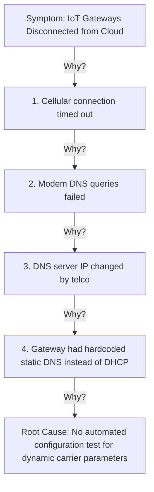
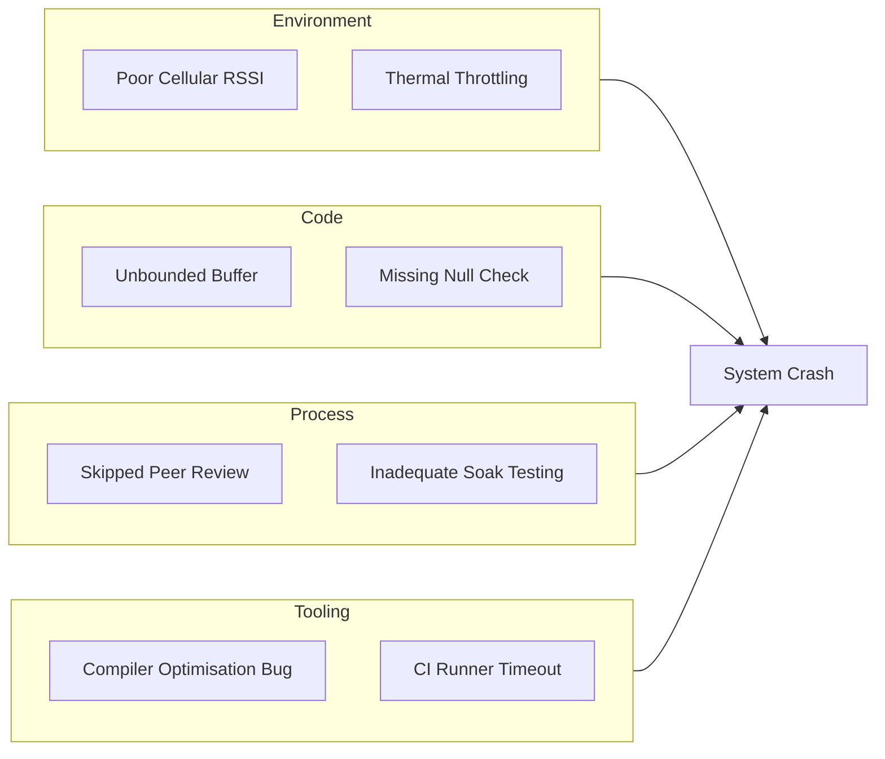

# Defect management and debugging

This guideline defines the engineering standards for reporting, triaging, diagnosing, and resolving software defects across embedded firmware, edge devices, and cloud infrastructure. It establishes rigorous debugging disciplines, root cause analysis (RCA) frameworks, and blameless post-mortem procedures.

## Purpose and Scope

Unstructured defect reports and undisciplined "trial-and-error" debugging waste engineering effort, extend outage durations, and frequently introduce secondary bugs into production code.

This standard establishes:
- Standardised defect creation criteria (DC-1 to DC-4).
- A unified Severity versus Priority classification matrix.
- A systematic 38-point debugging checklist (DBG-1 to DBG-38).
- Root Cause Analysis (RCA) methodologies and blameless post-mortem templates.

## 1. Defect Creation Standards

Every defect logged in the engineering issue tracker (Jira / GitHub Issues) MUST adhere to the four defect creation rules:

### DC-1: Define the System Context and Environment

The defect report MUST precisely specify the target execution environment:
- **Target Platform & Architecture**: Target hardware variant, processor architecture (for example, Nordic nRF52840, STM32H7, x86-64).
- **Software Versions**: Exact firmware version string, Git commit SHA, OS/RTOS version (for example, FreeRTOS v10.4.3, Zephyr v3.5.0, Ubuntu 22.04 LTS).
- **Configuration Parameters**: Any non-standard compiler flags, configuration settings, or feature toggles enabled during reproduction.
- **Workflow State**: The operational state of the system immediately preceding the failure.

### DC-2: Research and Reproduce the Root Cause

The author MUST perform preliminary investigation prior to submitting the ticket:
- **Reproducibility**: Retest the failure sequence until an exact, deterministic step-by-step reproduction recipe is established.
- **Intermittency**: If the issue is non-deterministic (for example, race condition or timing jitter), state the empirical reproduction frequency (for example, "occurs in approximately 3 out of 100 power cycles").
- **Boundary Isolation**: Narrow down which subsystem triggers the fault by examining error return codes and system audit logs.

### DC-3: Attach Concrete Supporting Evidence

Defect reports MUST include direct diagnostic evidence rather than verbal assertions:
- Serial console logs, syslog captures, or cloud distributed traces (with correlation IDs).
- Logic analyser captures (sigrok/Saleae) or Wireshark PCAPs for communication bus or networking faults.
- Core dump summaries, register state dumps (PC, LR, SP, HardFault status registers), or stack backtraces.
- Visual evidence (screenshots, annotated diagrams, or step recorder recordings).

### DC-4: Format Objectively Without Speculation or Blame

All text MUST adhere to professional, objective technical reporting:
- Maintain strict factual neutrality: describe what happened versus what was expected.
- Avoid emotional language, opinions, speculation, or assigning individual blame.
- Use structured headings: **Summary**, **Environment**, **Preconditions**, **Steps to Reproduce**, **Expected Result**, **Actual Result**, and **Attachments**.

### Standard Defect Report Template

```markdown
### Summary
LTE Modem fails to reconnect after waking from Deep Sleep when network signal is marginal (-115 dBm).

### Environment
- **Device**: Smart Gateway Rev C (Board ID: GW-REV-C3)
- **Firmware Version**: v2.4.1 (Git commit: `a3b7c89f`)
- **Modem Firmware**: Quectel BG95-M3 (Revision: BG95M3LAR02A03)
- **RTOS**: FreeRTOS v10.4.3

### Preconditions
1. Device provisioned with valid SIM card on Band 20.
2. RF attenuator adjusted to simulate weak cellular signal (-115 dBm RSRP).

### Steps to Reproduce
1. Command device into deep sleep via CLI: `system sleep --duration 300`
2. Wait 300 seconds for RTC wakeup timer to expire.
3. Observe UART diagnostic console during modem power-rail re-initialisation.

### Expected Result
Modem driver re-initialises UART communication, registers with the cellular tower within 45 seconds, and transitions to connected state.

### Actual Result
Modem power pin toggles correctly, but AT command response times out after 10,000 ms. The driver enters an infinite retry loop, depleting the backup battery within 4 hours.

### Supporting Evidence
- Console log: [console_dump_reconnect_fail.log]
- Oscilloscope capture: [power_rail_glitch_ch1.png]
- Logic analyser trace: [uart_at_timeout.sr]
```
[[CAPTION:Figure]] Standard defect report example for embedded hardware/firmware integration.

## 2. Severity and Priority Classification

Defects MUST be classified across two independent dimensions: **Severity** (technical impact on the system) and **Priority** (urgency of commercial resolution).

### 2.1 Severity Levels

| Severity | Label | Definition | Technical Criteria |
| :--- | :--- | :--- | :--- |
| **Sev-1** | Critical / Outage | Total system stoppage or catastrophic data corruption. | Device crash, boot loop, hard fault, security vulnerability exploited in wild, or complete cloud service unavailability with no workaround. |
| **Sev-2** | Major / Degraded | Severe impairment of core functionality. | Primary business capability or sensor telemetry stream non-functional; partial data loss; workaround requires significant manual intervention. |
| **Sev-3** | Moderate | Non-critical functionality broken; workaround exists. | Secondary feature failure (for example, diagnostic LED sequence incorrect, non-essential report failure); system continues operating safely. |
| **Sev-4** | Minor / Cosmetic | Negligible operational impact. | Typographical error in logs, minor web portal UI alignment defect, non-conforming variable name in debug build. |

[[CAPTION:Table]] Technical severity levels and criteria.

### 2.2 Priority Levels and SLAs

| Priority | Label | Target Resolution SLA | Release Mechanism |
| :--- | :--- | :--- | :--- |
| **P1** | Blocker | Work begins immediately; continuous effort until resolved. | Dedicated hotfix release deployed out-of-band. |
| **P2** | High | Resolved within current active sprint. | Included in the next scheduled minor release. |
| **P3** | Medium | Scheduled into backlog for upcoming release cycle. | Standard sprint planning backlog. |
| **P4** | Low | Resolved as opportunistic maintenance when adjacent code is modified. | Future release candidate. |

[[CAPTION:Table]] Priority levels and resolution service-level agreements.

## 3. Systematic Debugging Discipline

Engineers MUST approach defect resolution methodically, following the 38-point debugging checklist adapted from classic software engineering practices:

### 3.1 General Debugging Discipline

| ID | Checklist Question |
| :--- | :--- |
| **DBG-1** | Have you set a maximum time limit for quick initial debugging before stepping back to formulate a structured plan? |
| **DBG-2** | Have you checked the issue tracker, knowledge base, and commit history to ensure the issue has not already been diagnosed? |
| **DBG-3** | Are you utilising all available debugging tools (hardware debuggers, JTAG/SWD, compiler warnings, static analysers, sanitizers)? |
| **DBG-4** | Do you operate on the default assumption that the defect resides in your own code rather than the compiler, OS, or hardware? |
| **DBG-5** | Have you strictly eliminated superstitious, trial-and-error changes made without understanding root cause? |
| **DBG-6** | Are you using multiple complementary techniques (differential debugging, binary search, assertions, execution traces)? |
| **DBG-7** | Do you solicit advice and code inspection from peers when progress stalls? |
| **DBG-8** | If diagnosis exceeds the initial estimate, have you communicated the delay to project stakeholders? |
| **DBG-9** | Do you know when to step back, take a break, and allow subconscious problem-solving to operate? |
| **DBG-10** | Do you verify that the proposed fix actually resolves the root problem rather than masking symptoms? |
| **DBG-11** | Do you document the root cause and learning points to prevent recurrence across the team? |

[[CAPTION:Table]] General debugging discipline checklist items.

### 3.2 Techniques for Finding Errors

| ID | Diagnostic Technique |
| :--- | :--- |
| **DBG-12** | Formulate an explicit hypothesis based on observed data before executing the next test run. |
| **DBG-13** | Refine and minimise the test case until it contains the smallest reproducible sequence of steps. |
| **DBG-14** | Attempt to reproduce the error through different pathways or operating conditions. |
| **DBG-15** | Generate additional telemetry data and register inspections to validate or invalidate competing hypotheses. |
| **DBG-16** | Evaluate negative tests: identify what does *not* fail to narrow the search space. |
| **DBG-17** | Brainstorm alternative hypotheses if initial assumptions fail validation. |
| **DBG-18** | Narrow the suspicious code region using binary search (git bisect or commenting out submodules). |
| **DBG-19** | Inspect code modified recently in git commit history. |
| **DBG-20** | Expand the inspection window if the defect involves corrupted memory or delayed side effects. |
| **DBG-21** | Isolate components and test them incrementally in a synthetic test harness. |
| **DBG-22** | Pay particular attention to routines that have historically exhibited high defect densities. |
| **DBG-23** | Use systematic brute-force instrumented logging when interactive debuggers cannot capture timing issues. |
| **DBG-24** | Check for classic failure modes: off-by-one errors, uninitialised pointers, stack overflows, integer truncation. |
| **DBG-25** | Explain the problem aloud line-by-line to a colleague or inanimate object ("rubber duck debugging"). |
| **DBG-26** | Take a deliberate break to reset cognitive perspective when stuck. |

[[CAPTION:Table]] Techniques for finding errors checklist items.

### 3.3 Techniques for Fixing Errors

| ID | Remediation Practice |
| :--- | :--- |
| **DBG-27** | Ensure you thoroughly understand the root problem before touching any line of production source code. |
| **DBG-28** | Check the proposed solution against architectural guidelines and quality standards. |
| **DBG-29** | Write a failing automated regression test that reproduces the defect before applying the fix. |
| **DBG-30** | Maintain composure; avoid rushing out unverified "hotfixes" under production pressure. |
| **DBG-31** | Confirm that your diagnosis explains all observed symptoms, not merely a subset. |
| **DBG-32** | Preserve the original failing branch and log captures for post-incident review. |
| **DBG-33** | Fix the underlying architectural or algorithmic defect, not merely the immediate symptom. |
| **DBG-34** | Change code only with clear, defensible architectural justification. |
| **DBG-35** | Understand the wider system context to ensure the fix does not break downstream invariants. |
| **DBG-36** | Make one atomic change at a time; test and verify between changes. |
| **DBG-37** | Search the entire codebase for identical or similar flawed code patterns. |
| **DBG-38** | Re-run full automated regression test suites to guarantee zero unintended side effects. |

[[CAPTION:Table]] Techniques for fixing errors checklist items.

## 4. Root Cause Analysis (RCA) and Blameless Post-Mortems

For every Sev-1 and Sev-2 incident, the team MUST carry out a Root Cause Analysis (RCA). It MUST publish a blameless postmortem within 5 working days of the incident being resolved.

### 4.1 The 5-Whys Methodology

Teams must trace failures back to underlying systemic, procedural, and cultural causes rather than stopping at the immediate technical trigger:


[[CAPTION:Figure]] 5-Whys root cause analysis tree.

### 4.2 Ishikawa (Fishbone) Diagram

Complex distributed faults must be analysed across the five core engineering dimensions:


[[CAPTION:Figure]] Ishikawa fishbone root cause categorisation.

### 4.3 Blameless Post-Mortem Template

```markdown
# Blameless Post-Mortem: [INCIDENT-ID] - [Brief Title]

## Executive Summary
- **Date of Incident**: [YYYY-MM-DD]
- **Duration of Outage**: [X hours, Y minutes]
- **Severity**: [Sev-1 / Sev-2]
- **Impacted Systems**: [List of services, firmware versions, or customer cohorts]
- **Lead Investigator**: [Name]

## Incident Timeline (All times in UTC)
- **14:02**: Firmware OTA campaign initiates deployment of v2.4.1 to batch 1 (500 units).
- **14:15**: Automated cloud alerts trigger: disconnect rate exceeds 20% threshold.
- **14:22**: On-call engineer initiates incident triage; halts OTA rollout.
- **15:05**: Hardware debugger connects to laboratory unit; HardFault identified in modem driver.
- **16:30**: Patch verified in lab; hotfix v2.4.2 compiled and validated.
- **17:15**: Hotfix dispatched to impacted fleet; telemetry streams recover.

## Root Cause
Modem re-initialisation routine assumed valid UART response within 100 ms. In low-signal environments, the cellular modem required up to 450 ms to respond, causing a null pointer dereference in the response parser.

## What Went Well
- Automated disconnect alerts triggered within 13 minutes of rollout.
- Staged deployment policy contained the failure to batch 1 (only 500 of 50,000 units affected).
- Rollback was executed promptly without cascading database failure.

## What Went Wrong
- Pre-release soak testing was conducted solely under optimal laboratory RF signal conditions (-65 dBm).
- Unit test suite mocked UART responses synchronously with zero latency.

## Action Items
| ID | Action Item | Owner | Target Date | Tracking Key |
| :--- | :--- | :--- | :--- | :--- |
| **ACT-1** | Add RF attenuation sweep (-60 to -115 dBm) to automated HIL test matrix. | [Name] | 2026-10-15 | HW-402 |
| **ACT-2** | Implement asynchronous timeout protection and watchdog kick in modem driver. | [Name] | 2026-09-30 | FW-891 |
| **ACT-3** | Update GU-021 defect review checklist to mandate latency injection in mocks. | [Name] | 2026-10-05 | DOC-112 |
```
[[CAPTION:Figure]] Blameless post-mortem report template.

## Related Documents

- [Design Checklist Guide](../templates/design-review-checklist.md)
- [Code Review Checklist](../templates/code-review-checklist.md)
- [C Coding Standards](../standards/c-coding-standard.md)
- [Code Review Guide](code-review.md)
- [Architecture Review Checklist](../templates/architecture-review-checklist.md)
- [Fundamental Software Architecture Principles](../standards/software-architecture-principles.md)
- [API Design and Error Management Standards](../standards/api-design.md)
