# How Git works

*Written for engineers who want to understand Git rather than memorise commands.*

## Mental Model: What Git Is

A lot of pain with Git comes from thinking about it as:

- A timeline of commits
- A central server and client
- Files changing over time

This is wrong (or at least not the useful view).

The right mental model:

### Git Is a Content-Addressable Database of Snapshots, Connected Into a Directed Acyclic Graph (DAG)

Let’s unpack that without getting academic.

### Git stores snapshots, not diffs

When you commit:

- Git stores **what your project looks like now**, not a diff from the previous commit.
- Internally, each commit points at a **tree** (your folder hierarchy).
- Trees point at **blobs** (file contents).
- The entire structure is immutable. Once stored, Git never edits it; it adds new objects.

This is why:

- Rewriting history does not break the past; it makes **new commits**.
- Rollback doesn’t delete old work; it points somewhere else.

### The DAG: Directed Acyclic Graph

This matters more than people realise.

Git commits form a DAG:

- Directed: each commit points to one or more parents
- Acyclic: no cycles; a commit never points “forward”
- Graph: not a straight line; merges create multiple parents, and branching creates diverging nodes

If you zoom out, a DAG with a branch and a merge looks like this:

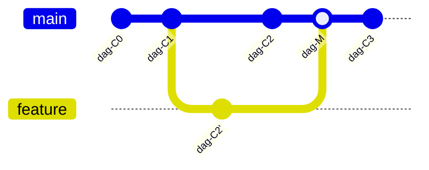
[[CAPTION:Figure]] A branch and a merge in the commit DAG

People imagine this instead, as a straight line:

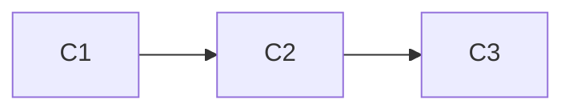
[[CAPTION:Figure]] The commonly (and incorrectly) imagined linear history

The DAG is not linear. It’s a **web of snapshots**.

This is useful because branching and merging are cheap: you are **moving pointers**.

- A **branch** is a label pointing at a commit
- `HEAD` is a pointer to “your current branch”
- Moving branches does not rewrite the DAG; it moves the label

That is incredibly powerful.

### The DAG explained step-by-step

Let’s illustrate two developers working:

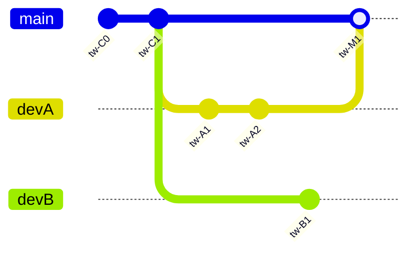
[[CAPTION:Figure]] Two developers branching and merging into main

Important details:

#### Commit IDs are hashes

The commit hash is **content + metadata**:

`commit = hash(tree + parents + message + timestamp + author...)`

Change anything → new hash.

That’s why rebase creates **new commits**:\
You change the commit parent → different hash.

#### No central truth

With Git, there isn’t one single “timeline”.\
There are many possible paths.

- `main` is a pointer **your team agrees** is the official one
- Feature branches are different paths in the DAG

#### Merge = “join two DAG paths”

- Git finds the **merge base**
- Calculates diffs from base → both branches
- Tries to apply both into a **new merge commit**

This is three-way merge, which is far smarter than diffing two files.

### HEAD, branch pointers, and detached HEAD

- `HEAD` points to the **current branch**
- That branch pointer points to a **commit**
- That commit points to a tree

Example:

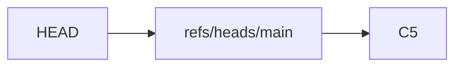
[[CAPTION:Figure]] HEAD, a branch pointer, and the commit it references

When you `checkout <commit>` (not branch):

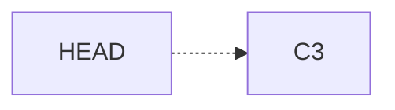
[[CAPTION:Figure]] Detached HEAD pointing directly at a commit

That’s “detached HEAD”: `HEAD` points straight at the commit, with no branch label between.\
You’re not on a branch.\
If you commit from here, the commit is **unreferenced** until you create a branch.

That’s why people “lose” commits: they make them where no pointer references them.

Reflog solves that later.

## Working Model: Local vs Remote

Git is **distributed**:

- Your local `.git` is a full database
- Remotes are **other copies**
- `push` and `pull` are **synchronisation events**

You don’t “check files out from the server”.\
You **replicate the DAG**, then collaborate via branch pointers.

## Zones: Working directory, Index, Repository

Understanding these is essential:

### Working Directory

Your actual files.

### Index (Staging Area)

Snapshot you want to commit **next**.

### Repository

All commits and history in `.git`.

Cycle:


[[CAPTION:Figure]] The working directory, index, and repository cycle

This explains why:

- `git commit` does not commit **everything changed**, only what you staged.
- You can stage part of a file.

## Basic workflow with explanation

```bash
git status
git add file.c
git commit -m "Fix A"
git push origin main
```

Nothing magical.\
No server-side locking.\
No checkout/in/out.\
No central timeline.

## Branching in Depth

### Branches Are Pointers

A branch is:

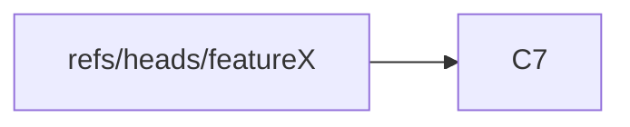
[[CAPTION:Figure]] A branch as a pointer to a commit

When you commit, Git:

- Makes a new commit
- Moves `featureX` to the new commit

That’s it.

### Creating and switching

```bash
git checkout -b feature/api
```

This creates:

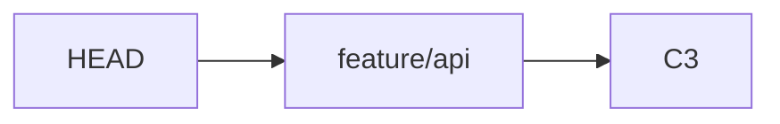
[[CAPTION:Figure]] HEAD following a newly created feature branch

Commits now extend the **feature branch**, not main.

## Merging: Detailed Explanation

Merging is not file copying.

### Merge base

To merge `A` and `B`:

1. Find their **last common commit** (merge base).
1. Calculate changes from base → A
1. Calculate changes from base → B
1. Apply both to base
1. If conflicts → ask you

Example:

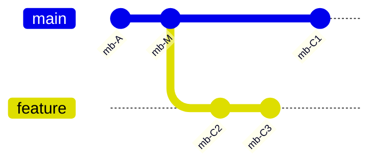
[[CAPTION:Figure]] Merge base of two diverged branches

Merge base = `M`.

This is why you can merge branches even if they diverged months ago.

### Merge types detailed

#### Fast-forward merge

History is linear, with no divergence. Feature branched off `B`, and `main` has not moved since:

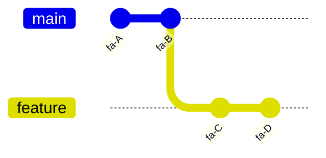
[[CAPTION:Figure]] Two branches before a fast-forward merge

Since `main` did not move, Git moves the `main` pointer forward to `D`; no new commit is created:

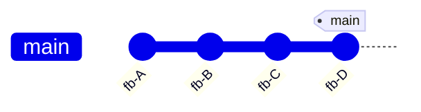
[[CAPTION:Figure]] State after a fast-forward merge

#### Merge commit

Both `main` and `feature` moved since they diverged, so Git creates a new merge commit `M` with two parents:

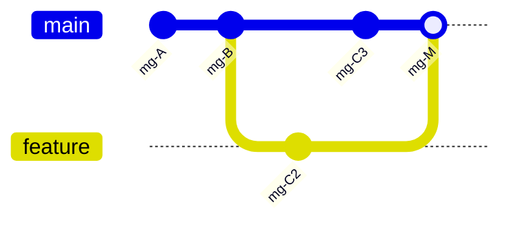
[[CAPTION:Figure]] A merge commit joining two diverged branches

Merge creates new commit `M`.

### No fast-forward merge (`--no-ff`)

Teams often want to preserve branch context.\
So they **force a merge commit** even if fast-forward is possible.

This keeps feature branches visible in history.

### Merge conflicts

Conflicts happen when:

- Same line changed
- Adjacent lines changed
- File moved in one branch and edited in another
- Binary files can’t be merged

When Git cannot reconcile both sides automatically, it writes conflict markers directly into the file:

```text
<<<<<<< HEAD
int retries = 3;
=======
int retries = 5;
>>>>>>> feature/tuning
```

- Everything between `<<<<<<< HEAD` and `=======` is **your current branch's version**.
- Everything between `=======` and `>>>>>>> feature/tuning` is the **incoming branch's version**.
- You edit the file to keep the version you want (or blend both), then delete all three marker lines.

Conflict resolution is not about guessing: it is about **intent**.

Good practice:

- Resolve conflicts **one commit at a time**
- Do not keep one side without checking it
- Compile and test after merge

## Merge Strategies

`git merge` picks a strategy automatically based on how many branches you are merging, but you can choose one explicitly with `git merge -s <strategy>`. This is a different question from the fast-forward or merge-commit outcome described above. The strategy is the *algorithm* Git uses to combine the branches, not the shape of the resulting history.

| Strategy       | What it does                                                               | When to use                                             |
| --------------- | ---------------------------------------------------------------------------- | ---------------------------------------------------------- |
| `ort`           | The default since Git 2.34. A three-way merge that detects renames and handles criss-cross merge bases better than its predecessor. | Almost always; this is what runs when you type plain `git merge`. |
| `recursive`     | The previous default three-way merge algorithm. Still available and still correct, just superseded by `ort`. | Rarely chosen deliberately; occasionally useful for compatibility with older tooling. |
| `--ff-only`     | Not a merge strategy as such, but a flag that refuses to create a merge commit: it only succeeds if the merge could fast-forward. | Enforcing a linear history on shared branches, or checking whether a merge would be trivial before doing it. |
| `ours` (`-s ours`) | Records a successful merge but keeps your current branch's tree entirely, discarding every change from the other side. | Deliberately marking a branch as merged without taking its content, for example retiring an old branch while preserving its history in the graph. |
| `octopus`       | Merges more than two branches in a single commit. Chosen automatically when you run `git merge branchA branchB branchC`. Has no built-in conflict resolution: it fails outright if there is any conflict. | Combining several independent, low-risk topic branches at once, typically by a release manager. |
| `resolve`       | An older two-branch three-way merge algorithm, simpler and more conservative than `recursive`/`ort`, without rename detection. | Rarely needed today; kept for compatibility and as a fallback for edge cases `ort` handles poorly. |
| `subtree`       | A variant of the recursive/ort algorithm that treats one project's history as if it were always a subdirectory of the other, adjusting paths on the fly. | Merging in another project's history at a specific path; this is the strategy `git subtree` (below) uses internally. |
[[CAPTION:Table]] Git merge strategies and when each applies

### Strategy Options vs Strategy

Do not confuse the strategy itself with `-X` **strategy options**, which tune the `ort`/`recursive` algorithm's conflict resolution rather than replacing it:

```bash
git merge -X ours feature/x     # on a per-hunk conflict, prefer our side; still a real three-way merge
git merge -X theirs feature/x   # on a per-hunk conflict, prefer their side; still a real three-way merge
git merge -s ours feature/x     # ignore the other branch's changes entirely, for every file
```

`-X ours` only wins conflicting hunks in your favour and still incorporates the other branch's non-conflicting changes. `-s ours` is far more drastic: nothing from the other branch reaches the working tree at all, only a merge commit recording that it happened.

## Rebase: Detailed View

Rebase is misunderstood.

### What Rebase Does

Rebase:

1. Takes your commits
1. Temporarily removes them
1. Moves branch pointer to another base
1. Replays commits one by one:

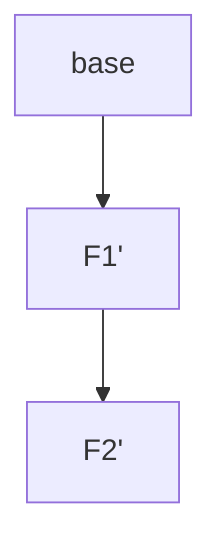
[[CAPTION:Figure]] Commits replayed onto a new base during rebase

These are **new commits**.\
Original ones remain in reflog until pruned.

### Why Rebase

For feature work:

- You want a clean story: “main → my work”
- Without messy merge commits

Rebase lets:

- Code review be easier
- Bisection simpler
- History readable

#### When NOT to rebase

Never rebase a branch that others already use.\
You change commit IDs → their work breaks.

Rule:

- Local = rebase ok
- Shared = prefer merge

## Log and Reflog: Powerful Inspection

### `git log`: Reading the DAG

Examples:

```bash
git log --oneline --graph --decorate --all
```

This shows:

- Branch pointers
- Tags
- Merge structure

Also helpful:

```bash
git log --patch           # show diffs
git log --stat            # file changes
git log --first-parent    # follow merges on main
git log path/to/file.c    # history of a file
```

`--first-parent` is brilliant for release history.

### `git reflog`: The Time Machine

Reflog tracks **pointer movements**:

- HEAD moved
- Branch moved
- Checkout happened
- Reset happened

Even after you think you “deleted” commits, they are in reflog.

```bash
git reflog
```

Recovery example:

```bash
git reset --hard <id-from-reflog>
```

This is **how you recover broken history**.

## Bisect: Finding the Commit That Broke Something

`git bisect` performs a binary search across the DAG to find the commit that introduced a regression. It is invaluable when you know "it worked at some point" but not where it stopped.

### How it works

1. Tell Git a known-bad commit (usually `HEAD`) and a known-good commit (an older tag or commit).
1. Git checks out a commit halfway between the two.
1. You test it and tell Git `good` or `bad`.
1. Git halves the remaining range and repeats.
1. After `log2(n)` steps, Git identifies the exact first-bad commit.

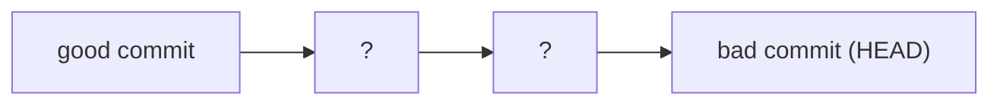
[[CAPTION:Figure]] Binary search narrowing to the first bad commit

### Manual bisect

```bash
git bisect start
git bisect bad                 # HEAD is broken
git bisect good v1.4.0         # this tag was fine
# Git checks out a midpoint commit
# ...build and test...
git bisect good                # or: git bisect bad
# repeat until Git reports the first bad commit
git bisect reset               # return to where you started
```

### Automated bisect

If the regression can be detected by a script or test command, let Git drive the whole search:

```bash
git bisect start HEAD v1.4.0
git bisect run npm test
```

Git runs the command at each step and interprets a non-zero exit code as `bad`, zero as `good`, so no manual testing is required.

## Pull Requests: Real-World Workflow

PRs are workflow, not Git. But they use Git theory.

Modern development flow:

### Creating a PR

1. Branch:

```bash
git checkout -b feature/mag-tamper
```

1. Commit locally until complete.
1. Pull latest main into branch:

```bash
git fetch origin
git rebase origin/main      # or git merge origin/main
```

1. Push branch:

```bash
git push -u origin feature/mag-tamper
```

1. Create PR:

    - Source: `feature/mag-tamper`
    - Target: `main` (or `develop`)

### Good PR hygiene

A good PR:

- Is **small**
- Solves one problem
- Has clear title: what + why
- Contains description:
  - Motivation
  - Changes
  - Testing
  - Impact
  - Steps to verify

### Review etiquette

Rules for reviewers:

- Review code, not people
- Ask questions before demands
- Suggest alternatives
- Provide rationale
- Don’t bike-shed

Rules for authors:

- Respond with respect
- Document decisions
- Don’t ignore comments
- Avoid making PRs “3-in-1” refactors, features, formatting

### Merge options in PR UI

You usually get three options for combining a pull request. These are different from both the fast-forward or merge-commit outcome and the `ort`/`recursive`/`ours` algorithm choice covered earlier. This is the menu a PR tool (GitHub, GitLab and similar) offers when you click merge. Starting from the same point, `main` at `A`, with `feature` carrying two commits:

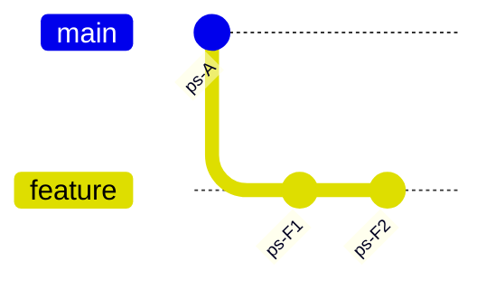
[[CAPTION:Figure]] Starting point shared by all three PR merge options

#### Merge Commit (PR Option)

Preserves branch history: every commit from `feature` stays, joined by a new merge commit with two parents.

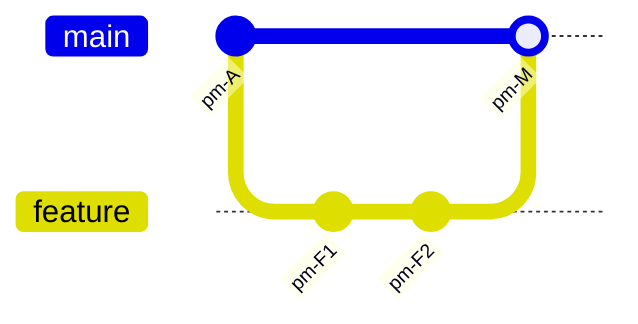
[[CAPTION:Figure]] Resulting history from a merge commit

A good choice when context matters.

#### Squash and merge

Combines all of `feature`'s commits into a single new commit on `main`. The individual `F1`/`F2` commits and the branch structure are gone from `main`'s history.

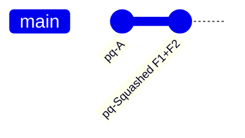
[[CAPTION:Figure]] Resulting history from squash and merge

Good for messy feature history.

#### Rebase and merge

Replays `feature`'s commits one by one onto the tip of `main` as new commits, then fast-forwards, with no merge commit at all.

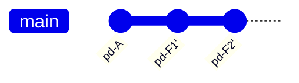
[[CAPTION:Figure]] Resulting history from rebase and merge

Linearises history. Good for clean timelines.

#### Choosing between them

| Option           | Resulting history                          | Individual commits kept? | Good For                                    |
| ---------------- | ------------------------------------------- | ------------------------- | -------------------------------------------- |
| Merge commit      | Branch shape preserved, plus a merge commit | Yes, unchanged             | Preserving how and when work happened |
| Squash and merge  | One new commit on `main`                    | No, collapsed into one     | Messy or WIP feature history you do not want on `main` |
| Rebase and merge  | Linear, feature commits replayed onto `main`| Yes, but with new commit IDs | A clean, bisectable, linear timeline |
[[CAPTION:Table]] Comparison of the three pull request merge options

Team should have a default policy.

## Cherry-Pick: Selective History

Use cases:

- Backport fix to old release branch
- Take isolated commit without full merge

Risk:

- Can duplicate commits across branches
- Future merges may conflict badly

Rule:

- Cherry-pick **isolated fixes**
- Avoid cherry-picking **whole feature work**

## Tags: Marking Releases

A tag is a fixed pointer to a specific commit. Unlike a branch, a tag never moves once created; it exists to mark a point in history, most commonly a release.

### Lightweight vs Annotated Tags

- A **lightweight** tag is just a name pointing at a commit, with no extra metadata: `git tag v1.2.3`.
- An **annotated** tag is a full Git object: it stores the tagger, date, and a message, and can be GPG-signed. Use annotated tags for anything you intend to keep, including every release:

```bash
git tag -a v1.2.3 -m "Release 1.2.3: PAN recovery fix"
git tag -s v1.2.3 -m "Release 1.2.3"   # signed, if you use GPG
```

### Working with Tags

```bash
git tag                        # list tags
git tag -l "v1.2.*"            # list tags matching a pattern
git push origin v1.2.3         # push a single tag
git push origin --tags         # push all tags
git tag -d v1.2.3               # delete locally
git push origin --delete v1.2.3 # delete on the remote
git describe --tags             # nearest tag reachable from HEAD
```

### Naming and Placement

Tag names conventionally follow [Semantic Versioning](https://semver.org): `vMAJOR.MINOR.PATCH`, for example `v2.1.0`. Where you tag depends on the branching strategy. On trunk-based or GitHub Flow projects, tag the commit on `main` right after it is deployed. On GitFlow, release branching or cherry-pick release branching, tag the commit on the `release/x.y` branch once it is finalised, not on `main`.

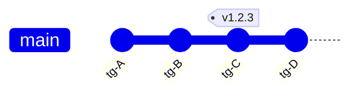
[[CAPTION:Figure]] A tag pinned to a specific commit, unaffected by later commits

### Tags vs Branches

Both are refs, both point at a commit, and both are cheap to create, but they mean different things and Git treats them differently:

| Question                         | Branch                                   | Tag                                            |
| ---------------------------------- | ------------------------------------------ | ------------------------------------------------- |
| Does it move?                     | Yes, automatically, with every commit made on it | No; it stays on the commit it was created against |
| What does it represent?           | Ongoing work: a line of development         | A fixed point: a release, a milestone            |
| Can you commit "onto" it?         | Yes, that is the point                       | No; there is nothing to check out and extend the way you would a branch |
| Typical lifetime                  | Created and deleted routinely                | Created once, kept indefinitely                  |
| Stored under                      | `refs/heads/`                                | `refs/tags/`                                     |
[[CAPTION:Table]] How tags and branches differ

A practical rule of thumb: if you expect to add more commits to it, it is a branch. If it marks a point you want to return to exactly, it is a tag.

## Reset vs Revert: When and Why

### Revert

Safe for shared history:

```bash
git revert <commit>
```

Adds a new commit undoing the change.

### Reset

Moves branch pointer:

```bash
git reset --soft HEAD~1
git reset --mixed HEAD~1
git reset --hard HEAD~1
```

Only safe when:

- Never pushed
- Only you have it

## Debugging Git mistakes

### “I lost my commits”

Solution: reflog. See `git reflog`: The Time Machine, above, for how this works.

### Detached HEAD

Solution:

```bash
git branch recovery
```

See HEAD, branch pointers, and detached HEAD, above, for why this happens.

### Bad merge

Solution:

```bash
git revert -m 1 <merge-commit>
```

`-m 1` tells revert which parent of the merge commit to treat as the mainline; see Merge types detailed, above, for what a merge commit's parents are.

## Worktrees: Multiple Branches at Once

A worktree is a second working directory backed by the same `.git` database. It lets you have more than one branch checked out at the same time, without stashing, without a second clone, and without duplicating the object history.

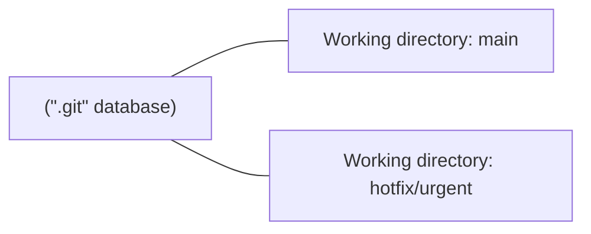
[[CAPTION:Figure]] One `.git` database backing two working directories

### When Worktrees Help

- A hotfix lands while you have uncommitted work in progress: check out the hotfix branch in a second worktree instead of stashing.
- Running the previous release's test suite while continuing development on `main`.
- Reviewing a colleague's pull request locally without disturbing your own checkout.

### Worktree Commands

```bash
git worktree add ../hotfix-dir hotfix/urgent   # new worktree on an existing branch
git worktree add -b review/pr-42 ../review-dir origin/pr-42   # new branch + worktree
git worktree list
git worktree remove ../hotfix-dir
git worktree prune                              # clean up after manually deleting a worktree directory
```

### Caveats

- The same branch cannot be checked out in two worktrees at once; Git refuses with "already checked out".
- All worktrees share the same object database and remotes; deleting the original clone breaks every worktree that depends on it.
- Worktrees are local-only. They are not something you push, pull, or see reflected for other clones of the repository.

## Submodules: Nesting Repositories

A submodule embeds one Git repository inside another, at a specific subdirectory, pinned to one exact commit. The parent repository does not store the submodule's files or history, only a pointer. The pointer is its URL and the commit it should be at, recorded in a `.gitmodules` file and a special gitlink entry.

```mermaid
flowchart LR
    P["Parent repo"] -->|"pointer: commit abc123"| S["Submodule repo (separate history)"]
```
[[CAPTION:Figure]] A parent repository pointing at a pinned commit of a submodule

### When Submodules Help

- Vendoring a shared library or firmware component that several independent repositories need, at an explicitly pinned version.
- Splitting a large codebase into separately-versioned repositories that are still assembled together for a build.

### Submodule Commands

```bash
git submodule add https://example.com/lib.git libs/lib   # add a submodule
git clone --recurse-submodules https://example.com/app.git   # clone, including submodules
git submodule update --init --recursive          # populate submodules after a plain clone
git submodule status                              # commit each submodule is pinned to, and whether it's clean
git submodule foreach 'git pull origin main'      # run a command in every submodule
```

To change what a submodule points at: commit and push inside the submodule first, then commit the updated pointer in the parent repository. Forgetting the second step is the most common submodule mistake; the parent repository silently keeps pointing at the old commit.

### Caveats and Alternatives

- Submodules are a frequent source of confusion: a plain `git clone` leaves submodule directories empty until `submodule update --init` runs, and CI pipelines need explicit configuration to check them out.
- Checking out a submodule leaves it in a detached HEAD by design, since it is pinned to a commit rather than a branch; work done there needs its own branch and its own push before the pointer commit in the parent will make sense to anyone else.
- **`git subtree`** is the main alternative; see below.
- A **monorepo** avoids the pointer/pinning problem entirely by keeping everything in one repository, at the cost of a larger single checkout and coarser access control.
- For dependencies that have a package manager (npm, pip, NuGet), version pinning through that package manager is usually simpler than a Git submodule.

## Subtrees: Embedding History Directly

Where a submodule stores a *pointer* to another repository, `git subtree` copies that repository's files and history directly into a subdirectory of the parent repository. There is no separate clone step and no `.gitmodules` file: once merged in, a subtree is ordinary, versioned content as far as anyone cloning the parent repository is concerned. Under the hood it uses the `subtree` merge strategy described above.

```mermaid
flowchart LR
    P["Parent repo"] -->|"subtree merge, --prefix=libs/lib"| S["Subtree content, now part of parent's own history"]
```
[[CAPTION:Figure]] A subtree merges another project's files and history directly into a subdirectory

### Subtree Commands

```bash
git subtree add --prefix=libs/lib https://example.com/lib.git main --squash
git subtree pull --prefix=libs/lib https://example.com/lib.git main --squash
git subtree push --prefix=libs/lib https://example.com/lib.git main
```

`--squash` collapses the incoming project's history into a single commit rather than importing every commit it ever had; drop it only if you specifically want the full imported history.

### Subtree vs Submodule

| Question                              | Submodule                                  | Subtree                                          |
| ---------------------------------------- | --------------------------------------------- | ---------------------------------------------------- |
| What the parent repo stores            | A pointer (URL + commit)                       | The actual files and (optionally) history           |
| Consumer experience after plain clone  | Empty directory until `submodule update --init` | Works immediately; nothing extra to run              |
| Pushing changes back upstream          | Straightforward: commit and push inside the submodule | Awkward: `subtree push` re-derives commits to send    |
| Repository size                        | Small; only a pointer is stored                | Grows with the vendored content, unless `--squash` is used |
| Clarity that content is external       | Explicit and visible in `.gitmodules`          | Implicit; nothing marks the directory as vendored beyond convention |
[[CAPTION:Table]] Choosing between a submodule and a subtree

As a rule of thumb, use a submodule when you want an explicit, easily updated pointer to a fast-moving dependency. Use a subtree when consumers should be able to clone and build with no extra steps, and you rarely push changes back upstream.

## Git Hooks: Automating Actions

A hook is a script Git runs automatically at a specific point in its workflow. Hooks live as executable files under `.git/hooks/`, named after the event they respond to.

### Client-Side and Server-Side Hooks

| Hook               | Runs                                       | Typical use                                    |
| -------------------- | ---------------------------------------------- | ---------------------------------------------------- |
| `pre-commit`        | Before a commit message is even written        | Run linters or formatters; block the commit on failure |
| `commit-msg`        | After the message is written, before the commit is created | Enforce a commit message format, for example a ticket-number prefix |
| `post-commit`       | After the commit is created                     | Notifications; local logging                         |
| `pre-push`          | Before `git push` sends anything                | Run the test suite; block pushes on failure          |
| `post-checkout`     | After `checkout` or `switch`                     | Rebuild generated files; warn about stale dependencies |
| `post-merge`        | After a merge completes                          | Reinstall dependencies if the lockfile changed        |
| `pre-receive` / `update` / `post-receive` | On the **server**, when a push arrives | Enforce branch-protection policy; trigger CI; notify chat |
[[CAPTION:Table]] Common Git hooks and what they are used for

### The Catch: Hooks Are Not Versioned by Default

`.git/hooks/` lives inside `.git`, and `.git` is never cloned or pushed; it is regenerated locally by every clone. That means hooks placed there do not travel with the repository, and every teammate would need to install them by hand. Two ways around this:

```bash
git config core.hooksPath .githooks   # point Git at a versioned directory instead
```

Commit a `.githooks/` directory alongside the code, and every clone that runs this one config command uses the team's shared hooks. Alternatively, tools such as Husky, `pre-commit`, or Lefthook manage this automatically, usually by installing themselves via a `post-checkout` or dependency-install step.

### Example: A Minimal `pre-commit` Hook

```bash
#!/bin/sh
if git diff --cached | grep -q "TODO"; then
    echo "Commit blocked: staged changes contain a TODO"
    exit 1
fi
```

Save this as `.githooks/pre-commit`, make it executable (`chmod +x`), and set `core.hooksPath` as above. A non-zero exit code blocks the action; a zero exit code allows it through.

## Git Branching Strategies

### Main-Only (Trunk-Only / Single-Branch)

#### Description

- There is only one long-lived branch (typically `main`).
- All work, whether feature, bugfix, or experiments, is committed directly to `main`.
- No persistent feature branches.
- Typical branch names: none needed; everything happens on `main`.

```mermaid
gitGraph
  commit id:"mo-M0" tag:"main"
  commit id:"mo-M1"
  commit id:"mo-M2"
  commit id:"mo-M3"
```
[[CAPTION:Figure]] Main-Only branching: all work committed directly to main

#### When to Use

- Small teams or solo projects.
- Prototyping, proof-of-concept, or minimal codebases.
- Projects with frequent releases and minimal complexity.

#### Pros

- Minimal setup.
- No branch overhead.
- No merge conflicts due to long-lived branches.

#### Cons

- Risky: every change goes straight into shared history, which makes it straightforward to break things.
- Little isolation, making it hard to test big changes without risk.
- Hard to track work per feature or separate stable vs experimental changes.

#### Verdict

Only viable for minimal or short-lived projects. For anything non-trivial, isolation (feature branches or similar) is usually worthwhile.

### Feature-Branching

#### Description

- Each new feature, bugfix, or task gets its own branch, typically named something like `feature/xyz`, `bugfix/1234`, etc.
- Developers work in isolation in that branch.
- When done + reviewed, branch is merged into `main`.
- Typical branch names: `feature/<ticket-or-slug>`, `bugfix/<ticket-or-slug>`.

```mermaid
gitGraph
  commit id:"fe-M0" tag:"main"
  branch feature/foo
  checkout feature/foo
  commit id:"fe-F1"
  commit id:"fe-F2"
  checkout main
  merge feature/foo id:"fe-M1"
```
[[CAPTION:Figure]] Feature-Branching: isolated branches merged into main

#### When to Use

- Teams working on multiple features in parallel.
- Codebases needing isolation per feature for safe development.
- Most modern development workflows.

#### Pros

- Good isolation per feature.
- Parallel development without interference.
- Straightforward to discard or delay features if needed.
- Clear mapping between branch and work item.

#### Cons

- If branches live long, risk of merge conflicts and integration drift.
- Overhead of branch management, merging, testing.
- Feature branches need regular syncing to prevent "falling too far behind".

#### Verdict

The “default safe mode” for most teams: balances isolation, flexibility, and safety.

### GitFlow

#### Description

- Multiple long-lived branch types: `main` (production), `develop` (integration), plus support branches: `feature/*`, `release/*`, `hotfix/*`. [abtasty+2Medium+2](https://www.abtasty.com/blog/git-branching-strategies/?utm_source=chatgpt.com)
- Features branch off `develop`, then merge back into `develop`.
- When you prepare a release, you branch a `release/x.y.z` from `develop`, stabilize, then merge into both `main` and `develop`.
- For urgent hotfixes, branch off `main`, merge fix, then merge back to `develop`.
- Typical branch names: `feature/*` and `release/x.y.z` off `develop`, `hotfix/*` off `main`.

```mermaid
gitGraph
  commit id:"gf-V0" tag:"main"
  branch develop
  checkout develop
  commit id:"gf-D1"
  branch feature/foo
  checkout feature/foo
  commit id:"gf-F1"
  checkout develop
  merge feature/foo id:"gf-FD"
  branch release/1.0.0
  checkout release/1.0.0
  commit id:"gf-R1"
  checkout main
  merge release/1.0.0 id:"gf-M1"
  checkout develop
  merge release/1.0.0 id:"gf-D2"
  branch hotfix/urgent
  checkout hotfix/urgent
  commit id:"gf-H1"
  checkout main
  merge hotfix/urgent id:"gf-H-merge"
  checkout develop
  merge hotfix/urgent id:"gf-D3"
```
[[CAPTION:Figure]] GitFlow: main, develop, feature, release, and hotfix branches

#### When to Use

- Larger teams, multiple concurrent streams, multiple versions in production or long-lived support branches.
- Organizations requiring formal release cycles, QA and staging phases, hotfix support.

#### Pros

- Clear, structured workflow.
- Isolation of work streams, proper release preparation, controlled hotfixes.
- Good for long-term maintenance and version support.

#### Cons

- Complex: many branches, many merging points.
- Slow: high overhead, especially for small or fast-moving teams.
- Risk of merge mistakes if developers aren’t disciplined.

#### Verdict

Good for complex projects, mature products, or multiple maintained versions. Probably overkill for small or fast-iterating teams.

### GitHub Flow

#### Description

- A simplified model: `main` holds production-ready code.
- Developers create a branch per feature/bug fix (similar to feature-branching), then merge to `main` via pull request when ready. No separate `develop`, no release branches.
- Typical branch names: `feature/<slug>`, or any short descriptive name off `main`; no fixed prefix is required.

```mermaid
gitGraph
  commit id:"gh-M0" tag:"main"
  branch feature/foo
  checkout feature/foo
  commit id:"gh-F1"
  checkout main
  merge feature/foo id:"gh-M1"
```
[[CAPTION:Figure]] GitHub Flow: feature branches merged directly into main

#### When to Use

- Teams practising continuous integration / continuous delivery (CI/CD), frequent small releases.
- Small–medium projects, web apps, SaaS, where quick iteration and fast deployment matter.

#### Pros

- Straightforward to understand and use.
- Encourages small, focused changes.
- Works well with CI/CD pipelines and frequent deployment.

#### Cons

- `main` must always stay production-ready, which requires robust testing and deployment safeguards.
- Harder to manage long-term release versions or patch older versions.
- Less formal structure: risks slip if discipline is poor.

#### Verdict

Excellent for agile, fast-paced teams with good automated testing and deployment.

### GitLab Flow

#### Description

- A middle ground between GitHub Flow and GitFlow: keeps the single `main` integration branch from GitHub Flow, but adds downstream **environment branches** (for example, `staging` and `production`) or **release branches** for versioned software.
- Feature branches come off `main` and merge back via merge request, same as GitHub Flow.
- Deployments happen by promoting `main` into the next environment branch, one merge at a time.
- Typical branch names: `feature/*` off `main`, plus the fixed environment names `staging` and `production`.
- Distinct from Environment Branching (below): `main` stays the single integration point here, and the environment branches only ever receive promotions from it.

```mermaid
gitGraph
  commit id:"gl-M0"
  branch staging
  commit id:"gl-S0"
  checkout main
  branch production
  commit id:"gl-P0"
  checkout main
  branch feature/foo
  commit id:"gl-F1"
  checkout main
  merge feature/foo id:"gl-M1"
  checkout staging
  merge main id:"gl-S1"
  checkout production
  merge staging id:"gl-P1"
```
[[CAPTION:Figure]] GitLab Flow: main promoted through staging and production

#### When to Use

- Teams that want GitHub Flow's simplicity but need a visible, auditable path from `main` to each deployed environment.
- Products with a staging/QA gate before production, or that need versioned releases without the full weight of GitFlow.

#### Pros

- Simpler than GitFlow, more structured than GitHub Flow.
- Environment branches double as a live record of what is deployed where.
- Works for both continuous delivery and scheduled releases.

#### Cons

- More branches than GitHub Flow, and still needs discipline to avoid environment drift.
- Cherry-picking or hotfixing "backwards" (for example, production before main) can get confusing.
- Choosing where a fix belongs (main vs environment branch) is a recurring judgement call.

#### Verdict

A sensible default when GitHub Flow feels too loose but GitFlow feels too heavy.

### Trunk-Based Development

#### Description

- Developers integrate changes frequently into a single shared branch, often `main` (the “trunk”).
- Use short-lived feature branches or commit directly, but merge back very frequently (daily or even more often). Some teams use feature flags to hide incomplete work.
- Typical branch names: short, disposable branches such as `<initials>/<slug>`, alive for a day or two at most.

```mermaid
gitGraph
  commit id:"tb-M0" tag:"main"
  commit id:"tb-M1"
  branch short-lived/feat1
  checkout short-lived/feat1
  commit id:"tb-F1"
  checkout main
  merge short-lived/feat1 id:"tb-M2"
  branch short-lived/feat2
  checkout short-lived/feat2
  commit id:"tb-F2"
  checkout main
  merge short-lived/feat2 id:"tb-M3"
```
[[CAPTION:Figure]] Trunk-Based Development: short-lived branches merged frequently

#### When to Use

- Teams with good automated testing & CI/CD.
- Rapid release cadence, frequent small changes.
- Projects where feature-toggle / flags are used to hide incomplete features.

#### Pros

- Minimises integration pain, merge conflicts.
- Encourages small incremental changes.
- Supports fast delivery / continuous deployment.

#### Cons

- Requires discipline, strong testing, feature-flags if features aren’t fully complete.
- Harder to isolate large changes or long-running features.
- Risk that `main` becomes unstable if process breaks.

#### Verdict

Effective for teams set up for CI/CD, with strong automation, testing and code discipline.

### Environment Branching

#### Description

- Dedicated long-lived branches represent deployed environments, typically `development` → `staging` → `production`.
- Feature branches are created from, and merged back into, `development`.
- Promoting a change to the next environment is a merge (or PR) from one environment branch into the next.
- Typical branch names: `feature/*` off `development`, plus the fixed environment names `development`, `staging`, `production`.
- Distinct from GitLab Flow (above): there is no separate `main` here; `development` is itself one of the three environment branches feature work lands on.

```mermaid
gitGraph
  commit id:"en-M0"
  branch development
  checkout development
  commit id:"en-D0"
  branch staging
  commit id:"en-S0"
  checkout development
  branch production
  commit id:"en-P0"
  checkout development
  branch feature/foo
  commit id:"en-F1"
  checkout development
  merge feature/foo id:"en-D1"
  checkout staging
  merge development id:"en-S1"
  checkout production
  merge staging id:"en-P1"
```
[[CAPTION:Figure]] Environment Branching: development promoted through staging and production

#### When to Use

- Organisations with a formal deployment pipeline and distinct environment owners or sign-off gates.
- Regulated or infrastructure-heavy contexts where "what is in staging vs production" needs to be answerable from the branch list alone.

#### Pros

- Clear, visual mapping between branches and the deployment pipeline.
- Straightforward to see, and roll back, what is live in each environment.
- Supports formal change-approval processes between environments.

#### Cons

- Environment branches can drift apart if promotions are skipped or done out of order.
- Extra merge overhead compared to a single trunk.
- Does not suit frequent, small releases well; better for staged rollouts.

#### Verdict

Worth it when the environments themselves need governance, not only the code.

### Release-Branching / Maintenance Branching

#### Description

- `main` (or trunk) is used for ongoing development.
- For each planned version or release, a dedicated `release/x.y` (or similar) branch is created.
- Bug fixes can go into release branches. Release branches may receive hotfixes.
- Once released, release branch may be merged into main (or remain for maintenance), depending on policy. Also allowing multiple active release versions.
- Typical branch names: `release/x.y`, with `hotfix/x.y.z` for urgent fixes against a specific release.
- Distinct from GitFlow's `release/*` branches: GitFlow cuts a release branch to stabilise one upcoming release and then retires it, while here release branches are often kept indefinitely, one per version still under support.

```mermaid
gitGraph
  commit id:"rb-M0" tag:"main"
  commit id:"rb-M1"
  branch release/1.0
  checkout release/1.0
  commit id:"rb-R1"
  checkout main
  commit id:"rb-M2"
  branch release/2.0
  checkout release/2.0
  commit id:"rb-R2"
```
[[CAPTION:Figure]] Release-Branching: dedicated branches per release version

#### When to Use

- Products that need long-term maintenance of multiple versions (for example, enterprise or LTS support).
- Use cases where you cannot always keep everyone on the latest version; older versions must be maintained.

#### Pros

- Clean version separation.
- Ability to patch old versions without interfering with ongoing development.
- Clear release history and stability.

#### Cons

- Branch proliferation.
- Cherry-picking fixes across branches is error-prone.
- More management overhead.

#### Verdict

Useful for mature products needing long-term support and multiple active versions, but adds overhead and complexity.

### Cherry-pick Release Branching (Selective Release)

This is the pattern for a team that runs **trunk-based development for merging** (every completed feature lands on `main`) but wants a **curated** release. Rather than branching `release/x.y` from `main` with everything up to that point, the release branch starts from a stable point. Only specific, already-merged features are cherry-picked onto it.

#### Description

- `main` is the single source of truth: all completed features merge here as they finish (trunk-based style).
- When a release is due, a `release/x.y` branch is cut.
- Instead of merging `main` wholesale, individual feature commits (or merge commits) are **cherry-picked** from `main` onto the release branch, so a feature can be "done" and sitting in `main` without necessarily shipping in the next release.
- Anything not cherry-picked waits for a later release.
- Typical branch names: ordinary `feature/*` branches merged into `main`, plus `release/x.y` cut for each curated release.

```mermaid
gitGraph
  commit id:"cp-M0" tag:"main"
  branch feature/A
  checkout feature/A
  commit id:"cp-A1"
  checkout main
  merge feature/A id:"cp-MA"
  branch feature/B
  checkout feature/B
  commit id:"cp-B1"
  checkout main
  merge feature/B id:"cp-MB"
  branch feature/C
  checkout feature/C
  commit id:"cp-C1"
  checkout main
  merge feature/C id:"cp-MC"
  branch release/1.0
  checkout release/1.0
  cherry-pick id:"cp-MA" parent:"cp-A1"
  cherry-pick id:"cp-MC" parent:"cp-C1"
```
[[CAPTION:Figure]] Cherry-pick Release Branching: selected features cherry-picked into a release branch

Here, features A and C ship in `release/1.0`; feature B is complete on `main` but held back on purpose.

#### When to Use

- No canonical name exists for this in the way "GitFlow" or "GitHub Flow" do, but it is a documented, real-world pattern: teams sometimes call it "cherry-pick to release", a "curated release branch", or "selective release". It shows up wherever teams want the integration benefits of trunk-based merging without every merged feature being release-committed.
- Regulatory or contractual gating, where a specific feature must not ship until a separate approval lands.
- Staggered rollout across customers or regions using the same codebase.
- Teams without mature feature-flag infrastructure who still want to decouple "merged" from "released".

#### Pros

- Decouples integration (merging early, avoiding long-lived branches) from release timing.
- No feature-flag machinery required to hold work back.
- `main` always reflects the full, current state of development.

#### Cons

- Manual and error-prone: someone has to track which commits go into which release.
- Cherry-picks can conflict, especially if the held-back feature and a shipped feature touch the same code.
- History diverges between `main` and `release/x.y` in a way that is harder to reason about than a straight merge.
- Feature flags are usually the safer alternative for the same goal, if the team can invest in them.

#### Verdict

A pragmatic escape hatch rather than a strategy to adopt by default. Reach for feature flags first, and use selective cherry-picking when flags are not feasible.

### Forking Workflow

#### Description

- Fundamentally different from the others: instead of branches within one shared repository, each contributor has their **own server-side fork** of the repository.
- Contributors branch and commit within their own fork, then open a pull request from their fork back to the main (upstream) repository.
- The upstream repository owner reviews and merges; no contributor needs write access to the main repository.
- Typical branch names: whatever a contributor likes in their own fork; only upstream `main` (and any release branches) needs a fixed name.

```mermaid
flowchart LR
    subgraph Upstream["Upstream repository"]
        M[main]
    end
    subgraph ForkA["Contributor A's fork"]
        FA[feature/foo]
    end
    subgraph ForkB["Contributor B's fork"]
        FB[feature/bar]
    end
    M -->|fork| FA
    M -->|fork| FB
    FA -->|pull request| M
    FB -->|pull request| M
```
[[CAPTION:Figure]] Forking Workflow: contributors submit pull requests from their own forks

#### When to Use

- Open-source projects with many external, untrusted, or occasional contributors.
- Any project where write access to the canonical repository should stay controlled.

#### Pros

- Strongest possible isolation: no contributor can push directly to upstream.
- Forces every change through review via pull request.
- Scales to large, distributed, loosely affiliated contributor bases.

#### Cons

- Heavier setup and mental overhead (keeping a fork in sync with upstream).
- Not needed, and mostly overkill, for a single trusted internal team.
- Requires more Git fluency (remotes, syncing forks) from contributors.

#### Verdict

The right default for open-source projects; unnecessary ceremony for a closed internal team that already uses feature branches and PRs.

### Branch Naming Conventions

Most of the strategies above lean on a `<type>/<name>` naming convention, such as `feature/checkout-flow` or `release/2.1`. This works because Git branches are just refs, stored under `.git/refs/heads/<name>`, and a `/` in the name creates a real subdirectory in that path. Two consequences follow directly from that:

- A namespace prefix (`feature/`, `release/`, `hotfix/`) groups related branches together in tooling that understands the convention (branch lists, CI triggers, protection rules), without needing any special Git feature.
- You cannot have a branch called `release` and a branch called `release/1.0` at the same time. Git stores the first as the file `refs/heads/release` and the second as `refs/heads/release/1.0`, and a file cannot also be a directory. Git refuses the second branch with an error such as `cannot lock ref ... 'refs/heads/release' exists; cannot create 'refs/heads/release/1.0'`. Pick a convention (bare `release` for a single active release, or `release/x.y` for several) and stay on one side of it.

A common set of prefixes, independent of which strategy you use:

| Prefix       | Typical use                                       |
| ------------- | -------------------------------------------------- |
| `feature/*`   | New functionality, not yet in `main`                |
| `bugfix/*`    | A fix for an issue found before release             |
| `hotfix/*`    | An urgent fix against code already in production    |
| `release/*`   | Stabilising a specific version ahead of release     |
| `chore/*`     | Tooling, dependency bumps, or other non-user-facing work |
| `docs/*`      | Documentation-only changes                          |
[[CAPTION:Table]] Common branch-name prefixes and what they signal

### Comparing the strategies

| Strategy                        | Branch overhead | Release control            | Good Fit                                   |
| -------------------------------- | ---------------- | --------------------------- | -------------------------------------------- |
| Main-Only                        | None              | None (every commit is live)  | Solo projects, prototypes                    |
| Feature-Branching                | Low               | Loose (merge when ready)     | Most teams, most projects                    |
| GitFlow                          | High              | Strict, scheduled releases   | Large teams, multiple maintained versions    |
| GitHub Flow                      | Low               | None (deploy on merge)       | CI/CD teams shipping continuously            |
| GitLab Flow                      | Medium            | Staged, via environment branches | Staging/production gate before release   |
| Trunk-Based Development          | Minimal           | None (feature flags instead) | Mature CI/CD, high commit frequency          |
| Environment Branching            | Medium            | Staged, per environment      | Formal, governed deployment pipelines        |
| Release-Branching / Maintenance  | Medium-high       | Per-version, long-lived       | Products supporting several live versions    |
| Cherry-pick Release Branching    | Medium            | Selective, per feature        | Curated releases without feature-flag tooling |
| Forking Workflow                 | High (per contributor) | Via PR review           | Open-source, untrusted or external contributors |
[[CAPTION:Table]] Comparison of the branching strategies covered in this guide

## Useful links

(only links, no references in the content)

- [https://www.youtube.com/watch?v=WBg9mlpzEYU](https://www.youtube.com/watch?v=WBg9mlpzEYU)
- [https://www.youtube.com/watch?v=Mfz8NQncwiQ](https://www.youtube.com/watch?v=Mfz8NQncwiQ)
- [https://www.youtube.com/watch?v=hae9zg0-sZY](https://www.youtube.com/watch?v=hae9zg0-sZY)
- [https://www.youtube.com/watch?v=dgOpnebZkRo](https://www.youtube.com/watch?v=dgOpnebZkRo)

## Appendix: Command Reference

### Basic Concepts and Terms

| Term                 | Meaning                                                   |
| -------------------- | --------------------------------------------------------- |
| Repository           | The full project history (in `.git`)                      |
| Working Directory    | The actual files you’re editing                           |
| Index (Staging Area) | The next commit snapshot                                  |
| Commit               | A snapshot of staged changes                              |
| Branch               | A pointer to a commit                                     |
| HEAD                 | Where you are in the history (usually the current branch) |
| DAG                  | Directed Acyclic Graph that models history                |
| Remote               | Another copy of the repo (for example, `origin`)          |
| Worktree             | A second checkout of the repo in another directory        |
| Bisect               | Binary search across commits to find a regression         |
[[CAPTION:Table]] Basic Git concepts and terms

### Global Setup

These are one-time settings.

#### Identity

```bash
git config --global user.name "Your Name"
git config --global user.email "you@example.com"
```

#### Defaults and Safety

```bash
git config --global init.defaultBranch main
git config --global pull.rebase false   # or true if your team prefers
git config --global core.autocrlf input # depends on OS
```

#### Credential Helper

```bash
git config --global credential.helper store
```

### Repository Creation and Cloning

#### Start a New Repo

```bash
git init
```

Creates `.git/` and starts tracking.

#### Clone Existing

```bash
git clone <url>
cd repo
```

#### Add Remote Later

```bash
git remote add origin <url>
```

### Status, Diff, Add, Commit

#### Status

```bash
git status
```

Shows:

- modified files
- staged files
- untracked files
- branch info

#### Diff

```bash
git diff
git diff --staged
git diff HEAD~1 HEAD
```

#### Stage changes

```bash
git add file.c
git add .           # everything (careful)
git add -p          # interactive hunks
```

#### Commit

```bash
git commit -m "Short summary"
git commit
```

Without `-m` opens editor for detailed message.

#### Ignoring and cleaning

```bash
echo "*.log" >> .gitignore
git clean -n        # preview what would be removed
git clean -fd        # remove untracked files and directories
```

`.gitignore` only stops **untracked** files being tracked; it does not affect files Git already knows about. `git clean` removes untracked files from the working directory; always run `-n` first to preview.

### Branch Management and Switching

#### List branches

```bash
git branch
git branch -a      # includes remote branches
```

#### Create branch

```bash
git branch feature/x
```

#### Create and switch

```bash
git checkout -b feature/x
```

#### Switch

```bash
git checkout feature/x
```

or the newer, narrower form:

```bash
git switch feature/x
```

`checkout` is overloaded: it switches branches and restores files, which is why `switch` (branches) and `restore` (files) were split out. Prefer `switch` and `restore` for clarity in day-to-day use; `checkout` still works everywhere and is what most older docs and scripts use.

#### Rename branch

```bash
git branch -m old-name new-name     # rename current or named branch
git push origin -u new-name         # push the new name
git push origin --delete old-name   # remove the old name upstream
```

#### Track a remote branch

```bash
git branch -vv                                  # show tracking status for all local branches
git branch --set-upstream-to=origin/feature/x    # set tracking on the current branch
git checkout --track origin/feature/x            # create + track in one step
```

#### Find merged and stale branches

```bash
git branch --merged main       # branches fully merged into main, safe to delete
git branch --no-merged main    # branches with unmerged work
git fetch --prune              # remove local references to deleted remote branches
```

#### Delete branch

```bash
git branch -d feature/x      # safe delete (refuse if unmerged)
git branch -D feature/x      # force delete
git push origin --delete feature/x   # delete on the remote
```

#### Worktrees (multiple branches checked out at once)

```bash
git worktree add ../hotfix-dir hotfix/urgent
git worktree list
git worktree remove ../hotfix-dir
```

A worktree checks out another branch into a separate directory, backed by the same `.git` database. Useful for working on a hotfix without stashing or disturbing your current branch's state.

### Fetch, Pull, Push

#### Fetch

```bash
git fetch origin
```

Updates remote-tracking (does **not** merge).

#### Pull

```bash
git pull
git pull origin main
```

Fetch + merge (or rebase if configured).

#### Push

```bash
git push origin main
git push -u origin feature/x
```

`-u` sets upstream so later `git push` works without args.

### Merging

#### Fast-forward Merge (Quick Reference)

```bash
git checkout main
git merge feature/x
```

If no divergence, branch pointer moves forward.

#### No Fast-forward Merge

```bash
git merge --no-ff feature/x
```

Forces a merge commit even if FF possible.

#### Conflict resolution

```bash
git status
git diff
# manually edit conflict markers
git add .
git commit
```

### Rebase

#### Rebase onto latest main

```bash
git checkout feature/x
git fetch origin
git rebase origin/main
```

#### Interactive rebase (tidy history)

```bash
git rebase -i HEAD~5
```

Options:

- pick
- squash
- reword
- drop
- fixup (like squash, but discards the fixup commit's message)

#### Fixup and autosquash

```bash
git commit --fixup <commit-id>   # creates a "fixup! ..." commit
git rebase -i --autosquash HEAD~5
```

`--fixup` marks a commit as belonging to an earlier one. `--autosquash` then reorders the interactive rebase list so those fixups land next to, and squash into, the commit they target, without you moving lines by hand.

#### Abort or continue

```bash
git rebase --abort
git rebase --continue
```

### Undoing Mistakes

#### Unstage

```bash
git restore --staged file.c
```

#### Discard local changes

```bash
git restore file.c
```

#### Reset (local history rewrite)

```bash
git reset --soft HEAD~1
git reset --mixed HEAD~1
git reset --hard HEAD~1
```

> **Warning:** Never use reset on pushed commits.

#### Revert (safe for shared history)

```bash
git revert <commit-id>
```

Creates a new commit that undoes a past commit.

### Cherry-Pick

Apply a specific commit from elsewhere:

```bash
git checkout main
git cherry-pick <commit-id>
```

Used for **backporting** fixes; use sparingly.

### Stash

Save work without committing:

```bash
git stash push -m "WIP"
git stash push --include-untracked   # also stash new, untracked files
git stash list
git stash show stash@{0}
git stash apply stash@{0}            # restore, keep it in the stash list
git stash pop                        # restore, then delete from the stash list
git stash drop stash@{0}             # delete without restoring
```

`apply` is safer when you might want the same stash again elsewhere; `pop` is the common case of "restore and forget".

### Log and Reflog

#### Log

```bash
git log
git log --oneline
git log --oneline --graph --decorate --all
git log --patch
git log --stat
```

Useful patterns:

- `--first-parent` for release history
- `-- path/to/file` for file history

#### Reflog

```bash
git reflog
```

Shows **HEAD movements**.\
Use to recover lost work:

```bash
git reset --hard <id-from-reflog>
```

### Bisect

```bash
git bisect start
git bisect bad
git bisect good v1.4.0
# test, then: git bisect good | git bisect bad
git bisect reset

git bisect start HEAD v1.4.0
git bisect run npm test      # automated
```

### Tags and Releases

#### Create tags

```bash
git tag v1.0.0
git tag -a v1.0.0 -m "Description"
```

#### Push tags

```bash
git push origin v1.0.0
git push origin --tags
```

### Submodules

```bash
git submodule add https://example.com/lib.git libs/lib
git clone --recurse-submodules https://example.com/app.git
git submodule update --init --recursive
git submodule status
git submodule foreach 'git pull origin main'
```

### Subtrees

```bash
git subtree add --prefix=libs/lib https://example.com/lib.git main --squash
git subtree pull --prefix=libs/lib https://example.com/lib.git main --squash
git subtree push --prefix=libs/lib https://example.com/lib.git main
```

### Merge Strategies (Quick Reference)

```bash
git merge -s ort feature/x          # default; usually omitted
git merge --ff-only feature/x       # refuse unless a fast-forward is possible
git merge -s ours feature/x         # keep our tree entirely, discard theirs
git merge -X ours feature/x         # normal merge, prefer our side on conflicting hunks
git merge branchA branchB branchC   # octopus, for more than two branches at once
```

### Hooks

```bash
git config core.hooksPath .githooks   # use a versioned hooks directory
chmod +x .githooks/pre-commit         # hooks must be executable
```

### Useful Command Flows

This is where the cheat-sheet becomes a **practical reference**.

#### Feature Development Flow

```bash
git checkout main
git pull
git checkout -b feature/abc
# work…
git add .
git commit -m "Implement X"
git fetch origin
git rebase origin/main
git push -u origin feature/abc
# create PR
```

#### Basic Merge Flow

```bash
git checkout main
git pull
git merge feature/abc
git push
```

#### PR Fixup Flow (after comments)

```bash
git checkout feature/abc
# apply fixes
git add .
git commit -m "Address review feedback"
git push
```

Or tidy history before merge:

```bash
git rebase -i origin/main
git push --force-with-lease
```

Use `--force-with-lease` for safety (protects peers’ work).

#### Recover Lost Work

```bash
git reflog
git checkout <id>
git branch recovery
```

#### Clean Up Local Branches

```bash
git branch --merged
git branch -d feature/old
```
