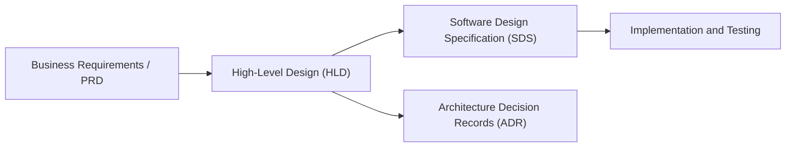

# Writing a high-level design

This guideline defines the engineering standard, narrative structure, and quantitative capacity estimation framework for authoring High-Level Design (HLD) documents. It bridges the gap between Product Requirements Documents (PRDs) or Business Architecture and low-level Software Design Specifications ([Writing a software design specification](software-design-specification.md)).

## 1. Purpose and Architecture Context

A High-Level Design document establishes a shared architectural vision for a proposed system or major capability. It enables technical leaders, software engineers, security specialists, and operational teams to evaluate structural soundness, identify technical risks, and align on integration patterns before detailed implementation begins.



[[CAPTION:Figure]] High-Level Design within the systems engineering lifecycle.

### 1.1 When an HLD is Required

An HLD must be drafted, reviewed, and approved via the Architecture Review Board ([Running an architecture review board](architecture-review-board.md)) under any of the following conditions:

- A new software service, container, embedded device platform, or cloud subsystem is being introduced.
- A cross-cutting change impacts two or more bounded contexts, teams, or external API contracts.
- Significant changes are proposed to data persistence topologies, messaging protocols, or network boundaries.
- The system introduces non-trivial operational cost, strict latency budgets, or regulatory compliance obligations (such as ETSI EN 303 645, UK PSTI, or GDPR).

### 1.2 Narrative Structure: Architecture as a Story

An effective HLD functions as an engaging technical narrative. Rather than dumping uncontextualised class diagrams or database schemas, the author should guide the reader through:

- **The Context**: What problem are we solving, why now, and what are the explicit system boundaries?
- **The Blueprint**: High-level component decomposition and data flows that an executive or non-engineer can grasp.
- **The Calculations**: Grounded capacity sizing (traffic, storage, memory, bandwidth) that validates technical feasibility.
- **The Trade-offs**: Why chosen approaches triumphed over viable alternatives.
- **The Operability**: How the system will be deployed, observed, secured, and maintained in production.

## 2. Capacity Estimation and System Sizing Framework

Quantitative sizing transforms architectural assertions into measurable engineering requirements. The following mathematical framework must be used in the HLD to size compute, storage, caching, and network bandwidth.

### 2.1 Traffic and Request Rate Calculations

To determine Queries Per Second (QPS), calculate both average and peak loads. Peak load typically introduces a peak multiplier ($M_p$) between $2.0$ and $4.0$ depending on user behaviour patterns and batch telemetry schedules.

$$\mathrm{QPS}_{\mathrm{avg}} = \frac{\mathrm{Daily\ Active\ Users\ (DAU)} \times \mathrm{Requests\ per\ User\ per\ Day}}{86{,}400 \mathrm{seconds}}$$

$$\mathrm{QPS}_{\mathrm{peak}} = \mathrm{QPS}_{\mathrm{avg}} \times M_p$$

For example, an IoT telemetry ingestion platform serving 50,000 connected smart gateways, each transmitting a telemetry packet once every 30 seconds:

- Packets per gateway per day: $86{,}400 / 30 = 2{,}880$
- Total daily events: $50{,}000 \times 2{,}880 = 144{,}000{,}000$ events/day
- Average ingestion QPS: $144{,}000{,}000 / 86{,}400 = 1{,}667 \mathrm{QPS}$
- Peak ingestion QPS ($M_p = 2.5$ during post-outage reconnection storm): $1{,}667 \times 2.5 = 4{,}167 \mathrm{QPS}$

### 2.2 Storage Sizing and Growth Projections

Storage calculations must account for raw payload size, database indexing overhead (typically $25\%\mathrm{to}35\%$), and cluster replication factors (for example, $3\times$ replication in distributed datastores such as Kafka, Cassandra, or PostgreSQL clusters).

$$\mathrm{Daily\ Raw\ Data} = \mathrm{Daily\ Ingested\ Records} \times \mathrm{Average\ Payload\ Size\ (Bytes)}$$

$$\mathrm{Daily\ Total\ Storage} = \mathrm{Daily\ Raw\ Data} \times (1 + \mathrm{Index\ Overhead}) \times \mathrm{Replication\ Factor}$$

$$\mathrm{Annual\ Storage} = \mathrm{Daily\ Total\ Storage} \times 365$$

| Metric Parameter | Ingestion Telemetry Example | User Profile Service Example |
| :--- | :--- | :--- |
| Daily Records | $144{,}000{,}000$ packets | $5{,}000{,}000$ profile updates |
| Average Size per Record | $600\mathrm{bytes}$ (CBOR / JSON) | $4\mathrm{KB}$ |
| Daily Raw Volume | $86.4\mathrm{GB}$ | $20.0\mathrm{GB}$ |
| Indexing Overhead | $30\%$ ($1.30\times$) | $25\%$ ($1.25\times$) |
| Cluster Replication Factor | $3\times$ | $3\times$ |
| Effective Daily Storage | $336.96\mathrm{GB/day}$ | $75.00\mathrm{GB/day}$ |
| 1-Year Uncompressed Storage | $123.0\mathrm{TB/year}$ | $27.4\mathrm{TB/year}$ |
| 3-Year Projected Footprint | $369.0\mathrm{TB}$ | $82.2\mathrm{TB}$ |

[[CAPTION:Table]] Capacity sizing reference table for multi-year storage planning.

### 2.3 Network Bandwidth Sizing

Network capacity must specify ingress and egress throughput, including transport overhead (TLS handshakes, HTTP/2 frame headers, or MQTT wrapper headers):

$$\mathrm{Bandwidth}_{\mathrm{Ingress}} = \mathrm{QPS}_{\mathrm{peak}} \times \mathrm{Average\ Request\ Payload\ Size}$$

$$\mathrm{Bandwidth}_{\mathrm{Egress}} = \mathrm{QPS}_{\mathrm{peak}} \times \mathrm{Average\ Response\ Payload\ Size}$$

Using the 4,167 peak QPS telemetry scenario with a 600-byte payload:

- Raw Ingress: $4{,}167 \times 600\mathrm{bytes/sec} = 2.50\mathrm{MB/s} = 20.0\mathrm{Mbps}$
- Acknowledgment Egress ($100\mathrm{bytes}$ response): $4{,}167 \times 100\mathrm{bytes/sec} = 0.42\mathrm{MB/s} = 3.36\mathrm{Mbps}$

### 2.4 In-Memory Caching Sizing (Pareto 80/20 Rule)

When designing low-latency caching layers (Redis, Memcached), architects should apply the Pareto principle: approximately $20\%$ of hot entities account for $80\%$ of read traffic.

$$\mathrm{Cache\ Working\ Set} = \mathrm{Daily\ Unique\ Active\ Records} \times 0.20 \times \mathrm{Cached\ Entity\ Size} \times (1 + \mathrm{Metadata\ Overhead})$$

If $10{,}000{,}000$ entities are read per day with an average entity size of $2\mathrm{KB}$ and $15\%$ memory allocator overhead:

- $\mathrm{Working\ Set} = 10{,}000{,}000 \times 0.20 \times 2\mathrm{KB} \times 1.15 = 4.6\mathrm{GB}$ RAM working set required.

## 3. High-Level Design Document Template

The following template outlines the required sections for all formal HLD submissions. Authors must clone and complete this structure.

### 3.1 Template Outline

```markdown
# High-Level Design: [System or Service Name]

| Document Attribute | Value |
| :--- | :--- |
| Document Identifier | HLD-[Project]-[Number] |
| Author(s) | [Name, Role] |
| Reviewer(s) / Approvers | [ARB Lead, Principal Engineer, SecOps Lead] |
| Target Release / Milestone | [Milestone / Sprint / Date] |
| Status | [Draft / Under Review / Approved / Superseded] |

[[CAPTION:Table]] HLD Document metadata.

## 1. Executive Summary and Context
- **Problem Statement**: Brief 2-3 paragraph explanation of the business need, customer pain point, or technical limitation.
- **Goals**: Explicit, measurable outcomes (for example, "Process 5,000 sensor readings/sec with p99 latency < 200 ms").
- **Non-Goals**: Explicitly out-of-scope capabilities to prevent scope creep.
- **Assumptions and Dependencies**: External services, hardware availability, or upstream team deliverables.

## 2. High-Level Architecture Overview
- **System Context Diagram**: C4 Level 1 diagram illustrating users, external systems, and boundaries.
- **Key Architectural Decisions**: Core technology choices (languages, frameworks, datastores) linking to ADRs ([Writing ADRs and RFCs](decision-records.md)).
- **Subsystem Decomposition**: High-level responsibilities of containers or microservices.

## 3. Detailed Architecture and Component Interactions
- **Container / Component Diagram**: C4 Level 2 / Level 3 diagram showcasing communication protocols.
- **Data Flow and Sequence**: Key runtime sequence diagrams illustrating happy-path and edge-case execution.
- **Data Model and Persistence**: Logical schema, datastore selection rationale, indexing strategy, and partition keys.
- **API and Interface Contracts**: Protobuf, OpenAPI, or AsyncAPI references complying with [API design and error handling](../standards/api-design.md).

## 4. Capacity and Sizing Analysis
- **Traffic Model**: Daily Active Users / Devices, QPS average and peak calculations.
- **Storage and Growth**: Raw vs indexed storage, replication, and 3-year projection.
- **Network Bandwidth**: Ingress and egress throughput requirements.
- **Memory and Caching**: Cache hit-rate targets, eviction policies, and cluster memory sizing.

## 5. Architectural Quality Attributes (Non-Functional Requirements)
- **Availability and Fault Tolerance**: Target SLA (99.9% / 99.99%), failover mechanics, circuit breakers.
- **Latency and Throughput**: p50, p95, and p99 latency targets under peak load.
- **Scalability**: Horizontal vs vertical scaling rules, autoscaling triggers (CPU, queue depth).
- **Security and Compliance**: STRIDE threat modelling, authentication/authorisation (OAuth2/mTLS), encryption at rest/in transit, compliance standards (ETSI EN 303 645, GDPR).
- **Data Integrity and Consistency**: ACID vs BASE, event ordering, idempotency mechanisms.

## 6. Operability, Observability, and Deployment
- **Deployment Topology**: Cloud regions, multi-zone clustering, container orchestration (Kubernetes), or embedded firmware partition map.
- **Observability Strategy**: Metrics (RED/USE methods), distributed tracing (OpenTelemetry), structured log schemas.
- **Disaster Recovery and Backups**: Recovery Point Objective (RPO) and Recovery Time Objective (RTO).
- **Rollback and Migration Plan**: Blue/Green or Canary deployment strategy, schema migration sequencing.

## 7. Trade-offs and Alternatives Considered
- **Alternative 1**: Description, evaluation, and rationale for rejection.
- **Alternative 2**: Description, evaluation, and rationale for rejection.
```

[[CAPTION:Figure]] High-Level Design document template structure and mandatory sections.

## 4. Architectural Review and Gate Criteria

All HLD documents must undergo formal evaluation prior to implementation sign-off. Reviewers assess documents against the McConnell-style Architecture Review Checklist defined in [Architecture review checklist](../templates/architecture-review-checklist.md):

- **ARC-1 to ARC-6 (General Quality)**: Are goals clear, boundaries well-defined, and assumptions documented?
- **ARC-7 to ARC-14 (Design Considerations)**: Are loose coupling, high cohesion, and standard patterns utilised?
- **ARC-15 to ARC-23 (Operational & Quality Requirements)**: Are capacity estimates mathematically verified, failure modes mitigated, and security controls explicit?

Upon successful review, the HLD is registered in the Architecture Registry and referenced by subsequent Software Design Specifications ([Writing a software design specification](software-design-specification.md)).
