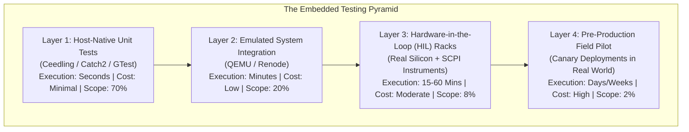
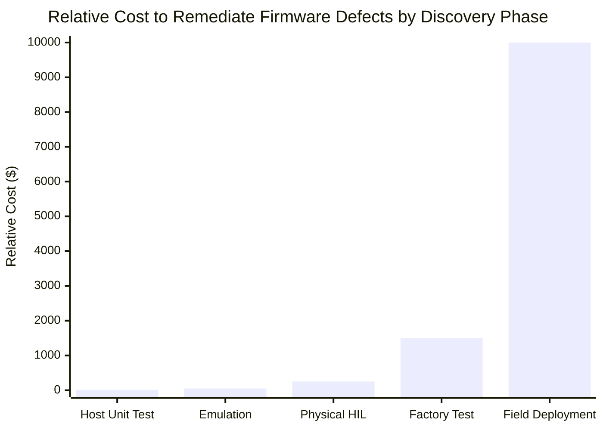

# The IoT Testing Pyramid

In traditional web development, testing takes place within standardized, homogeneous virtual machines or container environments. In embedded systems and IoT engineering, software execution is inextricably linked to analog electronics, peripheral bus timing, radio link instability, battery degradation, and environmental extremes.

Attempting to run all tests on physical hardware leads to severe development bottlenecks: hardware benches are expensive, scarce, and fragile. Conversely, testing solely in software simulators results in defect escapes when code encounters real silicon errata.

This chapter introduces the **Four-Layer Embedded Testing Pyramid**, analyzes the economics of defect discovery, and establishes test execution allocations across the delivery lifecycle.

## 1. The Four-Layer Embedded Testing Pyramid

To maximise testing velocity while maintaining absolute hardware reliability, engineering teams must organise testing across four distinct layers:

[[CAPTION:Figure]] The four layers of the connected systems testing pyramid.

### 1.1 Layer Characteristics & Responsibilities

| Test Layer | Execution Target | Execution Time | Infrastructure | Key Focus Areas |
| :--- | :--- | :--- | :--- | :--- |
| **Layer 1: Host Unit** | Developer x86/ARM host | < 30 seconds | Cloud CI runners | Business logic, state machines, math algorithms, CBOR/Protobuf serialization |
| **Layer 2: Virtual Emulation**| QEMU / Renode emulator | 1 to 5 minutes | Cloud CI runners | RTOS scheduling, multi-task IPC, peripheral driver state machines, network stack |
| **Layer 3: Physical HIL** | Real PCBA & Silicon | 15 to 60 minutes | Self-hosted hardware racks | Analog sensors, sleep currents, flash wear, power brownouts, conducted RF |
| **Layer 4: Field Pilot** | Deployed canary fleet | 1 to 4 weeks | Real cellular/satellite links | Real-world coverage dead zones, roaming handovers, weather cycling |

[[CAPTION:Table]] Characteristics of the four embedded testing layers.

## 2. Shift-Left Economics of Embedded Defect Discovery

The financial and operational cost of remediating a firmware defect increases by an order of magnitude with every development stage it escapes:

[[CAPTION:Figure]] Exponential escalation of bug remediation costs across the hardware lifecycle.

1. **Host Unit Level ($10)**: A developer identifies an integer overflow or buffer overrun within seconds via unit tests before pushing code.
1. **Physical HIL Level ($250)**: An automated overnight test rack catches an I2C bus lockup or excessive sleep current prior to release candidate tagging.
1. **Factory Production Level ($1,500)**: A defective bootloader slips past bench testing and halts contract manufacturing assembly lines, idling factory workers.
1. **Field Deployment ($10,000+)**: A sleep state deadlock drains batteries across 50,000 deployed units, requiring emergency on-site technician truck rolls or complete product recalls.

## 3. Recommended Test Allocation Strategy

Engineering squads must enforce the **70 / 20 / 8 / 2 Rule**:

- **70% of Tests in Layer 1 (Host Unit)**: Every algorithm, data structure, mathematical filter, and parser must execute on developer laptops and cloud CI runners without requiring physical microcontrollers.
- **20% of Tests in Layer 2 (Emulation)**: Multi-threaded FreeRTOS task interactions and network protocol handshakes must run inside headless QEMU or Renode instances on every pull request.
- **8% of Tests in Layer 3 (Physical HIL)**: Smoke test suites run on physical hardware test benches for pull requests; comprehensive electrical stress, power profiling, and fault injection suites run nightly.
- **2% of Tests in Layer 4 (Field Pilot)**: New firmware release candidates bake on internal dogfood devices and pre-production customer pilot units before full fleet distribution.
