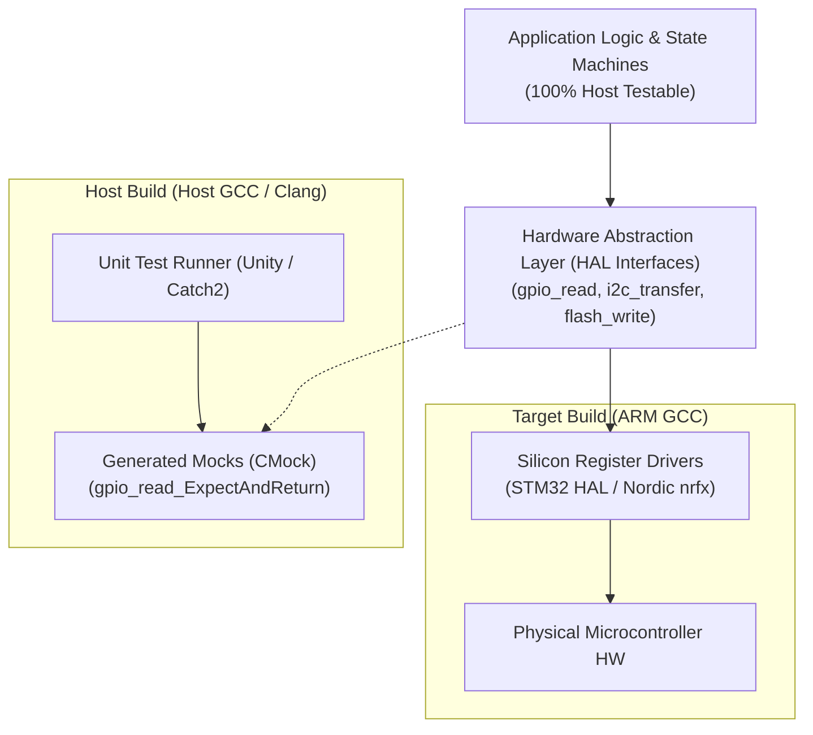

# Host-Based Firmware Testing

Testing firmware directly on physical target microcontrollers slows development: flashing via SWD/JTAG takes seconds, setting hardware breakpoints disrupts real-time timers, and automated test runners require specialized physical racks. By decoupling application logic from physical silicon registers, engineering teams can execute thousands of unit tests natively on developer workstations and standard cloud CI runners in seconds.

This chapter details the architecture of Hardware Abstraction Layers (HAL), test mocking using Ceedling and CMock, and memory safety sanitization using AddressSanitizer.

## 1. Hardware Abstraction Layer (HAL) Decoupling

To enable host-based compilation and testing, firmware must be structured with strict interface boundaries:



[[CAPTION:Figure]] Architectural separation between testable application logic and target silicon drivers.

### 1.1 Golden Rules for Host Testability

1. **Never Access Silicon Registers Directly in Business Logic**: Writing `GPIOA->BSRR = (1 << 5);` directly inside a state machine couples application logic to specific silicon. Always route I/O operations through an abstracted HAL function: `hal_gpio_write(PIN_STATUS_LED, GPIO_HIGH);`.
1. **Encapsulate Real-Time Clocks**: Never call hardware SysTick registers directly to calculate timeouts. Inject a clock interface or pass elapsed milliseconds into state functions, allowing tests to advance simulated time deterministically.

## 2. Test Mocking with Ceedling & CMock

**Ceedling** combines the **Unity** test harness with **CMock**, an automated mock generator for C. When provided a C header file, CMock automatically generates mock implementations of every declared function:

```c
// sensor_manager.h
#pragma once
#include <stdint.h>
#include <stdbool.h>

bool hal_i2c_read(uint8_t slave_addr, uint8_t reg, uint8_t *data, uint16_t len);
void hal_gpio_write(uint8_t pin_id, bool level);
```

When building host tests, CMock generates expectations:

```c
// test_sensor_manager.c
#include "unity.h"
#include "mock_sensor_manager.h"
#include "telemetry_engine.h"

void setUp(void) {}
void tearDown(void) {}

void test_sensor_read_success_should_update_state(void) {
    uint8_t simulated_payload[2] = {0x0A, 0x50}; // 26.40 C in fixed point

    // Set expectations on mock interfaces
    hal_i2c_read_ExpectAndReturn(0x48, 0x01, NULL, 2, true);
    hal_i2c_read_IgnoreArg_data();
    hal_i2c_read_ReturnArrayThruPtr_data(simulated_payload, 2);

    // Expect LED toggled high
    hal_gpio_write_Expect(5, true);

    // Execute application function
    telemetry_status_t status = telemetry_poll_sensors();

    TEST_ASSERT_EQUAL(TELEMETRY_OK, status);
    TEST_ASSERT_EQUAL_FLOAT(26.40f, telemetry_get_last_temp());
}

void test_sensor_read_failure_should_trigger_retry(void) {
    // Simulate I2C hardware bus error
    hal_i2c_read_ExpectAndReturn(0x48, 0x01, NULL, 2, false);
    hal_i2c_read_IgnoreArg_data();

    telemetry_status_t status = telemetry_poll_sensors();

    TEST_ASSERT_EQUAL(TELEMETRY_BUS_ERROR, status);
}
```

## 3. Detecting Memory Bugs with AddressSanitizer (ASan)

C firmware running on microcontrollers lacks virtual memory management (MMU); reading past the end of an array silently corrupts adjacent variables without triggering an immediate segmentation fault.

Compiling host unit tests with **AddressSanitizer (ASan)** and **UndefinedBehaviorSanitizer (UBSan)** instantly flags memory bugs:

```bash
gcc -fsanitize=address,undefined -g -O1 \
    -Isrc/ -Itests/ src/telemetry_engine.c tests/test_telemetry.c \
    -o run_tests && ./run_tests
```

```text
=================================================================
==12048==ERROR: AddressSanitizer: global-buffer-overflow on address 0x0001048
READ of size 4 at 0x0001048 thread T0
    #0 0x1000018f0 in parse_cbor_buffer telemetry_engine.c:84
    #1 0x1000021c0 in test_parse_truncated tests/test_telemetry.c:42
=================================================================
```

ASan detects buffer overflows, off-by-one errors, stack out-of-bounds reads, and memory leaks before the compiled binary is ever flashed onto physical hardware.

## 4. Automated Code Coverage Gates in CI

Every pull request must execute host tests and generate code coverage reports using `gcov` and `lcov`:

1. **Coverage Standard**: Teams must enforce minimum coverage thresholds:
   - Line Coverage: $\ge 85\%$
   - Branch Coverage: $\ge 80\%$
1. **Zero Compiler Warnings**: The host test build must compile with `-Wall -Wextra -Werror -pedantic` enabled, treating all warnings as blocking errors.
