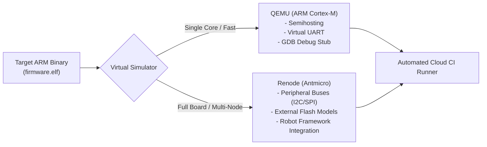

# QEMU and virtual hardware simulation

Host-based unit tests check pure algorithms and state machines. But they cannot run the real ARM Cortex-M binary, test real FreeRTOS context switches, or check how the code handles peripheral interrupts. Conversely, relying exclusively on physical hardware test benches for system integration creates severe bottlenecks in automated continuous integration (CI) pipelines.

**Virtual Hardware Simulation** bridges this divide by running target-compiled binary images (`.elf` / `.bin`) inside headless silicon emulators such as **QEMU** and **Renode**.



[[CAPTION:Figure]] Positioning QEMU and Renode for automated virtual hardware simulation.

## 1. Comparing QEMU and Renode

| Capability | QEMU (Quick Emulator) | Renode (Antmicro) |
| :--- | :--- | :--- |
| **Primary Strength** | Raw instruction execution speed, GDB debugging | Deterministic multi-peripheral & multi-node networks |
| **Peripheral Modelling** | Limited to standard core peripherals (UART, SysTick) | Highly extensible (I2C sensors, SPI flash, radio transceivers) |
| **Multi-Node Mesh** | Complex network tap configuration | Native support for multi-device BLE and 802.15.4 simulation |
| **Test Automation** | CLI exit codes, semihosting assertions | Native Python API and Robot Framework keywords |
| **Startup Overhead** | Extremely fast (< 100 ms) | Moderate (~2 to 5 seconds) |

[[CAPTION:Table]] Comparison of QEMU and Renode for embedded system simulation.

## 2. Fast System Emulation with QEMU

QEMU emulates target ARM Cortex-M instructions directly, allowing developers to verify RTOS task switching, scheduler behaviour, and stack usage without physical hardware:

```bash
# Running ARM Cortex-M4 Firmware in Headless QEMU
qemu-system-arm -M lm3s6965evb \
    -cpu cortex-m4 \
    -nographic \
    -semihosting \
    -kernel build/firmware.elf
```

### 2.1 Semihosting for Automated CI Verification

Semihosting enables code running inside the virtual ARM CPU to issue system calls directly to the host operating system:
- Print debug strings directly to the host console (`printf`).
- Read mock sensor configuration files from the host disk.
- Terminate the QEMU process cleanly with a return code (`exit(0)` for pass, `exit(1)` for fail), enabling seamless pass/fail status reporting in CI pipelines.

## 3. Full-Board & Multi-Peripheral Simulation with Renode

**Renode** provides cycle-accurate emulation of complete system-on-chip (SoC) architectures, including external SPI NOR flash chips, I2C temperature sensors, and wireless transceivers.

```mermaid
flowchart TD
    subgraph RenodeVM["Renode Virtual Machine"]
        MCU["STM32 / Nordic Cortex-M Core"]
        I2C["Virtual I2C Bus"]
        Sensor["Emulated BME280 Sensor Model"]
        SPI["Virtual SPI Bus"]
        Flash["Emulated W25Q32 NOR Flash (4 MB)"]
    end
    MCU --> I2C
    I2C --> Sensor
    MCU --> SPI
    SPI --> Flash
```



[[CAPTION:Figure]] Renode board model simulating core MCU and external peripheral components.

### 3.1 Scripting System Tests with Robot Framework

Renode integrates with **Robot Framework**, allowing test engineers to write human-readable end-to-end integration test scenarios:

```robot
*** Settings ***
Suite Setup                   Setup
Suite Teardown                Teardown
Test Teardown                 Test Teardown
Resource                      ${RENODEKEYWORDS}

*** Test Cases ***
Verify Sensor Acquisition And LittleFS Flash Storage
    [Documentation]           Verifies that firmware reads the virtual I2C sensor,
    ...                       logs reading to LittleFS, and reports over UART.
    Execute Command           mach create
    Execute Command           machine LoadPlatformDescription @platforms/boards/sensor-node.repl
    Execute Command           sysbus.i2c.bme280 Temperature 24.5
    Execute Command           sysbus.i2c.bme280 Humidity 60
    Execute Command           sysbus LoadELF @build/firmware.elf

    Create Terminal Tester    sysbus.uart0
    Execute Command           start

    Wait For Line On Uart     [BOOT] Initializing LittleFS filesystem... OK
    Wait For Line On Uart     [SENSOR] BME280 Read: Temp=24.5C, Hum=60%
    Wait For Line On Uart     [STORAGE] Telemetry record committed to flash sector 4
```

## 4. CI/CD Integration Best Practices

1. **Test Concurrency in Cloud Runners**: Virtual hardware simulations are headless and container-friendly. A single GitHub Actions workflow can execute 20 Renode instances in parallel across different test suites within minutes.
1. **Deterministic Fault Injection**: Use Renode to inject peripheral timeouts (for example, withholding I2C acknowledgments) to verify that the firmware's bus recovery state machine executes properly.
1. **Stack Overflow & Memory Watermarking**: Use simulator memory watchpoints to verify that no RTOS task stack comes within 256 bytes of overflowing under worst-case interrupt nesting.
