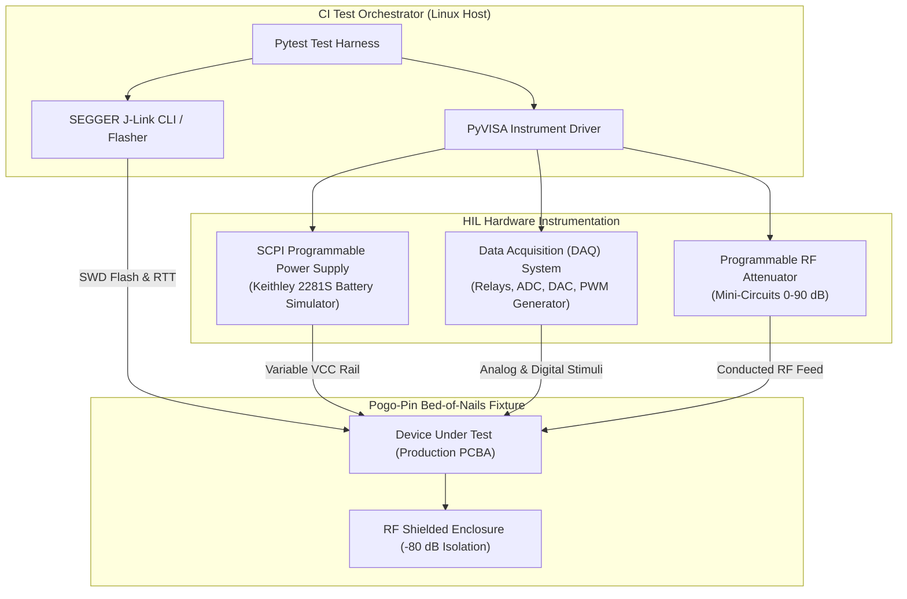
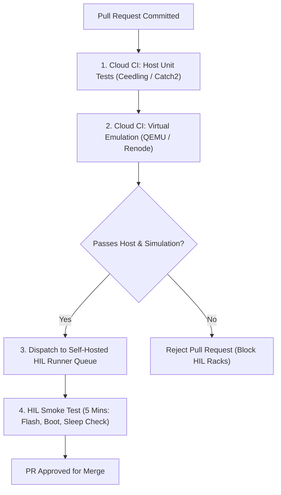

# HIL Bench Design & Automation

While virtual simulators validate logic and scheduling, they cannot detect subtle analog race conditions, crystal oscillator tolerances, radio transmitter harmonics, physical battery droop, or PCB layout flaws. Verifying embedded products before mass manufacturing requires an automated **Hardware-in-the-Loop (HIL)** test bench executing test suites on production-grade silicon.

This chapter details physical HIL bench construction, automated instrumentation control using SCPI and PyVISA, dynamic power profiling, and pytest test harness orchestration.

## 1. Physical HIL Test Rack Architecture

A standardized automated HIL test rack encloses laboratory instrumentation, debug probes, and custom mechanical fixtures within an electrically isolated chassis:



[[CAPTION:Figure]] Comprehensive instrumentation topology of an automated HIL test bench.

### 1.1 Key Hardware Components

1. **Bed-of-Nails Test Fixture**: Uses spring-loaded gold-plated pogo pins to contact gold test pads on the unpopulated bottom layer of the target PCB. This provides non-intrusive electrical access to power rails, SWD debug lines, UART ports, and analog sensor pins without soldering wires.
1. **Battery Simulator & DC Power Analyzer**: Instruments such as the Keithley 2281S or Keysight N6705 simulate dynamic chemical battery behaviour, replicating internal cell resistance ($R_{internal}$) and voltage discharge curves while logging current from 10 nA to 2 A.
1. **RF Shield Box & Conducted Attenuation**: The DUT is enclosed in a shielded aluminum box providing $> 80\,\mathrm{dB}$ of radio isolation. Cellular antennas connect via coaxial cables through programmable step attenuators, allowing automated software to simulate distance and signal degradation.
1. **High-Speed Debug Probe**: A SEGGER J-Link flasher automates firmware flashing, resets the target MCU, and streams high-bandwidth debug logs via Real-Time Transfer (RTT) without stalling real-time execution.

## 2. Test Automation Protocols: SCPI and PyVISA

Automated HIL test frameworks control lab equipment using the **Standard Commands for Programmable Instruments (SCPI)** syntax transmitted over USB, Ethernet, or GPIB:

```python
# conftest.py: Pytest Fixtures for Automated HIL Bench
import pytest
import pyvisa
import pylink
import time

@pytest.fixture(scope="session")
def power_supply():
    """Initializes and returns the SCPI programmable power supply."""
    rm = pyvisa.ResourceManager()
    psu = rm.open_resource("TCPIP0::192.168.1.105::inst0::INSTR")
    psu.timeout = 5000
    psu.write("*RST")
    psu.write("VOLT 3.600")
    psu.write("CURR 1.000")
    psu.write("OUTP ON")
    yield psu
    psu.write("OUTP OFF")
    psu.close()

@pytest.fixture(scope="session")
def flasher():
    """Initializes SEGGER J-Link for automated flashing and debugging."""
    jlink = pylink.JLink()
    jlink.open()
    jlink.set_tif(pylink.enums.JLinkInterfaces.SWD)
    jlink.connect("STM32L476RG", speed_khz=4000)
    yield jlink
    jlink.close()
```

## 3. Writing Pytest HIL Verification Tests

With instrumentation encapsulated into reusable pytest fixtures, test engineers write expressive, deterministic integration tests:

```python
# test_hil_power_and_sensors.py
import pytest
import time

def test_firmware_flash_and_boot(flasher, power_supply):
    """Flashes target binary and verifies clean system boot."""
    # Flash firmware image
    flasher.flash_file("build/firmware.hex", 0x08000000)
    flasher.reset(halt=False)
    time.sleep(0.5)

    # Verify current draw during boot is within expected operating limits
    current_ma = float(power_supply.query("MEAS:CURR?")) * 1000.0
    assert 5.0 <= current_ma <= 25.0, f"Abnormal boot current: {current_ma} mA"

def test_quiescent_deep_sleep_current(power_supply):
    """Verifies device achieves sub-5 uA deep sleep current."""
    # Allow device 10 seconds to complete initialization and enter PSM
    time.sleep(10.0)

    # Measure average current over 5 samples
    samples = []
    for _ in range(5):
        reading = float(power_supply.query("MEAS:CURR?")) * 1000000.0 # Convert to uA
        samples.append(reading)
        time.sleep(0.2)

    avg_sleep_ua = sum(samples) / len(samples)
    assert avg_sleep_ua <= 5.0, f"Deep sleep current {avg_sleep_ua:.2f} uA exceeds 5.0 uA limit!"
```

## 4. Continuous Integration Test Bench Scheduling

Because physical test racks cannot be replicated instantaneously like cloud containers, test execution must be scheduled efficiently:



[[CAPTION:Figure]] Staged gating pipeline protecting physical HIL test racks from invalid builds.

- **PR Smoke Suite (5 minutes)**: Verifies successful flash, clean boot, sensor read, and sub-5 $\mu\mathrm{A}$ sleep current.
- **Nightly Endurance Suite (4 to 8 hours)**: Executes 1,000 flash erase cycles, tests brownout voltage sweeps from 3.6 V down to 2.2 V, and runs continuous cellular socket reconnect stress tests.
