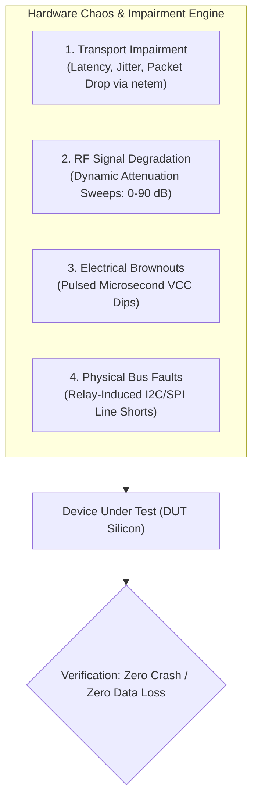
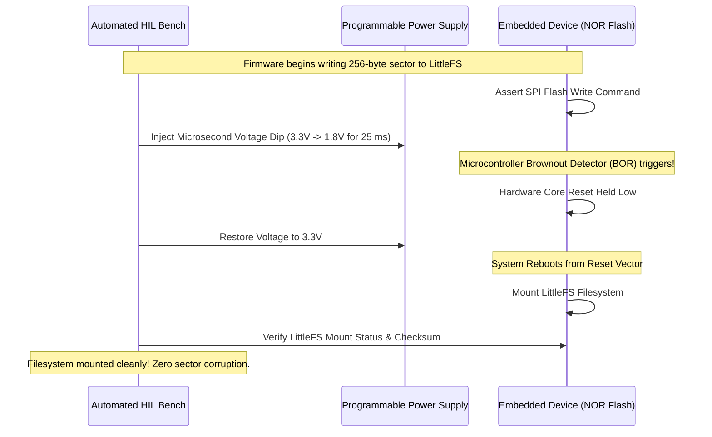

# Network simulation and chaos testing

Connected devices in the field face hostile physical and network conditions. Cellular towers drop connections without TCP FIN packets, and deep basements weaken radio signals to the noise floor. Ageing batteries produce large voltage dips during radio bursts. Testing firmware only under clean laboratory conditions guarantees catastrophic failures when deployed across thousands of customer sites.

**Chaos Engineering for IoT** intentionally subjects devices to electrical transients, bus lockups, RF signal degradation, and transport-layer packet corruption on automated test benches.



[[CAPTION:Figure]] Multi-domain chaos testing architecture for connected hardware resilience.

## 1. Network Impairment Simulation with Linux `netem`

When devices communicate with cloud endpoints through a local test gateway or Wi-Fi access point, the host can inject simulated wide-area network degradation using the Linux **Network Emulator (`netem`)**:

```bash
# Inject 250ms latency with 50ms jitter and 15% random packet loss on test bridge
sudo tc qdisc add dev eth1 root netem \
    delay 250ms 50ms distribution normal \
    loss 15% \
    corrupt 1%
```

### 1.1 Test Scenarios & Pass Criteria

| Injected Network Fault | Simulated Real-World Event | Pass / Fail Acceptance Criteria |
| :--- | :--- | :--- |
| **50% Packet Loss** | Rain fade / marginal RF cell edge | Device backs off retransmissions cleanly; buffers unsent records in LittleFS. |
| **Silent Socket Severance**| Cellular tower drops NAT table without RST/FIN | TCP keepalive timeout fires; socket is cleanly closed and reopened without memory leak. |
| **3-Second Packet Latency**| Satellite NTN backhaul delay | Protocol timers do not trigger prematurely; transactions complete without duplicate processing. |

[[CAPTION:Table]] Network impairment simulation test matrix.

## 2. RF Fading & Coverage Enhancement (CE) Sweeps

Using automated RF programmable step attenuators (such as Mini-Circuits USB attenuators), the HIL bench simulates a device moving through varying signal conditions or being installed deep underground:

```python
def test_rf_attenuation_sweep_and_reconnection(attenuator, dut_console):
    """Sweeps RF attenuation from 10 dB to 85 dB to verify link adaptation."""
    # Start with ideal signal
    attenuator.set_attenuation(10.0) # 10 dB loss (RSRP ~ -75 dBm)
    time.sleep(2.0)
    assert dut_console.get_current_rsrp() > -85

    # Ramp attenuation down to cell-edge limit
    for loss_db in [30, 50, 70, 85]:
        attenuator.set_attenuation(loss_db)
        time.sleep(5.0)
        rsrp = dut_console.get_current_rsrp()
        print(f"Loss: {loss_db} dB -> Measured RSRP: {rsrp} dBm")

    # At 85 dB loss, device should adapt to CE Level 2 (repetition coding)
    ce_level = dut_console.get_coverage_enhancement_level()
    assert ce_level in [1, 2], f"Expected CE Level 1 or 2 under heavy attenuation, got {ce_level}"

    # Return signal and confirm telemetry delivers cleanly
    attenuator.set_attenuation(10.0)
    time.sleep(5.0)
    assert dut_console.wait_for_telemetry_ack(timeout=30)
```

## 3. Electrical Brownout Fault Injection

The most dangerous field condition occurs when a depleted battery encounters a high-power radio burst, causing supply voltage to collapse momentarily:



[[CAPTION:Figure]] Automated brownout injection during active flash writes validating LittleFS copy-on-write resilience.

### 3.1 Brownout Verification Rules

1. **Zero Filesystem Corruption**: The filesystem must mount without errors upon reboot. Any torn writes must be rolled back to the last atomic commit.
1. **Zero Watchdog Lockup**: The microcontroller must not lock into an undefined high-current draw state when voltage hovers near the minimum logic threshold.
1. **Crash Reason Recorded in Flash**: Upon reboot, the boot routine must read the MCU reset flags (`RCC_CSR` or equivalent) and log that the reset was caused by a Brownout Reset (BOR) event rather than a clean power-on reset.

## 4. Hardware Chaos Scorecard & Gating

Before a firmware binary is signed for production fleet release, it must execute the complete automated chaos matrix:

1. **100 Consecutive Power Brownout Injections**: Device must achieve 100% recovery with zero unrecoverable flash corruption.
1. **100 I2C Bus Lockup Events**: Hardware recovery routine must release the bus within 9 clock cycles without requiring a system reboot.
1. **24-Hour Continuous Network Chaos Run**: Device must maintain 100% telemetry accounting (all records buffered offline and delivered upon network restoration).
